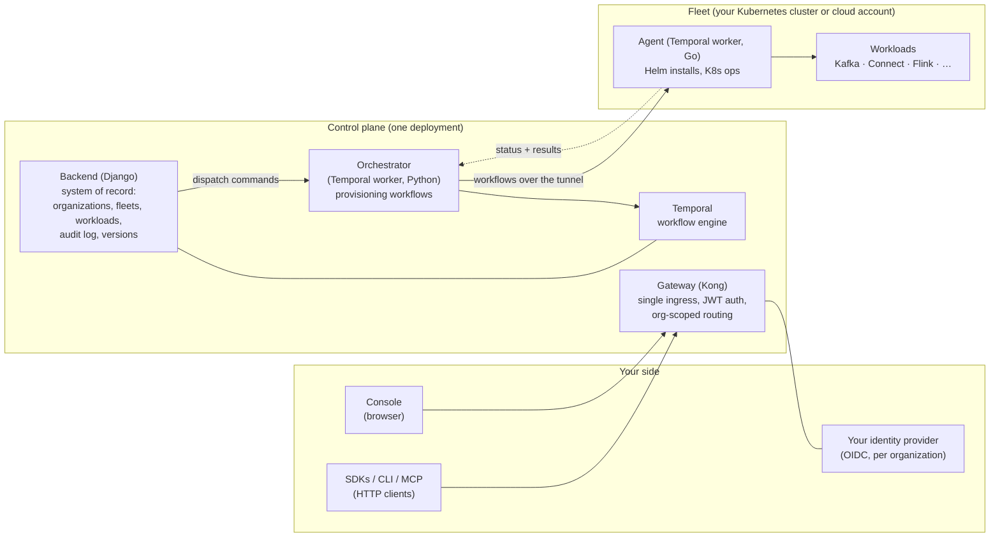
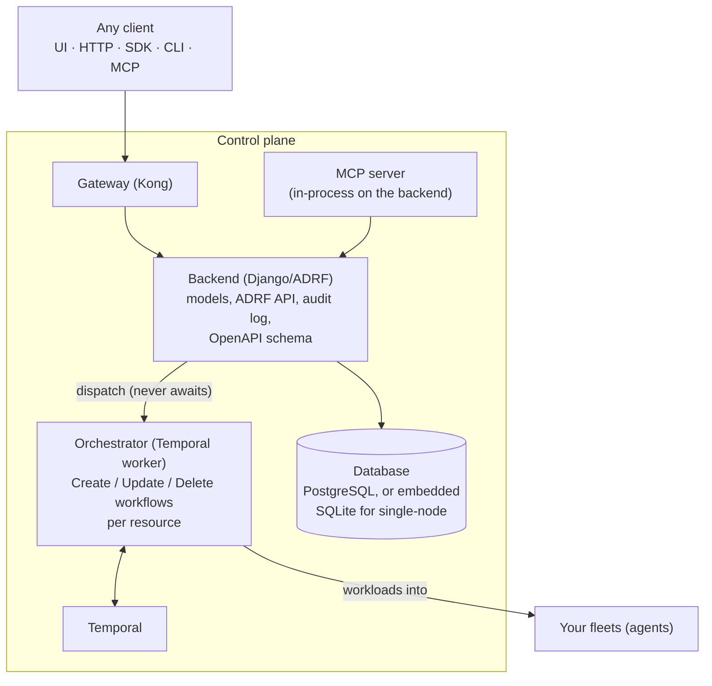
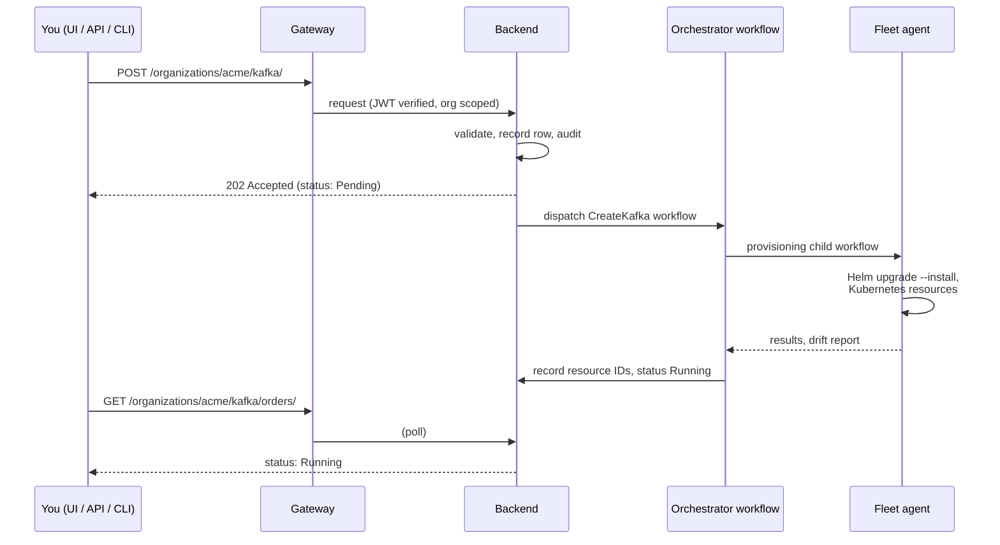

# Architecture

Streamtime is a management plane for streaming workloads. One **control
plane** records what you want running and drives it into existence;
one **agent per fleet** carries out the work inside your clusters.
Everything below is the system as deployed, not as a vendor abstraction.

## The big picture

The gateway is the only ingress: the console, the REST API, the SDKs,
the CLI and the MCP server all arrive through the same door, and the
organization in the URL path scopes everything behind it. The agent
inside a fleet has **no outbound API access** — the control plane dials
into it over a task queue, never the other way around, which is what
lets fleets sit behind firewalls.

## The control plane

How the pieces divide the work:

- **Gateway (Kong)** — JWT verification against the org's OIDC issuer,
  rate limiting, and routing `/organizations/<org>/…` to the right
  backend services. It is the single point of entry for every interface.
- **Backend (Django)** — the system of record. Every fleet, workload,
  version and command is a row here first, with a full audit trail.
  Views **dispatch and return**: a request that starts an operation
  returns `202` immediately and the client polls status.
- **Orchestrator (Temporal, Python)** — long-running Create, Update and
  Delete workflows per resource type. It provisions cloud
  infrastructure, records every resource ID back to the backend as it
  goes, and spawns agent child workflows for in-cluster work.
- **Agent (Temporal, Go, one per fleet)** — runs inside the fleet.
  Installs and upgrades workloads with Helm, reconciles Kubernetes
  state, and reports drift and results back. It has no outbound API
  access by design.
- **MCP server** — mounted in-process on the backend, so MCP tools call
  the same services and ORM as the REST API; it is a different door,
  not a different system.

Each consumer — console, SDKs, CLI, MCP — is written against the same
published OpenAPI contract, so what you can do in one interface maps
directly to the others.

## How an operation runs

Creating a Kafka cluster end to end:

Three properties follow from this shape:

- **Nothing blocks.** Every mutating call dispatches and returns; you
  poll status. A slow cloud never holds an HTTP connection open.
- **Idempotent retries.** Every step checks before it acts (Helm
  `upgrade --install`, delete succeeds if already gone), so a retried
  workflow is safe.
- **Full bookkeeping.** Resource IDs created in the cloud are written
  back as they are created, so deletion cleans up from the record, not
  from guesswork.

## Where to read on

- [Architecture]({{ site.baseurl }}/about/architecture/) —
  fleets, workloads, tenancy and scaling as a user faces them.
- [Configuration]({{ site.baseurl }}/getting-started/configuration/) — the accounts, domains and
  identity providers the control plane plugs into.
- [Operations](/operations/) — upgrades, monitoring
  and troubleshooting of a running installation.
