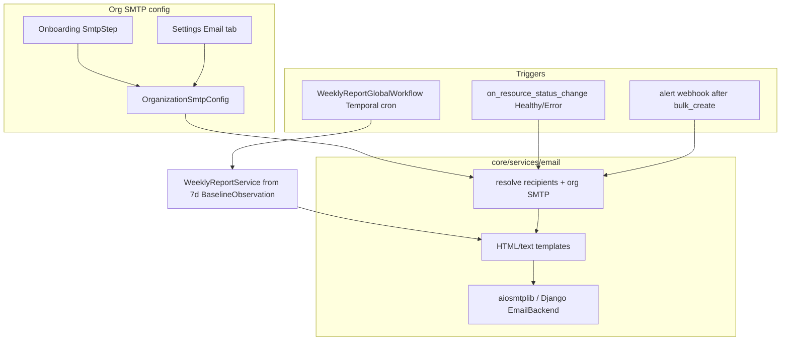

# SMTP Email Notifications & Weekly Cluster Reports

## Objective

Let each organization provide its own SMTP server so Streamtime can email users
about resource health, every alert Streamtime receives, and a weekly cluster
performance summary — without exposing baseline-metrics jargon to end users.

## Decisions (locked)

| Decision | Choice |
|---|---|
| SMTP scope | **Per-organization** — root onboarding seeds root org; Settings → Email for every org |
| Status emails | Resource **creator** only (`resource.author.email`) |
| Alert emails | Resource **creator** only (fleet/kafka matched via `Alert.cluster_id`) |
| Weekly reports | Resource **creator** + organization **`poc_email`** |
| Delivery path | **Streamtime backend mailer** (not Alertmanager `email_configs`) so targeting and weekly reports work for everything Streamtime stores |
| User-facing language | Never say “baseline metrics” / “observation windows” — use “cluster performance”, “this week”, “vs last week” |

## In scope

- Per-org SMTP config model, APIs, onboarding step, Settings Email tab
- Status emails on Healthy / Error for Fleet, Kafka, Connect, Flink, and related workloads
- Email for every alert ingested into Streamtime (firing and resolved)
- Weekly cluster performance report from existing 7d baseline observations (Fleet + Kafka)
- EmailDeliveryLog for audit and alert dedupe
- CLI / OpenAPI / SDK updates in the same change set as the API contract

## Out of scope

- Alertmanager-native email receivers / extending `AlertChannel` with `email`
- Emailing invites / license / billing (clipboard/mailto stays)
- PDF attachments
- Per-user notification preference center (beyond org toggles)
- Weekly reports for Connect / Flink / ClickHouse until baseline catalogs exist
- SMS / mobile push

## Approach

### Architecture

---

## 1. SMTP provider input (detailed)

### 1.1 Fields collected (Pydantic schema)

New schema `fleet-manager-backend/core/schemas/smtp_schema.py`:

| Field | Type | Required | Notes / validation |
|---|---|---|---|
| `enabled` | bool | yes | Default `false` until first successful test or explicit enable |
| `host` | str | yes when enabled | Hostname or IP; no scheme |
| `port` | int | yes when enabled | Default `587`; allow `25`, `465`, `587`, `2525` |
| `encryption` | enum | yes | `starttls` (default), `ssl`, `none` — map to SMTP behavior |
| `username` | str | no | Empty = no AUTH |
| `password` | str | no* | Write-only on API; never returned in GET (masked like System Config secrets) |
| `from_email` | EmailStr | yes when enabled | Envelope + From header |
| `from_name` | str | no | Display name, e.g. `Streamtime` |
| `reply_to` | EmailStr | no | Optional Reply-To |
| `timeout_seconds` | int | no | Default `30`; clamp 5–120 |

\*Password required when `username` is set. Stored with `EncryptedField` (Fernet), same pattern as API keys / PEM keys — not in plaintext `SchemaField`, not GlobalConfiguration.

**UI labels** (no internal jargon):

- Host → “SMTP server”
- Port → “Port”
- Encryption → “Connection security” (`STARTTLS` / `SSL/TLS` / `None`)
- From email → “From address”
- From name → “From name”
- Every field gets `helperText` (e.g. “Usually 587 with STARTTLS, or 465 with SSL/TLS”)

### 1.2 Model & persistence

New org-scoped model `OrganizationSmtpConfig` (OneToOne → `Organization`), in `core/models.py`:

- Discrete columns preferred for queryability of `enabled` (not only SchemaField)
- `password = EncryptedField(blank=True)`
- `auditlog.register` + `@reversion.register`
- Author FK for last editor

Do **not** put SMTP on `OrganizationConfig` — keep maintenance windows / provider allowlists separate from credentials.

### 1.3 APIs

Org-scoped routes in `core/urls/` (pattern like alert-channels):

| Method | Path | Behavior |
|---|---|---|
| `GET` | `/organizations/{org}/smtp-config/` | Return config with `password_set: bool`; never raw password |
| `PUT/PATCH` | same | Upsert; omit password to leave unchanged; empty string clears |
| `POST` | `/organizations/{org}/smtp-config/test/` | Send a short test message to the caller’s email (or optional `to` for admins); return success/failure without leaking SMTP dialog internals beyond a safe message |
| `POST` | `/organizations/{org}/smtp-config/verify/` | Optional: connect + AUTH only (no message) for faster validation during onboarding |

Permissions: org admin (same class as Alert Channels / Organization settings). Thin ADRF views → `SmtpConfigService`.

Serializer: `BaseADRFModelSerializer`; password write-only; OpenAPI via spectacular; regenerate SDK (`test-harness/./regen-sdk.sh`) in the same PR as contract change.

### 1.4 Onboarding

New optional step **“Email (SMTP)”** in `OnboardingWizard.jsx` — place after Root Org (needs org) and before or after Vault; mark **optional** so installs can finish without mail.

- New `SmtpStep.jsx`: form + “Send test email” + Skip
- Setup API: `PATCH /setup/smtp/` writing into **root** org’s `OrganizationSmtpConfig` (mirror `setup/vault.py` / `setup/root_org.py`)
- Setup status checklist includes `smtp_configured: bool` (not blocking)
- Headless bootstrap: prefer documenting CLI / API; do not invent silent SMTP defaults

### 1.5 Settings UI

New tab **Email** in `SettingsPage.js` (all orgs, not root-only):

- Route `/settings/email`
- Component `features/settings/components/organizationsettings/EmailSmtp.js`
- Same form as onboarding + Test + Enable toggle
- Notification preferences subsection (v1, minimal):
  - `status_emails_enabled` (default true when SMTP enabled)
  - `alert_emails_enabled` (default true)
  - `weekly_report_enabled` (default true)
  - Stored on `OrganizationSmtpConfig` so orgs can disable categories without removing SMTP

### 1.6 Mailer service

New `core/services/email/`:

- `smtp_client.py` — build connection from org config (`aiosmtplib` async or sync `EmailMessage` + `sync_to_async`; prefer one approach and keep async views happy)
- `mailer.py` — `send_org_email(org, *, to, subject, html, text, category)` — no-op + INFO log if SMTP disabled/missing; never raise into webhook/status hot paths (catch, log `exc_info=True`)
- `templates/` — Django or Jinja templates for status, alert, weekly report, test
- Idempotency / dedupe for alerts via `EmailDeliveryLog`

**EmailDeliveryLog** (lightweight): `id`, `organization`, `category` (`status`/`alert`/`weekly_report`/`test`), `to_email`, `subject`, `resource_type`, `resource_id`, `dedupe_key`, `status` (`sent`/`skipped`/`failed`), `error`, `created_at`. Retention prune >90d is optional / out of scope for v1.

### 1.7 CLI / MCP / SDK

- CLI: `streamtime smtp show|set|test` under org context
- MCP: read-only `get_smtp_config` (no password); skip write tools in v1 if unclear
- FleetManagerSDK: regenerate after OpenAPI change

---

## 2. Status emails (Healthy / Error)

### 2.1 Hook point

Add `core/services/email/status_notifications.py` and call it from the same serializer update paths that already call `on_resource_status_change` (Fleet / Kafka in `serializers.py`). Mirror for Connect / Connector / Flink / ClickHouse / Replicator / VKC serializers that mutate `status`.

Fire only when `previous_status != new_status` and `new_status in ("Healthy", "Error")` (map Flink/ClickHouse `Failed` to Error copy if used as terminal error).

### 2.2 Recipient

`resource.author.email` if author present and looks like a real user email (skip synthetic `fleet-workflow-agent@…`, `api-key-…`). If no author → skip + WARNING log (do not fall back to POC for status/alerts).

### 2.3 Content (user-facing)

- Subject: `{Resource type} “{name/identifier}” is healthy` / `… needs attention`
- Body: resource display name, identifier, org, link to UI detail page, short status line, timestamp
- No workflow IDs, no Temporal, no “baseline”

Recommended: enqueue a short `SendOrgEmailWorkflow` / activity so webhook/status paths return immediately and SMTP timeouts do not block orchestrator callbacks.

---

## 3. Alert emails (every alert Streamtime receives)

### 3.1 Hook point

After successful `bulk_create` in `FleetAlertWebhookView` / `KafkaAlertWebhookView` — same seam as `maybe_start_investigations_for_alerts`. Shared helper `maybe_email_alerts(org, alerts, resource)`.

Do **not** add Alertmanager email receivers; that would miss “all alerts Streamtime stored” and cannot target creators.

### 3.2 Recipient resolution

- Fleet webhook → `Fleet.author.email` for `fleet_id`
- Kafka webhook → `Kafka.author.email` for `kafka_id`
- Use the parent resource’s author for the alert’s `cluster_id`

### 3.3 Content

- Subject: `[Firing]` / `[Resolved]` + `labels.alertname` + severity
- Body: summary/description from annotations, severity, resource name, starts/ends, link to Diagnostics → Alerts
- Deduplicate re-notifications with `EmailDeliveryLog.dedupe_key`
- Both firing and resolved (Alertmanager sends both with `sendResolved: true`)

### 3.4 Preference gate

Respect `alert_emails_enabled` and org SMTP `enabled`.

---

## 4. Weekly report generation (detailed)

### 4.1 Data source (internal only)

Reuse existing bookkeeping — **no new PromQL** for CFK/Strimzi-covered metrics:

- `build_summary()` already returns metrics + `by_category` + `mean_pct_change` / `previous_mean`
- Prefer rows with `window == "7d"` and latest `window_end`
- Targets: Healthy fleets and kafkas via `list_healthy_baseline_targets` / per-org listing
- **v1 scope = Fleet + Kafka** (only scopes with rich baseline catalogs today)

### 4.2 Report builder service

New `core/services/email/weekly_report.py`:

1. For each org with `smtp.enabled` and `weekly_report_enabled`
2. For each Healthy fleet/kafka in that org
3. Call `build_summary(org, resource_type=…, resource_id=…)`
4. Filter to `window == "7d"`
5. Map categories to user-facing sections:
   - **Load** ← `load`
   - **Latency** ← `latency`
   - **Saturation** ← `saturation`
   - **Reliability** ← `reliability`
6. Per metric row: display name from `BaselineMetricDefinition` (human title), not raw `metric_identifier` alone — or a curated allowlist of headline metrics if the full catalog is too long
7. Format numbers with units from definition metadata; show week-over-week `%` as “vs previous week”
8. Skip empty categories; if zero OK observations → send a short “insufficient data this week” note rather than a blank report

**Headline metrics (recommended curated set for readable email)** — full catalog stays in UI; email highlights:

- Fleet: CPU utilization, memory utilization, disk/PVC utilization, not-ready nodes, apiserver latency
- Kafka: bytes in/out, produce/fetch latency, under-replicated partitions, offline partitions, broker CPU/JVM (provider-specific IDs from CFK/Strimzi YAMLs)

### 4.3 Recipients

- To: `resource.author.email` (creator)
- Cc: `organization.poc_email` (if set and distinct)

One email per resource (not one giant org digest) so creators only see what they own.

### 4.4 Temporal schedule

Mirror baseline global observe:

- Workflow: `WeeklyClusterReportWorkflow` in orchestrator
- Activity: backend HTTP via `BackendActivities` (consistent with other orchestrator patterns)
- Ensure schedule via `WorkflowDispatchService.ensure_cron_schedule` on backend startup + when SMTP weekly toggle enabled
- Cron from GlobalConfiguration key `weekly_cluster_report_cron` default `0 9 * * 1` (Monday 09:00 UTC) — operator-tunable; raise if missing after seed migration
- Overlap policy: `SKIP`
- Workflow input snapshot: cron, as-of date; activities receive org / resource lists — no mid-workflow env reads

Backend endpoint (internal / service auth):
`POST /organizations/{org}/email/weekly-reports/run/` (or platform fan-out) used by the activity.

### 4.5 Email shape (user-facing)

- Subject: `Weekly performance report — {resource name} ({week range})`
- Intro: one sentence, no mention of how data was collected
- Sections: Load / Latency / Saturation / Reliability with a small table (metric | this week avg | vs prior week | peak)
- Reliability callouts first if any under-replicated / offline / not-ready > 0
- CTA: “View details in Streamtime” → fleet/kafka detail performance tab
- Footer: “Sent by Streamtime for {org} via your organization’s mail server”

### 4.6 Failure behavior

- Missing SMTP → skip org, INFO log
- Partial metric gaps → still send with available rows
- SMTP failure → `EmailDeliveryLog` failed + ERROR log; do not fail entire global workflow for one org

---

## 5. Implementation sequence

1. Schema + model + migration — SMTP config + EmailDeliveryLog + notification toggles
2. Mailer service + templates + test endpoint
3. Setup + Settings UI + onboarding step
4. Status notification hook (all author-bearing workloads with Healthy/Error)
5. Alert email hook post-ingest
6. Weekly report service + Temporal workflow/schedule + GC seed
7. CLI + OpenAPI/SDK regen + tests
8. `/regression-check` consumers (frontend, CLI, MCP, SDK) in the same PR set
9. `/antipattern-check` + `/precommit-tests` before merge

## 6. Testing

- Unit: schema validation, password write-only, recipient resolution (skip synthetic emails), report builder formatting from fixture `BaselineObservation`s
- API: SMTP CRUD + test (mock SMTP), permission isolation across orgs
- Integration: status transition → mailer called with creator; alert ingest → mailer; weekly run for Healthy kafka with 7d rows
- Orchestrator: workflow unit test with mocked backend activity
- Frontend: SmtpStep + Email settings form (required fields, encryption options, test button)

## 7. Frontend compatibility

New endpoints only (additive). Existing Alert Channels unchanged. Update tour copy in `StreamTimeTour.jsx` if it still claims email Alert Channels — point users at SMTP settings instead.

## Deviations

- **SMTP password storage (§1.1, §1.2).** Stored as a `Secret` row via
  `SecretsManager` on the active provider (builtin or Vault), not an
  `EncryptedField`. `OrganizationSmtpConfig` holds only a reference to the
  secret. Follows the "secrets via `fleet_secrets_manager`" rule and still
  works without Vault (builtin provider).
- **Delivery path (§2.3).** Status and alert emails are sent from a
  fire-and-forget backend background task, not a `SendOrgEmailWorkflow`.
  SMTP credentials never enter Temporal history. A send lost to a pod restart
  is accepted; every attempt is recorded in `EmailDeliveryLog`. Implemented as
  `queue_org_email`: `transaction.on_commit` → a 4-worker `ThreadPoolExecutor`,
  because the status hooks run in sync serializer code (no event loop). Emails
  for rolled-back changes are never sent.
- **`author` is the creator (§2.2, §3.2, §4.3, review).** `author` used to be
  overwritten on every update by `OrganizationMixin.perform_update` and
  `OrganizationAndFleetMixin.perform_update` (`serializer.save(author=user)`), so after
  the orchestrator's status PATCHes it was the service account. Both now save without
  `author`; it is set once in `perform_create`. Migration 0180 restores `author` from
  the audit log's create entry for every model that has one (rows without an entry are
  left as they are). An interim `created_by` field was dropped before merge. The same
  two methods had their audit toggle inverted (updates were not logged when audit logs
  were on); they now log exactly when `perform_create` does.
- **Status hook moved to the model (§2.1, P7).** Status is written from many
  places (serializers, Flink/ClickHouse status endpoints, the workflow-failure
  handler in `views/workflows/views.py`, reconcile services), so the serializer
  hooks missed e.g. Fleet/Kafka going to Error when an operation fails.
  `StatusEmailMixin.save()` now detects the change for all 8 resources (Fleet,
  Kafka, Kafka Connect, connector, Flink, ClickHouse, replicator, VKC); the
  serializer hooks were removed. Bulk `queryset.update(status=…)` is not seen
  (only used to restore status after a cancelled fleet command). Connectors:
  Running = healthy, Failed = needs attention, Paused → Running is not emailed.
  VKC `DeleteFailed` (set by the orchestrator when a delete fails) is emailed as
  needs attention (review).
- **Weekly report data (§4.1, §4.2, P8).** Not `build_summary`'s
  `mean_pct_change`: observations run daily or more often, so its "previous" is
  the prior rolling 7d window (hours old). The report compares the latest 7d
  window with the one that ended ~7 days earlier (±1 day), and needs the latest
  window to have ended within 2 days. Targets are queried directly (Healthy
  Fleet/Kafka) because `list_healthy_baseline_targets` creates schedule rows as a
  side effect. Curated headline metrics with plain labels (full catalogue stays
  in the UI); Kafka headlines match the part after `kafka.<provider>.` so one list
  covers every provider. No creator → To the org's `poc_email` (no Cc). Re-runs in
  the same ISO week skip sent reports (dedupe key `weekly:<type>:<id>:<year>-W<nn>`).
  Endpoint is platform-wide on the root path only:
  `POST /organizations/root/internal/email/weekly-reports/run/`.
- **Weekly schedule (§4.4, P9).** `WeeklyClusterReportWorkflow` makes one
  backend call (`run_weekly_reports` activity; 10 min, 3 attempts — re-runs are
  safe). The backend ensures the single `weekly-cluster-report` Schedule on
  startup and whenever `weekly_cluster_report_cron` is edited in System Config
  (same hook as the baseline cron); migration 0176 seeds `0 9 * * 1`, and a
  missing key raises. Not ensured on the per-org weekly toggle: there is one
  platform-wide schedule and disabled orgs are skipped at run time.
- **Dedupe is claimed before queueing (review).** `queue_org_email` writes a
  `queued` EmailDeliveryLog row (unique per org + dedupe key while queued or sent,
  migration 0177) before handing the email to the worker, which then marks that
  row sent/failed. Overlapping weekly runs or alert deliveries can no longer both
  send; failed sends are retried; a queued claim older than 1 h is released.
- **Weekly run endpoint is worker-only (review).** Requires the verified
  orchestrator identity (`is_fleet_workflow_agent`), not just `organization.add`.
- **Email step is required in the onboarding wizard (§1.4, product feedback).**
  No Skip; `/setup/finalize/` lists `smtp` as a missing step until the root org has
  email saved and turned on. Headless installs (`headless_bootstrap.py`, env-driven)
  complete setup without finalize and keep email optional.
- **Reply-to removed (§1.1, product feedback).** Dropped from the model, API, mailer,
  CLI (`--reply-to`), MCP and UI (migration 0178).
- **Link address per organization (§2.3, product feedback).** New
  `link_base_url` on the org's email settings, pre-filled in the form from the
  browser's own address, so the "View in Streamtime" buttons work without a root
  admin setting `frontend_base_url` (now only the fallback). CLI: `--link-address`.
- **Email links (§2.3, §3.3).** Built from the existing `frontend_base_url`
  GlobalConfiguration key. If it is unset, emails are sent without a link and a
  WARNING is logged rather than dropping the notification.
- **Alert fan-out (§3.3).** One email per alert (not per webhook batch).
  Dedupe key is `fingerprint + status + startsAt`, so Alertmanager
  `repeat_interval` re-sends are skipped. Stored hashed in
  `EmailDeliveryLog.dedupe_key`; only a **sent** row suppresses, so a failed send
  retries on the next delivery. Missing fingerprints fall back to the labels.
  Link goes to `/diagnostics/alerts`.
- **Status email rollout (§2.1).** Fleet + Kafka ship first (existing
  `on_resource_status_change` seams); Connect / Connector / Flink /
  ClickHouse / Replicator / VKC follow in a separate phase.
- **`verify/` endpoint (§1.3).** Dropped; `test/` covers validation.
- **Onboarding step placement (§1.4).** "Email" sits after Vault, not directly
  after Root Org: the password is stored on the active secret provider, which the
  Vault step chooses. Setup endpoints are `GET/PATCH /setup/smtp/` and
  `POST /setup/smtp/validate/` (named like `vault/validate/`), all refused once setup is complete (GET too, so root's
  mail server details are not readable unauthenticated). `smtp_configured` is
  derived from the root org's config, not a new `SystemSetup` column.
- **Test button saves first (§1.5).** The test endpoint uses saved settings, so
  the form saves unsaved edits before sending ("Save and send test email").
- **SDK regen (§1.3, §1.7).** Not run by hand. On current `main`, `test-pr`
  regenerates `streamtime-sdk/` and commits it to the PR when the snapshot is
  stale, so this branch relies on that after `origin/main` is merged in.
