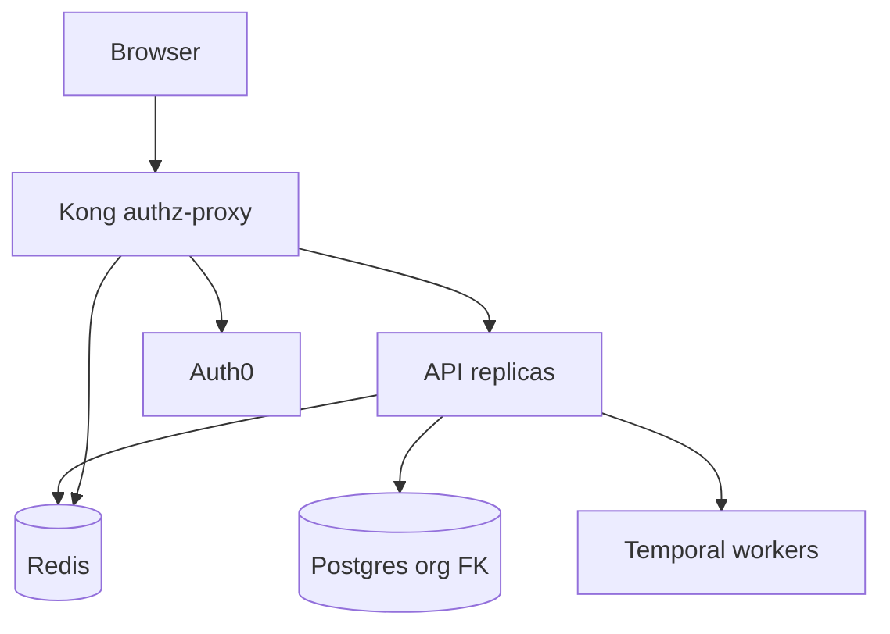
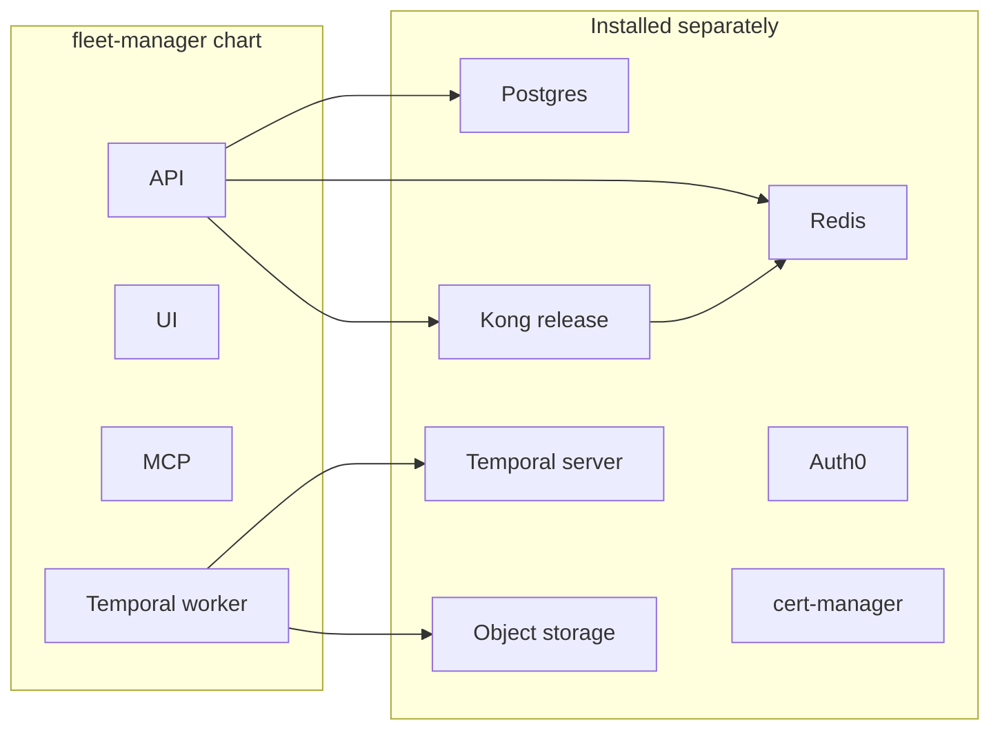
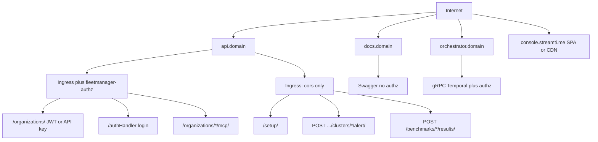
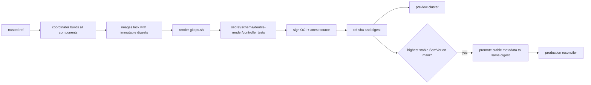

# Streamtime Public Productionization

Branch: `plan/streamtime-public-productionization` (from `main`).

Harden Streamtime as a **managed multi-tenant control plane** on our self-hosted Kubernetes cluster. Tenants stay **logically isolated** (shared Postgres / Temporal / Redis / Kong; org FK + `/organizations/{org}/` + Kong JWT).

The Helm chart is the **headless install contract**: every required non-secret runtime setting is expressible as values/`STREAMTIME_GLOBAL_*`; every sensitive bootstrap input is a `STREAMTIME_SECRET_*` (or secrets-provider lookup) sourced from the ExternalSecret target. Sensitive inputs are never seeded into GlobalConfiguration.

**GitOps controller install stays out of band.** [`scripts/render-gitops.sh`](scripts/render-gitops.sh) is the only renderer. Every trusted ref can publish an immutable OCI + GHA artefact; production is promoted only from the highest stable SemVer tag on `main`. A generated mirror may be serialized onto a dedicated `gitops/streamti.me` branch, never committed back to moving `main`.

**Secret contract:** generated values/manifests contain `ExternalSecret` resources and `secretKeyRef`s only. Secret values never enter Git, OCI, rendered YAML, image layers, action artefacts, or logs. A protected workflow on `main` and on the latest stable SemVer release may use GitHub Environment secrets solely to synchronize values into the external secret manager; the cluster's External Secrets Operator resolves them at reconciliation time. Feature/PR artefacts contain references only, so a test cluster must pre-provision matching preview secrets.

## End result

**a) GitOps artefact.** [`scripts/render-gitops.sh`](scripts/render-gitops.sh) renders a selected environment profile into manifests with image **digests** and external-secret references. A coordinated build publishes immutable OCI `gitops-streamti.me:<ref>-<sha>` + digest and a GHA artefact. The highest stable SemVer tag on `main` is additionally promoted to `stable`; production reconciles the promoted OCI digest (the dedicated GitOps branch is an optional audit mirror). A **conforming** cluster can apply it — one with the locked prerequisites, controller versions, namespace/host inputs, and referenced secrets described below.

**b) Hardened public site.** `https://console.streamti.me` is the UI (in-cluster **or** CDN). `https://api.streamti.me` is Kong: JWT/API-key on `/organizations/`, rate-limited (Redis policy) on every public API route, TLS via cert-manager (cluster) and/or the CDN for the console host.

**c) Autoscaling.** HPA (CPU) and values-driven resources only on chart-owned workloads (API/Uvicorn, Temporal workers, MCP, in-cluster UI) and the separate Kong release overlay. Postgres, Redis, object storage, and Temporal server stay operator-installed; the chart must not pretend a single in-cluster `postgres:14` (or similar) pod is HA.

## Success criteria

- Django `CACHES['default']` is Redis when `REDIS_URL` is set. **The same Redis instance** backs Kong rate-limiting. LocMem remains the fallback when `REDIS_URL` is unset.
- Chart does **not** install dependency charts or optional Postgres/Redis/MinIO templates. Connection details for Postgres, Redis, object storage, and Temporal are values/`secretKeyRef` (defaults may keep today’s out-of-band DNS names such as `fm-postgresql`).
- Helm sizing/HPA is **values**, not literals (see [Sizing](#tranche-3--sizing)).
- Auth0 is the production IdP, configured as **GlobalConfiguration** (`STREAMTIME_GLOBAL_OIDC_*` → `OAuthProvider` via headless bootstrap). Audience, logout, and tests go through that GC path — not a second Helm-only OIDC channel.
- Kong public Ingresses: no unauthenticated mutating APIs; all remaining public APIs rate-limited; certs on `console` / `api` / `orchestrator` hosts (CDN may terminate `console`).
- Headless parity: rendering emits every required non-secret `STREAMTIME_GLOBAL_*` key and every required sensitive `STREAMTIME_SECRET_*` as `secretKeyRef`, with no sensitive value copied to GlobalConfiguration.
- **GitOps artefact:** one renderer supports production and preview profiles. A same-repository feature/PR ref can publish an immutable OCI bundle after maintainer approval; fork PRs render/test without write credentials. Production promotion is atomic, digest-pinned, signed, and restricted to the highest stable SemVer tag whose commit is on `main`.
- **Tenant boundary:** shared Auth0 issuer/audience validates token provenance, not organization membership. Every request is authorized against URL-org membership keyed by stable `(issuer, subject)`; API-key header/path mismatch is rejected.
- **Secrets:** no rendered `Secret.data` / `stringData` or sensitive inline env values. ExternalSecret references reconcile in-cluster. Previously committed production credentials are revoked before any publication workflow is enabled.

## Out of scope

- Installing or operating Argo CD / Flux on long-lived clusters. A disposable-cluster acceptance test installs the pinned controller/prerequisites to prove the OCI contract.
- `kubectl` / `helm upgrade` from a laptop or a deploy-to-cluster GitHub job.
- Physical tenant isolation (schema-per-tenant, per-org Redis/Postgres, Vault namespaces).
- Changing `Fleet.tenancy_mode` (Kafka placement, not control plane).
- Bundled single-container Redis.
- Auth0 Organizations / SCIM / MFA productization beyond what is listed under Auth0 (MFA stays an Auth0 tenant policy).
- Per-tenant physical isolation. Backend membership/RBAC, API-key URL-org binding, and removal of Host-header trust **are in scope** because Kong authentication alone cannot enforce logical tenancy.



---

## Tranche 0 — Credential containment (before CI or deployment changes)

The current production overlay and chart contain live-looking credentials and fixed secret literals. Treat this as an incident prerequisite, not the final hardening step:

1. Revoke/rotate Auth0, GHCR, Docker Hub, Quay, license/orchestrator, cookie/encryption, database, MinIO and JWT credentials already committed.
2. Remove values from [`production/helm-values/streamtime-values.yaml`](production/helm-values/streamtime-values.yaml), chart defaults, tests, Git history artefacts and action outputs. Do not rewrite shared Git history without an explicit operator decision; revocation is the security boundary.
3. Configure External Secrets Operator and a production secret store (Vault is preferred by the existing architecture). Add a single `ExternalSecret` that materializes `streamtime-control-plane`; templates consume only `secretKeyRef`.
4. GitHub Environment `production-secrets` may hold values temporarily for automated synchronization to the external store. The sync job:
   - runs only for protected `main` or the highest stable SemVer tag on `main`;
   - uses environment approval and a least-privilege secret-store credential;
   - checks out no PR code and invokes no repository scripts;
   - masks values and writes no secret-bearing output/artefact;
   - on `main`, writes a versioned candidate path keyed by source SHA and performs validation without changing the live production alias;
   - on the highest stable SemVer tag, promotes the validated version/alias consumed by the production ExternalSecret;
   - is idempotent and records only secret versions/metadata.
5. Feature/PR workflows never receive production secrets. Their OCI manifests reference a configurable preview `ExternalSecret`/target Secret name; each test cluster pre-provisions that external-store path.
6. Secret promotion returns only a non-sensitive version identifier. The release bundle places that ID in pod-template annotations so ExternalSecret updates trigger a controlled rollout. Emergency rotation has a tested metadata-only GitOps promotion (or a pinned reloader controller); changing a Kubernetes Secret alone does not refresh env vars in running pods.

Publication remains disabled until a full-tree/history secret scan passes and the old values are confirmed revoked.

---

## Tranche 1 — Caching and related perf risks

LocMem is per-process. Helm already runs one API replica × one Uvicorn worker partly because of that. Scaling without Redis multiplies Prometheus and cloud-pricing calls.

### Current cache map

| Consumer | API | Key includes org? | TTL | Stampede |
|----------|-----|-------------------|-----|----------|
| Kafka metrics [`kafka_metrics.py`](fleet-manager-backend/core/services/kafka_metrics.py) | `aget`/`aset` | Yes | GC `kafka_metrics_cache_ttl_seconds` (30s); last-good ×10 | No lock on miss; every worker fans out to Prometheus |
| AWS/Azure/OCI pricing | sync `get`/`set` inside `async def` | No (global, correct) | 24h | All processes miss together at expiry |
| Kafka REST OAuth token [`kafka_topic_config.py`](fleet-manager-backend/core/services/kafka_topic_config.py) | sync `get`/`set` | Yes | token `expires_in` | Same check-then-set |

**Not Django cache (stay in-process even after Redis):**

- Vault `VaultProviderFactory._provider_cache` — config change only invalidates the worker that handled it. After Redis, a vault-mode switch still needs a **rolling API restart**.
- License JWKS cache, MCP API-key cache (60s), orchestrator `@lru_cache` YAML.

Frontend `metricsCache.js` already single-flights per tab; that does not help the API.

### Shared Redis (Django + Kong)

One logical Redis service. Two namespaces so keys never collide:

| Client | Use | Isolation |
|--------|-----|-----------|
| Django | `CACHES['default']` (metrics, pricing, Kafka-REST tokens) | `REDIS_URL` db **0**, `KEY_PREFIX: streamtime` |
| Kong | `rate-limiting` `policy: redis` (cluster-wide counters; required once Kong has >1 replica). JWKS stays in Kong’s in-process `kong.cache` | same host, db **1** (or prefix `kong:`) |

Do **not** turn on `KONG_DATABASE=postgres` for this. Kong stays db-less. Production uses an external HA Redis service with TLS, authentication, backups/config snapshots as supported by the provider, and separate least-privilege credentials for Django and Kong. Redis DB 0/1 is keyspace organization, **not** a security boundary.

[`settings.py`](fleet-manager-backend/fleet_manager/settings.py): `REDIS_URL` set → `django_redis.cache.RedisCache`; else LocMem.

```python
_redis_url = os.getenv("REDIS_URL", "").strip()
if _redis_url:
    CACHES = {
        "default": {
            "BACKEND": "django_redis.cache.RedisCache",
            "LOCATION": _redis_url,
            "TIMEOUT": 300,
            "KEY_PREFIX": "streamtime",
            "OPTIONS": {"CLIENT_CLASS": "django_redis.client.DefaultClient"},
        }
    }
```

- Add `django-redis` with `uv` in [`requirements.txt`](fleet-manager-backend/requirements.txt). Keep existing `redis` client.
- `REDIS_URL` is startup env (like `POSTGRES_HOST`), not `GlobalConfiguration`.
- Fail loud during startup/config validation if Redis is configured incorrectly. At runtime, explicitly test and document failure behavior: authentication and rate limiting fail closed; cache-only metrics/pricing paths may serve bounded last-good data but must not silently split into LocMem.
- Django sessions stay DB-default (API barely uses them). Kong login stays cookie-based (`/authHandler`); do not put OAuth tokens in Redis in this tranche.
- Convert pricing + Kafka-REST token paths to `aget`/`aset` so they do not block the event loop.
- Stampede: on metrics/pricing miss, `cache.add` / Redis `SET NX` (or a short lock key) so one process fills and others wait or serve last-good. Metrics already has last-good; use it as the wait fallback.

### Compose

Add `redis:7-alpine` to [`docker-compose.yaml`](docker-compose.yaml) for development. Backend `REDIS_URL=redis://redis:6379/0`. Gateway: rate-limiting plugin `policy: redis`, `redis_host: redis`, `redis_database: 1`. Document in [`env.example`](env.example). Production values point to the external HA endpoint via ExternalSecret-backed credentials.

### Tests

- Unset `REDIS_URL` → LocMem (existing tests keep working).
- Set `REDIS_URL` → backend is RedisCache (settings test; fakeredis acceptable).
- Metrics: two sequential reads share a key; lock test that a second miss does not double-fetch when lock is held.

Do not raise API `replicaCount` or `UVICORN_WORKERS` in production until Redis is actually in that cluster.

---

## Tranche 2 — Missing Helm connection wiring (vs compose)

[`charts/fleet-manager/`](charts/fleet-manager/) has **no Chart.yaml dependencies** and must keep it that way. It deploys API, UI, MCP, orchestrator worker, Ingress, Kong plugins. Postgres, Redis, object storage, Temporal server, and Kong are installed separately; the chart only consumes connection details via values/`secretKeyRef` (today many hosts are still hardcoded DNS names).

### Compose vs chart

| Component | docker-compose (dev) | Helm today | Public SaaS recommendation |
|-----------|----------------------|------------|----------------------------|
| API / UI / MCP / worker | Yes | Yes | Keep; parameterize sizing |
| Postgres | `postgres:14` | Hardcoded `POSTGRES_HOST=fm-postgresql` (not deployed) | **External only** — expose `POSTGRES_*` in values (host/port/db/user; password via ExternalSecret). Default may keep `fm-postgresql` for out-of-band local installs |
| Temporal **server** | `temporalio/temporal` `start-dev` (SQLite) | Hardcoded `fm-temporal-frontend:7233` (not deployed) | **Remain external** — `start-dev` is not production. Document the existing Temporal Helm/Cloud install. Keep `fleetmanager.orchestrator.temporalFrontendAddress` overridable |
| Kong | In-compose custom gateway image | Separate release + Ingress CRs (`kong-kong-proxy`) | **Remain external** — ingress controller + LB. Keep [`production/helm-values/kong-values.yaml`](production/helm-values/kong-values.yaml) |
| Redis | No | No | **External only** — values → `REDIS_URL` (Django) and Kong rate-limit redis host/db. Compose adds Redis for **local** only; production/preview point at an operator-installed endpoint |
| Keycloak | Yes + init job | Optional bootstrap job → `keycloak-fm-identity-headless` | **Do not add.** Public path is Auth0 |
| Grafana / Prometheus / Loki / Tempo | Partial (dev Loki URL is set but no Loki service) | Not this chart (`charts/fleet-manager-infra-shared/`) | Stay on infra-shared / cluster monitoring |
| cert-manager | Dev self-signed | ClusterIssuer only | Remain cluster addon |
| Vault / local registry / kind CCM | Profiles | No | Dev-only |



### Connection details via values (no dep templates)

Do **not** add Bitnami (or any) subcharts, and do **not** add optional single-node Postgres/Redis/MinIO Deployments/StatefulSets to this chart. Parameterize what is already assumed as DNS:

1. **Postgres** — values → `POSTGRES_HOST` / `POSTGRES_PORT` / `POSTGRES_DB` / `POSTGRES_USER`; password only via ExternalSecret `secretKeyRef`. Defaults may retain `fm-postgresql` for stacks installed out of band.
2. **Redis** — values → `REDIS_URL` for the API; Kong overlay points at the same logical Redis (db 1 or `kong:` prefix) for rate-limiting. Production requires external HA Redis with TLS and distinct Django/Kong credentials.
3. **Object storage** — values → config and Terraform-state endpoint URLs plus access-key secret refs (replace hardcoded `http://fm-minio:9000`). Fix [`fleet-manager-orchestrator/activities/core/s3.py`](fleet-manager-orchestrator/activities/core/s3.py) / [`activities/s3.py`](fleet-manager-orchestrator/activities/s3.py) to pass the configured endpoint to boto3 and prove create/read/version/delete round trips against the **operator-provided** S3-compatible service. Production requires versioning, encryption, backup/restore, and defined RPO/RTO.

**Temporal server:** evaluate-and-stop. Production Temporal is a real cluster (Postgres backend, history shards). Shipping `start-dev` in the Streamtime chart would look like “batteries included” and fail under load. Keep `fleetmanager.orchestrator.temporalFrontendAddress` overridable; require the operator to install Temporal (as they do now).

**Kong:** already a second Helm release. Nesting an ingress controller inside the app chart is the wrong layer. Point that release at the external Redis for rate-limiting; tighten plugins/values here (`external_host`, log level).

Production and preview profiles supply external endpoints via values + ExternalSecret refs. The prerequisite lock records owners, versions, TLS/auth, RPO/RTO, backup age SLOs and restore-test cadence for Postgres, Redis, object storage, Temporal, Kong, cert-manager and the GitOps controller.

Helm unittest: API/worker env `REDIS_URL`, `POSTGRES_*`, and object-storage URLs follow values; chart render contains **no** Postgres/Redis/MinIO workload templates.

---

## Tranche 3 — Sizing

Make every current literal a value. Prefer **more pods** over many Uvicorn workers (HPA, rolling updates, blast radius). Async views already multiplex I/O per worker.

Initial sizing hypothesis: tens of concurrent UI users and moderate provisioning. These numbers are **starting limits for a load test**, not production facts. Record baseline request latency/error rate, DB connections, Redis latency, Temporal schedule-to-start/backlog and worker saturation before enabling autoscaling.

| Component | Today | Proposed production overlay | Rationale |
|-----------|-------|----------------------------|-----------|
| API replicas | 1 hardcoded | **2** min | HA; needs Redis first |
| API HPA | none | CPU 70%, **min 2 / max 8** | Uvicorn processes = replicas × `UVICORN_WORKERS` |
| `UVICORN_WORKERS` | 1 hardcoded; `start` wants 4 if `FLEET_MANAGER_ENV=production` | **2** per pod | RCA ([`2026-04-10`](docs/rca/2026-04-10-fleet-create-double-validation-hang.md)); do not jump to 4 workers in one pod |
| `FLEET_MANAGER_ENV` | unset | **production** | |
| `UVICORN_LOG_LEVEL` | `debug` | **warning** | |
| API resources | `{}` | req 500m/1Gi, lim 2 CPU/2Gi | HPA needs requests |
| API PDB | none | minAvailable 1 when replicas ≥ 2 | |
| Django DB connection age | unset (0) | Start at **60** only after measured connection budget | Persistent connections improve latency but do not cap concurrency |
| UI replicas / HPA | 1 / none | **2** + CPU HPA **or omit Deployment** if CDN | See [CDN](#frontend--cdn) |
| MCP replicas / HPA | 1 / none | **2**, CPU HPA min 2 / max 4 | Stateless |
| MCP entrypoint | `reload=True` | **reload=false**, 1 Uvicorn worker | |
| MCP Kong retries | default | **0** | [`2026-04-30`](docs/rca/2026-04-30-kong-retry-storm-thread-pool-exhaustion.md) |
| Temporal worker replicas | 3 | **3** min | Shared `fleet-manager-tasks` |
| Temporal worker autoscaling | none | min 3 / max 10 after measurement | Prefer Temporal task-queue schedule-to-start/backlog through KEDA/Prometheus; CPU is a secondary guard, not the primary signal |
| `ThreadPoolExecutor` | **100** | **50** | |
| `max_concurrent_activities` | SDK default 100 | **40** per worker | |
| `max_concurrent_workflow_tasks` | SDK default 100 | **20** per worker | |
| Worker resources | `{}` | req 1 CPU/1.5Gi, lim 2 CPU/2Gi | Required for HPA |
| Kong proxy replicas / HPA | unset | **2**, CPU HPA min 2 / max 6 | Redis rate-limit policy so counters are cluster-wide |
| Kong nginx workers | compose=2 | **2–4**, `log_level: warn` | |
| Kong rate-limit | none | Initial measured limits per API key/org plus trusted-client IP; route-specific ingestion limits; `policy: redis` | Configure trusted CDN/LB proxy hops before using client IP |
| Redis | none | External HA production service; no HPA in this chart | Shared dependency requires availability and explicit fail-closed behavior |

Connection budget must be measured per process **and execution thread**, with Postgres administrative/maintenance reserve and alert thresholds. `HPA_max_API × UVICORN_WORKERS` is not a safe upper bound. Wire the actual Django setting name consistently, load-test max HPA, and put PgBouncer in the design before production if the measured worst case exceeds the budget—not after `too many connections`.

When HPA is enabled, do not let Helm repeatedly reset `Deployment.spec.replicas`. Add scale-down stabilization, `preStop`, sufficient termination grace, readiness probes, topology spread/anti-affinity, rollout surge/unavailable settings and PDB disruption tests. Temporal workers must drain active activities; retained workflow histories must pass replay tests and use Worker Versioning/build IDs or explicit patching rules before mixed-version rollout.

Parameterize templates + `values.schema.json`. Helm-unittest that asserts `replicas: 1` must read from values.

### Frontend / CDN

The console may be **in-cluster nginx** or a **CDN**. `console.streamti.me` and `api.streamti.me` are different origins but the same site; cookie, credentialed CORS and CSRF behavior must be configured explicitly.

```yaml
fleetmanager:
  ui:
    delivery: inCluster   # or cdn
    # cdn: skip UI Deployment + ui-ingress; cert for console is the CDN's
```

When `delivery: cdn`:

- Do not render UI Deployment/Service/Ingress.
- CORS / `CSRF_TRUSTED_ORIGINS` / Kong `frontend_base_url` / `allowed_redirect_domains` / cookie domain still use `console.streamti.me`.
- CDN origin is a digest-pinned static build promoted with the same release, or immutable object storage. `VITE_*` must be baked at build or injected at CDN edge using the existing `window._env_` contract. Document how the CDN build gets `VITE_API_URL=https://api.streamti.me`.
- Cluster cert-manager still issues `api.streamti.me` (and orchestrator/docs if published).

Production starts with `inCluster` unless the CDN contract is fully selected. Before `cdn`, define static artefact publication, immutable asset caching, short-lived HTML/runtime-config caching, invalidation, origin authentication/TLS, CSP, atomic promotion/rollback and synthetic availability probes. Preview defaults to `inCluster`. The renderer validates either mode.

---

## Tranche 4 — Auth0 as GlobalConfiguration

Production IdP is Auth0 (`streamtime.us.auth0.com`, audience `https://api.streamti.me`). Auth0 is a **Regular Web Application / BFF**, not a SPA: Kong owns authorization-code + PKCE and the confidential client credential. Runtime non-secret configuration is reconciled from `STREAMTIME_GLOBAL_OIDC_*` into `OAuthProvider`; sensitive client material stays in the external secret store.

Helm `fleetmanager.oidc.*` (if kept) is only a values convenience that **templates** `STREAMTIME_GLOBAL_OIDC_*`. Headless bootstrap already requires `oidc_issuer`, `oidc_jwks_uri`, `oidc_token_endpoint`, `oidc_authorize_endpoint`, `oidc_client_id` ([`headless_bootstrap.py`](fleet-manager-backend/core/services/headless_bootstrap.py)).

### Keep

- Org-scoped `OAuthProvider` + Kong `GET .../oidc-credentials/` before login.
- PKCE auth-code via `/authHandler`.
- Streamtime `OrgUser.role` as RBAC source of truth (do not switch to Auth0 groups in this tranche).
- One Auth0 tenant for all logically isolated orgs (shared issuer/audience). This proves token provenance only. Tenant authorization is a backend check that maps stable `(issuer, subject)` to an active `OrgUser` in the organization from the URL. Email is display/contact data, never the durable identity key.

### Change

1. **Transport and key validation** — require HTTPS and CA verification for discovery/JWKS/token calls; remove every public-path `ssl_verify=false`. Pin the allowed Auth0 signing algorithm (RS256 for this tenant), require matching JWK `kid`/`kty`/`use`/`alg`, and fail closed on fetch/rotation errors.
2. **Claims** — validate signature, exact issuer normalization, `aud` as string or array, `exp`, `nbf`, bounded future `iat`, token type and authorized-party/client binding where applicable. Disable root-provider fallback.
3. **OIDC callback** — persist and validate nonce; validate ID-token signature/issuer/audience/nonce (and `at_hash` if relied upon) before using any claim. Replace unauthenticated AES-CBC state with authenticated encryption.
4. **Tenant authorization** — store the Auth0 subject and issuer on the user identity; every URL-org request requires an active membership for that identity. A token for a user in org A accessing org B is always **403**. Root-global access is an explicit audited exception.
5. **BFF cookies and CSRF** — remove bearer tokens from query strings and JavaScript-readable broad-domain cookies. Use host-scoped, `Secure`, `HttpOnly` cookies and explicit credentialed CORS plus CSRF protection for mutations. `console.streamti.me` and `api.streamti.me` are same-site but different origins.
6. **Session lifetime** — first production release sets `oidc.refreshToken=false`, uses a short access-token lifetime, and re-enters Auth0 SSO when expired. Refresh-token support is a later, separate server-side session design with rotation/reuse detection, idle/absolute expiry, encrypted storage, revocation, concurrency and logout tests; never store refresh tokens in browser cookies.
7. **Federated logout** — revoke server-side state, clear only known host/org cookies, and redirect to Auth0 `/v2/logout` with exact allowlisted `returnTo`. Define behavior when Auth0 logout is unavailable.
8. **Reconciliation, not one-time bootstrap** — split initial system creation from an idempotent OIDC reconciliation service. Protected changes to GC/external-secret versions update `OAuthProvider` even when `SystemSetup.is_complete`; environment seeding must have an explicit ownership/overwrite policy and audit trail.
9. **No plaintext OAuthProvider secret** — replace `OAuthProvider.client_secret` storage with a secret reference (with a compatibility migration and contract scan). The internal-only credential service resolves the ExternalSecret-backed value for Kong over authenticated service-to-service transport; public serializers never return it.
10. **One values channel** — values map non-secrets to `STREAMTIME_GLOBAL_OIDC_*`; secrets map to ExternalSecret keys/references. Delete duplicate `globalConfig.oidc_*` copy-paste. Tests exercise reconciliation after initial setup and secret rotation, not only first bootstrap.
11. **Set Kong `external_host`** in [`api-authz-plugin.yaml`](charts/fleet-manager/templates/api-authz-plugin.yaml); disable Keycloak bootstrap on public profiles; quarantine broken `MyAccountPage.js` Auth0 SPA usage.
12. **Kafka OAUTHBEARER** — separate Auth0 M2M application with its own audience/scopes, external-secret keys and rotation. Do not reuse the web client.

### Explicitly later

- Auth0 Organizations ↔ Streamtime org slug mapping and auto-provision `OrgUser`.
- IdP groups → `OrgUser.role`.
- Per-tenant Auth0 applications. Shared provider configuration may remain, but memberships are always per organization and identities are keyed by `(issuer, subject)`.

---

## Tranche 5 — Kong public surface

Primary scope is **what Kong publishes to the internet** (Helm Ingresses + `kong-authz-proxy`). The backend membership/API-key checks and removal of Host-header trust are included because they complete the same tenant boundary. Probe-only URLs remain out of scope.

Helm API Ingress only mounts `/organizations/` and `/authHandler` on `api.<domain>`. `/health/`, `/metrics/`, `/preload-manifest/`, `/api/schema/` are **not** on that Ingress. Compose `kong.yml` additionally **whitelists** paths the Helm plugin does not (`whitelist_path_patterns` default `[]` in [`schema.lua`](fleet-manager-gateway/kong/plugins/kong-authz-proxy/schema.lua); [`api-authz-plugin.yaml`](charts/fleet-manager/templates/api-authz-plugin.yaml) sets none). Do not copy the compose whitelist onto the public Helm plugin.



### Unauthenticated on the public API host (no `fleetmanager-authz`)

| Route | Template | Fix |
|-------|----------|-----|
| `/setup/` | [`setup-ingress.yaml`](charts/fleet-manager/templates/setup-ingress.yaml) — plugins: cors + headers only | Production is headless. **Delete this Ingress** (or gate behind authz and refuse after setup complete). Do not add compose’s `/setup/.*` whitelist to Helm |
| `POST /organizations/.../clusters/.../alert/` | [`alert-ingress.yaml`](charts/fleet-manager/templates/alert-ingress.yaml) | Per-cluster credential bound to URL org+cluster, signed raw body + timestamp/nonce replay protection, body limit and dedicated rate limit; never one shared HMAC |
| `POST /benchmarks/.../results/` | [`benchmark-ingress.yaml`](charts/fleet-manager/templates/benchmark-ingress.yaml) | Remove from public surface until redesigned under `/organizations/{org}/...` with a short-lived benchmark-bound ingestion credential and ownership checks |
| `docs.<domain>` `/` and `/static` | [`docs-ingress.yaml`](charts/fleet-manager/templates/docs-ingress.yaml) | Auth-gate or disable public docs host in the production overlay |
| `console.streamti.me` | [`ui-ingress.yaml`](charts/fleet-manager/templates/ui-ingress.yaml) | SPA; leave public. Skip Ingress when `ui.delivery: cdn` (CDN TLS) |

`GET /organizations/{org}/oidc-credentials/` is **not** anonymous on Helm, but ordinary authenticated users still must never receive `client_secret`. Split the public metadata response from an authenticated internal service endpoint used by Kong; only the latter resolves the secret reference. Do not rely on an in-cluster URL or Host header as authentication.

### Authenticated Kong holes (plugin is on the route)

| Issue | Where | Fix |
|-------|-------|-----|
| JWT `aud` never checked | [`handler.lua`](fleet-manager-gateway/kong/plugins/kong-authz-proxy/handler.lua) | Require configured audience (string/array aware); backend membership remains the tenant boundary |
| Root-org JWT fallback | `handler.lua` ~718; Helm uses schema default `root_org_identifier: root` | Disable for public SaaS after `aud`+`iss` |
| Helm plugin omits `external_host` | [`api-authz-plugin.yaml`](charts/fleet-manager/templates/api-authz-plugin.yaml) vs compose `external_host: api.streamtime.local` | Set to `api.<domain>` so fleet-endpoint proxy cannot skip auth on the public host |
| Endpoints Ingress: authz but **no `host`** | [`endpoints-ingress.yaml`](charts/fleet-manager/templates/endpoints-ingress.yaml) (TODO in template) | Bind to an internal host **or** the API host with `external_host` enforced; do not leave all-hosts on the public proxy |
| Orchestrator gRPC on `orchestrator.<domain>` | [`orchestrator-ingress.yaml`](charts/fleet-manager/templates/orchestrator-ingress.yaml) | Keep authz; confirm API-key-only; do not expose Temporal UI; rate-limit |
| MCP `/organizations/*/mcp/` | [`mcp-ingress.yaml`](charts/fleet-manager/templates/mcp-ingress.yaml) + [`mcp-authz-plugin.yaml`](charts/fleet-manager/templates/mcp-authz-plugin.yaml) | Same claim + URL-org membership/API-key binding as API; Kong `retries: 0` |
| No rate-limiting plugin | API/MCP Ingress | Kong `rate-limiting`, `policy: redis`, external Redis (values) db 1, ~30 r/s per IP on `/organizations` |
| Plugin `encryption_key: "super-secret-key"` | both KongPlugin CRs | From Secret; rotate. Cookie encryption key already from values — move off git (same as overlay secret rotation) |
| Kong `log_level: debug` | [`kong-values.yaml`](production/helm-values/kong-values.yaml) | `warn` |

### API-key and internal-service boundary

- The organization in the URL is authoritative. Reject `X-Streamtime-Org` when it differs; never validate a key for org A and forward a request to org B.
- Do not place plaintext API keys in validation URLs or cache keys. Send them over an authenticated internal request and cache only a keyed digest plus revocation/version state.
- API keys require service/audience binding, expiry, scopes and per-method RBAC; test HTTP, fleet endpoints, MCP and orchestrator paths.
- Remove Host-header-based `RBAC_BYPASS_HOSTS` as a production trust boundary. Internal callers use authenticated service credentials or mTLS and namespace NetworkPolicies.
- Rate limiting uses trusted proxy configuration for the CDN/LB and combines per-key/per-org limits with route-specific ingestion limits; raw source IP alone is insufficient.

### Leave public (intentional)

- `/authHandler` — OIDC start/callback/logout (tighten logout + `returnTo` in Auth0 tranche).
- `/organizations/**` with valid authentication **and** URL-org authorization.

### Tests (Kong + backend tenant boundary)

- Helm unittest: setup/alert/benchmark Ingresses absent or carrying `fleetmanager-authz` when `ingress.setup.public: false`.
- Plugin specs: Auth0 claim matrix; root fallback off; API-key org-header/path mismatch → 403; plaintext keys absent from backend URLs/logs/cache keys.
- Backend: `(issuer, subject)` member of org A against org B → strict 403; API-key scopes/roles/methods; immediate revocation; root-global exception audited.
- Ingestion: alert tenant binding/replay/tamper/size tests; benchmark endpoint absent until its scoped credential design exists.

---

## Tranche 6 — Headless env-var parity in the chart

Helm already sets `STREAMTIME_BOOTSTRAP_MODE=headless` and copies `fleetmanager.globalConfig` → `STREAMTIME_GLOBAL_<KEY>`. Keep that mechanism for **non-secrets only**. Change [`headless_bootstrap.py`](fleet-manager-backend/core/services/headless_bootstrap.py) so sensitive required inputs come from `STREAMTIME_SECRET_*`/the configured secrets provider and are never persisted by `seed_global_config_from_env`.

Headless **crashes startup** if required GC keys are missing. A public install that omits one of them never comes up.

### Required for headless

Split today's `_REQUIRED_BASE_KEYS` into non-secret GC keys and sensitive bootstrap keys:

| GC key | Compose | Chart `globalConfig` schema | Chart templates today |
|--------|---------|----------------------------|------------------------|
| `license_key` | sensitive → `STREAMTIME_SECRET_LICENSE_KEY` | remove from GC schema | ExternalSecret key ref |
| `encryption_key` | sensitive → `STREAMTIME_SECRET_ENCRYPTION_KEY` | remove from GC schema | ExternalSecret key ref |
| `root_org_name`, `root_org_poc_email` | yes | yes | only if set in values |
| `oidc_issuer`, `oidc_jwks_uri`, `oidc_token_endpoint`, `oidc_authorize_endpoint`, `oidc_client_id` | yes | yes | duplicate of `fleetmanager.oidc.*` |
| `oidc_client_secret` | sensitive → `STREAMTIME_SECRET_OIDC_CLIENT_SECRET` | remove from GC schema | ExternalSecret key ref |
| registry usernames | non-secret GC/dedicated env from one values site | explicit schema | emitted without duplication |
| `ghcr_token`, `quay_token`, Docker Hub token | sensitive `STREAMTIME_SECRET_*` | remove from GC schema | ExternalSecret key refs |
| `orchestrator_mode` | yes | yes | prod overlay `builtin` |
| `orchestrator_address`, `orchestrator_server`, `orchestrator_server_name` | partial (`ORCHESTRATOR_SERVER` default `orchestrator:7233`; address/name often empty) | yes | `temporalFrontendAddress` is **not** the same key |

Optional but compose-wired, **missing from `values.schema.json`** (`additionalProperties: false` on `globalConfig`):

- `vault_mode`, `vault_url`, `vault_role_id`, `vault_secret_id`, `vault_mount_path`, `vault_kv_mount_path`, `vault_namespace` — Helm uses `fleetmanager.secrets.vault` → `STREAMTIME_GLOBAL_VAULT_*` only when `provider: vault`. Schema cannot express vault keys under `globalConfig`.
- `orchestrator_auth_mode`, `orchestrator_tunnel_url`, `managed_orchestrator_state`, `registry_tunnel_url`, `docker_hub_*` — in schema, not in default `values.yaml`.
- `kafka_metrics_cache_ttl_seconds` and any new GC keys — no schema entry, helm lint/`--validate` rejects them.

### Startup env (not GC) — compose vs chart

| Env | Compose (dev) | Helm API/UI/MCP/worker |
|-----|---------------|-------------------------|
| `FLEET_MANAGER_ENV` | `development` | **unset** (Django treats as development) |
| `REDIS_URL` | (to add, tranche 1) | missing until wired from values |
| `POSTGRES_CONN_MAX_AGE` | unset | missing |
| `LOKI_URL` | `http://loki:3100/...` | **missing** |
| `PACKAGE_SYNC_MAX_AGE_HOURS` | `24` | **missing** |
| `DATABASE` / `EMBEDDED_DB_PATH` | postgres or embedded | implied postgres only |
| `ENABLE_TRACING` / `OTEL_*` | optional | **missing** |
| `DJANGO_SECRET_KEY` | hardcoded in settings | **missing** (must become env in prod) |
| `OAUTH_VERIFY_SSL` | `false` | `true` (correct) |
| `UVICORN_*` | yes | hardcoded, not values |
| `VITE_DASHBOARD_SERVICE_URL` | yes | **missing on UI Deployment** |
| `VITE_STREAMTIME_VERSION` / `VITE_DEBUG` | yes | **missing** |
| `VITE_PUBLIC_IDP_INITIAL_ACCESS_TOKEN` | Keycloak DCR | omit in public Auth0 (correct) |
| MCP `reload` | n/a | prod image still `reload=True` |

### What to implement

1. **Single inventory** checked in as [`charts/fleet-manager/env-parity.yaml`](charts/fleet-manager/env-parity.yaml): every compose backend/frontend/MCP/worker env + each headless input, classified `nonSecretGlobal` or `secretRef` and mapped to a values/Secret key. CI renders both profiles and asserts the correct emission.
2. **Schema:** add Vault keys (or document they only live under `secrets.vault`); allow `globalConfig` additionalProperties **or** add every known GC key including `kafka_metrics_cache_ttl_seconds`. Prefer an explicit allow-list so typos fail lint.
3. **Dedupe:** non-secret OIDC settings template `STREAMTIME_GLOBAL_OIDC_*`; sensitive values template only `STREAMTIME_SECRET_*` from `secretKeyRef`. Registry usernames may emit into both required consumers from one values site; registry tokens are referenced from one Secret key and never copied into GC.
4. **Headless required keys in the production profile** as ExternalSecret-materialized `secretKeyRef`s: license, encryption, OIDC secret, registry tokens and orchestrator credentials. Non-secrets (issuer URLs, orchestrator mode, replica counts) stay in values. Preview profile references a separate configurable preview Secret and never receives production values.
5. **Fail helm lint / unittest** if `bootstrapMode: headless` and any classified required input is missing, any sensitive key is emitted as a literal, or any sensitive `STREAMTIME_GLOBAL_*` remains.
6. Wire the compose-only startup knobs that production needs: `FLEET_MANAGER_ENV`, `REDIS_URL`, the actual Django DB connection-age setting (one canonical name), `LOKI_URL` (values, can be empty), `PACKAGE_SYNC_MAX_AGE_HOURS`, `VITE_DASHBOARD_SERVICE_URL`, `VITE_STREAMTIME_VERSION` (= release SemVer).

Do not copy Keycloak-only compose vars (`STREAMTIME_INCLUDE_KEYCLOAK_BOOTSTRAP`, `VITE_PUBLIC_IDP_INITIAL_ACCESS_TOKEN`, `OAUTH_VERIFY_SSL=false`) into the public overlay.

---

## Tranche 7 — Atomic GitOps artefact for production and arbitrary refs

**Where logic lives:** [`scripts/render-gitops.sh`](scripts/render-gitops.sh) is the only renderer:

`(chart source SHA, profile values, release, namespace, domain mode, kube version, component digest map, secret-ref map) → output directory`

It performs no registry writes, Git writes, secret-store writes, network discovery or timestamping. Workflows coordinate builds and publication around it.

### Profiles and portability

| Profile | Defaults | Secret contract | Intended target |
|---------|----------|-----------------|-----------------|
| `production` | namespace `streamtime`, public hosts, in-cluster UI initially, external HA dependencies | `ExternalSecret` → `streamtime-control-plane` | conforming production cluster |
| `preview` | required unique namespace/release, no public streamti.me hosts, in-cluster UI; deps pre-installed on the target cluster — profile only supplies connection/secret refs | configurable preview ExternalSecret/target Secret reference | disposable or isolated test cluster |

The renderer accepts `--values`, `--release`, `--namespace`, `--domain-mode`, `--images-lock`, `--secrets-lock`, `--kube-version`, and `--out`. It never hardcodes the production overlay for branch builds. Multiple previews can coexist without cluster-scoped name collisions.

[`deploy/prerequisites.lock.yaml`](deploy/prerequisites.lock.yaml) defines the supported Kubernetes range plus exact minimum/pinned versions and ownership for Flux/Argo OCI support, Kong/CRDs, Temporal, External Secrets Operator, cert-manager, metrics/KEDA, storage classes and external service endpoints. The application bundle is valid on a **conforming** cluster, not an arbitrary empty cluster. Do not render a cluster-scoped `ClusterIssuer`; reference an operator-owned issuer by value.

### Coordinated build and immutable release



New coordinator workflow calls reusable component-build jobs and waits for **all** digest outputs. Adding `workflow_call` alone is insufficient: the coordinator must gate render/publish on successful API, UI, orchestrator, MCP, gateway and chart builds, verify required architectures, and fail on any missing digest. Component jobs do not independently promote `latest`.

Render from the checked-out chart at the exact source SHA and record both source SHA and packaged chart digest. Pin API/UI/orchestrator/MCP/gateway plus agent/cluster-link chart references by digest/version in `images.lock`; no `latest` remains in a production bundle.

### Event and privilege model

| Event | Trust / behavior |
|-------|------------------|
| fork `pull_request` | Unprivileged render/lint/double-render only; upload a GHA test artefact if permitted. No secrets, package write, signing or OCI publication |
| same-repository PR / feature branch | Unprivileged tests first; a maintainer label or `workflow_dispatch` invokes the protected publisher for the exact head SHA. Immutable OCI `<sanitized-ref>-<sha>` only; no moving tag is used by reconcilers |
| push to `main` | Build/test immutable candidate. Protected `production-secrets` job may synchronize GitHub Environment values to a versioned candidate secret-store path, but does not change the live alias or promote production |
| stable SemVer tag on `main` | Verify tag ancestry, protected-tag policy and that it is the highest non-prerelease SemVer. With a concurrency lock and environment approval, promote the already-tested OCI digest and validated external-secret version to the production aliases |
| prerelease/non-main tag | Immutable preview publication only; never production promotion or production secret access |

Never use `pull_request_target` to check out or execute PR code. Privileged publication consumes a previously verified immutable build result for an exact SHA. Pin actions and Helm/ORAS/cosign/schema tools to reviewed versions or commit SHAs.

“Latest release” selection is automated by a small tested SemVer selector: ignore prereleases, compare normalized SemVer, confirm the candidate commit is on `origin/main`, and use compare-and-swap/concurrency so an older run cannot finish last. Production records and reconciles the resulting OCI **digest**, not the mutable `stable` tag.

### Bundle layout and controller contract

- `manifests.yaml` — rendered namespaced resources and external-secret references
- `values.generated.yaml` — resolved non-secret profile values and digest refs
- `images.lock.yaml` — repository + digest for every deployable component/chart
- `SOURCE` — source SHA, SemVer/ref, chart digest, renderer/tool versions; no wall-clock timestamp
- `kustomization.yaml` — applies `manifests.yaml`
- `prerequisites.lock.yaml` — copied supported dependency contract
- signature/attestation published alongside OCI (not inside the YAML tree)

Publish a **single gzip layer** with an Argo/Flux-supported OCI media type. Document GHCR authentication, Flux `OCIRepository` + `Kustomization`, Argo minimum version/application source, and cosign verification. GHA artefact retention is convenience only; OCI digest is the durable source.

Production canonical input is the promoted OCI digest. If a human-readable generated Git mirror is required, one serialized job writes only to protected `gitops/streamti.me` with compare-and-swap; `main` contains source profiles, locks and renderer code only.

### Secret synchronization

The render workflow never reads production secret values. A separate protected workflow with no repository checkout maps GitHub Environment secrets to a versioned candidate path in Vault/the selected external store. Only highest-stable-SemVer promotion updates the live alias. The OCI bundle contains only:

```yaml
externalSecret:
  enabled: true
  secretStoreRef: streamtime-production
  targetSecretName: streamtime-control-plane
```

For previews, those names are inputs and the target cluster must provision them. Secret scanning rejects every rendered `Secret.data`/`stringData`, sensitive inline env, URL credentials and known/base64-encoded revoked values. A heuristic high-entropy denylist is defense in depth, not the primary control.

### Deterministic and release guards

- Normal `helm template`/`helm lint` validates `values.schema.json`; pinned `kubeconform` (with required CRD schemas) validates rendered APIs offline. Do not use cluster-dependent `helm template --validate` in the pure renderer.
- Render twice in clean environments and compare byte hashes.
- Verify every image/chart digest exists before publication.
- Assert headless env parity and zero inline secrets.
- Test OCI single-layer/media type, pull by digest, signature verification, then end-to-end Flux and supported Argo reconciliation.
- Exercise fork PR, same-repo PR, duplicate push/PR, failed component build, concurrent branch runs, concurrent SemVer tags, stale-run cancellation and recreated/non-main tags.
- Disposable-cluster test installs locked prerequisites, provisions preview secret references, reconciles the OCI digest, waits for readiness, tests migrations and tenant denial, then destroys the cluster.
- Rollback promotes a previously signed OCI digest only after schema compatibility is checked; never rebuild an old tag.

---

## Tranche 8 — Production operations and reversible rollout

### Database and migrations

- Production Postgres is externally managed. Record version lifecycle, HA/failover, encryption, backup schedule, restore-test evidence, RPO/RTO, `max_connections`, reserved connections and saturation alerts.
- Replace “every API pod runs `migrate`” with one pre-rollout migration Job protected by an advisory lock and explicit success gate.
- Database changes follow expand/contract: release N adds backward-compatible schema, mixed N/N-1 pods work, a later release removes old schema. Each release declares the minimum rollback-compatible schema.
- Before a destructive migration: verified backup, restore rehearsal, data-size/runtime estimate and operator approval. A failed migration prevents workload rollout.
- Load tests measure connections per Uvicorn process and execution thread at maximum HPA. Add PgBouncer before production if the measured budget requires it.

### Object storage and infrastructure state

- Configuration and Terraform state require versioning, encryption, retention, backup/replication and restore tests. Losing state is a control-plane incident because deletion/reconciliation must not reconstruct cloud identifiers.
- Test the configured S3-compatible endpoint, credentials, path-style/TLS behavior and create/read/version/delete round trip against the operator-provided external store (values-wired URLs + secret refs). Do not deploy MinIO from this chart.

### Temporal

- Lock the external Temporal contract: owner, endpoint/namespace, TLS/API-key auth, persistence/visibility stores, retention/archival, HA/capacity, backup/restore, upgrade policy and outage behavior. Public ingress is rendered only when the selected Temporal topology actually exposes the in-cluster service.
- Use Worker Versioning/build IDs or documented Temporal patching rules. Replay retained histories in CI before rollout and before retiring patches.
- Scale workers from schedule-to-start/backlog with bounded concurrency. Add scale-down stabilization, `preStop`, termination grace and an active-activity drain test.

### Availability, TLS/DNS and observability

- Add readiness/startup/liveness probes as appropriate, topology spread/anti-affinity, PDBs, rollout surge/unavailable settings, priority classes where justified and node-drain tests.
- cert-manager/ExternalDNS/Ingress controllers are operator-owned prerequisites. The chart references issuer and ingress class values; it does not create a hardcoded cluster-wide issuer. Define DNS ownership, TTL/cutover, certificate responsibility (cluster vs CDN) and expiry/renewal alerts.
- Define initial SLOs and alerts for API availability/latency/errors, Kong auth/rate-limit/Redis failures, DB connections/latency/storage/backup age, Temporal schedule-to-start/failures, worker saturation, object-store errors, PVC capacity, certificate expiry, GitOps drift and CDN origin health.
- Promotion waits for migration success, rollout readiness and a smoke test. Automatic rollback is allowed only when schema-compatible; otherwise halt and follow the restore/forward-fix runbook.

---

## File catalog

Logic for artefact generation lives in **one script**; CI only publishes. Paths below are the expected touch list (some helm-unittests only if they assert today’s literals).

### New — GitOps renderer and publish (any ref)

| Path | Role |
|------|------|
| [`scripts/render-gitops.sh`](scripts/render-gitops.sh) | Pure renderer with explicit profile/release/namespace/domain/digest/secret-lock inputs |
| `scripts/select-latest-semver.sh` + tests | Select highest stable SemVer, reject prerelease/non-main candidates |
| `scripts/check-rendered-secrets.sh` | Structural Secret/env/URL scan plus known-value scan |
| `scripts/preflight-gitops.sh` | Operator/disposable-cluster check for locked prerequisites; never called by the pure renderer |
| [`deploy/streamti.me/production.values.yaml`](deploy/streamti.me/production.values.yaml) | Human non-secret production profile |
| [`deploy/streamti.me/preview.values.yaml`](deploy/streamti.me/preview.values.yaml) | Safe preview defaults: unique namespace/release, no production hosts |
| [`deploy/prerequisites.lock.yaml`](deploy/prerequisites.lock.yaml) | Controller/CRD/dependency versions, supported K8s range and ownership |
| `deploy/streamti.me/{README.md,kustomization.yaml}` | OCI consumption, prerequisite/secret contract and optional Git mirror |
| `.github/workflows/build-release-artifacts.yaml` | Coordinator: all component digest outputs → render → verify → sign → immutable OCI |
| `.github/workflows/sync-production-secrets.yaml` | No-checkout protected job: GitHub Environment secrets → external secret manager on main/latest stable SemVer |
| `.github/workflows/promote-production.yaml` | Protected, serialized SemVer/digest promotion and optional dedicated GitOps-branch mirror |
| `.github/CODEOWNERS` | Protect production profiles, lock files and privileged workflows |

**Not new logic elsewhere:** do not duplicate `helm template` in the workflow, in a second script, or in a Makefile.

**Image builds:** add explicit `workflow_call` inputs/outputs to existing API/UI/orchestrator/MCP/gateway/chart build workflows. Return immutable digests; sanitize refs; choose exact head SHA; pin actions; stop independent `latest` promotion. The coordinator—not a polling renderer—waits for all builds.

### New — Helm templates / tests (tranches 2–3, 6)

| Path | Role |
|------|------|
| `charts/fleet-manager/templates/external-secret.yaml` | Materialize configured production/preview target Secret through External Secrets Operator |
| `charts/fleet-manager/templates/database-migration-job.yaml` | One gated migration execution, not one per API pod |
| `charts/fleet-manager/templates/*-hpa.yaml` | API, UI (if in-cluster), MCP, Temporal worker |
| `charts/fleet-manager/templates/*-pdb.yaml` | API (and others when replicas ≥ 2) |
| `charts/fleet-manager/templates/rate-limiting-plugin.yaml` | Kong `rate-limiting` CR, Redis policy db 1 |
| `charts/fleet-manager/env-parity.yaml` | Classified non-secret GC vs sensitive Secret-ref headless inventory |
| `charts/fleet-manager/tests/connection-env_test.yaml` | `POSTGRES_*`, `REDIS_URL`, object-storage URLs follow values; no dep workload templates |
| `charts/fleet-manager/tests/*hpa*_test.yaml` | HPA from values |
| `charts/fleet-manager/tests/ui-delivery_test.yaml` | No UI Deployment/Ingress when `ui.delivery: cdn` |
| `charts/fleet-manager/tests/env-parity_test.yaml` | Every classified input present; no sensitive `STREAMTIME_GLOBAL_*` literal |

### Modify — Backend (tranches 1, 4)

| Path | Change |
|------|--------|
| [`fleet-manager-backend/fleet_manager/settings.py`](fleet-manager-backend/fleet_manager/settings.py) | Redis `CACHES` when `REDIS_URL` set |
| [`fleet-manager-backend/requirements.txt`](fleet-manager-backend/requirements.txt) | `django-redis` via `uv` |
| [`fleet-manager-backend/core/services/kafka_metrics.py`](fleet-manager-backend/core/services/kafka_metrics.py) | Stampede lock |
| [`fleet-manager-backend/core/services/kafka_topic_config.py`](fleet-manager-backend/core/services/kafka_topic_config.py) | `aget`/`aset` |
| `fleet-manager-backend/fleet_provider/{aws,azure,oci}_provider.py` | Pricing cache async + lock |
| [`fleet-manager-backend/core/tests/services/test_kafka_metrics.py`](fleet-manager-backend/core/tests/services/test_kafka_metrics.py) | Lock / shared key |
| [`fleet-manager-backend/core/services/headless_bootstrap.py`](fleet-manager-backend/core/services/headless_bootstrap.py) + new OIDC reconciliation service | Separate one-time creation from idempotent post-setup reconciliation |
| [`fleet-manager-backend/core/models.py`](fleet-manager-backend/core/models.py) + migrations | Stable OIDC identity `(issuer, subject)`; sensitive GC and plaintext `OAuthProvider.client_secret` migrated to secret references |
| OIDC serializers/internal credentials service | Never expose client secret publicly; authenticated internal resolution for Kong |
| Backend permission/API-key middleware and validation views | URL org authoritative; no Host-header bypass or plaintext key in URL/cache |
| [`fleet-manager-backend/core/tests/services/test_headless_bootstrap.py`](fleet-manager-backend/core/tests/services/test_headless_bootstrap.py) | Initial setup + post-setup Auth0 reconciliation/rotation |
| New identity/permission/API-key tests | Shared issuer cross-org strict 403; header/path equality; scopes/revocation/root audit |
| New: `fleet-manager-backend/core/tests/.../test_caches_settings.py` | LocMem vs RedisCache |

GlobalConfiguration remains the non-secret runtime configuration store. Secrets remain external references and are never copied into plaintext `GlobalConfiguration.value`.

### Modify — Compose / env / Kong plugin (tranches 1, 4, 5)

| Path | Change |
|------|--------|
| [`docker-compose.yaml`](docker-compose.yaml) | `redis:7-alpine`; backend `REDIS_URL`; gateway redis rate-limit |
| [`env.example`](env.example) | `REDIS_URL`, Auth0/GC notes |
| [`fleet-manager-gateway/kong.yml`](fleet-manager-gateway/kong.yml) | Rate-limit `policy: redis` db 1 (dev). **Do not** copy compose whitelist onto Helm |
| [`fleet-manager-gateway/kong/plugins/kong-authz-proxy/handler.lua`](fleet-manager-gateway/kong/plugins/kong-authz-proxy/handler.lua) | TLS/JWK/claim/nonce validation, authenticated state, BFF cookies/CSRF, API-key org binding, safe logout |
| [`fleet-manager-gateway/kong/plugins/kong-authz-proxy/schema.lua`](fleet-manager-gateway/kong/plugins/kong-authz-proxy/schema.lua) | Algorithm/claim/external-host/fallback/trusted-proxy/session policy |
| Gateway plugin specs (extend [`test-gateway.yaml`](.github/workflows/test-gateway.yaml) / Pongo tests) | Full Auth0 claim/JWK/TLS/callback/logout/API-key matrix |

### Modify — Chart values and existing templates (tranches 2–6)

| Path | Change |
|------|--------|
| [`charts/fleet-manager/values.yaml`](charts/fleet-manager/values.yaml) | Postgres/Redis/objectStorage connection blocks, HPA, resources, `ui.delivery`, `REDIS_URL`, `FLEET_MANAGER_ENV`, workers (no dep-chart enable flags) |
| [`charts/fleet-manager/values.schema.json`](charts/fleet-manager/values.schema.json) | Same keys; `globalConfig` must allow every required `STREAMTIME_GLOBAL_*` |
| [`charts/fleet-manager/templates/fleet-manager-api-deployment.yaml`](charts/fleet-manager/templates/fleet-manager-api-deployment.yaml) | Remove per-pod migration; replicas/HPA env, Redis, production env, non-secret GC, canonical DB connection setting, probes/spread/rollout |
| [`charts/fleet-manager/templates/fleet-manager-ui-deployment.yaml`](charts/fleet-manager/templates/fleet-manager-ui-deployment.yaml) | Gate on `ui.delivery`; sizing |
| [`charts/fleet-manager/templates/fleet-manager-mcp-deployment.yaml`](charts/fleet-manager/templates/fleet-manager-mcp-deployment.yaml) | Replicas/HPA; no `reload` |
| [`charts/fleet-manager/templates/temporal-worker-deployment.yaml`](charts/fleet-manager/templates/temporal-worker-deployment.yaml) | Backlog autoscaling inputs, bounded concurrency, drain/grace, resources/probes/spread |
| [`charts/fleet-manager/templates/ui-ingress.yaml`](charts/fleet-manager/templates/ui-ingress.yaml) / `ui-service.yaml` | Skip when CDN |
| [`charts/fleet-manager/templates/api-authz-plugin.yaml`](charts/fleet-manager/templates/api-authz-plugin.yaml) | `external_host`; config secret via supported KongPlugin `configFrom`/patch mechanism |
| [`charts/fleet-manager/templates/mcp-authz-plugin.yaml`](charts/fleet-manager/templates/mcp-authz-plugin.yaml) | Same external-secret-backed config; retries 0 |
| `fleet-manager-api-secret.yaml`, `temporal-worker-secret.yaml`, config-secret templates | Remove fixed/generated secret values; workloads reference ExternalSecret target keys only |
| [`charts/fleet-manager/templates/setup-ingress.yaml`](charts/fleet-manager/templates/setup-ingress.yaml) | Gate/delete for public overlay |
| [`charts/fleet-manager/templates/alert-ingress.yaml`](charts/fleet-manager/templates/alert-ingress.yaml) | Per-cluster signed ingestion policy |
| [`charts/fleet-manager/templates/benchmark-ingress.yaml`](charts/fleet-manager/templates/benchmark-ingress.yaml) | Absent publicly until org-scoped redesign |
| [`charts/fleet-manager/templates/endpoints-ingress.yaml`](charts/fleet-manager/templates/endpoints-ingress.yaml) | Bind `host` |
| [`charts/fleet-manager/templates/docs-ingress.yaml`](charts/fleet-manager/templates/docs-ingress.yaml) | Gate public docs |
| [`charts/fleet-manager/templates/orchestrator-ingress.yaml`](charts/fleet-manager/templates/orchestrator-ingress.yaml) | Render only for selected topology; scoped API-key auth/rate limit |
| [`charts/fleet-manager/templates/cluster-issuer.yaml`](charts/fleet-manager/templates/cluster-issuer.yaml) | Remove/gate; reference operator-owned issuer |
| Existing helm-unittests that hardcode `replicas: 1` / `UVICORN_WORKERS=1` | Read from values (`fleet-manager-api-deployment_test.yaml`, `deployment_test.yaml`, worker/mcp/ui tests, ingress plugin tests) |

### Modify — Other runtimes / overlays / frontend

| Path | Change |
|------|--------|
| [`fleet-manager-orchestrator/worker.py`](fleet-manager-orchestrator/worker.py) | Smaller thread pool / concurrency caps |
| [`fleet-manager-orchestrator/activities/core/s3.py`](fleet-manager-orchestrator/activities/core/s3.py) | Honor external S3-compatible endpoint/TLS/path style from values; state round-trip tests |
| [`fleet-manager-mcp/__main__.py`](fleet-manager-mcp/__main__.py) | `reload=False` |
| [`production/helm-values/streamtime-values.yaml`](production/helm-values/streamtime-values.yaml) | Remove/revoke values; migrate to production profile + ExternalSecret refs |
| [`production/helm-values/kong-values.yaml`](production/helm-values/kong-values.yaml) | External HA Redis/TLS credentials by Secret ref, replicas/HPA, `log_level: warn` |
| [`fleet-manager-frontend/src/features/onboarding/`](fleet-manager-frontend/src/features/onboarding/) (OIDC step / presets) | Auth0 audience `https://api.streamti.me` |
| [`fleet-manager-frontend/src/features/my-account/MyAccountPage.js`](fleet-manager-frontend/src/features/my-account/MyAccountPage.js) | Quarantine broken Auth0 SPA usage |
| Existing build workflows | Reusable explicit ref inputs + immutable digest outputs; pinned actions; no independent `latest` |
| [`.github/workflows/test-helm-charts.yaml`](.github/workflows/test-helm-charts.yaml) | Watch profiles/locks/renderer; schema, double-render, secret and OCI-layout checks |

**Do not commit generated trees from PRs or tags to `main`.** Preview and production outputs live as signed immutable OCI digests + GHA convenience artefacts. An optional audit mirror writes only to the dedicated protected GitOps branch.

---

## Implementation order

0. **Contain credentials immediately:** revoke committed values; configure external secret store/ESO; land no-checkout protected synchronization; keep publication disabled until scans pass.
1. **Close tenant/authentication blockers:** stable `(issuer, subject)` membership, API-key URL-org binding, remove Host-header trust, JWKS TLS + full Auth0 validation, authenticated callback state, secure BFF cookies/CSRF. Remove setup/benchmark exposure; secure alert ingestion. This precedes any public production artefact.
2. **Redis + measured performance:** django-redis, async cache access/locks, compose Redis, external HA production Redis, route/key/org rate limits, trusted proxies, explicit outage behavior. Benchmark before raising replicas/concurrency.
3. **Reversible runtime operations:** external Postgres/Redis/object storage/Temporal contracts (connection details via values), S3 endpoint fix for the configured store, one migration Job + expand/contract policy, worker versioning/replay/drain, probes/spread/PDBs, SLOs and rollback gates.
4. **Headless parity and portable profiles:** ExternalSecret-backed secret refs, complete non-secret GC schema, production/preview values, locked prerequisites, no cluster-scoped collisions.
5. **Atomic GitOps pipeline:** reusable digest-producing builds → coordinator → deterministic renderer → structural secret/schema/controller tests → signed immutable OCI. Fork PRs test only; approved same-repo refs publish previews; highest stable SemVer on `main` promotes a tested digest.
6. **Optional CDN:** only after its artefact/cache/invalidation/origin/CSP/rollback contract passes; in-cluster UI remains the initial production default.

Each numbered step is split into reviewable PRs, but its security/operational acceptance gate must pass before the next production promotion. No step runs `helm upgrade` from GitHub.

## Test plan

- Credential gate: old production credentials revoked; history/tree/action artefacts scanned; generated bundles contain no `Secret.data`/`stringData`, sensitive inline env or known/base64 values; ExternalSecret reconciles to the expected keys.
- Backend: Redis vs LocMem and outage semantics; metrics lock; initial headless setup plus post-setup OIDC reconciliation; `(issuer, subject)` membership; strict cross-org 403; root audit; API-key path/header/scope/role/revocation matrix.
- Kong/OIDC: HTTPS/JWKS CA failure, `aud` string/array, issuer normalization, wrong algorithm/JWK use/type, unknown `kid`, `exp`/`nbf`/future `iat`, ID-token signature/audience/nonce, authenticated state tamper, query-token rejection, cookie/CSRF, logout failure/revocation.
- Ingestion: alert org+cluster binding, raw-body tamper, replay/stale timestamp, oversized body and rate limits; no public benchmark route until scoped redesign tests pass.
- Helm unittest: external connection values wired (`POSTGRES_*`, `REDIS_URL`, object-storage URLs); no Postgres/Redis/MinIO workload templates; HPA without replica fights, worker drain settings, UI absent for CDN, public ingress gates, operator-owned issuer, ExternalSecret refs and no compose whitelist.
- **Env parity:** API env contains every classified non-secret `STREAMTIME_GLOBAL_*` and every sensitive `STREAMTIME_SECRET_*` as `secretKeyRef`; no sensitive value is persisted in GC; `FLEET_MANAGER_ENV=production`.
- **Render determinism:** explicit preview inputs; two clean renders are byte-identical; Helm schema + pinned kubeconform/CRD schemas pass; every component is digest-pinned; OCI layer/media type works with supported Flux and Argo versions.
- **CI trust:** fork PR cannot publish or read secrets; approved exact head SHA can; failed component blocks release; duplicate/concurrent runs cannot move a channel backward; SemVer selector rejects prerelease/non-main/older tags; actions/tools are pinned.
- **Disposable-cluster story:** install locked prerequisites, provision preview external-secret path, reconcile OCI by digest, wait for readiness/migration, perform S3 state round trip, Auth0/API-key tenant denial, Redis loss and Temporal drain, then rollback to prior compatible signed digest.
- **Production promotion:** migration/backup/restore prerequisites and SLO smoke gate pass; highest stable SemVer promotes the exact tested digest; production secret synchronization logs metadata/version only; no generated commit lands on `main`.

## Deviations

- **2026-09-29 — Kong remains a separate Helm release.** The GitOps OCI bundle templates `charts/fleet-manager` only (API/UI/worker, Ingresses, KongPlugins). Kong Gateway itself stays operator-installed via `production/helm-values/kong-values.yaml` / `deploy/prerequisites.lock.yaml` (`releaseOverlay`). Nesting the ingress controller in the app chart was rejected by this plan; rate-limit Redis host and plugin config ship as chart values / ExternalSecret-backed KongPlugin CRs in the bundle.
- **2026-09-29 — Kind bootstrap Opaque Secrets.** When `fleetmanager.externalSecret.enabled=false` (headless Kind), the chart may render Opaque `Secret` data from `bootstrapSecrets`. Production/preview profiles and `scripts/render-gitops.sh --domain-mode production` require ExternalSecret and fail closed if it is disabled, so published artefacts contain refs only.
- **2026-09-29 — In-chart MinIO / objectStorage removed.** The fleet-manager chart no longer ships optional MinIO. Operators provision external object storage; connection details stay out of the GitOps secret contract for this tranche.
- **2026-10-10 — Sibling HA umbrella.** `charts/streamtime-ha` may install CloudNativePG, Temporal, Redis, and Kong for a self-hosted highly available control plane. `charts/fleet-manager` still must not gain those subchart dependencies. streamti.me GitOps keeps operator-installed Postgres, Temporal, Redis, and Kong. See `plans/streamtime-ha-control-plane.md`.
