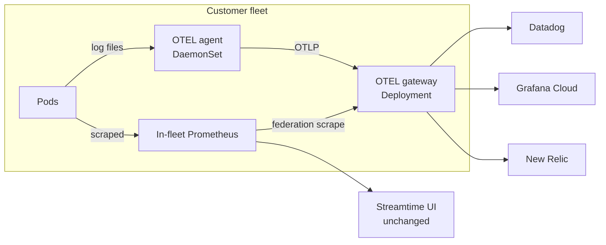
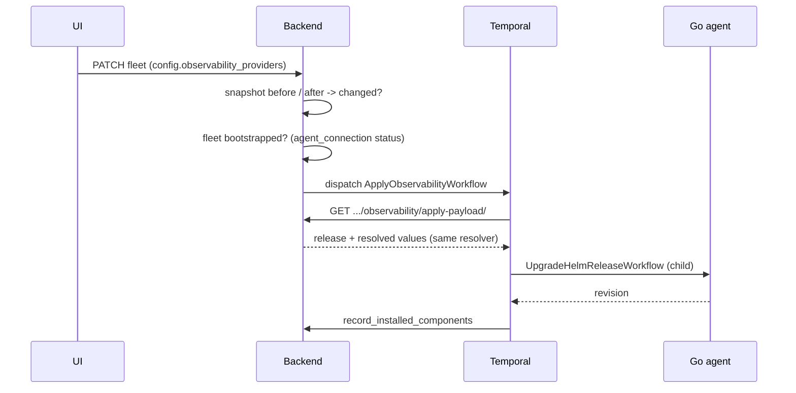

# BYO Observability — End-to-End Flow

How a customer's Datadog / Grafana Cloud / New Relic account travels from a form in Settings
to metrics and logs arriving in that vendor.

**Branch**: `feat/BYO-Observability` · **Design doc**: [`.cursor/plans/byo-observability.md`](https://github.com/streamtime-ai/fleet-manager/blob/main/.cursor/plans/byo-observability.md)

---

## The one-paragraph version

Streamtime keeps its own Prometheus + Loki exactly as before. Alongside them, every fleet also
runs a pair of **OpenTelemetry Collectors** — a node agent and a gateway — installed at bootstrap
whether or not the customer has attached anything. Attaching a "monitoring account" adds one
**exporter** to the gateway's config. That's the whole feature: the collectors are always there,
and an account is one more exporter on a pipeline that already exists.



Two deliberate consequences of that shape:

- **The agent never holds a credential.** It ships to the gateway over plaintext in-cluster OTLP
  and nothing else. Vendor API keys exist on exactly one workload in the cluster.
- **Nothing is conditional.** Both collectors install on every fleet. Attach/detach only rewrites
  a list of exporters, so there is no "component appears/disappears" state machine to get wrong.

---

## Part 1 — The operator creates a monitoring account

### 1.1 The Settings form

`Settings → Monitoring Accounts` (`features/settings/SettingsPage.js`, tab
`/settings/observability`) renders
`features/settings/components/organizationsettings/ObservabilityProvider.js`.

The credential fields are **not** hardcoded. Picking a product triggers:

```
GET /organizations/{org}/sku/observability/providers/            -> [{identifier, name}, ...]
GET /organizations/{org}/sku/observability/providers/{vendor}/credentials/  -> JSON Schema
```

and the second response is handed straight to RJSF. Adding a fourth vendor on the backend makes
its form appear with no frontend change.

> **Gotcha**: unlike the bootstrap-provider endpoint, this one returns the **bare JSON Schema**,
> not `{json_schema, ui_schema}`. The hook reads it directly.

### 1.2 What each vendor asks for

| Vendor | Fields | Secret |
|---|---|---|
| Datadog | `api_key`, `site` (enum of the 6 DD sites) | `api_key` |
| Grafana Cloud | `otlp_endpoint`, `instance_id`, `access_token` | `access_token` |
| New Relic | `license_key`, `region` (`US` \| `EU`) | `license_key` |

Defined in `core/schemas/observability_provider_schema.py` as `SanitizedPydanticModel` subclasses
with `extra="forbid"`. Each declares `__sanitize_fields__` matching its plugin's `secret_fields`.

### 1.3 Storage and redaction

`POST /organizations/{org}/observability-providers/` → `ObservabilityProviderViewSet`
(`core/views/organization/observability_providers.py`).

`ObservabilityProviderSerializer` (`core/serializers.py:2364`) does two things worth knowing:

- **On read** — `to_representation` replaces every `secret_fields` value with `"********"`.
  This applies to the UI, the CLI, and MCP alike. There is no endpoint that returns a stored
  credential in cleartext.
- **On write** — if an incoming secret field *is* `"********"`, the stored value is restored
  before validation. That is what lets the edit form round-trip without the user re-typing keys.

The row lands in `ObservabilityProvider` (`core/models.py:1847`): UUID pk, org FK,
`identifier` slug, `vendor`, and a `SchemaField` holding the vendor's Pydantic model.

---

## Part 2 — Attaching accounts to a fleet

### 2.1 At fleet create

`features/infrastructure/KubernetesFleetCreate.js`, Basic Configuration step, renders
`<ObservabilityAccountSelect>` — a plain MUI `Autocomplete multiple` labelled
**"How should this fleet be monitored?"**. It writes identifiers to
`values.config.observability_providers`.

The control hides itself entirely when the org has no accounts, so a fleet form doesn't grow an
empty field for a feature nobody has set up.

`FleetCreateSerializer` (`core/serializers.py:3187`) reads `config.observability_providers` and
calls `.set()` on the `FleetConfig` M2M (`core/models.py:1001`) — the same shape as
`alert_channels` sitting directly above it.

### 2.2 After the fleet exists

`PATCH /organizations/{org}/fleet/{id}/` with a new `config.observability_providers` list.

`FleetRetrieveView._update_and_reconcile` (`core/views/fleet/views.py:201`) snapshots the attached
set before the update, compares after, and dispatches `ApplyObservabilityWorkflow` only when it
actually changed — see [Part 5](#part-5--attachdetach-after-bootstrap).

---

## Part 3 — `compute-components` turns accounts into exporters

**This is the single source of truth.** There is no second path that re-derives exporters from
stored credentials.

```
GET /organizations/{org}/fleet/{fleet}/compute-components/
  -> BootstrapResolverService.resolve_bootstrap_values()
```

### 3.1 Where the merge happens

`core/services/bootstrap_resolver.py`, right after the external-dns and cert-manager blocks:

```python
if "fleet_manager_otel" in components:
    from core.services.observability_sinks import build_fleet_sink_plan

    sink_plan = await build_fleet_sink_plan(fleet)
    otel = components["fleet_manager_otel"]
    otel["resolved_values"] = self._deep_merge_dicts(
        otel.get("resolved_values") or {},
        {"fleetId": fleet_id, "organization": org_id},
    )
    otel["resolved_values"]["providers"] = sink_plan["providers"]
```

Note the last line is a **whole-key replace**, not a deep merge. `providers` is a list, and the
attached account set is authoritative — a stale value left in a fleet's `advanced_config` must not
survive a detach. There is a regression test for exactly this
(`test_detach_clears_a_stale_user_override`).

The fleet query carries `select_related("config")` + `prefetch_related("config__observability_providers")`
so the merge costs no extra round trips.

### 3.2 Plugin → exporter fragment

`core/services/observability_sinks.py` walks the attached accounts and asks each plugin for one
fragment:

```python
@dataclass
class ObservabilityExporterFragment:
    identifier: str        # the account slug, e.g. "dd-prod"
    vendor: str
    exporter_name: str     # "datadog/dd-prod"
    exporter: Dict         # the collector exporter config, credentials included
    signals: Tuple[str, ...] = ("metrics", "logs")
```

The whole job of a plugin is: name an exporter, describe it, say which signals it accepts.

| Vendor | Exporter name | Auth mechanism |
|---|---|---|
| Datadog | `datadog/<id>` | `api.key` + `api.site`; `host_metadata.enabled: false` so DD doesn't bill each collector pod as a host |
| Grafana Cloud | `otlphttp/grafanacloud/<id>` | `Authorization: Basic <b64(instance_id:access_token)>`, pre-encoded in the plugin |
| New Relic | `otlphttp/newrelic/<id>` | `api-key: <license_key>` header, regional endpoint |

Every exporter also gets `retry_on_failure` + `sending_queue` from
`DEFAULT_EXPORTER_RESILIENCE` — vendor SaaS intake is the one hop we don't control, so it queues
and retries rather than dropping on first error.

**Grafana Cloud uses a pre-encoded header rather than a `basicauth` extension.** That keeps the
collector config to one exporter per account with nothing to also merge into
`service.extensions` — a materially simpler template.

### 3.3 Secrets on this endpoint

`compute-components` returns real credentials in
`components.fleet_manager_otel.resolved_values.providers[].exporter`. That is the design
decision recorded in the plan doc, and it matches how the stack already ships PagerDuty routing
keys, Slack webhooks and TLS private keys inside Helm values.

Two knock-on effects to be aware of rather than surprised by:

- `bootstrap_cluster` persists every chart's values to `InstalledComponent.helm_values`
  (`fleet_provider_base.py:845`), and that field is returned by the API
  (`core/serializers.py:5678`).
- The Settings `GET` on the account entity stays redacted regardless.

---

## Part 4 — Bootstrap installs the collectors

### 4.1 Two components, two Helm releases

| Key | Release | Chart | What it installs | Order | Conditional |
|---|---|---|---|---|---|
| `otel_operator` | `otel-operator` | `open-telemetry/opentelemetry-operator` | Controller + CRDs only. **No** collector CRs. | 81 | No |
| `fleet_manager_otel` | `fleet-manager-otel` | `oci://ghcr.io/streamtime-ai/fleet-manager-otel` | The two `OpenTelemetryCollector` CRs + agent RBAC | 82 | No |

> **The operator release name is length-constrained.** The chart builds every
> resource as `<release>-opentelemetry-operator`, truncates *that* to 63, and only
> then appends suffixes up to `-selfsigned-issuer` (18 chars) — so the Kubernetes
> 63-character limit is blown after truncation, where the chart can no longer
> protect it. Budget: `len(release) + 23 + 18 <= 63`, i.e. **release ≤ 22 chars**.
> `kafka-fleet-manager-otel-operator` (33) put eight resources over the limit and
> failed the install outright. Pinned by
> `TestOtelReleaseNameLength`.

Registered in `_COMPONENT_REGISTRY_MAP` (`core/services/bootstrap_resolver.py:234`). Same split as
`grafana_operator` vs `fleet-manager-dashboard-fleet`.

Why those numbers:

- **81** is immediately after `cert_manager` (80). The operator chart's admission webhook defaults
  to cert-manager-issued certs, so cert-manager's CRDs must already exist.
- **82** keeps the wrap chart behind the operator on install — and because the Go agent uninstalls
  releases **LIFO** (`streamtime-agent/internal/workflows/teardown.go:68`), that ordering also gives
  wrap-before-operator on teardown for free, so the CRs' finalizers clear while the controller is
  still running.

### 4.2 The contrib distro pin

The operator chart's default collector image is `opentelemetry-collector-**k8s**`, which ships
**neither the Datadog exporter nor filelog**. Pinning to `-contrib` is therefore load-bearing, not
cosmetic. It lives in the tracked-repo preset
(`preload/helm_repos/helm__open-telemetry_github_io_opentelemetry-helm-charts__opentelemetry-operator.json`):

```json
"manager": {
  "collectorImage": {
    "repository": "ghcr.io/open-telemetry/opentelemetry-collector-releases/opentelemetry-collector-contrib",
    "tag": "0.158.0"
  }
}
```

Both that image and the operator manager image are also in `preload/registry_images.yaml`, so
air-gapped installs mirror them like every other bootstrap image.

### 4.3 What the wrap chart renders

`charts/fleet-manager-otel/` produces five objects:

```
ServiceAccount        fleet-manager-otel-agent
ClusterRole           fleet-manager-otel-agent      (pods/namespaces/nodes/replicasets: get,list,watch)
ClusterRoleBinding    fleet-manager-otel-agent
OpenTelemetryCollector fleet-manager-otel-agent     mode: daemonset
OpenTelemetryCollector fleet-manager-otel-gateway   mode: deployment
```

The `OpenTelemetryCollector` CRD has no `presets` field (that's the standalone collector *chart*,
which this deliberately does not use) — so the log-tailing volumes and the `k8sattributes` RBAC are
templated by hand.

**Agent** (`otel-agent.yaml`) — hostPath-mounts `/var/log/pods` read-only, parses lines with the
`container` operator (handles both CRI and docker formats, and extracts pod/namespace/container from
the file path with no per-distribution branching), enriches with `k8sattributes`, and exports OTLP
to the gateway Service. Its only exporter is `otlp`.

**Gateway** (`otel-gateway.yaml`) — receives OTLP from the agent, scrapes the in-fleet Prometheus
`/federate` with `honor_labels: true`, stamps `streamtime.fleet` / `streamtime.organization`, and
fans out to every exporter in `providers[]`.

> **Fleet identity is stamped twice, deliberately.** A `resource` processor sets it as a resource
> attribute (which is what OTLP-native backends like Datadog and New Relic read, and what lands as
> structured metadata in Loki), and an `attributes` processor sets the same values at *datapoint*
> level. The second one is not redundant: Prometheus-compatible backends (Grafana Cloud, Mimir) do
> **not** turn resource attributes into metric labels — they divert them into a separate
> `target_info` series. With only the resource processor,
> `container_memory_working_set_bytes{streamtime_fleet="..."}` matches nothing while
> `count({streamtime_fleet="..."})` returns a graph, because the latter is matching `target_info`.
> That false-positive is what makes this worth knowing. Pinned by the
> "stamps fleet identity at both resource and datapoint level" chart test.

Note the per-backend asymmetry when querying: New Relic keeps `streamtime.fleet` with dots;
Prometheus rewrites it to `streamtime_fleet`; Loki keeps it as structured metadata (filter with
`| streamtime_fleet="..."`, not as a `{}` stream selector).

### 4.4 The two template decisions worth explaining

**Why federation for metrics.** Prometheus `remote_write` is out of architecture, and Prometheus
cannot emit OTLP. Federation is therefore the only route by which fleet metrics reach a vendor.
The design doc left this "optional"; in practice it is on by default, with
`gateway.federation.match` as the knob.

**Why a `nop` exporter.** A collector pipeline with an empty `exporters` list fails config
validation outright. So `exportersFor` falls back to `nop` when nothing is attached:

```gotemplate
{{- define "fleet-manager-otel.exportersFor" -}}
{{- $names := list -}}
{{- range .providers -}}
{{- if has .signal (.signals | default (list "metrics" "logs")) -}}
{{- $names = append $names .exporterName -}}
{{- end -}}{{- end -}}
{{- if not $names -}}{{- $names = list "nop" -}}{{- end -}}
{{- toJson $names -}}
{{- end -}}
```

That keeps OTLP intake — and therefore the `/otel` endpoint — working on a fleet with no BYO
account, which is the common case. It also means a `signals: [metrics]` account is correctly
absent from the logs pipeline.

### 4.5 Verified render

With three accounts attached, `compute-components` → `helm template` produces:

```
gateway receivers:  ['otlp', 'prometheus']
gateway exporters:  ['datadog/e2e-dd', 'nop',
                     'otlphttp/grafanacloud/e2e-gc', 'otlphttp/newrelic/e2e-nr']
metrics pipeline:   ['datadog/e2e-dd', 'otlphttp/grafanacloud/e2e-gc', 'otlphttp/newrelic/e2e-nr']
logs pipeline:      ['datadog/e2e-dd', 'otlphttp/grafanacloud/e2e-gc', 'otlphttp/newrelic/e2e-nr']

agent exporters:    ['otlp']  -> fleet-manager-otel-gateway-collector.monitoring.svc:4317
agent has secrets:  False
```

Detach everything and both pipelines fall back to `['nop']` with the OTLP receiver still up.

---

## Part 5 — Attach/detach after bootstrap

Bootstrap bakes the account set into the chart values at install time. Changing it later needs its
own route, because **cloud-provider `UPDATE` is a no-op** — `AwsProvider.run` branches on `CREATE`
(line 2702) and `DELETE` (3203) with no `else`, and GCP/OCI/Azure are the same.



**The payload endpoint is a projection, not a second resolver.**
`FleetObservabilityApplyPayloadView` (`core/views/fleet/bootstrap_resolver.py:145`) calls the same
`resolve_bootstrap_values` and returns just the `fleet_manager_otel` install descriptor. The
exporter set an apply installs is byte-identical to what a bootstrap would have installed.

**Two guards on dispatch** (`core/services/observability_apply.py`):

1. Only when the attached set actually changed — a PATCH that touches something else doesn't
   trigger a Helm upgrade.
2. Only when the fleet is bootstrapped (`agent_connection.status` in
   `{bootstrap_initiated, bootstrap_complete}`). Before that there is no release to upgrade, and
   bootstrap will install the current set anyway.

Dispatch failures are logged, never raised: the attachment is already persisted, and the next
bootstrap or manual apply converges.

The workflow ID is deterministic —
`/organizations/{org}/fleet/{fleet}/command/ApplyObservabilityWorkflow` — so rapid repeated
attaches dedupe rather than piling up.

---

## Part 6 — The `/otel` endpoint

Every fleet gets a public OTLP/HTTP intake, so customers can point their *own* instrumented
applications at Streamtime's collector.

```
https://shared-{fleet}.{domain}/otel   ->  fleet-manager-otel-gateway-collector:4318
```

- **Route**: a fourth `HTTPRoute` in `charts/fleet-manager-infra-shared/templates/kong-http-routes.yaml`,
  copying the `loki` block. Appended at the end of the file so the existing chart tests' document
  indices don't shift.
- **Auth**: reuses the existing `monitoring-basic-auth` KongPlugin. No new Secret, no new
  KongConsumer — exactly what the `/logs` route does.
- **Credentials**: an `otel` key in the fleet's shared-credentials secret, mirroring `metrics`
  (again, same as `logs`).
- **Discovery**: an `EndpointConfig(type="otel")` row, surfaced in the new fleet **Endpoints** tab.

### The shared-credentials backfill

`otel` was added after fleets were already running, so `bootstrap_cluster` sets
`need_persist_secret = True` when an otherwise-valid existing secret lacks the key:

```python
if valid_existing and not _credential_pair_valid(existing_parsed.get("otel")):
    need_persist_secret = True
```

It is deliberately **not** added to `_is_valid_shared_credentials_structure`'s required-keys tuple —
doing that would invalidate every existing fleet's secret and force a full credential regeneration.
Because `otel` mirrors `metrics` rather than being generated, the backfill is a rewrite, not a
rotation.

---

## Part 7 — The other consumers

| Surface | What it got |
|---|---|
| **CLI** | `streamtime observability-provider {list,get,create,delete,available,credential-schema}` |
| **MCP** | `list_observability_providers`, `get_observability_provider` (read-only, redacted) |
| **Bootstrap config editor** | "OpenTelemetry Operator" and "OpenTelemetry Collectors" entries, so both releases are inspectable and version-pinnable like every other component |
| **Fleet Endpoints tab** | Reuses `features/endpoints/EndPoints.js` as-is |

---

## File map

| Concern | Path |
|---|---|
| Wrap chart | `charts/fleet-manager-otel/` |
| `/otel` route | `charts/fleet-manager-infra-shared/templates/kong-http-routes.yaml` |
| Vendor plugins | `fleet-manager-backend/observability_provider/` |
| Credential schemas | `core/schemas/observability_provider_schema.py` |
| Fragment merge | `core/services/observability_sinks.py` |
| Bootstrap wiring | `core/services/bootstrap_resolver.py` (`_COMPONENT_REGISTRY_MAP`, `resolve_bootstrap_values`) |
| Apply payload endpoint | `core/views/fleet/bootstrap_resolver.py` |
| Apply dispatch | `core/services/observability_apply.py` |
| Workflow | `fleet-manager-orchestrator/workflows/apply_observability.py` |
| Activity | `fleet-manager-orchestrator/activities/backend.py` (`get_fleet_observability_payload`) |
| Endpoint + credentials | `fleet-manager-orchestrator/workflows/fleet_provider_base.py` |
| Settings UI | `features/settings/components/organizationsettings/ObservabilityProvider.js` |
| Hooks | `hooks/settings/observabilityProviders.js` |
| Fleet create | `features/infrastructure/KubernetesFleetCreate.js` (`ObservabilityAccountSelect`) |
| Packages | `preload/package_rules.yaml`, `preload/helm_repos/`, `preload/registry_images.yaml` |

---

## Operating notes

**No migration is required.** `SchemaField` deconstructs to the same union of class *names*, so
reshaping a vendor's Pydantic model doesn't alter the field Django sees. But Grafana Cloud's shape
did change (`prometheus_url`/`loki_url`/… → `otlp_endpoint`/`instance_id`/`access_token`), so any
account created on this branch **before** that change will fail validation on read. Delete and
recreate those rows.

**Package versions need a sync.** Preload registers the tracked repos and package rules at startup,
but the actual version rows come from `PackageSyncWorkflow` scraping the repo index. Until that
runs, `compute-components` raises
`No supported packages found for otel_operator`. This is the normal path for any new component.

**The generated SDKs are stale.** `test-harness/regen-sdk.sh` picks up the new endpoints correctly,
but the committed spec snapshot predates a lot of unrelated work, so regenerating sweeps in ~10k
lines of other people's drift. That belongs in its own change. Until then
`hooks/settings/observabilityProviders.js` carries hand-written typedefs with a note to swap them
back.

## Known gaps

- **Manual-mode bootstrap.** `workflows/bootstrap_fleet_cluster.py:162` skips conditional
  components and never calls `_apply_runtime_values`. Both OTEL components are unconditional so
  they install, but that path gets no runtime overlay.
- **OpenShift is wired but unverified.** The agent needs hostPath access to `/var/log/pods`, which
  the restricted SCC forbids. The chart exposes `agent.runAsUser`/`runAsGroup` (nullable),
  `agent.seLinuxOptions` and `agent.sccClusterRole`, and the wrap chart's preload carries an
  `openshift` preset mirroring Promtail's (`container_logreader_t` +
  `system:openshift:scc:hostmount-anyuid-v2`). None of it has been exercised on a real cluster.
- **Traces.** Out of scope for v1 — no traces pipeline is configured on either collector.
- **Gateway fan-out is linear.** N attached accounts means N× egress from one Deployment.
  `gateway.replicas` is the knob; an HPA can wait until a real fleet needs one.
