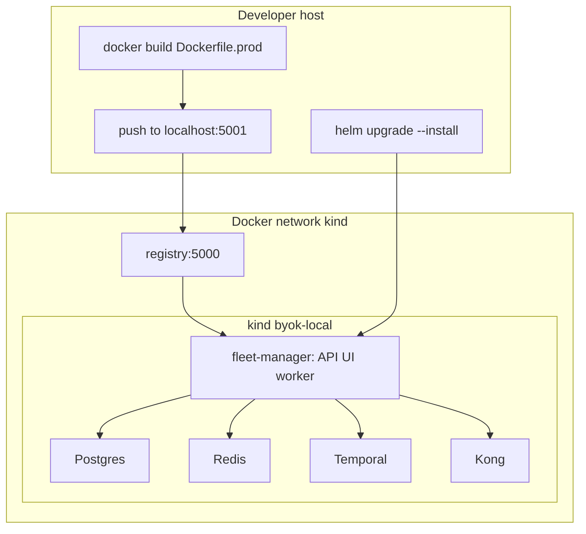

# Deploy fleet-manager Helm on local kind (customer-like)

This guide installs the **fleet-manager control-plane chart** onto the local kind
cluster created by [`scripts/setup-dev-fleet.sh`](https://github.com/streamtime-ai/fleet-manager/blob/main/scripts/setup-dev-fleet.sh),
with **in-cluster** Postgres, Redis, Temporal, and Kong, using **local**
control-plane images and OCI charts from the repo registry.

It mirrors the **customer chart contract** (operator-owned dependencies +
`charts/fleet-manager` for API / UI / Temporal worker). It does **not** reproduce
production GitOps (digest-pinned OCI bundles, Flux, Vault, External Secrets).
For that contract see [`deploy/streamti.me/README.md`](https://github.com/streamtime-ai/fleet-manager/blob/main/deploy/streamti.me/README.md).

## When to use which topology

| Topology | Control plane | Dataplane | Use when |
|----------|---------------|-----------|----------|
| **Day-to-day local** | `docker compose` | kind (`byok-local`) BYOK fleet | Fast iteration on API/UI/workflows |
| **This guide** | Helm `charts/fleet-manager` **on kind** | Same kind cluster (optional BYOK) | Validate chart install + local images/charts like a customer cluster |
| **HA chart on kind** | Helm [`charts/streamtime-ha`](https://github.com/streamtime-ai/fleet-manager/blob/main/charts/streamtime-ha/README.md) | Same kind cluster | Smoke the batteries-included installer (Postgres, Temporal, Redis, Kong, cert-manager) |

Do not run compose control-plane services and this Helm install against the same
hostnames at once — they will fight for `*.streamtime.local` and ports.
Do not install this guide's Postgres, Redis, Temporal, or Kong in a namespace
where `charts/streamtime-ha` is installed. That chart brings those services up
itself.



## Prerequisites

- Docker, kind, kubectl, Helm 3 (OCI)
- ~16 GiB RAM free for a single-node kind cluster with deps + control plane
- Repo checkout at the workspace root

### 1. Create the kind cluster

```bash
./scripts/setup-dev-fleet.sh
./scripts/setup-dev-fleet.sh --status
```

This creates cluster `byok-local`, writes kubeconfigs under `assets-staging/`,
and configures an insecure containerd mirror for `registry:5000`.

Export the host kubeconfig for the rest of this guide:

```bash
export KUBECONFIG="${PWD}/assets-staging/byok-local-kind.yaml"
kubectl cluster-info
```

### 2. Local OCI / container registry on the `kind` network

Kind nodes pull `registry:5000`. From the host, push to `localhost:5001`.

Start **only** the registry (and the external `kind` network, which already
exists after setup-dev-fleet):

```bash
docker compose up -d registry
```

Confirm:

```bash
curl -s http://localhost:5001/v2/_catalog
```

### 3. Namespace

Everything in this guide uses a single namespace:

```bash
kubectl create namespace streamtime --dry-run=client -o yaml | kubectl apply -f -
```

---

## Build and push local control-plane images

[`scripts/build-and-push-streamtime.sh`](https://github.com/streamtime-ai/fleet-manager/blob/main/scripts/build-and-push-streamtime.sh)
builds **agent / kafka-admin / related** images — **not** the API, UI, or
orchestrator. Build those with the production Dockerfiles (same as CI):

```bash
REG=localhost:5001/streamtime
TAG=local

# API
docker build -f fleet-manager-backend/Dockerfile.prod \
  -t "${REG}/streamtime-api:${TAG}" fleet-manager-backend
docker push "${REG}/streamtime-api:${TAG}"

# UI
docker build -f fleet-manager-frontend/Dockerfile.prod \
  -t "${REG}/streamtime-ui:${TAG}" fleet-manager-frontend
docker push "${REG}/streamtime-ui:${TAG}"

# Temporal worker (orchestrator) — context is repo root (needs streamtime-sdk)
docker build -f fleet-manager-orchestrator/Dockerfile \
  -t "${REG}/streamtime-orchestrator:${TAG}" .
docker push "${REG}/streamtime-orchestrator:${TAG}"

# Kong gateway image (used by the Kong Helm release below, not by fleet-manager pods)
docker build -f fleet-manager-gateway/Dockerfile.prod \
  -t "${REG}/streamtime-gateway:${TAG}" fleet-manager-gateway
docker push "${REG}/streamtime-gateway:${TAG}"
```

In-cluster image references use `registry:5000/streamtime/...` (same artifacts).

After rebuilding the same `:local` tag, restart pods (chart templates do not set
`imagePullPolicy`; non-`latest` tags default to `IfNotPresent`):

```bash
kubectl -n streamtime rollout restart deploy/fleet-manager deploy/fleet-manager-ui deploy/temporal-worker
```

---

## Build and push local Helm charts

Push charts the control plane and fleets will resolve at runtime:

```bash
./scripts/build-and-push-chart.sh all
# Or a subset, e.g.:
# ./scripts/build-and-push-chart.sh fleet-manager
# ./scripts/build-and-push-chart.sh streamtime-agent
# ./scripts/build-and-push-chart.sh streamtime-operator
```

Default registry is `localhost:5001`, repository path `streamtime`. Agent
install from the worker uses **in-cluster** OCI:

`oci://registry:5000/streamtime/streamtime-helm` (see
`fleetmanager.streamtimeagent.*` in the values block below).

---

## Install in-cluster dependencies

Same ownership model as production ([`deploy/prerequisites.lock.yaml`](https://github.com/streamtime-ai/fleet-manager/blob/main/deploy/prerequisites.lock.yaml)):
the fleet-manager chart does **not** install Postgres, Redis,
Temporal, or Kong. Install them in `streamtime` with kind-sized settings
(replicas 1, small requests).

Commands below use public Helm repos current as of writing; adjust chart
versions if your environment pins differently.

### cert-manager

```bash
helm repo add jetstack https://charts.jetstack.io
helm repo update
helm upgrade --install cert-manager jetstack/cert-manager \
  --namespace cert-manager --create-namespace \
  --set crds.enabled=true \
  --wait
```

Use a **self-signed** ClusterIssuer for kind (Let’s Encrypt HTTP-01 will not
work without a public domain). Create it before installing fleet-manager, and
point the chart at it (`certManager.createClusterIssuer: false` below so the
chart does not create `letsencrypt-prod`):

```bash
kubectl apply -f - <<'EOF'
apiVersion: cert-manager.io/v1
kind: ClusterIssuer
metadata:
  name: selfsigned-issuer
spec:
  selfSigned: {}
EOF
```

### Postgres (Bitnami)

```bash
helm repo add bitnami https://charts.bitnami.com/bitnami
helm upgrade --install fm-postgresql bitnami/postgresql \
  --namespace streamtime \
  --set auth.username=fleetmanager \
  --set auth.password=fleetmanager \
  --set auth.database=fleetmanager \
  --set primary.persistence.enabled=false \
  --set primary.resources.requests.cpu=100m \
  --set primary.resources.requests.memory=256Mi \
  --wait
```

Service DNS (typical Bitnami fullname): `fm-postgresql.streamtime.svc.cluster.local`.

### Redis (standalone)

```bash
helm upgrade --install fm-redis bitnami/redis \
  --namespace streamtime \
  --set architecture=standalone \
  --set auth.enabled=false \
  --set master.persistence.enabled=false \
  --set master.resources.requests.cpu=50m \
  --set master.resources.requests.memory=128Mi \
  --wait
```

Django `REDIS_URL` (db 0): `redis://fm-redis-master.streamtime.svc.cluster.local:6379/0`.

### Temporal (dev-scale Helm — not `start-dev`)

Temporal Helm chart **≥1.0** installs only Temporal server components. It does
**not** bundle Cassandra, Elasticsearch, Prometheus, or Grafana. Reuse the
Postgres install from this guide for default and visibility stores (see
[Temporal Helm UPGRADING.md](https://github.com/temporalio/helm-charts/blob/main/UPGRADING.md)).

```bash
helm repo add temporalio https://go.temporal.io/helm-charts
helm repo update
cat >/tmp/fm-temporal-values.yaml <<'EOF'
server:
  replicaCount: 1
  config:
    # Helm does not register Temporal namespaces unless create is true
    # (unlike docker-compose start-dev). The orchestrator worker uses "default".
    namespaces:
      create: true
      namespace:
        - name: default
          retention: 3d
    persistence:
      defaultStore: default
      visibilityStore: visibility
      numHistoryShards: 128
      datastores:
        default:
          sql:
            createDatabase: true
            manageSchema: true
            pluginName: postgres12
            driverName: postgres12
            databaseName: temporal
            connectAddr: "fm-postgresql.streamtime.svc.cluster.local:5432"
            connectProtocol: tcp
            user: fleetmanager
            password: fleetmanager
        visibility:
          sql:
            createDatabase: true
            manageSchema: true
            pluginName: postgres12
            driverName: postgres12
            databaseName: temporal_visibility
            connectAddr: "fm-postgresql.streamtime.svc.cluster.local:5432"
            connectProtocol: tcp
            user: fleetmanager
            password: fleetmanager
EOF
helm upgrade --install fm-temporal temporalio/temporal \
  --namespace streamtime \
  --version '>=1.0.0-0' \
  -f /tmp/fm-temporal-values.yaml \
  --wait --timeout 15m
```

Frontend address for the worker (confirm with `kubectl -n streamtime get svc`):

`fm-temporal-frontend.streamtime.svc.cluster.local:7233`

If the temporal-worker crashes with `Namespace default is not found` (install
done before `namespaces.create` was set), create it once via admintools
(confirm the Deployment name with `kubectl -n streamtime get deploy | grep temporal`):

```bash
kubectl -n streamtime exec -it deploy/fm-temporal-admintools -- \
  temporal operator namespace create -n default --retention 72h
kubectl -n streamtime exec deploy/fm-temporal-admintools -- \
  temporal operator namespace describe -n default
```

Then restart the worker if it is still CrashLooping:

```bash
kubectl -n streamtime rollout restart deploy/fleet-manager-temporal-worker
```

If schema jobs fail with permission errors creating databases, grant `CREATEDB`
to `fleetmanager` (or point the SQL stores at the Bitnami `postgres` superuser).
Do not pass top-level `cassandra.*` / `elasticsearch.enabled` / monitoring flags
— those keys were removed in chart v1.

### Kong (local gateway image)

Install Kong with a **kind-shrunk** overlay inspired by
[`production/helm-values/kong-values.yaml`](../production/helm-values/kong-values.yaml)
(replicas 1, local gateway image). This guide assumes **cloud-provider-kind** (or
equivalent) so `proxy.type=LoadBalancer` gets an EXTERNAL-IP.

The Kong chart runs SemVer checks on `image.tag`. Tag `local` is not SemVer, so
set `image.effectiveSemver` to the Kong version baked into the gateway image
(3.9). Enable `kong-authz-proxy` to match the custom gateway image.

```bash
helm repo add kong https://charts.konghq.com
helm repo update
helm upgrade --install kong kong/kong \
  --namespace streamtime \
  --set image.repository=registry:5000/streamtime/streamtime-gateway \
  --set image.tag=local \
  --set image.effectiveSemver=3.9.0 \
  --set 'env.plugins=bundled\,kong-authz-proxy' \
  --set proxy.type=LoadBalancer \
  --set proxy.http.containerPort=8000 \
  --set proxy.tls.containerPort=8443 \
  --set ingressController.enabled=true \
  --set ingressController.ingressClass=kong \
  --set ingressController.admissionWebhook.enabled=false \
  --set replicaCount=1 \
  --set resources.requests.cpu=100m \
  --set resources.requests.memory=512Mi \
  --wait --timeout 10m
```

If the Kong pod stays `0/2` Ready with KIC logging `failed posting new config to /config`,
check the `fleetmanager-authz` / `fleetmanager-mcp-authz` KongPlugins: Kong rejects
`root_org_identifier: ""` unless the gateway image includes `len_min = 0` on that
field (rebuild/push `streamtime-gateway` after pulling this fix). Temporary workaround:
set the field to `"root"` on both plugins.

Wait for the proxy Service EXTERNAL-IP (cloud-provider-kind), then point
`/etc/hosts` / DNS at it. `kubectl port-forward` remains a fallback if the LB
is not ready.

```bash
kubectl -n streamtime get svc kong-kong-proxy -w
```

Confirm the proxy Service name (often `kong-kong-proxy`):

```bash
kubectl -n streamtime get svc | grep -i kong
```

Set `fleetmanager.gateway.internalUrl` to that Service, e.g.
`http://kong-kong-proxy.streamtime.svc.cluster.local:80`.

---

## Install the fleet-manager chart

The chart hardwires **`STREAMTIME_BOOTSTRAP_MODE=headless`**: there is no setup
wizard. On first API start, `headless_bootstrap` completes `SystemSetup` from
Helm values / secrets. If required fields are missing or invalid, the API pod
fails with `ImproperlyConfigured` (not a Ready pod waiting for `/setup`).

Prefer the **local chart path** while iterating. OCI install mirrors a customer
pull-from-registry once charts are pushed:

```bash
# From local path (recommended while developing the chart)
helm upgrade --install streamtime ./charts/fleet-manager \
  --namespace streamtime \
  -f - <<'EOF'
# …values from the block below…
EOF

# Or from local OCI (after ./scripts/build-and-push-chart.sh fleet-manager)
# HELM_EXPERIMENTAL_OCI=1 helm upgrade --install streamtime \
#   oci://localhost:5001/streamtime/fleet-manager --version <pushed-version> \
#   --namespace streamtime -f - <<'EOF'
# …
# EOF
```

### Headless prerequisites (fill before install)

| Input | Values path | Notes |
|-------|-------------|--------|
| License JWT | `fleetmanager.license` | Must validate and be registered in STDNS |
| Fernet encryption key | `bootstrapSecrets.encryptionKey` | Not the Django default placeholder — generate below |
| OIDC | `fleetmanager.oidc.*` + `bootstrapSecrets.oidcClientSecret` | Bring your own IdP (this guide does not install Keycloak) |
| Root POC email | `globalConfig.root_org_poc_email` (+ `superUserEmails`) | Valid email; becomes org admin |
| GHCR | `ghcr.username` + `ghcr.token` | Required by headless |
| Quay | `quay.username` + `quay.token` | Required by headless |
| Builtin orchestrator hostnames | `globalConfig.orchestrator_address` / `orchestrator_server_name` | Match your `domain` (e.g. `orchestrator.streamtime.local`) |

Generate a Fernet key (required for headless):

```bash
python -c "from cryptography.fernet import Fernet; print(Fernet.generate_key().decode())"
```

Inventory of all headless env channels:
[`charts/fleet-manager/env-parity.yaml`](https://github.com/streamtime-ai/fleet-manager/blob/main/charts/fleet-manager/env-parity.yaml).

### Example values (inline)

Replace every `REPLACE_*` / placeholder secret before install. **Never** commit
real production credentials. Use `openssl rand -hex 32` for opaque secrets and
the Fernet command above for `encryptionKey`.

```bash
helm upgrade --install streamtime ./charts/fleet-manager \
  --namespace streamtime \
  -f - <<'EOF'
fleetmanager:
  domain: streamtime.local
  license: "REPLACE_WITH_VALID_STDNS_REGISTERED_LICENSE_JWT"
  cookie_encryption_key: "dev-only-cookie-encryption-key-32b!!"
  ingressClassName: kong
  superUserEmails: "you@example.com"

  ui:
    repository: registry:5000/streamtime/streamtime-ui
    tag: local
    digest: ""
    delivery: inCluster
    replicas: 1

  api:
    repository: registry:5000/streamtime/streamtime-api
    tag: local
    digest: ""
    replicas: 1
    uvicornWorkers: 1
    fleetManagerEnv: development
    migration:
      enabled: true

  orchestrator:
    repository: registry:5000/streamtime/streamtime-orchestrator
    tag: local
    digest: ""
    replicas: 1
    temporalFrontendAddress: fm-temporal-frontend.streamtime.svc.cluster.local:7233
    temporalFrontendService: fm-temporal-frontend
    temporalFrontendPort: 7233
    publicIngress: false

  postgres:
    host: fm-postgresql.streamtime.svc.cluster.local
    port: "5432"
    database: fleetmanager
    username: fleetmanager

  gateway:
    internalUrl: http://kong-kong-proxy.streamtime.svc.cluster.local:80

  streamtimeagent:
    registryUrl: registry:5000
    repository: streamtime
    chartVersion: latest

  streamtimeclusterlink:
    registryUrl: registry:5000
    repository: streamtime
    chartVersion: latest

  # Bring-your-own IdP — fill all required OIDC fields for headless.
  oidc:
    issuer: "https://REPLACE_IDP_ISSUER/"
    jwksUri: "https://REPLACE_IDP_ISSUER/.well-known/jwks.json"
    audience: "https://api.streamtime.local"
    scope: "openid profile email"
    tokenEndpoint: "https://REPLACE_IDP_ISSUER/oauth/token"
    authorizeEndpoint: "https://REPLACE_IDP_ISSUER/authorize"
    emailClaim: email
    groupsClaim: groups
    refreshToken: false
    clientId: "REPLACE_OIDC_CLIENT_ID"

  ghcr:
    username: "REPLACE_GHCR_USERNAME"
    token: "REPLACE_GHCR_TOKEN"
  quay:
    username: "REPLACE_QUAY_USERNAME"
    token: "REPLACE_QUAY_TOKEN"
  dockerhub:
    username: ""
    token: ""

  rateLimiting:
    enabled: false

  ingress:
    setup:
      public: false
    docs:
      public: true
    benchmark:
      public: false

  rbacBypassHosts: "localhost,127.0.0.1,fleet-manager"

  externalSecret:
    enabled: false

  bootstrapSecrets:
    postgresPassword: "fleetmanager"
    jwtSecretKey: "dev-only-jwt-secret-replace-me-32b"
    oidcClientSecret: "REPLACE_OIDC_CLIENT_SECRET"
    kongAuthzEncryptionKey: "dev-only-kong-authz-key-32bytes!"
    kongAuthzSalt: "dev-only-salt"
    encryptionKey: "REPLACE_WITH_FERNET_KEY"
    orchestratorApiKey: "dev-only-orchestrator-api-key"
    redisUrl: "redis://fm-redis-master.streamtime.svc.cluster.local:6379/0"
    # Kong→API shared secret for POST .../api-keys/validate/ (X-Streamtime-Internal-Key).
    # Injected as API env INTERNAL_SERVICE_KEY and KongPlugin backend.internal_service_key.
    # Empty or mismatched values break agent Temporal dial (401 Unauthorized after TLS).
    internalServiceKey: "dev-only-internal-service-key"
    djangoSecretKey: "dev-only-django-secret-key-replace"

  globalConfig:
    preload_manifest_url: http://fleet-manager.streamtime.svc.cluster.local:8000/preload-manifest/
    root_org_name: root
    root_org_poc_email: "you@example.com"
    orchestrator_mode: builtin
    orchestrator_auth_mode: none
    orchestrator_address: orchestrator.streamtime.local
    orchestrator_server_name: orchestrator.streamtime.local

certManager:
  createClusterIssuer: false
  clusterIssuerName: selfsigned-issuer
EOF
```

---

## DNS and access

Ingress hosts are `api.<domain>`, `console.<domain>`, `docs.<domain>`, etc.
(`domain: streamtime.local` above). Setup Ingress stays off (`ingress.setup.public: false`)
because headless already completed onboarding.

1. Find the Kong proxy address:

```bash
kubectl -n streamtime get svc kong-kong-proxy -o wide
```

2. Map hosts (example with port-forward if there is no LoadBalancer IP):

```bash
kubectl -n streamtime port-forward svc/kong-kong-proxy 8443:443 8080:80
```

Add to `/etc/hosts` (point at `127.0.0.1` when using port-forward):

```text
127.0.0.1 api.streamtime.local console.streamtime.local docs.streamtime.local orchestrator.streamtime.local
```

Trust the self-signed cert or use `curl -k` while validating.

---

## Verify

```bash
kubectl -n streamtime get pods,ingress
# Expect: fleet-manager / fleet-manager-ui / temporal-worker Ready
# (API pods ran manage.py migrate in the fleet-manager-migrations init;
#  headless_bootstrap completed SystemSetup — no /setup wizard)

kubectl -n streamtime logs deploy/fleet-manager -c fleet-manager-migrations --tail=50
kubectl -n streamtime logs deploy/fleet-manager -c fleet-manager --tail=80 | grep -i headless || true
```

Smoke the API through Kong (adjust URL/port):

```bash
curl -sk https://api.streamtime.local:8443/healthz/ || curl -s http://api.streamtime.local:8080/healthz/
```

Sign in at `https://console.streamtime.local` with the configured IdP (not `/setup`).

### Optional: BYOK on the same kind cluster

You can register `byok-local` as a BYOK fleet using
`assets-staging/byok-local-kind.yaml` (same pattern as
[`scripts/create-byok-fleet.sh`](https://github.com/streamtime-ai/fleet-manager/blob/main/scripts/create-byok-fleet.sh)). Expect
**resource pressure** on a single node; trim heavy dataplane charts with
[`scripts/trim-fleet-charts.sh`](https://github.com/streamtime-ai/fleet-manager/blob/main/scripts/trim-fleet-charts.sh) if needed.

Agent charts must resolve from `registry:5000` (already set via
`streamtimeagent.registryUrl`). Push agent images/charts with
`./scripts/build-and-push-streamtime.sh` before provisioning.

After the agent deploys, confirm Temporal connectivity:

```bash
kubectl -n streamtime-agent logs -l app.kubernetes.io/name=streamtime-agent-helm --tail=40 \
  | grep -iE 'connectivity verified|failed reaching server|Unauthorized|Internal'
```

Expect `Orchestrator connectivity verified successfully`. If you see
`401 Unauthorized` or `failed reaching server: Internal`, check that
`bootstrapSecrets.internalServiceKey` is non-empty and matches what the
API and KongPlugins were installed with (re-apply fleet-manager values if needed).

---

## Production vs this kind path

| Concern | Production / customer | This guide |
|---------|----------------------|------------|
| Install path | Digested OCI GitOps (`render-gitops.sh` + Flux/Argo) | `helm upgrade --install` from local path / local OCI |
| Bootstrap | Headless (`STREAMTIME_BOOTSTRAP_MODE`) + Vault secrets | Headless + `bootstrapSecrets` / values placeholders |
| Images | `ghcr.io/…@sha256:…` | `registry:5000/streamtime/…:local` |
| Secrets | Vault + External Secrets | `externalSecret.enabled: false` + `bootstrapSecrets` |
| Deps | Operator-owned HA Postgres/Redis/Temporal/Kong | Bitnami / Temporal / Kong Helm, replicas 1, often no PVC |
| TLS | Public ACME issuer | Self-signed ClusterIssuer |
| Scale | HPA, PDB, multi-replica Kong | Single replicas, rate limiting off |

Canonical customer contract: [`deploy/streamti.me/README.md`](https://github.com/streamtime-ai/fleet-manager/blob/main/deploy/streamti.me/README.md).

---

## Cleanup

Uninstall control plane first, then dependencies:

```bash
helm -n streamtime uninstall streamtime || true
helm -n streamtime uninstall kong fm-temporal fm-redis fm-postgresql || true
helm -n cert-manager uninstall cert-manager || true
kubectl delete clusterissuer selfsigned-issuer --ignore-not-found
kubectl delete namespace streamtime --wait=false
```

Wipe the kind cluster entirely:

```bash
./scripts/setup-dev-fleet.sh --delete --force-recreate
# or --delete only, without recreate
```

---

## Related docs

- [Building and Deploying Streamtime Agent and Helm Chart](BUILDING_AND_DEPLOYING.md) — agent/operator OCI to `localhost:5001`
- [streamti.me control-plane secrets](https://github.com/streamtime-ai/fleet-manager/blob/main/deploy/streamti.me/README.md) — production ESO / GitOps
- [Prerequisites lock](https://github.com/streamtime-ai/fleet-manager/blob/main/deploy/prerequisites.lock.yaml) — ownership of external deps
