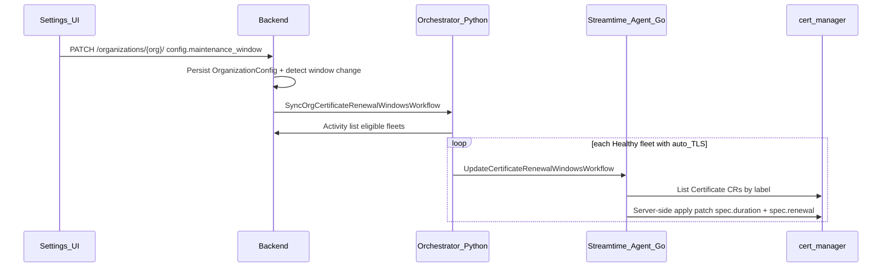

# Plan: Certificate Renewal During Maintenance Window

## Overview

Schedule cert-manager auto-TLS certificate renewals during the org maintenance window by injecting `spec.renewal.windows` (cron) and `duration: 8760h` into all auto-generated Certificate manifests, and fan out an agent workflow to patch existing Certificates when the maintenance window changes. Requires cert-manager upgrade to >=1.21.0.

## Problem

Auto-generated ACME certificates (cert-manager) renew on cert-manager's default schedule (~30 days before expiry), which can trigger unexpected Kafka broker rollouts. Renewal should be constrained to the org's configured maintenance window using cert-manager's `spec.renewal.windows` API (available in **cert-manager v1.21.0+**).

## Current State

| Area | Finding |
|------|---------|
| Maintenance window | Stored on [`OrganizationConfig.maintenance_window`](https://github.com/streamtime-ai/fleet-manager/blob/main/fleet-manager-backend/core/models.py) as `{start_time, end_time, frequency, week_day?, month_day?}` — **no timezone** |
| Certificates | 5 Helm Certificate templates + 1 Go workflow; **no `spec.renewal` or `duration`** on ACME certs |
| cert-manager version | [`package_rules.yaml`](https://github.com/streamtime-ai/fleet-manager/blob/main/fleet-manager-backend/preload/package_rules.yaml) pins `>=1.13.0,<1.20.0`, default `v1.19.2` — **too old for `spec.renewal`** |
| Runtime usage | Maintenance window is **not consumed** anywhere; cert renewal is uncontrolled |

## Architecture



**Two delivery paths (both required):**
1. **Helm values at provision/upgrade** — new and upgraded workloads get renewal config from compute-components
2. **Agent patch workflow** — existing live Certificates updated immediately when maintenance window changes (no Helm upgrade / broker rollout)

---

## Prerequisite: cert-manager Upgrade

Bump [`fleet-manager-backend/preload/package_rules.yaml`](https://github.com/streamtime-ai/fleet-manager/blob/main/fleet-manager-backend/preload/package_rules.yaml):

```yaml
- name: "Cert Manager"
  version_constraint: ">=1.21.0,<1.22.0"
  default_version: "v1.21.1"
```

- Existing fleets must upgrade cert-manager **before** renewal windows are applied (CRD validation will reject unknown fields on older versions)
- Document in operator notes: run fleet cert-manager upgrade, then enable renewal windows
- Helm charts should **conditionally** render `spec.renewal` only when `.Values.certManager.renewal` is set (safe during phased rollout)

---

## 1. Extend Maintenance Window Schema (timezone)

Add optional `timezone` field (IANA, default `"UTC"`) to align cert-manager `spec.renewal.windows[].timezone` with user intent.

### Backend

| File | Change |
|------|--------|
| [`fleet-manager-backend/core/models.py`](https://github.com/streamtime-ai/fleet-manager/blob/main/fleet-manager-backend/core/models.py) | Add `timezone: Optional[str] = "UTC"` to `MaintenanceWindowSchema`; validate against `zoneinfo.available_timezones()` |
| [`fleet-manager-backend/core/serializers.py`](https://github.com/streamtime-ai/fleet-manager/blob/main/fleet-manager-backend/core/serializers.py) | Add `timezone` to `MaintenanceWindowSerializer` |
| Migration | None needed (JSONField) |

### Frontend

| File | Change |
|------|--------|
| [`fleet-manager-frontend/src/features/settings/components/organizationsettings/Organization.js`](https://github.com/streamtime-ai/fleet-manager/blob/main/fleet-manager-frontend/src/features/settings/components/organizationsettings/Organization.js) | Add timezone `Autocomplete` (IANA list) with helperText; default `UTC` |
| [`fleet-manager-frontend/src/features/organization-management/CreateOrganizationPage.js`](https://github.com/streamtime-ai/fleet-manager/blob/main/fleet-manager-frontend/src/features/organization-management/CreateOrganizationPage.js) | Same default |
| [`fleet-manager-frontend/src/features/settings/__tests__/Organization.test.js`](https://github.com/streamtime-ai/fleet-manager/blob/main/fleet-manager-frontend/src/features/settings/__tests__/Organization.test.js) | Cover timezone validation |

Regenerate OpenAPI types after serializer change.

---

## 2. Maintenance Window → cert-manager Renewal Converter

**New file:** [`fleet-manager-backend/core/services/certificate_renewal.py`](https://github.com/streamtime-ai/fleet-manager/blob/main/fleet-manager-backend/core/services/certificate_renewal.py)

```python
@dataclass
class CertManagerRenewalConfig:
    duration: str          # "8760h" (1 year)
    renew_before: str      # "720h" (30 days)
    policy: str            # "RenewBefore"
    windows: list[dict]    # [{cron, windowDuration, timezone}]

def maintenance_window_to_cert_manager_renewal(window: dict) -> CertManagerRenewalConfig:
    ...
```

### Conversion rules

| Org frequency | cert-manager cron | Notes |
|---------------|-------------------|-------|
| `daily` | `{M} {H} * * *` | M/H from `start_time` |
| `weekly` | `{M} {H} * * {D}` | D = cron day (`sunday`=0 … `saturday`=6) |
| `monthly` | `{M} {H} {month_day} * *` | |
| all | `windowDuration` = `end_time - start_time` as Go duration (`"2h"`, `"1h30m"`) | |
| all | `timezone` from window or `"UTC"` | |

**Defaults (per requirement):**
- `duration: 8760h` (1 year)
- `renewBefore: 720h` (30 days — gives cert-manager enough slack to find a window before expiry)
- `renewal.policy: RenewBefore`

**Unit tests:** [`fleet-manager-backend/core/tests/services/test_certificate_renewal.py`](https://github.com/streamtime-ai/fleet-manager/blob/main/fleet-manager-backend/core/tests/services/test_certificate_renewal.py) — daily/weekly/monthly, edge times, timezone passthrough, invalid window.

---

## 3. Helm Chart Changes

### Scope — include

| Chart | Template | Certificate name |
|-------|----------|------------------|
| `fleet-manager-strimzi` | [`templates/external-certificate.yaml`](https://github.com/streamtime-ai/fleet-manager/blob/main/charts/fleet-manager-strimzi/templates/external-certificate.yaml) | `external-kafka-cert` |
| `fleet-manager-cfk` | [`templates/external-certificate.yaml`](https://github.com/streamtime-ai/fleet-manager/blob/main/charts/fleet-manager-cfk/templates/external-certificate.yaml) | `external-kafka-cert` |
| `fleet-manager-infra-shared` | [`templates/kafka-external-certificate.yaml`](https://github.com/streamtime-ai/fleet-manager/blob/main/charts/fleet-manager-infra-shared/templates/kafka-external-certificate.yaml) | `external-kafka-cert` |
| `fleet-manager-strimzi-alerts` | [`templates/alertmanager-certificate.yaml`](https://github.com/streamtime-ai/fleet-manager/blob/main/charts/fleet-manager-strimzi-alerts/templates/alertmanager-certificate.yaml) | `alertmanager-tls-cert` |
| `fleet-manager-cfk-alerts` | [`templates/alertmanager-certificate.yaml`](https://github.com/streamtime-ai/fleet-manager/blob/main/charts/fleet-manager-cfk-alerts/templates/alertmanager-certificate.yaml) | `alertmanager-tls-cert` |

### Scope — exclude

- [`stdns-cm-webhook-pki.yaml`](https://github.com/streamtime-ai/fleet-manager/blob/main/charts/fleet-manager-infra-shared/templates/stdns-cm-webhook-pki.yaml) — internal webhook CA/TLS, not user-facing auto-TLS, already has fixed durations
- Platform ingress-shim certs (`cert-manager.io/cluster-issuer` annotations in `fleet-manager` chart) — implicit Certificates, out of broker-rollout scope

### Shared Helm partial (per chart)

Add `_certificate_renewal.tpl` in each chart (or inline) and include in Certificate `spec`:

```yaml
{{- if .Values.certManager.renewal }}
duration: {{ .Values.certManager.renewal.duration | quote }}
renewBefore: {{ .Values.certManager.renewal.renewBefore | quote }}
renewal:
  policy: {{ .Values.certManager.renewal.policy | quote }}
  windows:
  {{- range .Values.certManager.renewal.windows }}
  - cron: {{ .cron | quote }}
    windowDuration: {{ .windowDuration | quote }}
    timezone: {{ .timezone | quote }}
  {{- end }}
{{- end }}
```

### Labels (for agent discovery)

Add to all auto-TLS Certificate `metadata.labels`:

```yaml
labels:
  app.kubernetes.io/managed-by: fleet-manager
  fleet-manager.streamtime.ai/auto-tls: "true"
```

### values.yaml defaults

Add under `certManager:` in each chart's [`values.yaml`](https://github.com/streamtime-ai/fleet-manager/blob/main/charts/fleet-manager-strimzi/values.yaml):

```yaml
certManager:
  renewal: {}   # populated by backend; empty = no renewal block (backward compat)
```

### Helm unit tests

Update existing cert tests to assert `duration`, `renewal.policy`, `renewal.windows` when `certManager.renewal` is set:
- [`charts/fleet-manager-strimzi/tests/external_certificate_test.yaml`](https://github.com/streamtime-ai/fleet-manager/blob/main/charts/fleet-manager-strimzi/tests/external_certificate_test.yaml)
- [`charts/fleet-manager-cfk/tests/external_certificate_test.yaml`](https://github.com/streamtime-ai/fleet-manager/blob/main/charts/fleet-manager-cfk/tests/external_certificate_test.yaml)
- [`charts/fleet-manager-infra-shared/tests/kafka-external-certificate_test.yaml`](https://github.com/streamtime-ai/fleet-manager/blob/main/charts/fleet-manager-infra-shared/tests/kafka-external-certificate_test.yaml)
- [`charts/fleet-manager-strimzi-alerts/tests/cert_manager_test.yaml`](https://github.com/streamtime-ai/fleet-manager/blob/main/charts/fleet-manager-strimzi-alerts/tests/cert_manager_test.yaml)
- [`charts/fleet-manager-cfk-alerts/tests/cert_manager_test.yaml`](https://github.com/streamtime-ai/fleet-manager/blob/main/charts/fleet-manager-cfk-alerts/tests/cert_manager_test.yaml)

---

## 4. Backend Values Injection

Inject `certManager.renewal` from org maintenance window during compute-components.

| File | Change |
|------|--------|
| [`fleet-manager-backend/core/services/kafka_workload_charts.py`](https://github.com/streamtime-ai/fleet-manager/blob/main/fleet-manager-backend/core/services/kafka_workload_charts.py) | In `_populate_cert_manager_auto_tls()`: load `org.config.maintenance_window`, call converter, set `merged["certManager"]["renewal"]` |
| [`fleet-manager-backend/core/services/cert_manager_bootstrap.py`](https://github.com/streamtime-ai/fleet-manager/blob/main/fleet-manager-backend/core/services/cert_manager_bootstrap.py) | Same injection for `infra_shared_cert_manager` values in fleet bootstrap |
| [`fleet-manager-backend/core/tests/services/test_kafka_workload_charts_service.py`](https://github.com/streamtime-ai/fleet-manager/blob/main/fleet-manager-backend/core/tests/services/test_kafka_workload_charts_service.py) | Assert renewal block present when auto-TLS enabled |

Also update [`streamtime-agent/internal/workflows/domain_certificate.go`](https://github.com/streamtime-ai/fleet-manager/blob/main/streamtime-agent/internal/workflows/domain_certificate.go) `buildCloudflareCertificateManifest()` to accept and render `duration` + `renewal` fields (for future use).

---

## 5. New Workflow: Update Certificate Renewal Windows

### 5a. Go Agent — `UpdateCertificateRenewalWindowsWorkflow`

**New files:**
- [`streamtime-agent/internal/workflows/certificate_renewal.go`](https://github.com/streamtime-ai/fleet-manager/blob/main/streamtime-agent/internal/workflows/certificate_renewal.go)
- [`streamtime-agent/internal/activities/certificate_renewal.go`](https://github.com/streamtime-ai/fleet-manager/blob/main/streamtime-agent/internal/activities/certificate_renewal.go)
- [`streamtime-agent/internal/workflows/certificate_renewal_test.go`](https://github.com/streamtime-ai/fleet-manager/blob/main/streamtime-agent/internal/workflows/certificate_renewal_test.go)

**Register** in [`streamtime-agent/internal/worker/runner.go`](https://github.com/streamtime-ai/fleet-manager/blob/main/streamtime-agent/internal/worker/runner.go).

#### Input

```go
type UpdateCertificateRenewalWindowsInput struct {
    Organization  string              `json:"organization"`
    FleetID       string              `json:"fleet_id"`
    Duration      string              `json:"duration"`       // "8760h"
    RenewBefore   string              `json:"renew_before"`   // "720h"
    Renewal       CertManagerRenewal  `json:"renewal"`        // policy + windows
    LabelSelector string              `json:"label_selector"` // default: fleet-manager.streamtime.ai/auto-tls=true
}
```

#### Activity: `PatchCertificateRenewalWindows`

1. List `cert-manager.io/v1` `Certificate` resources **cluster-wide** with label selector `fleet-manager.streamtime.ai/auto-tls=true`
2. For each Certificate, server-side apply (merge patch, field manager `streamtime-agent`) updating only:
   - `spec.duration`
   - `spec.renewBefore`
   - `spec.renewal`
3. **Idempotent** — same input applied twice yields same state
4. **Does not trigger immediate renewal** — only changes scheduling; brokers are unaffected until cert-manager renews inside the window
5. Return `{patched_count, certificate_names[]}`

**Fallback for pre-label certs:** also match known names (`external-kafka-cert`, `alertmanager-tls-cert`) in namespaces owned by the fleet (fleet namespace + kafka namespaces). Query kafka identifiers from workflow input or discover via label `fleet-manager.streamtime.ai/fleet={fleet_id}` if we add that label to workload namespaces.

#### Workflow logic

```
1. Validate input (duration, renewal.windows non-empty)
2. Execute PatchCertificateRenewalWindows activity
3. Log patched count; succeed even if 0 certs found (fleet may have no auto-TLS yet)
4. Do NOT wait for Certificate Ready — patch is scheduling-only
```

Uses existing patterns from [`ApplyManifest`](https://github.com/streamtime-ai/fleet-manager/blob/main/streamtime-agent/internal/activities/kubernetes.go) (server-side apply) and dynamic client list from [`kubernetes.go`](https://github.com/streamtime-ai/fleet-manager/blob/main/streamtime-agent/internal/activities/kubernetes.go).

---

### 5b. Python Orchestrator — Fan-out Workflows

**New files:**
- [`fleet-manager-orchestrator/workflows/sync_org_certificate_renewal_windows.py`](https://github.com/streamtime-ai/fleet-manager/blob/main/fleet-manager-orchestrator/workflows/sync_org_certificate_renewal_windows.py) — org-level parent
- [`fleet-manager-orchestrator/workflows/sync_certificate_renewal_windows.py`](https://github.com/streamtime-ai/fleet-manager/blob/main/fleet-manager-orchestrator/workflows/sync_certificate_renewal_windows.py) — per-fleet wrapper (optional thin layer)
- [`fleet-manager-orchestrator/tests/test_sync_org_certificate_renewal_windows.py`](https://github.com/streamtime-ai/fleet-manager/blob/main/fleet-manager-orchestrator/tests/test_sync_org_certificate_renewal_windows.py)

Auto-registered via dynamic workflow discovery in [`worker.py`](https://github.com/streamtime-ai/fleet-manager/blob/main/fleet-manager-orchestrator/worker.py).

#### `SyncOrgCertificateRenewalWindowsWorkflow` (parent, `fleet-manager-tasks`)

```
Input: { organization, renewal_config }   # pre-computed by backend

1. BackendActivities.get_fleets_for_certificate_renewal_sync(org)
   → [{fleet_id, ...}] where status=Healthy AND domain.auto_create_certificates=True
     AND cert-manager ACME enabled (route53/cloudflare/stdns)

2. For each fleet (parallel child workflows, bounded concurrency ~5):
     execute_agent_command_child_workflow(
       "UpdateCertificateRenewalWindowsWorkflow",
       { organization, fleet_id, duration, renew_before, renewal }
     )

3. Aggregate results: { fleets_attempted, fleets_succeeded, total_certs_patched }
```

Uses [`execute_agent_command_child_workflow`](https://github.com/streamtime-ai/fleet-manager/blob/main/fleet-manager-orchestrator/workflows/agent_command_helper.py) — same pattern as alert rules / Helm upgrades.

#### New backend activity

Add to [`fleet-manager-orchestrator/activities/backend.py`](https://github.com/streamtime-ai/fleet-manager/blob/main/fleet-manager-orchestrator/activities/backend.py):

```python
@activity.defn
async def get_fleets_for_certificate_renewal_sync(input: dict) -> list[dict]:
    # Query Fleet.objects.filter(organization__identifier=org, status="Healthy")
    #   .select_related("domain")
    # Filter: domain.auto_create_certificates and use_cert_manager_acme(domain)
```

---

### 5c. Backend Dispatch on Maintenance Window Change

**New service:** [`fleet-manager-backend/core/services/certificate_renewal_dispatch.py`](https://github.com/streamtime-ai/fleet-manager/blob/main/fleet-manager-backend/core/services/certificate_renewal_dispatch.py)

Modeled on [`alert_rules.py:_dispatch_apply_after_mutation`](https://github.com/streamtime-ai/fleet-manager/blob/main/fleet-manager-backend/core/services/alert_rules.py):

```python
class CertificateRenewalDispatchService:
    async def dispatch_org_sync(self, org: Organization, renewal_config: CertManagerRenewalConfig):
        subject = f"/organizations/{org.identifier}/command/SyncOrgCertificateRenewalWindowsWorkflow"
        await CommandDispatchService().dispatch(
            CommandDispatchRequest(
                command_handler="SyncOrgCertificateRenewalWindowsWorkflow",
                args={"renewal_config": renewal_config.model_dump()},
                subject=subject,
            ),
            organization_identifier=org.identifier,
        )
```

**Trigger hook** in [`OrganizationSerializer.update()`](https://github.com/streamtime-ai/fleet-manager/blob/main/fleet-manager-backend/core/serializers.py):

```python
def update(self, instance, validated_data):
    old_window = None
    if config_data and "maintenance_window" in (config_data or {}):
        old_window = instance.config.maintenance_window if hasattr(instance, "config") else None
    organization = super().update(...)
    if config_data and maintenance_window_changed(old_window, new_window):
        renewal = maintenance_window_to_cert_manager_renewal(new_window)
        # fire-and-forget dispatch (async wrapper or sync dispatch helper)
        CertificateRenewalDispatchService().dispatch_org_sync(organization, renewal)
```

Also dispatch when **only timezone** changes.

**Register** in [`command_dispatch.py`](https://github.com/streamtime-ai/fleet-manager/blob/main/fleet-manager-backend/core/command_dispatch.py):

```python
class SyncOrgCertificateRenewalWindowsInput(BaseModel):
    renewal_config: dict  # structured sub-model

WORKFLOW_INPUT_REGISTRY["SyncOrgCertificateRenewalWindowsWorkflow"] = SyncOrgCertificateRenewalWindowsInput
```

**Tests:** [`fleet-manager-backend/core/tests/services/test_certificate_renewal_dispatch.py`](https://github.com/streamtime-ai/fleet-manager/blob/main/fleet-manager-backend/core/tests/services/test_certificate_renewal_dispatch.py) — maintenance window change triggers dispatch; unchanged window does not; `WorkflowAlreadyStartedError` handled gracefully.

---

## 6. End-to-End Flows

### New Kafka cluster provision

```
Kafka CREATE → compute-components → certManager.renewal injected → Helm installs Certificate with duration + renewal windows → cert-manager schedules renewal in window
```

### Maintenance window update

```
Settings UI → PUT org config → serializer detects change → SyncOrgCertificateRenewalWindowsWorkflow
  → per-fleet UpdateCertificateRenewalWindowsWorkflow → patch live Certificates
```

### Kafka workload UPDATE (unrelated to settings)

Helm upgrade via existing update workflow also refreshes Certificate spec from values (belt-and-suspenders).

---

## 7. Operational Notes

- **cert-manager safety net:** If no renewal window matches before expiry, cert-manager still renews at calculated `renewBefore` time rather than letting certs expire (documented cert-manager behavior)
- **Window frequency guidance:** Daily/weekly windows work well with 30-day `renewBefore`; monthly-only windows risk missing the renewal window — consider frontend helperText recommending daily/weekly for cert renewal
- **ACME CA limits:** Let's Encrypt certs are max 90 days; setting `duration: 8760h` may be clamped by the issuer. cert-manager will use the minimum of requested duration and issuer max. Document that ACME certs remain ~90-day validity but **renewal timing** is controlled by maintenance window
- **Phased rollout:** Deploy cert-manager upgrade first → deploy code → maintenance window changes patch existing certs → new provisions get renewal from Helm

---

## Implementation Todos

- [ ] Bump cert-manager package rule to >=1.21.0 and document upgrade prerequisite for existing fleets
- [ ] Add timezone field to MaintenanceWindowSchema, serializer, and frontend settings UI (default UTC)
- [ ] Implement `maintenance_window_to_cert_manager_renewal()` service with unit tests
- [ ] Add `certManager.renewal` partial, duration/renewBefore/renewal spec, and auto-tls labels to all 5 Certificate templates + helm tests
- [ ] Inject `certManager.renewal` in `kafka_workload_charts._populate_cert_manager_auto_tls` and `cert_manager_bootstrap`
- [ ] Implement `UpdateCertificateRenewalWindowsWorkflow` + `PatchCertificateRenewalWindows` activity in streamtime-agent
- [ ] Implement `SyncOrgCertificateRenewalWindowsWorkflow` with backend activity to list eligible fleets and fan out to agent
- [ ] Hook `OrganizationSerializer.update` to dispatch sync workflow on maintenance_window/timezone change; register in command_dispatch
- [ ] Add backend dispatch tests, orchestrator workflow unit tests, and integration test for org settings update → workflow dispatch

---

## File Change Summary

| Layer | New | Modified |
|-------|-----|----------|
| Backend | `services/certificate_renewal.py`, `services/certificate_renewal_dispatch.py`, tests | `models.py`, `serializers.py`, `kafka_workload_charts.py`, `cert_manager_bootstrap.py`, `command_dispatch.py` |
| Orchestrator | `workflows/sync_org_certificate_renewal_windows.py`, tests | `activities/backend.py` |
| Agent (Go) | `workflows/certificate_renewal.go`, `activities/certificate_renewal.go`, tests | `worker/runner.go`, `workflows/domain_certificate.go` |
| Helm (5 charts) | `_certificate_renewal.tpl` (per chart) | `external-certificate.yaml`, `kafka-external-certificate.yaml`, `alertmanager-certificate.yaml`, `values.yaml`, helm unit tests |
| Frontend | — | `Organization.js`, `CreateOrganizationPage.js`, tests, generated API types |
| Config | — | `preload/package_rules.yaml` (cert-manager >=1.21) |
