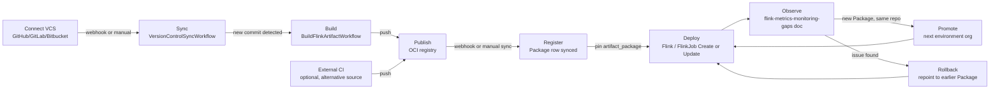
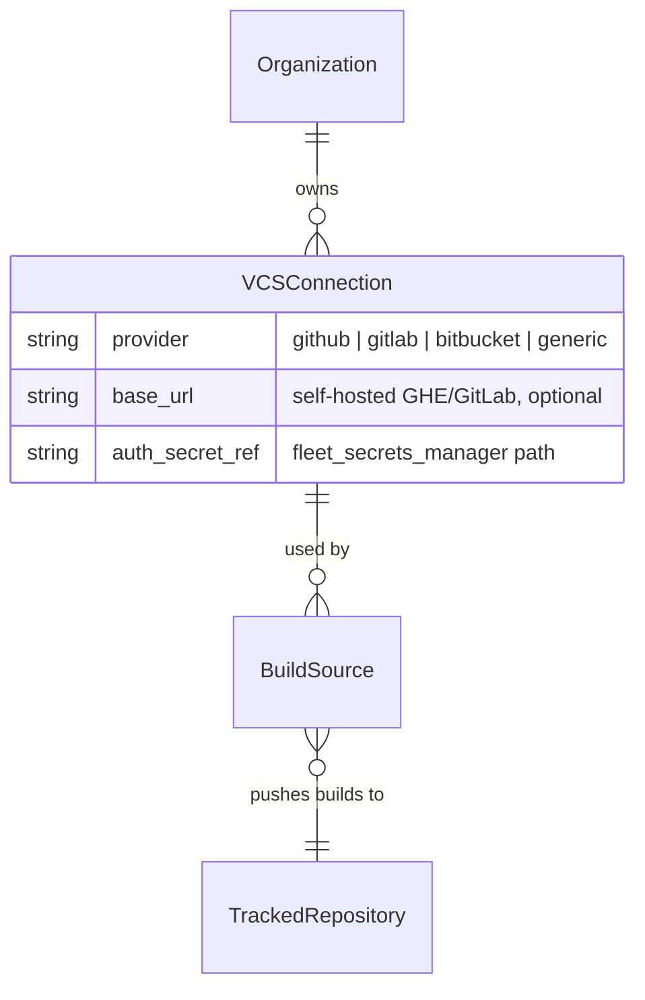
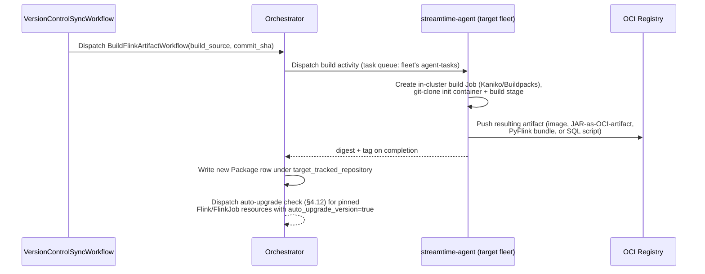
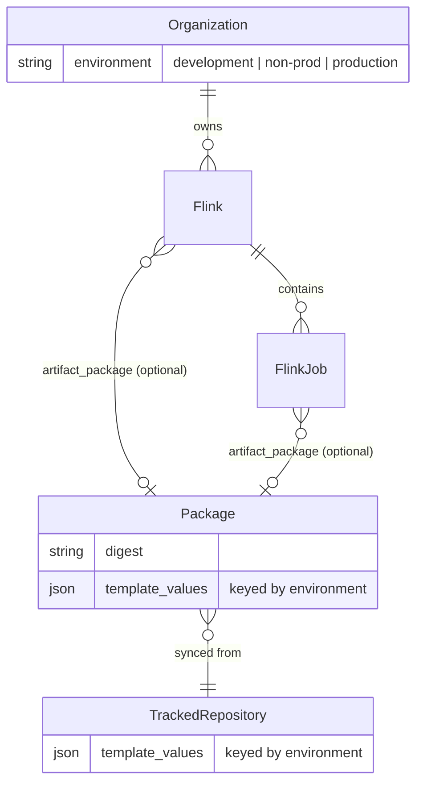
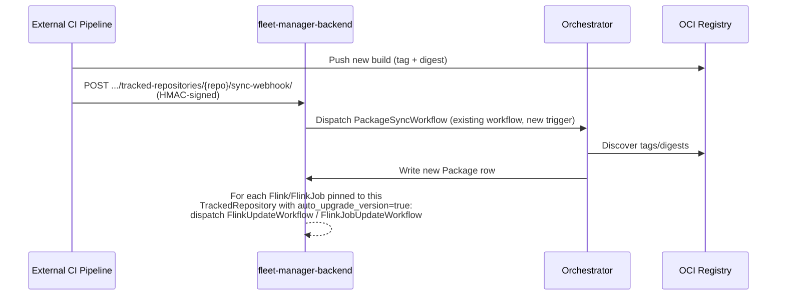
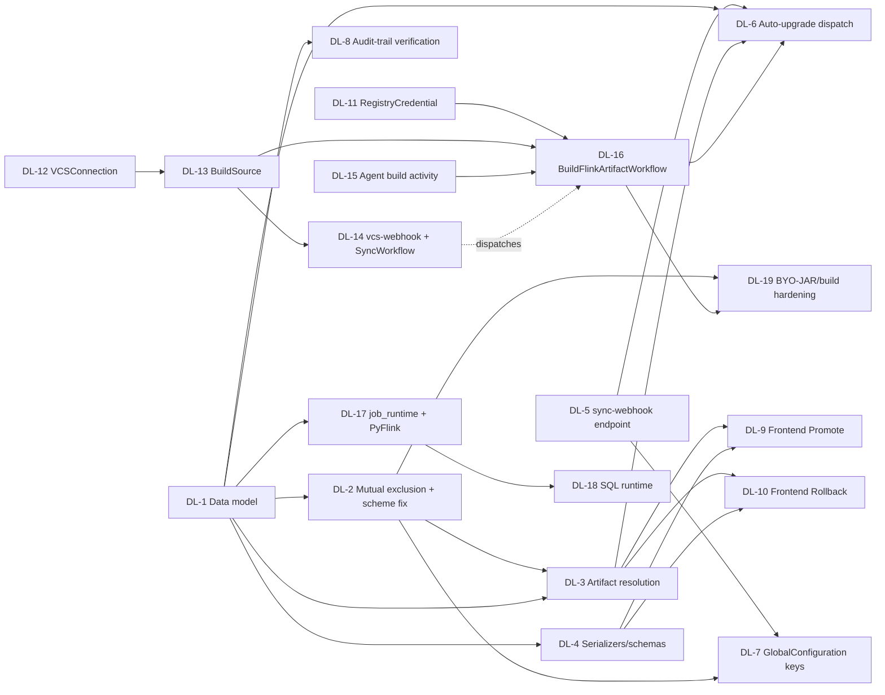

# Technical Design: Flink Development-to-Deployment Lifecycle, VCS-Driven Builds & Multi-Runtime Support

> **Implemented (2026-10):** user-supplied, versioned JAR artifacts with deploy and rollback shipped as *Flink projects* — see [`flink-projects.md`](flink-projects.md) and [`plans/flink-project.md`](https://github.com/streamtime-ai/fleet-manager/blob/main/plans/flink-project.md). It points clusters/jobs at a `FlinkProjectVersion` rather than the generic `artifact_package` sketched here (§4.7), and rollback (§4.11) redeploys an earlier version through the existing update paths.

**Status:** Draft
**Author:** Ashwin Venkatesan
**Last updated:** 2026-09-09
**Roadmap priority:** #3 of 3 — see [`roadmap.md`](./roadmap.md)
**Depends on:** [`units-technical-design.md`](./units-technical-design.md) (§5 data
model — `Flink`/`FlinkJob` as the deploy targets this lifecycle manages)
**Supersedes/absorbs:** `byo-jar-and-pyflink-technical-design.md`, which is now removed. Its
content (Artifact Reference foundation, BYO-JAR hardening, PyFlink support) is fully merged below,
alongside two capabilities that document explicitly scoped out — in-app VCS/build integration and
SQL as a job runtime — because all five converge on the same `TrackedRepository`/`Package`
artifact catalog and the same `artifact_package` reference mechanism. Splitting them across two
documents was only ever an artifact of sequencing (this doc shipped first, deferred items followed
later); now that the deferred scope is expanding to include real build execution, keeping one
document is what keeps the artifact-reference model, promotion, rollback, and auto-upgrade logic
consistent across every artifact *origin* (external CI push, in-app VCS-triggered build, or direct
upload) instead of re-explaining it three times.

---

## 1. Summary

Today, getting a code change into a running Flink job means hand-editing `application_jar` to a
new raw URL and calling Update — no versioning, no provenance, no promotion path across
environments, no rollback beyond remembering the previous URL, and no path from "I have a git repo
with Flink code" to "there's a running job" that doesn't involve a human copying a URL by hand. Job
code is also assumed to always be a JVM JAR — PyFlink and SQL jobs have no representation anywhere
in the schema or charts.

This document designs the full loop:

**connect (VCS) → sync → build → publish → register → deploy → observe → promote → rollback**

reusing the `TrackedRepository`/`Package` OCI catalog (`core/models.py:2758`, `2837+`) that already
exists in this codebase for Helm charts and container images, rather than introducing a parallel
mechanism. Two things are genuinely new relative to the original scope of this document:

1. **In-app build execution.** Rather than only accepting artifacts that some external CI system
   already pushed to a registry, fleet-manager can itself connect to a VCS provider (GitHub/
   GitLab/Bitbucket/self-hosted git), sync a repository, build a Flink artifact (JAR, PyFlink
   bundle, or SQL script) from source, and push the result to a registry it also manages
   credentials for — closing the loop end-to-end instead of assuming a build pipeline exists
   somewhere else. External CI remains fully supported as an alternative path (§4.8) — this is
   additive, not a replacement.
2. **Multi-runtime jobs.** `job_runtime` becomes a three-way selector — `jar` / `python` / `sql` —
   all resolved through the same artifact-reference mechanism, so a SQL script or a PyFlink bundle
   gets the same versioning, promotion, and rollback story a JAR gets today.

Every deploy — regardless of artifact origin or runtime — gets a versioned, digest-backed
reference and a full audit trail for free via `auditlog.register`/`@reversion.register`, already
mandated by CLAUDE.md's model conventions.

## 2. Goals / Non-Goals

**Goals**
- A user can connect a VCS repository (GitHub/GitLab/Bitbucket/self-hosted) to fleet-manager, have
  it synced, and have a Flink artifact built from source and pushed to a registry — without a
  separately-operated CI system being a hard prerequisite.
- A user can point `Flink`/`FlinkJob` at a *versioned artifact* (`Package`), not a raw URL,
  regardless of whether that `Package` was produced by an in-app build or an external CI push.
- The same artifact digest can be promoted across environments (dev → non-prod → production)
  using environment-scoped config that already exists on `TrackedRepository`/`Package`.
- Rollback is "redeploy an earlier `Package`," reusing the existing idempotent Update workflow —
  no new rollback-specific workflow.
- Job code is not restricted to JVM JARs — PyFlink and Flink SQL are first-class `job_runtime`
  options, resolved through the same artifact/build machinery as JAR jobs.
- A user can register credentials for an arbitrary registry (not just the three hardcoded brands
  fleet-manager already knows about) and push both container images and JARs/PyFlink
  bundles/SQL scripts to it — the catalog is already artifact-type-agnostic (§3.2), so this is a
  credentials/registration gap, not a data-model gap.
- Every deploy has an audit trail: which `Package` (digest), built from which commit, which
  org/environment, when, by whom.
- Build execution is durable — a VCS sync or a build that hits a transient network failure
  (git host, registry) retries and resumes rather than silently failing a fire-and-forget call,
  per CLAUDE.md's Temporal conventions.

**Non-Goals**
- A general-purpose, language-agnostic CI/CD pipeline builder. This system builds *Flink
  artifacts* specifically (JAR via Maven/Gradle, PyFlink via a Python package step, SQL via
  validation-and-packaging) — not an arbitrary user-defined pipeline DSL for any workload.
- Git hosting, PR review, or branch management. "VCS integration" here means *cloning a repo at a
  ref to build from it*, not embedding a git client/UI.
- A shared, multi-tenant build farm separate from the target Flink fleet. The default design
  (§4.5) runs builds on the same cluster the job will deploy to, reusing the agent's existing
  in-cluster execution capability rather than standing up new build infrastructure. A dedicated
  build fleet is a valid future evolution but is out of scope here (see Open Questions §11.6).
- BYO-JAR static content scanning/sandboxing beyond runtime pod-security hardening (§4.13) —
  no scanning infrastructure exists anywhere in this codebase for any artifact type, and adding it
  only for Flink is a separate, larger security initiative.
- Blue/green or canary job deployment. Flink's own `upgradeMode` (stateless/savepoint) already
  governs how a redeploy transitions state; this document doesn't add new deployment strategies
  on top of what the Operator supports.
- Full PyFlink feature parity (custom Python environments, native `pip` dependency resolution at
  runtime) — scoped to `pythonFile` + a static `requirements.txt`/archive, matching what the
  Operator CRD actually supports today.

---

## 3. Current State

### 3.1 Artifact reference today

`Flink.application_jar` / `FlinkJob.application_jar` are plain strings
(`flink_schema.py:276-283`, `flink_job_schema.py:132-139`), validated only for non-empty content —
**no scheme allowlist** (contrast `FlinkSavepointStrategySchema.location`, which is validated by
`validate_storage_uri()`, `flink_schema.py:66-77`, against
`s3a://, s3://, gs://, oci://, wasbs://, abfss://, hdfs://, file://`). The chart
(`charts/streamtime-flink/templates/flinkdeployment.yaml:127-130`) passes this string straight
through to the Operator's `job.jarURI`. There is no concept of "version" here at all — redeploying
a new build means overwriting the string and calling Update; the old value isn't retained anywhere
queryable. There is also no `job_runtime` concept anywhere — JAR is the only path the chart
renders.

### 3.2 The `TrackedRepository` / `Package` catalog — the reusable foundation

- `TrackedRepository` (`core/models.py:2882`) tracks an OCI or Helm registry, with
  `template_values` **keyed by environment** (`default`, `development`, `non-prod`, `production`,
  or `openshift` distribution).
- `Package` (`core/models.py:2960+`) is one synced artifact: `registry_url`, `repository`, `tag`,
  **`digest`** (from the registry's `Docker-Content-Digest` header — the integrity primitive),
  `manifest`, `config`, and its own `template_values`. Critically, **nothing in this model
  distinguishes "container image" from any other OCI artifact type** — it's a generic OCI
  Distribution Spec record. This means the requirement "save both images and JARs in the registry"
  is **already satisfied by the existing catalog**: a JAR, a PyFlink bundle (zip), a SQL script,
  or a container image are all just differently-shaped OCI artifacts under the same `Package`
  model. No schema change is needed for artifact-type generality — only for *how many registries
  and credentials* can be registered (§3.5) and *how an artifact gets produced* (§4.5, new).
- Value resolution: `package.default_values → tracked_repository.template_values →
  package.template_values → user chart_values` (`core/services/preset_resolver.py:284-359`) —
  this environment-keyed layering is **already exactly the mechanism environment promotion needs**;
  nothing new has to be built for it (§4.10).
- Sync today is pull-only: `POST /organizations/{org}/tracked-repositories/{repository}/sync/`
  (`core/views/shared/tracked_repositories.py:41`) → `PackageSyncWorkflow`
  (`fleet-manager-orchestrator/workflows/package_sync.py:34`). No webhook exists yet for the
  external-CI path — a new build doesn't become a `Package` row until someone calls `sync/` or a
  cron does (§4.8 closes this).
- `PackageRule` (`core/services/package_rules.py`) already classifies synced versions as
  supported/deprecated/latest by semver/age — reusable as-is for "which builds are OK to deploy"
  policy, and for scoping a `Package` picker to a specific `TrackedRepository` in the rollback UI.

### 3.3 `Organization.environment` — the promotion axis that already exists

`Organization.environment` (`core/models.py:111-115`) is a `CharField` with choices
`development` / `non-prod` / `production`, defaulted per-org. This is the **exact same enum**
`TrackedRepository.template_values` and `Package.template_values` are keyed by
(`core/models.py:2807`, `2951`). In other words: the data model for "this artifact's config
differs by environment" already exists and already lines up with how organizations are typed in
this system — promotion doesn't need a new "Environment" model, it needs the deploy flow to use
`request.organization.environment` when resolving a `Package`'s layered values.

### 3.4 Nearby precedent: `auto_upgrade_version`

CFK has an existing "opt-in auto-redeploy on new version" toggle:
`fm_types/cfk.py:155` / `core/schemas/kafka_advanced_config_schema.py:96`, consumed in
`fleet_workload/cfk.py:719-743`. This is the pattern to mirror for "new `Package` synced → job
auto-updates," rather than inventing new semantics for Flink.

### 3.5 Registry credentials today — narrower than the catalog implies

Verified in `core/services/packages.py:36-65` and `core/views/setup/registry.py:388-448`
(`SetupRegistryView`): registry auth is resolved from `GlobalConfiguration` keys, but only for
**three hardcoded brands** — `ghcr_username/token`, `docker_hub_username/token`,
`quay_username/token` — plus a single global "mirror" registry slot
(`container_registry_url/username/password`) set up during onboarding. There is:
- **No per-`TrackedRepository` credential.** All auth is global, keyed by matching the registry
  hostname string against three known brands.
- **No push credential path at all.** Everything in this file is read/pull-oriented
  (`get_registry_auth_from_env`, `RegistryActivities._make_oci_request` in
  `fleet-manager-orchestrator/activities/registry.py`). There is no code path today that pushes an
  artifact fleet-manager itself produced.
- **Credentials stored as plaintext `GlobalConfiguration` values**, not via `fleet_secrets_manager`
  (Vault-backed) — a pre-existing deviation from CLAUDE.md's "Secrets via `fleet_secrets_manager`
  — never plaintext fields" principle, worth fixing as new credential storage is added rather than
  extending the plaintext pattern (§4.6, §11.7).

This means "get the remote registry details from the user and save it" is **partially already
happening** — but only for well-known pull sources, globally, not for an arbitrary user-registered
push destination. Closing this gap (§4.6) is a prerequisite for step 4 of the requested workflow
(upload a built JAR to a registry).

### 3.6 VCS integration — zero precedent

Confirmed no `github`/`gitlab`/`bitbucket`/git-clone code anywhere in the backend or orchestrator.
The only OAuth concept in the system, `OAuthProvider` (`core/models.py:108`), is org identity/SSO
(OIDC per org) — unrelated to source-control authentication. This is genuinely new surface area
(§4.2–§4.5).

### 3.7 PyFlink and SQL — zero precedent

No `python_file`, `python_requirements`, `pyflink`, or SQL-runner references anywhere in
`core/schemas/flink_schema.py`, `flink_job_schema.py`, or the orchestrator.
`charts/streamtime-flink/templates/flinkdeployment.yaml:127-140` renders only the `job.jarURI`
branch. The Flink Kubernetes Operator's `FlinkDeployment` CRD supports `job.pythonFile` as an
alternative `job.*` field alongside `jarURI`, and the Operator's own examples ship a generic
`SqlRunner` driver JAR that takes a `-Dscript=<path>` argument to execute a `.sql` file as a job —
the CRD-level capability exists for both, this codebase simply never templates either.

---

## 4. Proposed Design

### 4.1 Lifecycle model



Two artifact **origins** feed the same catalog: an in-app VCS-driven build (new, §4.2–§4.5) or an
external CI push (existing design, §4.8). From "Register" onward, the flow is identical regardless
of origin — this is the point of routing both through `TrackedRepository`/`Package` rather than
building separate mechanisms. The genuinely new pieces are: `VCSConnection`, `BuildSource`, the two
new Temporal workflows, generalized registry credentials, and the CI webhook trigger (retained from
the original design). Everything from "Register" onward reuses existing machinery.

### 4.2 VCS Connection model



New model `VCSConnection`:
- `organization` FK, `provider: Literal["github","gitlab","bitbucket","generic"]`, `base_url`
  (optional — self-hosted/GHE), `name` (friendly label).
- `auth_secret_ref` — a reference into `fleet_secrets_manager` (Vault-backed), **not** a plaintext
  field, correcting the pattern noted as a gap in §3.5 rather than repeating it. Holds a PAT or
  GitHub App installation token, matching what other secret-bearing models already do — mirrors the
  precedent in `core/services/kafka_connect_components.py`/`certificate_authority.py`, which
  already use `SecretsManager`/`VaultProviderFactory` for connector/CA secrets.
- Plain CRUD via a new `VCSConnectionViewSet` (`OrganizationMixin`, `BaseADRFModelSerializer`) —
  **no Temporal workflow for the connection record itself**, matching the existing
  `TrackedRepository`/`HelmRepository` pattern: registering a repository is a database write, not
  infrastructure provisioning, so CLAUDE.md's "three workflows per resource" (which governs
  *provisioned* infra) doesn't apply here any more than it applies to `TrackedRepository` today.
- `auditlog.register` + `@reversion.register`, per CLAUDE.md model conventions.

### 4.3 Build Source model

New model `BuildSource` — configures what to build and where to push it:
- `organization` FK, `vcs_connection` FK, `repo_full_name` (e.g. `"org/repo"`), `ref` (branch or
  tag, default `"main"`), `build_context_path` (default `"."`).
- `artifact_kind: Literal["jar","python","sql","image"]` — tells `BuildFlinkArtifactWorkflow` how
  to package the build output (§4.5). `image` is included explicitly because the same build
  pipeline is the natural place to also build container images "for other purposes," per the
  request — the workflow doesn't need to special-case Flink; it detects a `Dockerfile` at the
  build context path the same way it detects a `pom.xml`/`build.gradle`/`setup.py`.
- `build_tool: Literal["auto","maven","gradle","pip","dockerfile"]`, default `"auto"` — auto-detect
  by presence of `pom.xml` → Maven, `build.gradle`/`build.gradle.kts` → Gradle, `setup.py`/
  `pyproject.toml` → pip package step, `Dockerfile` → Kaniko image build. Explicit override
  available for repos with nonstandard layouts.
- `target_tracked_repository` FK(`TrackedRepository`) — **reuses the existing model**; a
  `BuildSource` doesn't need its own registry-connection fields, it just needs to know which
  already-registered `TrackedRepository` (§4.6) receives its output. This is what makes the
  "Register" stage of §4.1 identical for both artifact origins — a build produces a `Package`
  under a `TrackedRepository` exactly the way an external CI push does.
- No `job_runtime`/Flink-resource linkage on `BuildSource` at all — deliberately decoupled. A
  `BuildSource` only knows "build this repo, push to this `TrackedRepository`." Which
  `Flink`/`FlinkJob` picks up the resulting `Package` (and whether it does so automatically) is
  entirely governed by the existing `artifact_package`/`auto_upgrade_version` fields (§4.7, §4.12)
  — a build-produced `Package` is indistinguishable from a CI-pushed one once it lands in the
  catalog, so no new matching/wiring logic is needed on the deploy side.
- Plain CRUD, same reasoning as §4.2 — no workflow for the record itself.

### 4.4 `VersionControlSyncWorkflow` (new, Temporal)

Dedicated durable workflow, separate from the build workflow, because the two have materially
different execution profiles — matching CLAUDE.md's "time p95 manually, use 2–3×" and
"`heartbeat_timeout` = 2× heartbeat interval for activities >30s" guidance, which only makes sense
if sync and build aren't sharing one timeout budget:

- **Trigger**: a VCS provider webhook (push event) on a new endpoint,
  `POST .../build-sources/{id}/vcs-webhook/`, HMAC/signature-verified per-provider (GitHub's
  `X-Hub-Signature-256`, GitLab's token header, etc. — provider-specific verification, same
  external-caller auth posture as the CI webhook in §4.8), or a manual "Sync now" trigger from the
  UI, dispatched via `CommandDispatchService` like every other workflow dispatch in this codebase.
- **What it does**: resolve the latest commit SHA for `BuildSource.ref` via the VCS provider's API
  (using `VCSConnection.auth_secret_ref`), compare against the last-built SHA (tracked via the most
  recent `AgentCommand` row for this `BuildSource`, §4.5 — no new tracking model needed, see
  below), and if changed, dispatch `BuildFlinkArtifactWorkflow` with the resolved SHA as input.
  Cheap, fast (a single API call plus a comparison), sub-30s in the common case — no long-running
  git clone happens here, that's the build workflow's job (§4.5).
- **Idempotency**: re-running sync for a SHA that's already been built is a no-op (check-then-act,
  per CLAUDE.md design principle #4) — safe to re-trigger from a retried webhook delivery.
- **Snapshot at start** (design principle #5): the workflow receives `BuildSource` config and the
  resolved auth secret reference as input at dispatch time; it does not re-fetch from the DB mid-
  workflow.

### 4.5 `BuildFlinkArtifactWorkflow` (new, Temporal) + agent build execution

The heavier, longer-running counterpart to §4.4 — this is the actual "build JAR from repo code"
step (steps 3–4 of the requested feature list).



**Why in-cluster on the target fleet, not a new shared build service:** the streamtime-agent
already runs inside each managed cluster with Helm + K8s execution capability and already performs
OCI pulls for chart/artifact installation (this document's original design reused that exact
mechanism, §4.7 below). Running the build there means arbitrary user build code executes on the
customer's own compute and network, not on shared fleet-manager infrastructure — the same blast-
radius reasoning that already governs where Helm installs happen. This is, however, **new agent
capability, not reuse of an existing one** — there's no existing precedent in `streamtime-agent`
for creating and watching an arbitrary K8s `Job` (only Helm install activities exist today); this
document is explicit that a new agent-side activity is required, not implying it's a drop-in reuse.

- **New agent activity**: create a Kubernetes `Job` in a dedicated `build` namespace (not the
  namespace the Flink cluster itself runs in), using:
  - An init container that clones `BuildSource.repo_full_name` at `commit_sha` using the VCS
    credential (mounted as a K8s `Secret`, sourced from `fleet_secrets_manager` at dispatch time —
    never written to the workflow's own persisted state).
  - A build container appropriate to `BuildSource.build_tool` (Kaniko for `dockerfile`; a Maven/
    Gradle/pip base image running the detected build command otherwise).
  - A push step using the `target_tracked_repository`'s registry credential (§4.6), producing a
    tagged, digest-addressed artifact.
  - `PodSecurity` restricted profile, `NetworkPolicy` scoping egress to the VCS host and the target
    registry only (not arbitrary internet), and resource limits — same defense-in-depth posture
    already recommended for BYO-JAR hardening (§4.13), now applied to the build environment itself
    since it's executing user-controlled build scripts.
  - The orchestrator polls/awaits Job completion via the existing agent-command status mechanism
    (`AgentCommand`, `CommandStatus`) — no new run-tracking model needed; a `BuildFlinkArtifactWorkflow`
    dispatch **is** an `AgentCommand` row, exactly like every other workflow dispatch in this
    codebase, with `command_handler="BuildFlinkArtifactWorkflow"` and `result` holding the produced
    `{registry_url, repository, tag, digest}` on success. This is the row `VersionControlSyncWorkflow`
    (§4.4) checks to determine "has this SHA already been built."
- **Non-Flink artifact kinds** (`artifact_kind="image"`): the same workflow/activity handles a
  generic container image build (no Flink-specific packaging step) — this is what lets "images
  built for other purposes" and Flink JARs share one pipeline and one catalog, per the request,
  without a second build mechanism.
- **Timeouts**: build duration varies widely by project size — no single empirical p95 exists yet
  (unlike other workflows in this codebase, this is genuinely new execution, not a redesign of a
  timed operation). Recommend a generous initial `workflow_execution_timeout` (e.g. 30 min),
  `heartbeat_timeout` on the Job-watch activity at 2× the poll interval, and revisiting once real
  build-time data exists — flagged in Open Questions (§11.1) rather than guessed at here.

### 4.6 Registry credentials, generalized

Closes the gap in §3.5. New model `RegistryCredential`:
- `organization` FK, `tracked_repository` FK (`OneToOneField` — one credential set per registered
  repository; a repository with no `RegistryCredential` falls back to the existing three-brand/
  mirror-slot lookup for backward compatibility with today's pull-only orgs).
- `auth_secret_ref` — again a `fleet_secrets_manager` reference, not a plaintext `GlobalConfiguration`
  value, fixing the deviation noted in §3.5 for *new* credential storage (existing plaintext
  brand/mirror credentials are left as-is; migrating them is a separate cleanup, §11.7).
- Supports push, unlike today's read-only credential resolution — `RegistryActivities`
  (`fleet-manager-orchestrator/activities/registry.py`) gains a push path (currently only
  `_make_oci_request` GET/HEAD call sites exist for manifests/blobs; a `PUT`-based push path,
  following the same OCI Distribution Spec auth flow already implemented for pulls, is new but
  mechanically symmetric to what's there).
- `TrackedRepositoryViewSet` gains create/update handling for the paired `RegistryCredential` (or a
  nested write) so registering a new push-capable registry — "get the registry details from the
  user and save it" — is a single API call from the frontend, not a `TrackedRepository` write plus
  a separate opaque `GlobalConfiguration` edit.

### 4.7 Artifact Reference model

Unchanged from the original design of this document — the foundation everything above produces
input for. Add an optional FK, alternative to the raw-URL field, on both `Flink` (Application mode)
and `FlinkJob`:



- `artifact_package = models.ForeignKey(Package, null=True, blank=True, on_delete=models.PROTECT)`
  — `PROTECT` because a deployed job must not silently lose its artifact if the `Package` row is
  deleted out from under it.
- `Flink.clean()` / `FlinkJob.clean()`: exactly one of `application_jar` (raw URL, now routed
  through `validate_storage_uri()` — closes the zero-scheme-restriction gap as a side effect) or
  `artifact_package` may be set for Application-mode clusters / Job Workspace jobs.
- Resolution to `jarURI` (or `pythonFile`/SQL script path, §4.9) happens backend-side, in
  `FlinkComponentsService`/`FlinkJobComponentsService`, before chart templating: if
  `artifact_package` is set, resolve the layered `template_values` chain **using
  `flink.organization.environment` as the environment key** (§3.3), and resolve the artifact
  itself to wherever the agent's existing OCI-pull-and-mount path places it —
  `local:///data/flink/jars/<name>.jar` (or the runtime-appropriate mount path, §4.9). **No chart
  change required for the JAR case** — the chart still reads `.Values.flink.application_jar`
  verbatim, same as today.

### 4.8 Registration: external CI webhook (alternative artifact origin)

Retained from the original design — this is the path for orgs whose build already happens outside
fleet-manager (Jenkins, GitHub Actions, etc.) and just needs a way to register the result, as
opposed to §4.4/§4.5's in-app build path.



- New action `sync-webhook/` on `TrackedRepositoryViewSet`
  (`core/views/shared/tracked_repositories.py`) — same `PackageSyncWorkflow` dispatch as the
  existing manual `sync/`, gated by an HMAC signature or shared secret (external caller, not an
  authenticated org user).
- New field `auto_upgrade_version: bool` (default `False`) on `Flink` and `FlinkJob`, mirroring
  `fm_types/cfk.py:155` exactly. When `PackageSyncWorkflow` **or** `BuildFlinkArtifactWorkflow`
  (§4.5) produces a new `Package` matching the `(tracked_repository, tag)` a resource is pinned to,
  and `auto_upgrade_version` is `True`, dispatch the existing
  `FlinkUpdateWorkflow`/`FlinkJobUpdateWorkflow` with `artifact_package` repointed. This dispatch
  logic is shared code, not duplicated per artifact origin (§4.12).
- Without `auto_upgrade_version`, the new `Package` is simply selectable in the Update form —
  manual redeploy, identical UX whether the `Package` came from an in-app build or external CI.

### 4.9 Job Runtime: JAR / PyFlink / SQL

**Product framing**: a **Job Runtime** selector, orthogonal to Single-Job vs. Job Workspace mode —
`JAR (Java/Scala)` / `Python (PyFlink)` / `SQL` — surfaced on the Add Job form and the Single-Job
cluster's Advanced Config, per the product/UX framing in
[`units-and-cluster-ux.md`](./units-and-cluster-ux.md) §5c.

**Schema changes** (`flink_schema.py`, `flink_job_schema.py`):
- `job_runtime: Literal["jar", "python", "sql"] = Field(default="jar", ...)`.
- `python_file: Optional[str]` — same shape/validation as `application_jar` (raw URL, scheme
  allowlist, or `artifact_package` reference — a Python file benefits from the same
  Package-catalog treatment a JAR does).
- `python_requirements: Optional[str]` — path/URI to a `requirements.txt`, validated the same way.
- `python_archives: Optional[List[str]]` — matches Operator CRD's `job.pythonArchives` for bundling
  extra Python deps.
- `sql_script: Optional[str]` (**new**) — same raw-URL/`artifact_package`-reference treatment as
  `python_file`. Points at a `.sql` file, either uploaded directly or produced by a
  `BuildSource` with `artifact_kind="sql"` (§4.3) — even though a SQL script needs no real "build"
  step, routing it through the same `Package` catalog keeps versioning/promotion/rollback uniform
  across all three runtimes rather than SQL being a special case.
- `entry_class` (`flink_job_schema.py:148`, JAR-only today) becomes conditionally required: only
  when `job_runtime == "jar"`. Mirrors the visibility-toggle pattern already needed to fix the
  `mode`-based drift flagged in `units-technical-design.md` §6.3 — that fix should land first
  rather than adding a second axis of conditional fields on top of a known-broken first one.

**Chart change** (`charts/streamtime-flink/templates/flinkdeployment.yaml:127-140`):

```yaml
{{- if eq .Values.flink.job_runtime "python" }}
  job:
    pythonFile: {{ .Values.flink.python_file | quote }}
    {{- if .Values.flink.python_requirements }}
    pythonRequirements: {{ .Values.flink.python_requirements | quote }}
    {{- end }}
    {{- with .Values.flink.python_archives }}
    pythonArchives:
      {{- toYaml . | nindent 6 }}
    {{- end }}
    {{- if .Values.flink.parallelism }}
    parallelism: {{ .Values.flink.parallelism }}
    {{- end }}
{{- else if eq .Values.flink.job_runtime "sql" }}
  job:
    jarURI: {{ .Values.flink.sql_runner_jar_uri | quote }}
    args: ["-Dscript={{ .Values.flink.sql_script_mount_path }}"]
{{- else if .Values.flink.application_jar }}
  job:
    jarURI: {{ .Values.flink.application_jar | quote }}
    ... # existing jar branch unchanged
{{- end }}
```

Same additive branching needed in
`charts/streamtime-flink-session-job/templates/flinksessionjob.yaml` for Job Workspace mode jobs.
`sql_runner_jar_uri` is a fixed, operator-configured reference to the Flink Operator's example
`SqlRunner` driver JAR (new `GlobalConfiguration` key, §7) — not something a user builds; it's
shared infrastructure the SQL runtime always uses, with the user-supplied `.sql` script as the only
per-job variable.

**Orchestrator**: no new workflow logic beyond §4.4/§4.5 — `FlinkComponentsService`/
`FlinkJobComponentsService` pass the resolved runtime fields through to chart values exactly as
they do for `application_jar` today; `FlinkCreateWorkflow`/`FlinkJobCreateWorkflow` need no changes
(sizing/config resolution is a backend concern, the orchestrator just re-fetches compute
components, consistent with `units-technical-design.md` §8).

**Explicitly deferred**: native runtime `pip install` of dependencies (Operator CRD doesn't support
this either); custom Python base images beyond what the `flink-python` base image ships; a SQL
runtime that supports anything beyond what a single `SqlRunner`-executed script can express (no
Flink SQL Gateway session/statement-set support in this first cut).

### 4.10 Promotion across environments

Because `Package.template_values` and `TrackedRepository.template_values` are already keyed by
the same `development`/`non-prod`/`production` enum as `Organization.environment`, promotion
needs **no new data model** — it's a UX/workflow pattern on top of §4.7:

1. A build lands in dev org: `Flink` in a `development`-environment org references
   `artifact_package` = `Package{digest: sha256:abc, tag: v1.4.0}` — whether that `Package` was
   produced by `BuildFlinkArtifactWorkflow` (§4.5) or an external CI push (§4.8) is invisible from
   this point forward.
2. Promoting to the next environment = creating (or updating) a `Flink`/`FlinkJob` in a
   `non-prod`-environment org, referencing **the same `Package` row** (same digest — this is the
   guarantee that what gets promoted is byte-identical to what was tested, not a rebuild).
   `FlinkComponentsService`'s value resolution automatically picks up `non-prod`-keyed
   `template_values` instead of `development`-keyed ones for that org — the existing layering
   mechanism (§3.2) does the environment-specific config swap with zero new code.
3. Repeat for `production`.

**New, thin UI/API surface**: a "Promote" action on the Job Workspace / cluster management page
that pre-fills a Create (or Update, if the target already exists) request in a target org with
`artifact_package` copied from the source — a convenience wrapper around the existing Create/
Update endpoints, not a new workflow or new backend concept. `CommandDispatchService`
(`core/command_dispatch.py:597`) dispatch semantics are unchanged; this is a frontend
orchestration of two existing calls (read source resource, dispatch create/update on target org).

### 4.11 Rollback

Rollback is redeploy with `artifact_package` pointed at an earlier `Package` row for the same
`TrackedRepository` — the catalog retains every synced/built version, so "roll back to the build
from last Tuesday" is a `Package` lookup (filtered/sorted via `PackageRule`'s existing
supported/deprecated/latest classification, `core/services/package_rules.py`), not a new
version-history feature. Uses the same `FlinkUpdateWorkflow`/`FlinkJobUpdateWorkflow` as any other
redeploy — no rollback-specific workflow, consistent with CLAUDE.md's "idempotent everything" and
"three workflows per resource, no exceptions" principles.

### 4.12 Auto-upgrade dispatch (unified across artifact origins)

Single piece of dispatch logic, invoked from two triggers:
- `PackageSyncWorkflow` completion (§4.8, external CI-driven).
- `BuildFlinkArtifactWorkflow` completion (§4.5, in-app VCS-driven).

Both write a `Package` row under a `TrackedRepository` and then run the same check: for every
`Flink`/`FlinkJob` with `auto_upgrade_version=True` pinned to that `(tracked_repository, tag)`,
dispatch the existing idempotent Update workflow with `artifact_package` repointed. Implementing
this once (e.g. a shared `core/services/auto_upgrade.py` helper called from both workflow
completions) rather than duplicating it per origin is the direct payoff of decoupling `BuildSource`
from `Flink`/`FlinkJob` in §4.3 — the deploy side never needs to know or care where a `Package`
came from.

### 4.13 BYO Job JAR / build artifact hardening

Building on §4.7 and now also relevant to build-produced artifacts (§4.5):

- **Integrity**: routing uploads through `Package` gives every artifact a `Package.digest`
  (from the registry's content-addressable digest) for free — real integrity verification, not a
  name-based convention. This applies equally to artifacts a user uploaded directly and artifacts
  `BuildFlinkArtifactWorkflow` produced.
- **Access control**: gate raw-URL mode (`application_jar`/`python_file`/`sql_script` as a plain
  string) behind an org-level admin toggle (`GlobalConfiguration` key
  `flink.allow_raw_jar_url`, per CLAUDE.md principle #6). Default `False` for new orgs once a
  catalog path exists, so "paste any URL" becomes an explicit opt-in rather than the only option.
- **Runtime sandboxing** — explicitly *not* solved by artifact-level design alone. Recommend, as
  defense-in-depth:
  - PodSecurity admission / non-root, read-only-root-filesystem TaskManager and JobManager pods —
    and, newly, the same posture for the build `Job` itself (§4.5), since it executes
    user-controlled build scripts, arguably a *higher*-risk surface than a pre-built artifact.
  - `NetworkPolicy` restricting egress from job pods (a user JAR should not need arbitrary outbound
    network access by default) and, for the build `Job`, egress scoped to only the VCS host and the
    target registry.
  - Resource limits already exist via `FlinkResourcesSchema` (`flink_schema.py:43`) — confirm
    they're enforced as K8s `resources.limits`, not just `requests`, in the rendered chart; extend
    the same enforcement to the new build `Job`.
  - Needs sign-off from whoever owns cluster security posture on whether pod-security defaults
    already cover this generically or need Flink/build-specific hardening.
- **Explicitly out of scope**: static artifact content scanning (decompiling/inspecting bytecode
  or build output for malicious patterns) — weak defense-in-depth relative to runtime sandboxing,
  and no scanning infrastructure exists anywhere in this codebase for any artifact type today.

### 4.14 Audit trail

`Flink`/`FlinkJob` already have `auditlog.register` + `@reversion.register` per CLAUDE.md's model
conventions — adding `artifact_package` as a tracked field means every promote/rollback/
auto-upgrade is already captured by existing audit-log infrastructure with zero new logging code.
`Package.digest` on each historical audit entry gives exact byte-for-byte provenance of what was
running at any point in time; for build-produced artifacts, the `AgentCommand` row for the
originating `BuildFlinkArtifactWorkflow` dispatch (§4.5) additionally links that digest back to the
exact `commit_sha` it was built from — full source-to-running-job provenance, not just
artifact-to-running-job.

---

## 5. Data Model Changes

| Model | Field | Type | Notes |
|---|---|---|---|
| `VCSConnection` (**new**) | — | new model | `organization` FK, `provider`, `base_url`, `name`, `auth_secret_ref` (§4.2) |
| `BuildSource` (**new**) | — | new model | `organization`, `vcs_connection` FK, `repo_full_name`, `ref`, `build_context_path`, `artifact_kind`, `build_tool`, `target_tracked_repository` FK (§4.3) |
| `RegistryCredential` (**new**) | — | new model | `organization`, `tracked_repository` FK (1:1), `auth_secret_ref` (§4.6) |
| `Flink` | `artifact_package` | `FK(Package, null=True, blank=True, on_delete=PROTECT)` | Application mode only; mutually exclusive with `application_jar` |
| `Flink` | `auto_upgrade_version` | `bool`, default `False` | mirrors `fm_types/cfk.py:155` |
| `Flink` | `job_runtime` | `Literal["jar","python","sql"]`, default `"jar"` | (**new**, extends the original two-way selector) |
| `Flink` | `python_file` / `python_requirements` / `python_archives` | see §4.9 | conditional on `job_runtime` |
| `Flink` | `sql_script` | `Optional[str]` | (**new**) conditional on `job_runtime == "sql"` |
| `FlinkJob` | same seven fields as `Flink` above | — | Job Workspace jobs get the identical set |

All nullable/defaulted, no backfill — same pattern as `flink_units`/`max_flink_units` in
`units-technical-design.md` §5. Migration: `makemigrations && migrate` inside the backend
container per CLAUDE.md Quick Start.

---

## 6. API / Views / Schema Changes

- `Flink.clean()` / `FlinkJob.clean()`: mutual-exclusion validation across
  `application_jar`/`python_file`/`sql_script`/`artifact_package` per `job_runtime` (§4.7, §4.9);
  raw-URL validators now call `validate_storage_uri()` (closes the scheme-allowlist gap as a
  byproduct); `entry_class` required only when `job_runtime == "jar"`.
- New `VCSConnectionViewSet` (`core/views/shared/vcs_connections.py`, new) — plain CRUD,
  `OrganizationMixin`, `BaseADRFModelSerializer` (§4.2).
- New `BuildSourceViewSet` — plain CRUD, same conventions; new action `vcs-webhook/` dispatching
  `VersionControlSyncWorkflow` (§4.4), and `build/` for a manual "Build now" trigger dispatching
  `BuildFlinkArtifactWorkflow` directly (§4.5).
- `core/views/shared/tracked_repositories.py`: new `sync-webhook/` action on
  `TrackedRepositoryViewSet`, HMAC-authenticated (§4.8); paired `RegistryCredential` create/update
  handling (§4.6).
- `FlinkResponseSchema` / `FlinkJobResponseSchema`: add `artifact_package` (nested minimal
  reference: `id`, `tag`, `digest`), `auto_upgrade_version`, `job_runtime`, `python_file`,
  `python_requirements`, `python_archives`, `sql_script`.
- `FlinkAdvancedConfigView` / new `FlinkJobAdvancedConfigView` (already proposed in
  `units-technical-design.md` §6.4): extend field list with all fields above, visible per the
  mode/runtime rules in §4.9, using whatever mechanism replaces the current hand-written visibility
  toggle (`units-technical-design.md` §6.3 fix).
- New endpoint (or frontend-only orchestration, see §4.10): a "promote" convenience action —
  recommend starting frontend-only (compose existing GET + Create/Update calls) rather than a new
  backend endpoint.

---

## 7. GlobalConfiguration Keys

| Key | Purpose | Default |
|---|---|---|
| `flink.sync_webhook_shared_secret` (or per-`TrackedRepository`, TBD — see Open Questions) | Auth for the external-CI webhook (§4.8) | none — required if webhook enabled |
| `flink.vcs_webhook_verification` (TBD shape — see Open Questions) | Per-provider webhook signature verification config for `vcs-webhook/` (§4.4) | none — required if VCS webhooks enabled |
| `flink.allow_raw_jar_url` | Gate raw-URL `application_jar`/`python_file`/`sql_script` org-wide, nudging toward catalog-based references | `True` initially (non-breaking), flip to `False` default once adoption is confirmed |
| `flink.sql_runner_jar_uri` (**new**) | Shared `SqlRunner` driver JAR reference used by every `job_runtime="sql"` deploy (§4.9) | none — required if SQL runtime is enabled |
| `flink.build_job_timeout_minutes` (**new**) | `workflow_execution_timeout` for `BuildFlinkArtifactWorkflow` until real p95 data justifies a tighter value (§4.5) | `30` |

Per CLAUDE.md's configuration philosophy — operator-tunable, seeded via migration or setup note.
New secret-bearing values (`VCSConnection.auth_secret_ref`, `RegistryCredential.auth_secret_ref`)
go through `fleet_secrets_manager`, **not** `GlobalConfiguration` — per CLAUDE.md's "Secrets via
`fleet_secrets_manager` — never plaintext fields," correcting rather than extending the existing
plaintext-credential pattern noted in §3.5.

---

## 8. Orchestrator / Agent Changes

- **Two new workflow classes** (per explicit request — durable execution for both the sync check
  and the build itself, on separate timeout/retry budgets):
  - `VersionControlSyncWorkflow` (§4.4) — resolve latest commit, compare, conditionally dispatch
    build. Short-lived, frequent (webhook-driven).
  - `BuildFlinkArtifactWorkflow` (§4.5) — clone, build, push, register `Package`, trigger
    auto-upgrade check. Long-lived, infrequent, heartbeats through the agent Job-watch activity.
  - Both follow CLAUDE.md's Temporal conventions: `workflow.logger`, `workflow.sleep()`,
    `workflow.now()`, `workflow.uuid4()`, explicit `workflow_execution_timeout`, snapshot-at-start
    input (no mid-workflow DB/env re-fetch).
  - Neither is a third "Delete" workflow for a provisioned resource in the CLAUDE.md CRUD sense —
    they're operation workflows, the same category `PackageSyncWorkflow` already is (dispatched via
    an action endpoint, not part of a resource's Create/Update/Delete triple). `VCSConnection` and
    `BuildSource` themselves, being plain database records with no infrastructure to provision, get
    no workflows at all (§4.2, §4.3) — consistent with how `TrackedRepository`/`HelmRepository`
    work today.
- **No new workflow classes for deploy/promote/rollback** — `FlinkUpdateWorkflow`/
  `FlinkJobUpdateWorkflow` already exist and are idempotent; auto-upgrade and rollback both dispatch
  them, just with a different `artifact_package` resolved to a different `local://` path.
- **New agent (Go) activity**: create-and-watch a K8s `Job` for the build execution (§4.5) — this
  is genuinely new agent capability (no existing K8s-Job-management precedent in
  `streamtime-agent`, confirmed by search), unlike the OCI-pull-and-mount path this design reuses
  unchanged for artifact *resolution* (deploying an already-built artifact needs no new agent
  code — only *producing* one does).

---

## 9. Rollout Plan

1. **Foundation** (§4.7): `artifact_package` FK + mutual-exclusion validation + scheme-allowlist
   fix; `FlinkComponentsService`/`FlinkJobComponentsService` resolution logic using
   `organization.environment`. Unblocks everything else — the smallest independently-valuable slice.
2. **External CI registration** (§4.8): `sync-webhook/` endpoint + HMAC auth; `auto_upgrade_version`
   field + unified dispatch logic (§4.12). Ships value (versioned, promotable, rollback-able deploys)
   before any in-app build capability exists.
3. **Registry credentials, generalized** (§4.6): `RegistryCredential` model + push-capable
   `RegistryActivities` path — prerequisite for step 4 (in-app build needs somewhere to push to).
4. **VCS connection & build source registration** (§4.2, §4.3): `VCSConnection`, `BuildSource`
   models + CRUD views. No workflow execution yet — just the ability to register "here's my repo
   and where builds should land."
5. **In-app build execution** (§4.4, §4.5): `VersionControlSyncWorkflow`,
   `BuildFlinkArtifactWorkflow`, new agent build activity. The largest and riskiest slice — new
   agent capability, new execution environment, real timeout data doesn't exist yet.
6. **Promotion** (§4.10): frontend "Promote" action wrapping existing Create/Update calls.
7. **Rollback** (§4.11): frontend "Rollback" action — a `Package` picker scoped to the resource's
   `TrackedRepository`, dispatching the existing Update workflow.
8. **Multi-runtime support** (§4.9): `job_runtime` extended to `jar`/`python`/`sql`; chart branches
   in both `flinkdeployment.yaml` and `flinksessionjob.yaml`; frontend Job Runtime selector —
   sequenced after the mode-visibility drift fix (`units-technical-design.md` §6.3) lands, to avoid
   stacking a second conditional-field axis on a known-broken first one. Independent of steps 1–7 —
   can land in parallel once the drift fix is in.
9. **BYO-JAR / build hardening** (§4.13): `flink.allow_raw_jar_url` gate; pod-security/
   `NetworkPolicy` review for both job pods and the new build `Job` — needs security sign-off,
   sequenced last since it hardens surface area introduced by steps 1–8.

Each stage is independently shippable. Steps 1–2 alone already close the scheme-restriction gap and
give every deploy a digest-backed provenance trail, before any build automation or new runtimes
exist.

---

## 10. Story Breakdown (Epic: this design)

This design is treated as one epic; below is the story breakdown with dependencies. Story points
and timeline to be assigned separately.

| ID | Story | Summary | TD ref | Depends on |
|---|---|---|---|---|
| DL-1 | Data model — artifact reference fields & migration | `Flink`/`FlinkJob`: `artifact_package`, `auto_upgrade_version`; migration (nullable/defaulted, no backfill) | §5 | — |
| DL-2 | Model validation — mutual exclusion & scheme-allowlist fix | `Flink.clean()`/`FlinkJob.clean()` enforce exactly one artifact source; raw-URL validators routed through `validate_storage_uri()` | §4.7, §6 | DL-1 |
| DL-3 | Artifact resolution in `FlinkComponentsService`/`FlinkJobComponentsService` | Resolve `artifact_package` to a `local://` path via the agent's existing OCI-pull mechanism; resolve layered `template_values` using `organization.environment` | §4.7 | DL-1, DL-2 |
| DL-4 | Serializer & schema updates | `FlinkResponseSchema`/`FlinkJobResponseSchema` expose all new fields; extend `FlinkAdvancedConfigView`/`FlinkJobAdvancedConfigView` field lists | §6 | DL-1 |
| DL-5 | `sync-webhook/` endpoint (external CI) | New HMAC-authenticated action on `TrackedRepositoryViewSet`, dispatching the existing `PackageSyncWorkflow` | §4.8, §6 | — |
| DL-6 | Auto-upgrade dispatch (unified) | Shared dispatch logic invoked from both `PackageSyncWorkflow` and `BuildFlinkArtifactWorkflow` completion, for every pinned resource with `auto_upgrade_version=true` | §4.12 | DL-1, DL-3, DL-5 |
| DL-7 | `GlobalConfiguration` keys (non-secret) | `flink.sync_webhook_shared_secret`, `flink.allow_raw_jar_url`, `flink.sql_runner_jar_uri`, `flink.build_job_timeout_minutes`; seed migration/setup note | §7 | DL-5, DL-2 |
| DL-8 | Audit-trail verification | Confirm `auditlog`/`django-reversion` correctly capture `artifact_package` FK changes on promote/rollback/auto-upgrade | §4.14 | DL-1 |
| DL-9 | Frontend — "Promote" action | Read source resource, pre-fill Create/Update request in target org with `artifact_package` copied across | §4.10 | DL-3, DL-4 |
| DL-10 | Frontend — "Rollback" action | `Package` picker scoped to the resource's `TrackedRepository` (using `PackageRule` classification), dispatching the existing Update workflow | §4.11 | DL-3, DL-4 |
| DL-11 | `RegistryCredential` model + push-capable registry activities | New model + `fleet_secrets_manager`-backed secret storage; `RegistryActivities` push path (PUT-based, OCI Distribution Spec auth flow) | §4.6 | — |
| DL-12 | `VCSConnection` model + CRUD | New model + secret storage; `VCSConnectionViewSet` | §4.2 | — |
| DL-13 | `BuildSource` model + CRUD | New model, FK to `VCSConnection` and `TrackedRepository`; `BuildSourceViewSet` | §4.3 | DL-12 |
| DL-14 | `vcs-webhook/` endpoint + `VersionControlSyncWorkflow` | Per-provider signature verification; commit-SHA resolution and comparison; conditional build dispatch | §4.4, §6 | DL-13 |
| DL-15 | New agent build activity | K8s `Job` create-and-watch capability in `streamtime-agent` (genuinely new — no existing Job-management precedent) | §4.5, §8 | — |
| DL-16 | `BuildFlinkArtifactWorkflow` | Orchestrator workflow: dispatch build to agent (DL-15), write `Package` row on success, trigger DL-6 | §4.5 | DL-11, DL-13, DL-15 |
| DL-17 | `job_runtime` field + PyFlink chart branch | `job_runtime` enum, `python_file`/`python_requirements`/`python_archives`; chart branches in both charts | §4.9 | DL-1; blocked on `units-technical-design.md` §6.3 mode-visibility fix |
| DL-18 | SQL runtime | `sql_script` field; chart branch using `flink.sql_runner_jar_uri`; `GlobalConfiguration` seed | §4.9, §7 | DL-17 |
| DL-19 | BYO-JAR / build hardening | `flink.allow_raw_jar_url` gate; pod-security/`NetworkPolicy` review for job pods and build `Job` — needs named security owner (§11.4) | §4.13 | DL-2, DL-16 |



Notes:
- DL-1, DL-5, DL-11, and DL-12 have no dependencies and can start in parallel — four independent
  tracks (artifact model, external-CI registration, registry credentials, VCS connections) that
  converge at DL-16.
- DL-3 (artifact resolution) and DL-16 (`BuildFlinkArtifactWorkflow`) are the two pivot stories:
  every frontend action, the auto-upgrade dispatch, and both new runtimes ultimately sit downstream
  of one or the other.
- DL-15 (new agent K8s-Job capability) is the highest-uncertainty story in this breakdown — it's
  new ground for the agent, not a variation on an existing pattern, and should be spiked/timeboxed
  separately before committing to the rest of the build-execution track's estimate.
- DL-17/DL-18 (multi-runtime) are independent of the VCS/build track (DL-11 through DL-16) except
  insofar as a `BuildSource` with `artifact_kind="python"`/`"sql"` needs `job_runtime` to exist on
  the deploy side to be useful — sequencing them in parallel is fine, just land DL-17 before
  wiring a Python-producing `BuildSource` into an actual auto-upgraded `FlinkJob`.
- DL-19 is sequenced last since it hardens surface area introduced by the rest of this epic.

---

## 11. Open Questions

1. **Build timeout/retry budget** — no empirical p95 exists yet for "clone + build + push" across
   arbitrary Flink repos; `flink.build_job_timeout_minutes` (§7) starts as a guess (30 min) and
   needs revisiting once real data exists. Should the timeout be per-`BuildSource`-configurable
   from day one, or a single org-wide default first?
2. **VCS webhook auth mechanism** — GitHub/GitLab/Bitbucket each have their own signature scheme;
   is a per-provider verification module the right shape, or should `generic` git connections
   simply not support webhooks (manual/polled sync only)?
3. **Cross-org promotion authorization** — promoting from a `development` org to a `production`
   org means one actor's action affects a different org's resources. Does this need an explicit
   approval step, or is it gated purely by whether the caller already has write access to both
   orgs (existing `OrganizationMixin` permission checks)?
4. **Pod-security posture ownership for the build `Job`** — confirmed needs a named owner (§4.13)
   before build-execution hardening can be marked done, not just designed. This is a materially
   larger question than the original BYO-JAR-only version of it, since the build `Job` executes
   arbitrary user build scripts, not just a pre-built artifact.
5. **`artifact_package` deletion semantics** — confirmed `PROTECT` blocks deleting a `Package`
   still referenced by a running resource; is a "last known good" fallback needed instead for any
   workflow that prunes old `Package` rows (build-produced `Package` rows will accumulate faster
   than manually-uploaded ones once auto-build-on-push is in use)?
6. **Dedicated build fleet, later** — this design deliberately runs builds on the same cluster the
   job deploys to (§4.5) to avoid standing up new infrastructure. If build volume or isolation
   requirements outgrow that (e.g. an org wants builds to never touch the production cluster's
   compute even transiently), a separate build-fleet concept is a plausible future iteration, not
   designed here.
7. **Plaintext registry-credential migration** — `RegistryCredential` (§4.6) is `fleet_secrets_manager`-
   backed from day one, but the existing three-brand/mirror-slot credentials (§3.5) remain
   plaintext `GlobalConfiguration` values. Is migrating those into the same secret store a
   prerequisite here, or a separately-scoped cleanup?
8. **PyFlink/SQL base image** — does `charts/streamtime-flink` need a `flink-python`-based image
   variant for PyFlink, and does the SQL runtime's driver JAR (`flink.sql_runner_jar_uri`) need to
   be baked into a maintained fleet-manager-owned image, or is it assumed the user's
   `artifact_package`/custom image already bakes in what's needed?
9. **`BuildSource` retention/versioning of build history** — every build produces a new `Package`
   (§4.5); does `PackageRule`'s deprecated/latest classification need tuning specifically for
   build-produced tags (e.g. `<branch>-<short_sha>` doesn't sort the same way semver does), or is
   the existing classification logic sufficient as-is?
