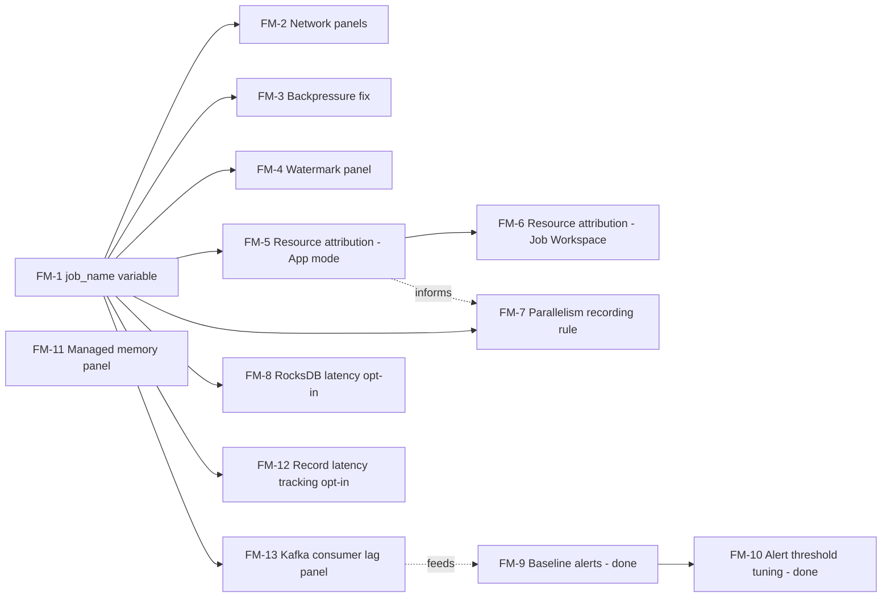

# Technical Design: Flink Metrics Monitoring Gaps

**Roadmap priority:** #2 of 3 — see [`roadmap.md`](./roadmap.md)

> Companion to [`units-technical-design.md`](./units-technical-design.md) and
> [`dev-to-deployment-lifecycle-technical-design.md`](./dev-to-deployment-lifecycle-technical-design.md).
> Grounded
> in an audit of every panel/query currently shipped in
> `charts/fleet-manager-dashboard-flink/dashboards/` (`FlinkOverview.json`, `FlinkJobs.json`,
> `FlinkCheckpoints.json`).

---

## 1. Summary

The current Flink Grafana dashboard chart covers cluster-health basics (TaskManager count, slots,
JVM CPU/heap/GC, job restarts/uptime, record throughput, checkpoint pass/fail and alignment time,
RocksDB cache/compaction pressure) but has no way to attribute any of that to a *specific job* in
a Job Workspace (Session mode) cluster, no network/shuffle visibility, no managed-memory or record
-latency visibility, no Kafka consumer-lag visibility, no operator-level detail, and no alerting
rules at all. This matters beyond dashboard completeness: several of these gaps directly block the
Flink Units (FU) sizing work — you cannot validate or refine an FU sizing formula against metrics
that were never captured — and the consumer-lag gap in particular means there is currently no way
to tell whether a Flink pipeline is keeping up with its source at all.

---

## 2. Goals / Non-Goals

**Goals**
- Close monitoring gaps that block FU sizing validation (per-job resource attribution, network,
  slot/parallelism utilization).
- Add job-level drill-down to a chart that today is namespace-scoped only, matching the reality
  that one Job Workspace cluster runs many `FlinkJob`s.
- Add baseline alerting — none exists today for Flink, unlike (need to confirm) other workload
  dashboards in this repo.
- Do all of this using metrics the Flink runtime and Kubernetes Operator already emit — no new
  custom instrumentation inside user jobs.

**Non-Goals**
- Building a new metrics pipeline/reporter. Flink's built-in `PrometheusReporterFactory`
  (`charts/streamtime-flink/values.yaml:78-79`) stays as-is; this is a Grafana JSON + scrape-config
  design, not a Flink runtime change.
- APM/distributed tracing for job code (out of scope — this is metrics, not traces).
- A general Prometheus/Grafana platform redesign. Scoped to the Flink dashboard chart only.

---

## 3. Current State

### 3.1 What's captured today

| Dashboard | Panels | Metrics |
|---|---|---|
| `FlinkOverview.json` | Registered TaskManagers, Running Jobs, Total/Available Task Slots, JVM CPU Load, JVM Heap Memory, Global Cluster Records Throughput, JVM GC Pause Duration | `flink_jobmanager_numRegisteredTaskManagers`, `flink_jobmanager_numRunningJobs`, `flink_jobmanager_taskSlotsTotal/Available`, `flink_{jobmanager,taskmanager}_Status_JVM_CPU_Load`, `flink_{jobmanager,taskmanager}_Status_JVM_Memory_Heap_{Used,Max}`, `sum(rate(flink_jobmanager_job_task_numRecordsIn/OutPerSecond[5m]))`, `flink_taskmanager_Status_JVM_GarbageCollector_*_Time` |
| `FlinkJobs.json` | Total Job Restarts, Job Uptime, Total Records In/Out, Task Records In/Out per Second, Task Backpressure Time, Buffer Pool Usage | `flink_jobmanager_job_numRestarts`, `flink_jobmanager_job_uptime`, `flink_jobmanager_job_task_numRecordsIn/Out(PerSecond)`, `flink_taskmanager_job_task_backPressuredTimeMsPerSecond`, `flink_taskmanager_job_task_buffers_{in,out}PoolUsage` |
| `FlinkCheckpoints.json` | Completed/Failed Checkpoints, Last Checkpoint Duration/Size, Checkpoint Duration & Alignment Time, State Size Persisted, RocksDB Cache & Memtable Usage, RocksDB Pending Flushes & Compactions | `flink_jobmanager_job_number{Completed,Failed}Checkpoints`, `flink_jobmanager_job_lastCheckpoint{Duration,Size}`, `flink_jobmanager_job_checkpointAlignmentTime`, `flink_taskmanager_job_task_operator_rocksdb_{block_cache_usage,cur_size_all_mem_tables,mem_table_flush_pending,compaction_pending}` |

### 3.2 Structural gaps (confirmed by inspecting the dashboard JSON directly)

- **Only one template variable exists across all three dashboards: `datasource`.** No `namespace`
  picker beyond the raw `$namespace` label match, and critically **no `job_name`/`job_id`
  variable anywhere** — every job-level panel (`FlinkJobs.json`, `FlinkCheckpoints.json`) plots
  *all* jobs superimposed on one graph with no way to isolate one job's series. In Application
  mode (one job per cluster) this doesn't matter; in Job Workspace mode (many `FlinkJob`s per
  `Flink` session cluster, the mode this Units design is being built for) it makes these panels
  close to unusable once more than one or two jobs are running.
- **No Prometheus alerting rules anywhere in the chart** (`grep` for `alert` across
  `charts/fleet-manager-dashboard-flink/` returns nothing) — everything here is dashboards-only,
  visual inspection required to notice a problem.
- **Correction (caught in review): this document originally claimed no `ServiceMonitor`/
  `PodMonitor` CRD exists and that scraping relies on pod annotations — that's wrong.**
  `charts/streamtime-flink/templates/podmonitor.yaml` ships a `PodMonitor`
  (`monitoring.coreos.com/v1`) unconditionally (no `.enabled` gate), and every other workload
  chart in this repo (`fleet-manager-cfk`, `fleet-manager-strimzi`, `streamtime-kafkaconnect`,
  `fleet-manager-infra-shared`) uses the same PodMonitor/ServiceMonitor/PrometheusRule CRD family.
  More conclusively: `core/services/bootstrap_resolver.py:149-158` installs
  `prometheus-community/kube-prometheus-stack` as a **baseline bootstrap component on every
  fleet** (namespace `monitoring`, `install_order: 40`), and a dedicated
  `charts/fleet-manager-prometheus-rules` chart already exists ("Dynamic PrometheusRule resources
  for Fleet Manager editable alert rules") with preloaded defaults
  (`fleet-manager-backend/preload/alert_rules/fleet_kps_defaults.yaml`). **Prometheus Operator is
  a hard assumption across this codebase, not an open question** — the `prometheus.io/scrape`
  annotations in `values-example.yaml:102-103` are just example user-supplied pod annotations
  (harmless belt-and-suspenders), not the actual scrape mechanism. This resolves Open Question #1
  (§9) and unblocks FM-9 (§8) — §4.12's alerting design can proceed via `PrometheusRule`
  unconditionally.
- **cAdvisor/kube-state-metrics are also already available on every fleet** — bundled in the same
  baseline `kube-prometheus-stack` install above. `fm_types/helm_values.py:218` confirms
  `kubeletEndpointsEnabled: Optional[bool] = True` (cAdvisor scraping via the kubelet endpoint is
  on by default), and `charts/fleet-manager-dashboard-fleet/values.yaml` ships pre-built
  `kube-state-metrics`/`node-exporter` dashboards consistent with the stack always being present.
  This resolves Open Question #2 (§9) and unblocks FM-5 (§8) — no new metrics-server/
  kube-state-metrics dependency needs shipping for §4.3's cgroup-join approach.

### 3.3 Metric-category gaps (things Flink's Prometheus reporter emits that no panel uses)

1. **Network/shuffle metrics** — `numBytesInPerSecond`, `numBytesOutPerSecond`, and Flink's
   network buffer metrics (e.g. availability/exclusive buffer counts) are standard Flink
   TaskManager metrics; none are queried anywhere in this chart, despite Network being one of the
   four sizing factors named for Flink Units (throughput, parallelism, state size, network —
   see `units-technical-design.md` §4.1).
2. **Per-job / per-task resource utilization** — the JVM CPU/heap panels in `FlinkOverview.json`
   are cluster-wide aggregates across every TaskManager pod, not attributed to a job or task slot.
   There is no panel answering "how much CPU/memory is *this job* actually using" — which is
   exactly the number needed to validate any proposed FU-to-resource formula against reality.
3. **Parallelism / slot utilization per job** — `FlinkOverview.json` shows cluster-wide
   `taskSlotsTotal`/`taskSlotsAvailable` only. No panel shows a given job's configured parallelism
   against its actual subtask distribution, and no per-job slot-consumption breakdown exists for
   a Job Workspace cluster running multiple jobs against a shared slot pool.
4. **Watermark / event-time lag** — no `currentInputWatermark`/`currentOutputWatermark` panel.
   For streaming SLA visibility (how far behind event-time processing is running) this is a
   standard, cheap-to-add Flink metric that's simply absent today.
5. **Backpressure status, not just duration** — `backPressuredTimeMsPerSecond` exists
   (`FlinkJobs.json`), but Flink's operator-level `isBackPressured`/backpressure-ratio status
   (surfaced via the JobManager REST API, not the metrics reporter, historically) and per-operator
   (not just per-task) backpressure breakdown are absent — the current panel tells you *some*
   backpressure occurred somewhere in the job, not which operator.
6. **RocksDB read/write latency and per-operator state size** — the two RocksDB panels
   (`FlinkCheckpoints.json`) cover cache/memtable usage and pending flush/compaction counts, but
   not `rocksdb_*` read/write latency histograms or a per-operator state-size breakdown — both
   standard when `state.backend.rocksdb.metrics.*` options are enabled in `flink_conf`, none of
   which are currently set (`charts/streamtime-flink/values.yaml`).
7. **Checkpoint failure reason / restart cause** — `numberOfFailedCheckpoints` is a count with no
   accompanying panel surfacing *why* (Flink also emits per-checkpoint failure info via job
   exceptions, typically consumed via the REST API's exceptions endpoint rather than a metric —
   flagged as a possible non-metrics addition, see §4.7).
8. **JVM managed memory usage** — `Status.JVM.Memory.Heap.Used` is covered (§3.1), but
   `Status.Flink.Memory.Managed.Used`/`Managed.Total` (the off-heap pool RocksDB and other managed
   state backends draw from — under `Status.Flink.Memory`, not `Status.JVM.Memory`, see the
   correction in §4.9) has no panel anywhere. This is a distinct failure mode from heap
   pressure — a job can be heap-healthy while its managed-memory pool (and therefore RocksDB) is
   saturated — and is directly relevant to state-size-driven FU sizing (`units-technical-design.md`
   §4.1).
9. **Record/event latency tracking** — Flink's optional latency-marker mechanism
   (`flink_taskmanager_job_latency` histograms, `p50`/`p95`/`p99` quantiles by source/operator) is
   not enabled or queried anywhere. This is distinct from the watermark gap in item 4 above:
   watermark tracks event-time progress, latency tracking measures actual wall-clock time a record
   spends traversing the pipeline. Requires `metrics.latency.interval` to be set in `flink_conf`
   (currently unset, so Flink emits nothing for this today) — non-negligible overhead at high
   parallelism, same opt-in consideration as RocksDB latency metrics (item 6 / §4.7).
10. **Kafka consumer lag** — for any Flink job with a Kafka source, `records-lag-max` (the Kafka
    client consumer metric, exposed by Flink's Kafka connector via its own metric group,
    `flink_taskmanager_job_task_operator_KafkaSourceReader_*` or the older
    `...consumer_records_lag_max` naming depending on connector version) is not queried by any
    panel. This is arguably the single most important SLA/freshness signal for a streaming
    pipeline and is currently invisible — a job can look perfectly healthy on every Flink-runtime
    metric in this chart while falling further and further behind its source. **Correction (caught
    in review): which metric name applies is not something this codebase can pin once** —
    `charts/streamtime-flink/values.yaml:24` only references the base `flink:1.17` image; no
    Kafka connector JAR is baked into the chart anywhere. The connector (and therefore the exact
    metric name) is entirely a function of whichever JAR each user's own Flink job bundles as its
    `application_jar`. §4.11/§4.12 need to handle both names per-job, not wait on a version to
    confirm (see §9 Open Question #5, reframed).

---

## 4. Proposed Design

### 4.1 Add a `job_name` template variable (foundation for everything else)

All Flink job-scoped metrics (`flink_jobmanager_job_*`, `flink_taskmanager_job_task_*`) already
carry a `job_name` label — the dashboards simply never expose a selector for it. Add:

```json
{
  "name": "job_name",
  "type": "query",
  "datasource": "$datasource",
  "query": "label_values(flink_jobmanager_job_uptime{namespace=\"$namespace\"}, job_name)",
  "refresh": 2,
  "multi": true,
  "includeAll": true
}
```

to all three dashboards' `templating.list`, and add `job_name=~\"$job_name\"` to every job-scoped
panel query. This is a pure dashboard-JSON change — no new metrics, no chart/values changes — and
should ship first since every other job-level addition below depends on being able to isolate one
job's series in a multi-job Job Workspace cluster.

**Correction #1 (caught in review, before deploy):** the very first version of this query lacked
any recency bound at all, which risked surfacing every `job_name` label value present in
Prometheus's TSDB index within retention, not just currently-running jobs.

**Correction #2 (caught during live verification, superseding #1):** the fix applied for
Correction #1 — wrapping the selector in a `[10m]` range-vector suffix,
`label_values(flink_jobmanager_job_uptime{namespace="$namespace"}[10m], job_name)` — turned out to
be a real regression, not just an untested assumption, and is **reverted** in the query above.
Verified directly against this fleet's Prometheus once deployed:

```
$ curl -u "$CREDS" --data-urlencode 'match[]=flink_jobmanager_job_uptime{namespace="definite-mollusk"}[10m]' \
    https://.../metrics/api/v1/series
{"status":"error","errorType":"bad_data","error":"invalid parameter \"match[]\": 1:58: parse error: unexpected \"[\""}
```

This Grafana/Prometheus combination passes a `label_values()` template variable's selector straight
through as a literal `match[]` parameter to `/api/v1/series`, which only accepts **instant** vector
selectors — a range-vector suffix like `[10m]` is not valid there and broke the variable (and by
extension every panel on all three dashboards, since Grafana can't populate `$job_name` at all when
its own definition query fails to parse) the moment it was deployed to a live cluster. This is
exactly the kind of thing `helm template`/`helm lint` (used to verify every phase of this design in
isolation) cannot catch, since neither renders or executes the query against a real Prometheus —
only a live deploy surfaced it.

**Corrected approach:** drop the `[10m]` suffix and keep the plain two-argument
`label_values(metric{selector}, label)` form, relying instead on `"refresh": 2` (on time range
change) plus Grafana's own default behavior of scoping a `label_values()` lookup to the dashboard's
currently-selected time range. This doesn't give the same hard "~10 minutes and gone" guarantee the
`[10m]` version aimed for — a dead job stays in the dropdown for as long as the dashboard's time
range window is (e.g., still listed under a "Last 6 hours" view even if the job died 5 hours ago) —
but it's the portable, actually-working mechanism, and it degrades gracefully: picking a tighter
time range window shrinks the same staleness the `[10m]` bound was trying to hard-code. Treat "use
a reasonably tight time range" as the operative guidance in place of a fixed lookback window.

This only ever affected the *variable/dropdown*. Panels driven by an **instant gauge** rather than a
`rate()`/`[5m]`-windowed query — e.g. §4.5's `currentInputWatermark` — can still show a dead job's
last-known value until Prometheus's staleness marker kicks in (~5 min after the last scrape for
that series, generally as soon as the job's pods are gone), independent of whatever the `$job_name`
variable itself resolves to. Panels intended to tolerate wide multi-job "All" selections should
still prefer rate/window-based queries over raw instant values where the underlying metric allows
it, precisely to get Prometheus's automatic staleness handling for free.

Separately, worth being precise about the `.*` ("All") case: Prometheus special-cases a matcher
that's exactly `.*` as "no filter," so selecting All is not inherently *more* expensive than these
dashboards' pre-`job_name`-variable baseline (which already queries every TaskManager subtask
series unfiltered). The cost/noise concern from stale series is real but is now bounded by the
dashboard's time range rather than a hardcoded window, per the corrected approach above.

### 4.2 Network / shuffle panel (new, `FlinkOverview.json` or new `FlinkJobs.json` panel)

```
sum by (job_name) (rate(flink_taskmanager_job_task_numBytesInPerSecond{namespace="$namespace", job_name=~"$job_name"}[5m]))
sum by (job_name) (rate(flink_taskmanager_job_task_numBytesOutPerSecond{namespace="$namespace", job_name=~"$job_name"}[5m]))
```

No `flink_conf` change required — these are default TaskManager I/O metrics, always emitted.
Add a second panel for network buffer pressure (`flink_taskmanager_job_task_buffers_*` already
partially covered, extend with `outputQueueLength`/`inPoolUsage` broken out per-job using the new
`job_name` variable from §4.1).

### 4.3 Per-job resource attribution

Flink's Prometheus reporter does not emit "CPU used by job X" directly — CPU/memory metrics are
process-level (per TaskManager pod), not job-level, because multiple jobs can share a
TaskManager's slots in Job Workspace mode. Two complementary approaches:

- **Slot-proportional estimate (cheap, approximate)**: derive per-job CPU/memory as
  `(job's consumed task slots / TaskManager's total task slots) × TaskManager pod CPU/memory`,
  computed as a Grafana transform or recording rule joining
  `flink_taskmanager_Status_JVM_CPU_Load` with a per-job slot-count metric
  (`flink_jobmanager_job_...` slot allocation isn't directly exposed either — would need to
  derive from `parallelism` at deploy time, which the backend already knows via
  `FlinkResourcesSchema`, §6.4).
- **Container-level cgroup metrics (accurate, requires Kubernetes-side data)**: if pod-level
  `container_cpu_usage_seconds_total`/`container_memory_working_set_bytes` (cAdvisor/kubelet,
  standard on any Kubernetes cluster with metrics-server or kube-state-metrics) are already
  scraped by whatever in-cluster Prometheus exists, join those by pod name — TaskManager pod
  names already encode which `Flink`/`FlinkJob` they belong to
  (`streamtime-agent` Helm release naming). This gives real per-pod CPU/memory without any Flink
  runtime change, but only works cleanly 1:1 for Application mode (one job per set of pods); Job
  Workspace mode still needs the slot-proportional estimate on top since multiple jobs share
  TaskManager pods.

**Recommendation**: ship the cgroup/pod-level join first (Application mode, 1:1, accurate,
reuses metrics that likely already exist in-cluster) and the slot-proportional estimate for Job
Workspace mode as a fast-follow, clearly labeled "estimated" in the panel title so it isn't
mistaken for a precise measurement. Both directly feed FU sizing-formula validation
(`units-technical-design.md` §4.1) — this is the highest-priority gap of the seven, since
without it there's no way to check whether the FU formula's TaskManager-slot-based cost estimate
matches what a job actually consumes.

### 4.4 Parallelism / slot utilization per job

```
flink_jobmanager_job_numRunningJobs{namespace="$namespace"}  # already exists, cluster-wide
```

New: expose per-job parallelism. The JobManager REST API's `/jobs/{jobid}` response includes
`vertices[].parallelism`, but this is **not currently exposed as a Prometheus metric**.

**Correction (caught in review):** the original proxy in this section,
`count by (job_name) (flink_taskmanager_job_task_numRecordsInPerSecond)`, is mathematically wrong,
not just approximate. `numRecordsInPerSecond` is emitted per subtask of every operator in a job's
DAG — `count by (job_name)` sums across *all* operators' subtasks, not one operator's. A job with 5
operators in series at parallelism 4 each returns `count = 20`, not `4`. This isn't a rough-but-close
estimate, it's off by a factor of operator count.

There's a deeper reason a single "job parallelism" query is the wrong shape to begin with: Flink
doesn't require uniform parallelism across a job's operators (per-operator overrides are legal), so
"the job's parallelism" isn't always a single well-defined number in the first place — only "each
operator's parallelism" is. The corrected design drops the single-scalar framing:

```
count by (job_name, task_name) (flink_taskmanager_job_task_numRecordsInPerSecond{namespace="$namespace", job_name=~"$job_name"})
```

with legend `{{task_name}}` — same query shape as the §4.6 per-operator backpressure fix, and one
series per operator rather than one misleading collapsed number per job. Framed correctly, this
panel's value is **detecting drift** between what was configured and what's actually running (e.g.
under an adaptive/reactive scheduler, or after a partial restart), not *sourcing* the configured
parallelism — the backend already knows the configured value directly from
`FlinkAdvancedConfigSchema.parallelism`/`FlinkJobAdvancedConfigSchema.parallelism` with zero
Prometheus derivation needed; Grafana has no clean way to join that backend-DB value into a panel,
so it's out of scope for this dashboard change and should just be documented as "see the job's
Advanced Configuration for the configured value" in the panel description, alongside this
observed-subtask-count panel.

The REST-API-polling alternative from the original design remains available as (b): a small
addition to the agent's existing REST-API polling (the agent already discovers topology at
workflow start, per `CLAUDE.md`'s Agent section) to push per-operator parallelism as a label on an
existing heartbeat/status report, surfaced as a custom low-cardinality gauge — this would give an
exact, not observed-subtask-derived, number, at the cost of new agent code. Recommend (a) first
since it needs zero new code (dashboard panel + optional recording rule only) and is honest about
what it measures; revisit (b) only if the drift signal (a) provides isn't precise enough in
practice.

### 4.5 Watermark / event-time lag

```
min by (job_name) (flink_taskmanager_job_task_currentInputWatermark{namespace="$namespace", job_name=~"$job_name"})
```

Standard Flink metric, always emitted for jobs with event-time semantics (returns `Long.MIN_VALUE`
for jobs without watermarks — panel should filter that out with a `> -9223372036854775000`-style
guard or a "no event-time watermark configured" no-data state). Pure dashboard addition, no chart
change.

### 4.6 Per-operator backpressure

`flink_taskmanager_job_task_backPressuredTimeMsPerSecond` already carries a `task_name` label
(confirmed present on all `flink_taskmanager_job_task_*` metrics) — the current panel just
aggregates across it. Add `by (job_name, task_name)` to the existing query and a legend template
(`{{task_name}}`) instead of adding a new metric — this is a query-shape fix, not a new
instrumentation gap, and should be near-zero effort.

### 4.7 RocksDB latency + per-operator state size

Requires enabling additional `flink_conf` keys not currently set in
`charts/streamtime-flink/values.yaml:78-79`'s block:

```yaml
flink_conf:
  state.backend.rocksdb.metrics.block-cache-usage: "true"    # already effectively covered
  state.backend.rocksdb.metrics.actual-delayed-write-rate: "true"
  state.backend.rocksdb.metrics.num-running-compactions: "true"
```

Flink's RocksDB latency histograms (`rocksdb_*` read/write timing) require
`state.backend.rocksdb.latency-track-enabled: "true"`, which the RocksDB docs flag as
non-negligible overhead — recommend making this **opt-in via `FlinkAdvancedConfigSchema`**
(new field, e.g. `enable_rocksdb_latency_metrics: bool = Field(default=False, ...)`) rather than
on-by-default, so the cost is only paid by clusters actually debugging state-backend performance.
Per-operator state size (as opposed to the current cluster-wide
`flink_jobmanager_job_lastCheckpointSize`) comes from `state.checkpoints.dir` metadata rather than
a metric — flagged as a metrics-adjacent gap, not solvable via Prometheus panels alone (see §5).

### 4.9 JVM managed memory panel (new)

```
flink_taskmanager_Status_Flink_Memory_Managed_Used{namespace="$namespace"} / flink_taskmanager_Status_Flink_Memory_Managed_Total{namespace="$namespace"}
```

**Correction (caught during live verification):** the metric name originally documented here,
`flink_taskmanager_Status_JVM_Memory_Managed_*`, doesn't exist — confirmed by listing every
`flink_taskmanager_Status_JVM_Memory_*` series Prometheus actually has for a live TaskManager
(Direct, Heap, Mapped, Metaspace, NonHeap — no `Managed`). Flink's managed memory pool (RocksDB's
off-heap allocation) is tracked under a *different* top-level metric group,
`Status.Flink.Memory.*`, not `Status.JVM.Memory.*` — "JVM Memory" only covers pools the JVM itself
manages (heap/direct/metaspace/etc.); Flink's own managed-memory allocator is a separate concern
Flink tracks itself, hence the different prefix. Verified the corrected query above returns real
data (`0`, correctly, for a job using the default heap state backend with nothing consuming the
managed pool) against a live cluster.

Standard TaskManager metric, always emitted, no `flink_conf` change needed. Add alongside the
existing JVM Heap panel in `FlinkOverview.json` so managed-memory pressure (RocksDB's off-heap
pool) is visible next to heap pressure rather than only inferred indirectly from the RocksDB
cache/compaction panels in `FlinkCheckpoints.json`.

### 4.10 Record latency tracking (new, opt-in)

Requires enabling in `charts/streamtime-flink/values.yaml`'s `flink_conf` block:

```yaml
flink_conf:
  metrics.latency.interval: "30000"   # ms; unset today, so Flink emits nothing for this metric
```

Once enabled, Flink emits `flink_taskmanager_job_latency` as a histogram per source/operator pair;
query the standard quantiles:

```
histogram_quantile(0.95, sum by (job_name, le) (rate(flink_taskmanager_job_latency_bucket{namespace="$namespace", job_name=~"$job_name"}[5m])))
```

Like RocksDB latency tracking (§4.7), latency markers add measurable overhead at high parallelism
(every record gets a periodic marker injected and timed end-to-end) — make this **opt-in via the
same `FlinkAdvancedConfigSchema` mechanism** as `enable_rocksdb_latency_metrics`, e.g.
`enable_latency_tracking: bool = Field(default=False, ...)`, rather than a chart-wide default.

### 4.11 Kafka consumer lag (new)

For jobs using Flink's Kafka connector as a source, the connector exposes the underlying Kafka
client's `records-lag-max` metric through Flink's metric group hierarchy (metric name varies by
connector version — `KafkaSourceReader.KafkaConsumer.records-lag-max` on the newer
`FLIP-27`-based `KafkaSource`, `Consumer.records-lag-max` on the legacy `FlinkKafkaConsumer`).
No `flink_conf` change required — this is emitted automatically whenever a job has a Kafka source,
same reporter as everything else in this chart.

```
max by (job_name) (
  flink_taskmanager_job_task_operator_KafkaSourceReader_KafkaConsumer_records_lag_max{namespace="$namespace", job_name=~"$job_name"}
  or
  flink_taskmanager_job_task_operator_Consumer_records_lag_max{namespace="$namespace", job_name=~"$job_name"}
)
```

**Correction (caught in review):** the original design flagged the exact metric name as needing
confirmation "against the connector version actually shipped" — but `charts/streamtime-flink`
doesn't ship or pin a Kafka connector version at all (§3.3 item 10); the connector is whatever JAR
each user's own job bundles, and different jobs on the same cluster can use different connector
generations. There's no single version to confirm against, so this can't be resolved as a one-time
lookup — the query above instead `or`-combines both known metric names
(`KafkaSourceReader.KafkaConsumer` for the FLIP-27 `KafkaSource`, `Consumer` for the legacy
`FlinkKafkaConsumer`), so a job using either connector generation is covered without per-job
configuration. A job using a connector whose metric group differs from both known shapes (e.g. a
non-Kafka source misconfigured with this panel, or a future connector rename) simply reports no
data — acceptable given there is no way to know in advance which shape a given job will use. Of
everything in this document, this is the closest to a direct SLA metric ("is this pipeline keeping
up with its source") and arguably deserves its own alert in §4.12's rule set, not just a dashboard
panel.

### 4.12 Baseline alerting rules (implemented)

**Correction (implemented, superseding the original draft below the line):** this section
originally proposed a static `PrometheusRule` CRD with `GlobalConfiguration`-backed thresholds.
Once FM-9/FM-10 were actually scoped for implementation, tracing the codebase's existing
alert-rules subsystem (`core/services/alert_rules.py`, `core/services/alert_rule_catalog.py`,
`core/views/kafka/alert_rules.py`, `AlertRuleSet`/`AlertRule` models) showed Kafka and ClickHouse
already have a materially different, more capable mechanism — catalog-seeded defaults that are
individually editable per-org afterward via a REST API
(`PATCH .../alert-rules/{alertname}/`, `AlertRuleUpdate.expr`), with zero `GlobalConfiguration`
involvement anywhere in that subsystem. Implemented Flink the same way rather than inventing a
parallel `GlobalConfiguration`-threshold mechanism specific to Flink:

- `AlertRuleSetScope.FLINK` added (`fleet | kafka | clickhouse | flink`, 4-way XOR
  `CheckConstraint` on `AlertRuleSet`), same shape as the other three scopes.
- New catalog file `preload/alert_rules/flink_open_source_defaults.yaml` carries the same seven
  alerts as the table below, with the "configurable threshold" placeholders resolved to concrete
  starting defaults (checkpoint duration: 60s, consumer lag: 10,000 records) — these are
  **editable per-org after seeding**, not fixed. An operator changes a threshold by calling
  `PATCH .../organizations/{org}/flink/{id}/alert-rules/{alertname}/` with a new `expr` —
  exactly how a Kafka operator tunes `KafkaRunningOutOfSpace`'s `< 15` threshold today.
- Full CRUD surface mirrors Kafka's exactly: `GET/POST .../flink/{id}/alert-rules/`,
  `PATCH/DELETE .../alert-rules/{alertname}/`, plus `ensure/`, `apply/`, `apply-payload/`,
  `apply-complete/`, `status/`, `cluster-snapshot/`, `validate/`, `reset-defaults/` — see
  `core/views/flink/alert_rules.py`.
- `apply/` dispatches the existing `ApplyAlertRulesWorkflow` (orchestrator), which installs the
  `fleet-manager-prometheus-rules` chart via Helm — no new workflow class, matching every other
  scope. `PrometheusRule` CRD generation happens inside that existing chart, not a new one.

The seven alerts (unchanged from the original design):

| Alert | Expression (sketch) | Severity |
|---|---|---|
| `FlinkJobRestartingRepeatedly` | `increase(flink_jobmanager_job_numRestarts[15m]) > 3` | warning |
| `FlinkCheckpointFailing` | `increase(flink_jobmanager_job_numberOfFailedCheckpoints[10m]) > 0` | warning |
| `FlinkCheckpointDurationHigh` | `flink_jobmanager_job_lastCheckpointDuration > 60000` (editable per-org) | warning |
| `FlinkNoAvailableTaskSlots` | `flink_jobmanager_taskSlotsAvailable == 0` | warning (Job Workspace: blocks new `FlinkJob` capacity) |
| `FlinkTaskManagerHeapPressure` | `flink_taskmanager_Status_JVM_Memory_Heap_Used / flink_taskmanager_Status_JVM_Memory_Heap_Max > 0.9` | critical |
| `FlinkJobBackpressured` | `flink_taskmanager_job_task_backPressuredTimeMsPerSecond > 800` (sustained, `for: 5m`) | warning |
| `FlinkKafkaConsumerLagHigh` | `(flink_taskmanager_job_task_operator_KafkaSourceReader_KafkaConsumer_records_lag_max or flink_taskmanager_job_task_operator_Consumer_records_lag_max) > 10000` (sustained, `for: 10m`, editable per-org) | warning |

Verified live end-to-end: created a real Flink cluster, `GET .../alert-rules/` seeded all 7 rules
from the catalog, `PATCH`'d `FlinkCheckpointDurationHigh`'s threshold and confirmed it persisted,
exercised `validate/`/`status/`/`reset-defaults/`/installed-components, and confirmed deleting the
Flink cluster cascades to remove its `AlertRuleSet`/`AlertRule` rows with no orphans.

---

## 5. Explicitly not solvable via Prometheus metrics alone

- **Checkpoint failure *reason*** — comes from the JobManager REST API's exceptions endpoint or
  job logs, not a metric. Would need the agent (which already talks to the K8s/Operator surface)
  to poll and surface this, or route through log-based alerting (Loki, already present per
  `monitoring/` in this repo) instead of Prometheus.
- **Per-operator state size** — derivable from checkpoint metadata files, not a running metric.
- **Job source code / DAG-level attribution** — none of this ties a metric back to which operator
  in a job's logical plan is the bottleneck beyond `task_name`; full DAG visualization is a Flink
  Web UI feature (already reachable via `FlinkWebUISchema`, `flink_schema.py:115`), not something
  to duplicate in Grafana.

---

## 6. Data Model / Schema Changes

| Model | Field | Purpose |
|---|---|---|
| `Flink` (advanced config) | `enable_rocksdb_latency_metrics: bool`, default `False` | opt-in per §4.7, avoids blanket overhead |
| `Flink` (advanced config) | `enable_latency_tracking: bool`, default `False` | opt-in per §4.10, avoids blanket overhead |
| `AlertRuleSetScope` | `FLINK = "flink"` added | new scope value alongside `fleet`/`kafka`/`clickhouse`, §4.12 |
| `AlertRuleSet` | `flink: FK(Flink, null=True, blank=True, on_delete=CASCADE)` | 4-way XOR `CheckConstraint`, `unique_alert_rule_set_per_flink`, §4.12 |
| `InstalledComponent` | `flink: FK(Flink, null=True, blank=True, on_delete=CASCADE)`; `flink_workload` component type | drift-detection bookkeeping for Flink Helm releases, §4.12 |

No `GlobalConfiguration` keys were added for alert thresholds — see the correction in §4.12. Alert
thresholds are per-org editable rows (`AlertRule.expr`) seeded from
`preload/alert_rules/flink_open_source_defaults.yaml`, the same mechanism Kafka/ClickHouse already
use, not a `GlobalConfiguration`-backed mechanism.

No changes to `FlinkJob`/`Flink` core sizing fields — this document is metrics/observability only,
independent of the FU data-model changes proposed in `units-technical-design.md` §5.

---

## 7. Rollout Plan

1. **§4.1 `job_name` variable** — dashboard-JSON only, ships first, unblocks everything job-scoped.
2. **§4.2 Network panels, §4.6 per-operator backpressure query fix, §4.9 Managed memory panel** —
   dashboard-JSON only, no chart/schema changes, cheap wins, ship together.
3. **§4.5 Watermark panel** — dashboard-JSON only.
4. **§4.11 Kafka consumer lag panel** — dashboard-JSON only; the `or`-combined query (§4.11) covers
   both known connector metric-name shapes, so this doesn't wait on anything. Highest-value
   addition in this document given it's the closest thing to a direct freshness/SLA signal.
5. **§4.3 Per-job resource attribution** — start with the cgroup/pod-level join (Application
   mode); cAdvisor/kube-state-metrics data is already available in-cluster via the baseline
   `kube-prometheus-stack` install (§3.2), so no new instrumentation dependency to add. Slot-
   proportional estimate for Job Workspace mode as fast-follow. **Highest priority for FU sizing**
   — this is what actually lets the FU sizing formula be validated against real usage.
6. **§4.4 Parallelism recording rule** — after §4.3, lower urgency.
7. **§4.7 RocksDB latency, §4.10 Record latency tracking** — schema fields (`enable_rocksdb_latency_metrics`,
   `enable_latency_tracking`) + `flink_conf` wiring, both opt-in given measured overhead.
8. **§4.12 Alerting rules (incl. consumer lag)** — Prometheus Operator is a confirmed baseline on
   every fleet (§3.2), so `PrometheusRule` CRDs are usable unconditionally; ship the seven baseline
   alerts with no scraping-pattern precondition to resolve first.

---

## 8. Story Breakdown (Epic: this design)

This design is treated as one epic; below is the story breakdown with dependencies. Story points
and timeline to be assigned separately.

| ID | Story | Summary | TD ref | Depends on |
|---|---|---|---|---|
| FM-1 | `job_name` template variable | Add `job_name` template variable to all three dashboards; add `job_name=~"$job_name"` to every job-scoped panel query | §4.1 | — |
| FM-2 | Network / shuffle panels | New panels for `numBytesInPerSecond`/`numBytesOutPerSecond` and network buffer pressure, per job | §4.2 | FM-1 |
| FM-3 | Per-operator backpressure query fix | Add `by (job_name, task_name)` + legend template to the existing backpressure panel | §4.6 | FM-1 |
| FM-4 | Watermark / event-time lag panel | New panel on `currentInputWatermark`, filtering the no-watermark sentinel value | §4.5 | FM-1 |
| FM-5 | Per-job resource attribution — Application mode | cAdvisor/kube-state-metrics pod-level CPU/memory join, keyed by TaskManager pod name | §4.3 | FM-1 (unblocked — cAdvisor/kube-state-metrics confirmed already available via the baseline `kube-prometheus-stack` install, §3.2) |
| FM-6 | Per-job resource attribution — Job Workspace mode | Slot-proportional CPU/memory estimate, clearly labeled "estimated" | §4.3 | FM-1, FM-5 (fast-follow) |
| FM-7 | Per-operator subtask-count panel | `count by (job_name, task_name)` panel showing observed running subtasks per operator (drift signal, not a job-level parallelism scalar — corrected from an earlier, mathematically incorrect `count by (job_name)` proxy) | §4.4 | FM-1; benefits from FM-5/FM-6 |
| FM-8 | RocksDB latency metrics — opt-in | New `enable_rocksdb_latency_metrics` field on `FlinkAdvancedConfigSchema`; `flink_conf` wiring; cache/memtable/compaction panels extended with latency histograms | §4.7, §6 | FM-1 |
| FM-9 | Baseline alerting rules — **done** | Seven alerts (job restarts, checkpoint failures/duration, no available slots, heap pressure, backpressure, consumer lag) seeded from `preload/alert_rules/flink_open_source_defaults.yaml` via the existing `AlertRuleSet`/`AlertRule` subsystem (`AlertRuleSetScope.FLINK`), applied through the existing `fleet-manager-prometheus-rules` chart and `ApplyAlertRulesWorkflow` — no new chart, no new workflow | §4.12 | FM-13 for the consumer-lag alert specifically (unblocked — Prometheus Operator confirmed baseline on every fleet, §3.2) |
| FM-10 | Alert threshold tuning — **done, mechanism changed** | Reframed from `GlobalConfiguration` keys to the existing per-org editable-rule mechanism (`PATCH .../flink/{id}/alert-rules/{alertname}/`) — matches how Kafka/ClickHouse thresholds are already tuned; no `GlobalConfiguration` keys added | §6 | FM-9 |
| FM-11 | Managed memory panel | New panel on `Status.Flink.Memory.Managed.{Used,Total}` (corrected from an initially-wrong `Status.JVM.Memory.Managed` name) alongside the existing Heap panel | §4.9 | — |
| FM-12 | Record latency tracking — opt-in | New `enable_latency_tracking` field on `FlinkAdvancedConfigSchema`; `metrics.latency.interval` wiring; new latency-quantile panel | §4.10, §6 | FM-1 |
| FM-13 | Kafka consumer lag panel | New panel on connector `records-lag-max`, per job — `or`-combined query covers both `KafkaSource`/`FlinkKafkaConsumer` metric-name shapes rather than waiting on a version to confirm (§9, reframed) | §4.11 | FM-1 |



Notes:
- FM-1 is the single foundation story — every other job-scoped panel depends on it, so it should
  ship first (matches Rollout Plan §7 step 1).
- FM-5, FM-9, and FM-13 were previously flagged as blocked on open questions (§9, items 1, 2, 5).
  All three are now resolved from existing code (Prometheus Operator and cAdvisor/kube-state-
  metrics are both confirmed-available baseline infrastructure on every fleet, §3.2; the consumer-
  lag metric-name question turned out to have no single version to confirm at all, since
  `charts/streamtime-flink` doesn't pin a connector — handled instead via an `or`-combined query,
  §4.11) — none of the three carry an engineering-blocking open question anymore.
- FM-2, FM-3, FM-4, FM-11 are independent of each other and of the rest of the backlog — cheap,
  parallelizable dashboard-only wins.
- FM-13 (Kafka consumer lag) is called out as the highest-value single addition in this backlog —
  it's the closest thing to a direct pipeline-freshness/SLA signal and currently has zero
  visibility.

---

## 9. Open Questions

Items 1, 2, and 5 below were resolved by inspecting the existing codebase rather than requiring a
product/infra decision — kept here (marked **Resolved**) for traceability rather than deleted,
since the story table (§8) and rollout plan (§7) both cite them as having been blockers.

1. **~~Which in-cluster Prometheus flavor do BYOK/cloud fleets actually run?~~ — Resolved.**
   `core/services/bootstrap_resolver.py:149-158` installs `prometheus-community/kube-prometheus-
   stack` as a baseline bootstrap component on every fleet, and `charts/streamtime-flink/templates/
   podmonitor.yaml` already ships an unconditional `PodMonitor`. Prometheus Operator is confirmed,
   not annotation-based scraping — see the corrected §3.2. §4.12's alerting design and §4.3's
   cAdvisor-join approach are both unblocked.
2. **~~Is cAdvisor/kube-state-metrics data already scraped on every target cluster?~~ — Resolved.**
   Yes — bundled in the same baseline `kube-prometheus-stack` install, with
   `kubeletEndpointsEnabled: True` by default (`fm_types/helm_values.py:218`). No new
   metrics-server/kube-state-metrics dependency needs shipping.
3. **Does per-job resource attribution belong in Grafana at all**, or should the "estimated FU
   consumption vs. allocated FU" comparison instead be a first-class field surfaced directly in
   the Fleet Manager UI (Job Workspace management page), computed backend-side from the same
   metrics rather than left as a dashboard-only artifact? This overlaps with the live
   sizing-preview idea already raised in `units-and-cluster-ux.md` §4 — checked that section
   directly; it's explicitly labeled "not yet scoped" there too, so there's no existing product
   direction to lean on. **Still open — a product decision, not resolvable from code.**
4. **RocksDB latency-tracking overhead** — needs an actual benchmark (CLAUDE.md's "time p95
   manually, use 2-3x" empirical-timeout principle applies in spirit here too) before deciding the
   default should stay opt-in vs. becoming safe-enough to default on. The same question applies to
   §4.10's record latency tracking (`metrics.latency.interval`). **Still open — needs a real
   benchmark run, not resolvable by reading code.**
5. **~~Exact Kafka consumer-lag metric name~~ — Resolved, but not the way originally framed.**
   The premise was wrong: `charts/streamtime-flink` doesn't pin a Kafka connector version at all
   (`values.yaml:24` only references the base `flink:1.17` image) — the connector is whatever JAR
   each user's own job bundles, so there's no single version to confirm against, ever. §4.11's
   query and §4.12's alert now `or`-combine both known metric-name shapes
   (`KafkaSourceReader.KafkaConsumer` and `Consumer`) instead of waiting on a lookup that can't
   resolve to one answer.
