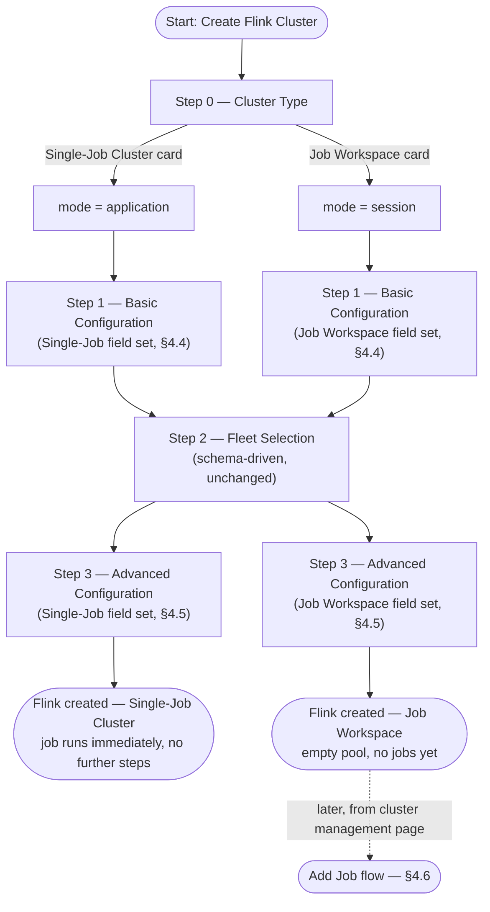
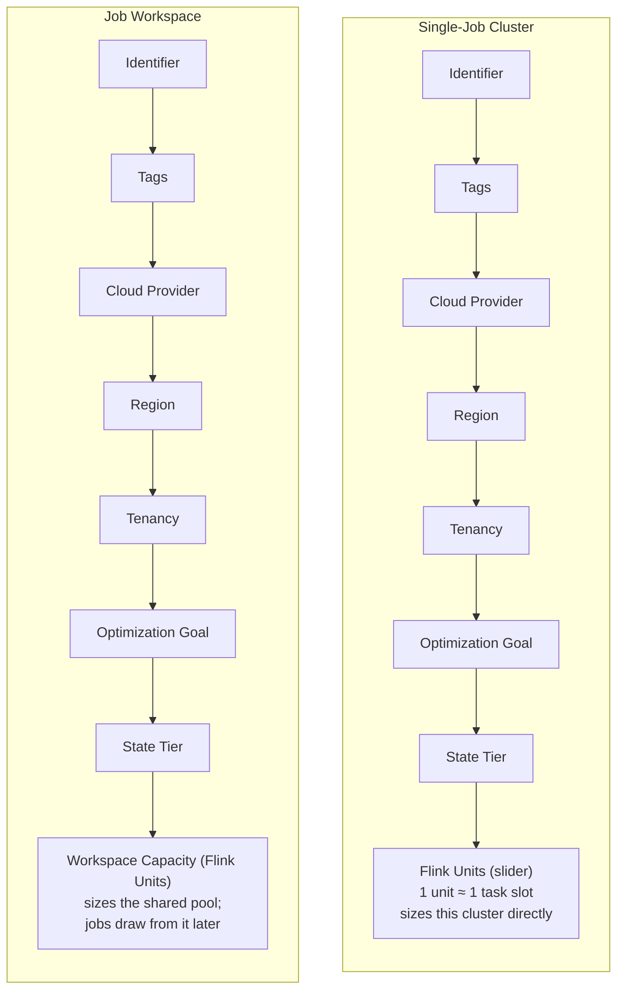
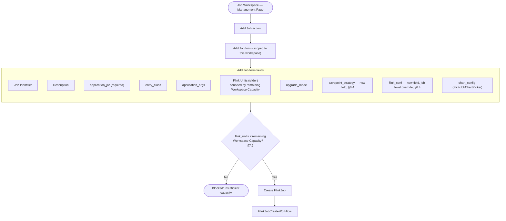
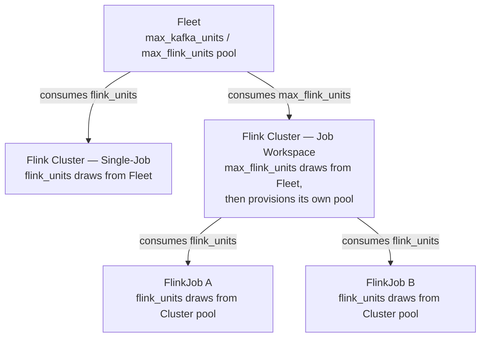
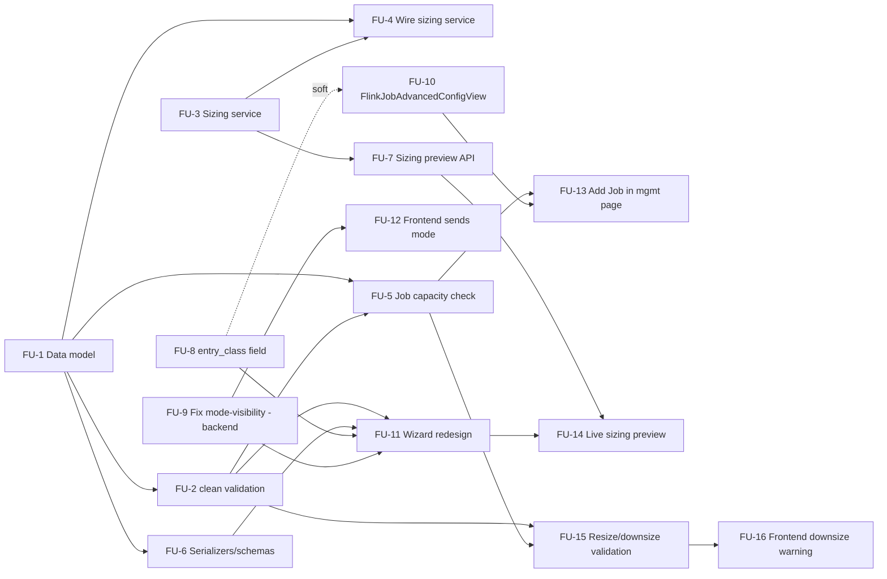

# Technical Design: Flink Units & Flink Cluster/Job Provisioning

**Status:** Draft
**Author:** Ashwin Venkatesan
**Last updated:** 2026-09-02
**Companion doc:** `docs/flink/units-and-cluster-ux.md` (product/UX discussion this design implements)
**Roadmap priority:** #1 of 3 — see [`roadmap.md`](./roadmap.md)
**See also:** [`metrics-monitoring-gaps-technical-design.md`](./metrics-monitoring-gaps-technical-design.md) (Grafana dashboard gaps, incl. per-job resource attribution needed to validate FU sizing)

---

## 1. Summary

Introduce **Flink Units (FU)** as a capacity/sizing abstraction for Flink cluster and job
provisioning, analogous in spirit to Kafka Units (`Kafka.kafka_units`), and use it to drive a
redesigned cluster-creation and job-submission UX split across two cluster modes: **Single-Job
Cluster** (`mode="application"`) and **Job Workspace** (`mode="session"`).

Unlike Kafka, Flink today has **no sizing computation and no plugin architecture** — this design
adds both, scoped to what currently exists rather than retrofitting the `fleet_workload`/
`BaseWorkloadProvider` abstraction Kafka uses (see §3.4 for why, and §9 for the alternative
considered).

---

## 2. Goals / Non-Goals

**Goals**
- Define `flink_units` as a first-class, unit-based capacity dial for TaskManager compute.
- Replace today's zero-derivation passthrough (`jobmanager_resources`/`taskmanager_resources`
  taken verbatim from user input) with a real sizing function.
- Support the two-level allocation model: Fleet → Flink cluster (pool) → FlinkJob (per-job draw,
  Job Workspace mode only).
- Redesign cluster-creation and job-submission UX to be consistent with the existing Kafka
  cluster wizard's field pattern.
- Fix the mode-based field visibility drift between frontend and backend (see §6.3).

**Non-Goals (this design)**
- Migrating Flink onto the `fleet_workload`/`BaseWorkloadProvider` plugin architecture wholesale
  — considered and deferred (§9).
- Direct JAR upload, PyFlink support, and VCS-backed redeploy — tracked separately, see
  [`roadmap.md`](./roadmap.md).

---

## 3. Current State (as of this writing)

### 3.1 Data model

- `Flink` (`core/models.py:3354-3480`): `mode` (`application`|`session`), `fleet` FK (nullable),
  `advanced_configuration` (`SchemaField(FlinkAdvancedConfigSchema)`), `provider` —
  `PROVIDER_CHOICES = [('open-source', 'Open Source')]` (line 3364-3367, hardcoded, comment notes
  "Reserve for future providers"), `ui_url`, `status`.
- `FlinkJob` (`core/models.py:3484-3576`): `flink` FK (`on_delete=CASCADE`, `related_name=jobs`),
  `unique_together=('flink','identifier')`, `advanced_configuration`
  (`SchemaField(FlinkJobAdvancedConfigSchema)`), `status`.
- **No `flink_units` field exists on either model today.**
- No `Flink.max_flink_units` or equivalent capacity-pool field exists.

### 3.2 Schemas (`core/schemas/flink_schema.py`, `flink_job_schema.py`)

- `FlinkAdvancedConfigSchema`: `application_jar` (optional, docstring-only convention for
  application mode, **not enforced by a model validator tied to `mode`** — `mode` lives on the
  outer `FlinkCreateSchema`, not this nested schema), `application_args`, `parallelism` (default
  1), `upgrade_mode`, `savepoint_strategy`, `web_ui`, `security`, `flink_conf`, `jobmanager`
  (free-form dict), `jobmanager_resources`, `taskmanager` (free-form dict),
  `taskmanager_resources`, `taskmanager_replicas` (default 1), `chart_config`, `extraVolumes*`.
  No `entry_class` field.
- `FlinkJobAdvancedConfigSchema`: `application_jar` (**required**), `entry_class` (present here
  only), `application_args`, `parallelism`, `upgrade_mode`, `savepoint_strategy`, `flink_conf`
  (job-level overrides), `chart_config`. No `web_ui`/`security`/`jobmanager*`/`taskmanager*` —
  these are cluster-scoped only.

### 3.3 Sizing — confirmed absent

- No `flink_sizing.py` or `flink_workload_charts.py` exists (contrast:
  `core/services/kafka_sizing.py`, `core/services/kafka_workload_charts.py`).
- `core/services/flink_components.py::FlinkComponentsService._build_runtime_values` reads
  `jobmanager_resources`, `taskmanager_resources`, `taskmanager_replicas` **verbatim from
  `advanced_configuration`** and promotes them into Helm chart value paths — no computation, no
  unit-based derivation, no lookup table.
- `FlinkSizingPreviewView` (`core/views/flink/config.py:39-58`) is a **stub** — returns a flat
  `base_cost: 50.0` regardless of input.

### 3.4 No plugin architecture

- `grep -i flink fleet_manager/settings.py` → zero matches. No `FLINK_CLUSTER_PROVIDERS`.
- No `fleet_workload/flink.py`; nothing implements `BaseWorkloadProvider` for Flink.
- The "Provider" dropdown in `FlinkCreate.js` (`DEFAULT_FLINK_SKUS`, lines 465-479) is a
  **hardcoded frontend constant** — a single `OpenSourceFlink` entry, not backend-fetched.
- `FlinkCloudProvidersListView` (`core/views/flink/config.py:26-35`) calls
  `list_kafka_cloud_provider_options()` (`core/services/org_option_controls.py:144-171`) — **the
  same Kafka-named function**, iterating `settings.CLOUD_PROVIDERS` generically. There is no
  Flink-specific cloud-provider registry.
- `Flink`/`FlinkJob` are plain `models.Model` — no relationship to `fleet_workload` or
  `BaseWorkloadProvider` anywhere in the codebase.

### 3.5 Advanced Configuration schema builder — mode-visibility drift

`FlinkAdvancedConfigView._post_sync` (`core/views/flink/config.py:139-273`) is a **hand-written
JSON Schema dict**, not derived from the Pydantic model (contrast: CFK's
`get_advanced_configs()` builds from `CFKAdvancedConfig.model_json_schema()`). It reads
`mode = data.get("mode", "application")` (line 149) to conditionally include
`application_jar`/`application_args`. **`FlinkCreate.js` never sends `mode` to this endpoint**
(payload at lines 723-731 omits it) — so the backend always defaults to `"application"`, and
today's actual mode-based field visibility is implemented **twice, client-side only**: once in
the post-fetch filter (`FlinkCreate.js:734-740`) and once duplicated in the fallback schema
(`FlinkCreate.js:749-763`). Several backend-accepted fields (`security`, `jobmanager_resources`,
`taskmanager_resources`, `image`, `kafka`, `extraVolumes*`) are never exposed in this schema at
all, regardless of mode.

### 3.6 Orchestrator

`fleet-manager-orchestrator/workflows/flink.py` / `flink_job.py`: proper three-`@workflow.defn`
pattern per resource (Create/Update/Delete × 2). `FlinkUpdateWorkflow` and
`FlinkJobUpdateWorkflow` both delegate to their respective `*CreateWorkflow` as a child workflow
(redeploy-via-create). Chart resolution goes through `BackendActivities.get_flink_compute_components`
/ `get_flink_job_compute_components`, which currently just proxies `FlinkComponentsService`'s
passthrough behavior (§3.3) — no sizing logic exists on the orchestrator side either.

---

## 4. Proposed Design

### 4.1 Flink Unit definition

**1 FU ≈ 1 TaskManager task slot's worth of baseline compute.** JobManager is sized
independently as a fixed baseline (not drawn from the FU pool), matching how Kafka fixes KRaft
controllers at 3 regardless of `kafka_units`.

```
taskmanager_replicas = ceil(flink_units / slots_per_taskmanager)   # slots_per_taskmanager default 1
vcpu_per_slot         = base_vcpu[optimization_goal]                 # Cost/Balanced/Performance tiers
ram_gb_per_slot        = base_ram[optimization_goal] * state_tier_multiplier[state_tier]
jobmanager_resources   = FIXED_JOBMANAGER_BASELINE[optimization_goal]  # not scaled by flink_units
```

`state_tier` (`Stateless` / `Light` / `Heavy-RocksDB`) scales RAM (and enables local disk for
RocksDB) per slot without changing slot count — mirrors CFK's
`ram_per_ku = 8 if Performance else 4` pattern (`fleet_workload/cfk.py:188-218`).

### 4.2 Two-level allocation

- **Fleet → Flink cluster**: same shape as Kafka's Fleet → Kafka cluster placement
  (`core/fleet_selection.py`). Not detailed further here — reuse the existing
  `FleetSelectionService`/`ClusterRequisition` machinery (`fleet_workload/base.py:74`) with
  `flink_units` substituted for `kafka_units` in the requisition, since fleet-level placement is
  workload-agnostic already (it operates on the KU/FU number, not Kafka-specific fields).
- **Flink cluster → FlinkJob** (Job Workspace mode only, new): `Flink.max_flink_units` is the
  pool; each `FlinkJob.flink_units` draws against it. Single-Job Cluster mode has no second
  level — `Flink.flink_units` (new field) sizes the cluster directly, same as Kafka.

### 4.3 Cluster creation wizard — flow by mode

The mode chosen in Step 0 determines the field set shown in every subsequent step, and whether
an "Add Job" flow exists at all afterward.



### 4.4 Step 1 (Basic Configuration) — fields by mode



Fields 1–7 are identical in both modes; only field 8's label, helper text, and downstream
behavior (§4.2) differ.

### 4.5 Step 3 (Advanced Configuration) — fields by mode

```mermaid
flowchart TB
    subgraph SingleJobAdv["Single-Job Cluster — Advanced Configuration"]
        direction TB
        A1["application_jar (required)"]
        A2["entry_class — new field, §6.1"]
        A3["application_args"]
        A4["upgrade_mode"]
        A5["savepoint_strategy"]
        A6["flink_conf"]
        A7["web_ui"]
        A8["security"]
        A9["jobmanager_resources, taskmanager_resources"]
        A10["image, kafka — behind Advanced disclosure"]
        A11["chart_config (FlinkChartPicker)"]
    end

    subgraph WorkspaceAdv["Job Workspace — Advanced Configuration"]
        direction TB
        B1["taskmanager_replicas, taskmanager_resources"]
        B2["jobmanager_resources"]
        B3["web_ui"]
        B4["security"]
        B5["image, kafka"]
        B6["chart_config (FlinkChartPicker)"]
        B7["NOT shown: application_jar, application_args,<br/>entry_class, upgrade_mode, savepoint_strategy —<br/>deferred to the per-job Add Job form, §4.6"]
    end
```



### 4.6 Add Job flow (Job Workspace mode only)



Single-Job Cluster mode has no equivalent of this flow at all — the job is implicit in the
cluster's own Flink Units field from §4.4, and there is nowhere else to submit a job to that
cluster.

### 4.7 Two-level Flink Unit allocation



Single-Job Cluster mode only has the top level (Fleet → Cluster, identical shape to Kafka's
Fleet → Kafka cluster). Job Workspace mode adds the second level (Cluster → Job) that Kafka has
no equivalent of.

---

## 5. Data Model Changes

```python
# core/models.py — Flink
flink_units = models.IntegerField(null=True, blank=True)        # Single-Job Cluster mode only
max_flink_units = models.IntegerField(null=True, blank=True)    # Job Workspace mode only

# core/models.py — FlinkJob
flink_units = models.IntegerField(default=1)
```

- Exactly one of `flink_units` / `max_flink_units` is populated on `Flink`, gated by `mode` —
  enforce via `Flink.clean()` (existing method pattern, e.g. `Kafka.clean()` at
  `core/models.py:1188-1215`), not a DB constraint, consistent with how `mode`-conditional
  validation is already handled elsewhere in this codebase.
- `FlinkJob.flink_units` needs a capacity check against the parent's remaining
  `max_flink_units` headroom — see §7.2.
- **Migration**: new fields nullable/defaulted, so existing rows don't need backfill logic beyond
  Django's standard `AddField` migration. Existing clusters will show `flink_units=None` until
  edited — acceptable since this is additive, not a behavior change for existing resources
  (`FlinkComponentsService` should keep its current passthrough behavior when `flink_units` is
  unset, only switching to unit-derived sizing when present — see §6.2).

---

## 6. Schema Changes

### 6.1 `core/schemas/flink_schema.py`

- Add `entry_class: Optional[str] = None` to `FlinkAdvancedConfigSchema` — currently only exists
  on `FlinkJobAdvancedConfigSchema`; needed for Single-Job Cluster mode to have parity with what
  a session job can specify (per `docs/flink/units-and-cluster-ux.md` §3a field-mapping table).
- No change needed to `application_jar`'s optionality — `flink_units`/`max_flink_units` are
  cluster-model fields, not advanced-config fields, matching how `kafka_units` lives on `Kafka`
  directly rather than inside `advanced_configuration`.

### 6.2 New sizing service: `core/services/flink_sizing.py`

Mirrors `core/services/kafka_sizing.py`'s role (not its exact shape, since Flink isn't a
`fleet_workload` plugin — see §3.4/§9). Proposed interface:

```python
def size_flink_workload(
    flink_units: int,
    optimization_goal: str,   # "Cost" | "Balanced" | "Performance"
    state_tier: str,          # "Stateless" | "Light" | "Heavy"
    slots_per_taskmanager: int = 1,
) -> dict:
    """Returns {taskmanager_replicas, taskmanager_resources, jobmanager_resources}."""
```

Called from `FlinkComponentsService._build_runtime_values` (replacing the current verbatim
passthrough) **only when `flink_units`/`max_flink_units` is set on the model** — falls back to
today's passthrough-from-`advanced_configuration` behavior otherwise, so existing clusters with
manually-specified `jobmanager_resources`/`taskmanager_resources` keep working unchanged
(backward compatible per design principle: no silent defaults overriding explicit user config).

### 6.3 Fix mode-visibility drift (`FlinkAdvancedConfigView`, `FlinkCreate.js`)

- `FlinkCreate.js` must send `mode` in the `getAdvancedConfig` request payload
  (`FlinkCreate.js:723-731`).
- Remove the duplicated client-side filter logic (`FlinkCreate.js:734-740`, `749-763`) — the
  backend's `_post_sync` (`config.py:149-189`) becomes the single source of truth for
  mode-conditional field visibility.
- Extend `_post_sync` to also emit the fields currently missing from the RJSF schema entirely
  regardless of mode (`security`, `jobmanager_resources`, `taskmanager_resources`, `image`,
  `kafka`) per the field-mapping table in the companion UX doc §3a — or migrate this view to a
  `model_json_schema()`-derived builder (à la `CFKWorkload.get_advanced_configs`) to eliminate
  the hand-maintained-dict drift risk long-term. Recommend the latter if scoped into this work;
  otherwise track as follow-up.

### 6.4 New: `FlinkJobAdvancedConfigView`

No RJSF-driving endpoint exists for `FlinkJob` today (`FlinkJobCreate.js` is a plain MUI form,
not schema-driven). Add `core/views/flink/jobs.py::FlinkJobAdvancedConfigView`, mirroring
`FlinkAdvancedConfigView`, to expose `savepoint_strategy` and `flink_conf` — both supported by
`FlinkJobAdvancedConfigSchema` today but absent from the current form (companion UX doc §3a gap
list, items 2-3).

---

## 7. API / Views Changes

### 7.1 `FlinkSizingPreviewView` — replace stub with real computation

`core/views/flink/config.py:39-58` currently returns a hardcoded `base_cost: 50.0`. Replace with
a call into `flink_sizing.size_flink_workload()` (§6.2) plus real cloud pricing resolution,
following the same pattern as `KafkaSizingService._build_pricing_items` +
`cloud_provider.resolve_pricing()` (`core/services/kafka_sizing.py:136-192`). Request/response
shape should mirror `KafkaSizingPreviewRequestSerializer` (`core/views/kafka/sizing.py:29-106`)
with `flink_units` replacing `kafka_units`, `state_tier` replacing `retention_days`/
`hot_tier_level`.

### 7.2 Capacity check for `FlinkJob` creation

New validation in the `FlinkJob` create path (`core/views/flink/jobs.py`, or
`FlinkJobSerializer.validate`): reject if
`requested flink_units > (parent.max_flink_units - Σ existing sibling jobs' flink_units)` — same
shape as Kafka's `available_ku` check (`core/fleet_selection.py:625-628`), but one level down
(cluster capacity, not fleet capacity). Per companion doc open question #2: recommend a **hard
block** (matching Kafka's `NoSuitableFleetError` pattern) for this design's initial scope, with
"resize workspace capacity inline" as a possible follow-up UX enhancement, not a blocker for
this change.

### 7.3 Serializers

- `FlinkSerializer` (`core/serializers.py:6505`): expose `flink_units`, `max_flink_units`
  (whichever is set, per mode), keep existing `mode`, `ui_url`, `jobs_count`.
- `FlinkJobSerializer` (`core/serializers.py:6769`): expose `flink_units`.
- `FlinkCreateSchema`/`FlinkUpdateSchema` (`flink_schema.py:422-484`): add `flink_units: Optional[int]`,
  `max_flink_units: Optional[int]` with the mode-conditional requirement enforced at the
  model-`clean()` layer (§5), consistent with how `Kafka` handles equivalent conditional
  validation via `settings.KAFKA_CLUSTER_PROVIDERS[workload].validate_advanced_configs(...)`
  (`core/models.py:1188-1215`) — though Flink has no plugin registry to delegate to, so this
  becomes inline logic on `Flink.clean()` itself.
- `FlinkJobCreateSchema`/`FlinkJobUpdateSchema` (`flink_job_schema.py:236-289`): add
  `flink_units: int = 1`.

### 7.4 Resize / downsize validation (new)

Raised during design review: nothing today distinguishes an Update that *increases*
`flink_units`/`max_flink_units` from one that *decreases* it — both flow through the same
`FlinkUpdateWorkflow`/`FlinkJobUpdateWorkflow` → `helm upgrade --install` → Operator-reconcile
path (§3.6). A decrease recomputes a smaller `taskmanager_replicas` (§4.1) and the Operator **will
actually terminate the excess TaskManager pods** on reconcile — this is a real infrastructure
scale-down, not a capacity-accounting-only change. (For comparison: Kafka's `kafka_units` has the
same property today — `_cfk_replica_count` in `core/services/kafka_workload_charts.py:498` already
maps `kafka_units` to real broker replica count, so a live KU downsize already terminates broker
pods too, with no equivalent guard. That gap is real but is Kafka-specific and out of scope for
this document.)

Three independent risks, none currently validated anywhere in this design:

**a) Downsize vs. pinned `parallelism`.** If `advanced_configuration.parallelism` (Single-Job
Cluster) or a `FlinkJob`'s own `parallelism` is explicitly set higher than what the *new*, smaller
`taskmanager_replicas * slots_per_taskmanager` can provide, the Operator's restore/resubmission
fails outright under `upgrade_mode="savepoint"`/`"last-state"` (state exists but can't be mapped
onto fewer slots), or the job silently restarts truncated under `"stateless"`. New validation in
`Flink.clean()`/`FlinkJob.clean()`: on an Update (not Create — no prior state to violate), reject
when `new_taskmanager_replicas * slots_per_taskmanager < parallelism` and `parallelism` is
explicitly set (not left at the schema default).

**b) Job Workspace: `max_flink_units` downsize vs. sibling job allocation.** Mirror image of
§7.2's create-time headroom check: reject a `max_flink_units` decrease that would leave
`Σ existing sibling FlinkJob.flink_units > new max_flink_units`. Unlike job creation — where
blocking is trivially safe, the job simply doesn't get created — there's no safe automatic fix
here; evicting or silently resizing an already-running sibling job to make room is not something
this design should do implicitly. **Hard block**, same posture as §7.2's recommendation (mirroring
Kafka's `NoSuitableFleetError`-style block), not an auto-remediation.

**c) `upgrade_mode` guard on downsize.** When a downsize is detected (any of `flink_units`/
`max_flink_units`/`FlinkJob.flink_units` decreasing relative to the current DB value) and
`upgrade_mode == "stateless"`, surface an explicit warning rather than silently proceeding — e.g.
a structured warning in the Update response, or a frontend confirmation dialog reading a computed
`is_downsize` flag: *"TaskManager pods will be terminated without a savepoint — in-flight state
will be lost."* Recommend **not** silently switching `upgrade_mode` to `"savepoint"` on the user's
behalf — that would violate CLAUDE.md's "raise loudly... never substitute a silent default"
principle (design principle #6); the user must opt in explicitly, or proceed knowingly.
  - Note while implementing this: `upgrade_mode`'s schema default is `"savepoint"`
    (`flink_schema.py:238`) but the chart's own default is `"stateless"`
    (`charts/streamtime-flink/values.yaml:37`) — a pre-existing discrepancy that determines how
    often this warning fires for clusters that never explicitly set `upgrade_mode`. Worth
    reconciling as part of this story rather than leaving two different defaults disagreeing.

**d) Where this validation lives.** Detecting "this is a downsize" requires comparing the
requested value against the *current* DB state, not just validating the request in isolation — so
this belongs in the Update path, with access to `self.instance`
(`FlinkSerializer.validate`/`FlinkJobSerializer.validate`, `core/serializers.py:6505`/`6769`), not
in `Flink.clean()`'s Create-time logic or in the orchestrator (which only ever re-fetches and
re-applies already-validated config, §8 — no orchestrator change needed here, this is entirely a
backend validation concern, consistent with how §7.2's capacity check is also backend-only).

---

## 8. Orchestrator Changes

- `workflows/flink.py::FlinkCreateWorkflow`: before chart-value resolution
  (`BackendActivities.get_flink_compute_components`), no change needed if sizing is fully
  resolved backend-side (§6.2) — the orchestrator already re-fetches compute components fresh at
  provisioning time (matching Kafka's re-derivation pattern, `workflows/cfk.py:535-543`), so
  `flink_sizing.py`'s output flowing through `FlinkComponentsService` is sufficient; no
  orchestrator-side duplication of the sizing formula is needed (avoiding the two-derivation
  drift that exists for Kafka between `size_kafka_workload()` preview and
  `kafka_workload_charts.py` — see companion doc §5 open question 3, which this design resolves
  in favor of a single canonical function).
- `workflows/flink_job.py::FlinkJobCreateWorkflow`: same — no new orchestrator logic, relies on
  `BackendActivities.get_flink_job_compute_components` picking up the new sizing service
  transparently.
- No agent-side (Go) changes — `DeployFlinkWorkloadWorkflow`/`DeployFlinkJobWorkloadWorkflow`
  already consume generic `ChartInstallConfig` with resolved values; sizing is entirely a
  backend/orchestrator-side concern.

---

## 9. Alternative considered: full `fleet_workload` migration

Given Flink currently duplicates infrastructure that `BaseWorkloadProvider` already generalizes
(sizing hooks, `get_selection_configs`/`get_advanced_configs`, cloud-provider filtering), one
could instead build `fleet_workload/flink.py` implementing `BaseWorkloadProvider` and register a
`FLINK_CLUSTER_PROVIDERS` setting, unifying Flink onto the same plugin path Kafka uses. This
would be architecturally cleaner and would fix the cloud-provider-list function-naming smell
(§3.4) as a side effect.

**Deferred for this design** because: (a) it's a larger refactor touching views, serializers,
and settings wiring beyond what Flink Units strictly requires; (b) `BaseWorkloadProvider`'s
`size_kafka_workload()` signature is Kafka-specific (parameter names like `kafka_units`,
`retention_days`) and would itself need generalizing first; (c) the two-level Fleet→Cluster→Job
allocation Flink needs doesn't have a Kafka precedent to reuse even under the plugin model — the
job-level draw-down logic (§7.2) would need to be net-new either way. Recommend scoping as a
separate follow-up if/when a second Flink provider (e.g. Ververica, per the `PROVIDER_CHOICES`
comment) is actually planned — premature to generalize for a single implementation today.

---

## 10. Rollout Plan

1. Migration: add `Flink.flink_units`, `Flink.max_flink_units`, `FlinkJob.flink_units` (nullable/
   defaulted, no backfill required).
2. Backend: `flink_sizing.py`, `Flink.clean()` mode-conditional validation, `FlinkJob` capacity
   check, resize/downsize validation (§7.4), `FlinkSizingPreviewView` real implementation,
   `FlinkJobAdvancedConfigView`.
3. Backend: fix `_post_sync` mode-visibility drift (§6.3), add `entry_class` to
   `FlinkAdvancedConfigSchema`.
4. Frontend: cluster wizard redesign (Step 0 card grid, conditional Flink Units/Workspace
   Capacity field, Optimization Goal + State Tier fields) per companion UX doc §3.
5. Frontend: "Add Job" moved to Job Workspace management page, `FlinkJobCreate.js` migrated to
   RJSF-driven form consuming the new `FlinkJobAdvancedConfigView`.
6. Send `mode` from frontend to `FlinkAdvancedConfigView`; remove duplicated client-side filter
   logic.

Each backend step is independently shippable and backward compatible (existing clusters without
`flink_units` set keep today's passthrough sizing behavior); frontend steps depend on their
corresponding backend step being deployed first.

---

## 11. Story Breakdown (Epic: this design)

This design is treated as one epic; below is the story breakdown with dependencies. Story points
and timeline to be assigned separately.

| ID | Story | Summary | TD ref | Depends on |
|---|---|---|---|---|
| FU-1 | Data model — Flink Units fields & migration | Add `Flink.flink_units`, `Flink.max_flink_units`, `FlinkJob.flink_units`; migration (nullable/defaulted, no backfill) | §5 | — |
| FU-2 | Model validation — mode-conditional `Flink.clean()` | Enforce exactly one of `flink_units`/`max_flink_units` set, gated by `mode` | §5, §7.3 | FU-1 |
| FU-3 | Sizing service — `flink_sizing.py` | Implement `size_flink_workload()`: FU → `taskmanager_replicas`/`taskmanager_resources`/`jobmanager_resources`, by `optimization_goal` + `state_tier` | §4.1, §6.2 | — |
| FU-4 | Wire sizing service into `FlinkComponentsService` | Replace verbatim passthrough in `_build_runtime_values` with `flink_sizing.py` call when `flink_units`/`max_flink_units` is set; keep passthrough fallback otherwise | §6.2 | FU-1, FU-3 |
| FU-5 | `FlinkJob` capacity-check validation | Reject job creation when `flink_units > remaining max_flink_units` headroom on parent `Flink` | §7.2 | FU-1, FU-2 |
| FU-6 | Serializer & schema updates | `FlinkSerializer`, `FlinkJobSerializer`, `FlinkCreateSchema`/`UpdateSchema`, `FlinkJobCreateSchema`/`UpdateSchema` expose `flink_units`/`max_flink_units` | §7.3 | FU-1 |
| FU-7 | `FlinkSizingPreviewView` real implementation | Replace `base_cost: 50.0` stub with `flink_sizing.py` + cloud pricing resolution, mirroring `KafkaSizingService` pattern | §7.1 | FU-3 |
| FU-8 | Add `entry_class` to `FlinkAdvancedConfigSchema` | Gives Single-Job Cluster mode parity with `FlinkJobAdvancedConfigSchema` | §6.1 | — |
| FU-9 | Fix mode-visibility drift — backend | `_post_sync` becomes single source of truth for mode-conditional field visibility; emit currently-missing fields (`security`, `jobmanager_resources`, `taskmanager_resources`, `image`, `kafka`) regardless of mode | §6.3 | — |
| FU-10 | New `FlinkJobAdvancedConfigView` | RJSF-driving endpoint for `FlinkJob`, exposing `savepoint_strategy`/`flink_conf`, mirroring `FlinkAdvancedConfigView` | §6.4 | FU-8 (parity, soft dependency) |
| FU-11 | Frontend — cluster creation wizard redesign | Step 0 card grid (Single-Job Cluster / Job Workspace), conditional Step 1 fields (Optimization Goal, State Tier, FU/Workspace Capacity), Step 3 field sets by mode | §4.3–§4.5 | FU-2, FU-6, FU-8, FU-9 |
| FU-12 | Frontend — send `mode` to Advanced Config endpoint | `FlinkCreate.js` sends `mode` in the `getAdvancedConfig` payload; remove duplicated client-side mode-visibility filter logic | §6.3 | FU-9 |
| FU-13 | Frontend — Add Job flow in Job Workspace management page | New RJSF-driven Add Job form scoped to a workspace, replacing the plain-MUI `FlinkJobCreate.js`; enforces capacity check inline | §4.6 | FU-5, FU-10 |
| FU-14 | Frontend — live sizing preview in wizard | Wire `FlinkSizingPreviewView` into the Step 1/3 wizard for a live FU-to-cost/resource preview | §7.1 | FU-7, FU-11 |
| FU-15 | Resize/downsize validation | `Flink.clean()`/`FlinkJob.clean()` + serializer `validate()` reject a downsize that violates pinned `parallelism` or over-allocates sibling jobs; reconcile `upgrade_mode` default discrepancy (schema `"savepoint"` vs. chart `"stateless"`) | §7.4 | FU-1, FU-2, FU-5 |
| FU-16 | Frontend — downsize confirmation warning | Surface a confirmation dialog when an Update is a downsize under `upgrade_mode="stateless"`, warning that state will be lost | §7.4 | FU-15 |



Notes:
- FU-1, FU-3, FU-8, FU-9 have no dependencies and can start in parallel.
- FU-4 (sizing wiring) is backward compatible by design (§6.2) — existing clusters without
  `flink_units` set keep today's passthrough behavior, so it can ship independently of the
  frontend stories.
- All frontend stories (FU-11 through FU-14) depend on their corresponding backend story being
  deployed first, per the Rollout Plan (§10).
- FU-15 depends on FU-5 not because it reuses that code, but because both are backend validation
  living on the same models/serializers — sequencing them together avoids two separate passes
  through `Flink.clean()`/`FlinkJob.clean()`.

---

## 12. Open Questions

Carried from companion doc §6, plus:

1. Should `Flink.clean()` house the mode-conditional validation inline (§5), or is a lighter-weight
   plugin-free abstraction (a single `flink_provider.py` module with functions, not a full
   `BaseWorkloadProvider` implementation) preferable for testability/reuse between the model and
   the sizing service?
2. `slots_per_taskmanager` — expose as a user-configurable Advanced Configuration field, or keep
   fixed at 1 (simplifying `flink_units == taskmanager_replicas` directly) for the initial
   release?
3. Confirm whether `FlinkSizingPreviewView`'s real pricing implementation should block this
   design's initial release or ship as a fast-follow, since it's UX-valuable but not required for
   `flink_units` to function correctly end-to-end.
4. **Should the §7.4(b) sibling-allocation block have a "resize inline" escape hatch?** — e.g. an
   atomic "shrink workspace and one of its jobs together" API, rather than forcing the user to
   manually downsize a `FlinkJob` first and the parent `Flink` second. Same "possible follow-up,
   not a blocker" posture as §7.2's open question #2.
5. **Should `upgrade_mode="stateless"` be blocked outright on a downsize (not just warned), for
   Job Workspace jobs specifically**, given a workspace job's state may be shared production
   context a Single-Job cluster's owner is less likely to trigger accidentally? Current
   recommendation in §7.4(c) is warn-not-block for both modes, but this is worth a product
   decision rather than an engineering default.
