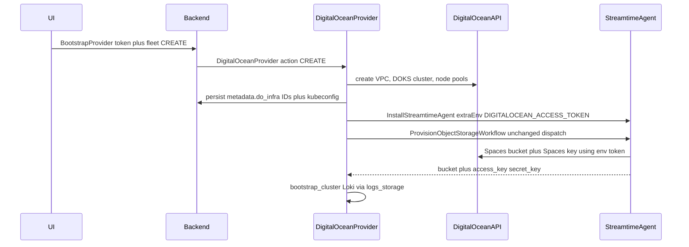

# DigitalOcean bootstrap provider

## Design decisions

- **Provider slug:** `digitalocean` (matches existing discovery labels `doks.digitalocean.com/*` and LB annotations). Workflow class: `DigitalOceanProvider` (`workflow_name = "DigitalOceanProvider"`).
- **Workflow shape:** Match production (`AwsProvider` / `GcpProvider`): **one** `@workflow.defn` class with `action: CREATE | DELETE`. Do **not** split into three workflow classes — `CommandDispatchService`, `PROVIDER_WORKFLOW_MAPPING`, and fleet CUD already assume this.
- **Credentials:** One DigitalOcean **personal access token with no expiration**, stored encrypted on `BootstrapProvider.configuration.digitalocean_token`. Same token is used by orchestrator activities **and** injected into the agent. Do not mint a child token (DO has no API to create non-expiring PATs from a PAT).
- **No IRSA / workload identity.** DOKS has no equivalent. Skip OIDC, IAM roles, SA annotations. Agent auth is `DIGITALOCEAN_ACCESS_TOKEN` via Helm `extraEnv` (same install-time `--set` path as `irsa_role_arn` for AWS).
- **`ProvisionObjectStorageWorkflow` orchestrator call stays unchanged** (`fleet_provider_base._provision_logs_storage_bucket` → `execute_agent_command_child_workflow(...)`). Agent-side WI + bucket activities gain a `digitalocean` branch so that existing workflow still succeeds.
- **Chicken-and-egg node pools:** Fleet CREATE still creates the initial DOKS node pool(s) in the orchestrator (agent is not running yet). Kafka Isolated/Dedicated pools after the agent is installed go through agent `ProvisionNodePoolWorkflow` (token from env). Orchestrator still implements `create_nodepool` / `delete_nodepool` activities for bootstrap and DELETE.
- **Spaces vs PAT:** The PAT can create Spaces buckets and Spaces keys. Loki cannot use the PAT as S3 credentials. Agent `CreateStorageIAMBinding` for DO will create a **bucket-scoped Spaces access key** and return `access_key` / `secret_key` (same as OCI HMAC). Loki S3 config follows the OCI path (endpoint + keys). `_provision_logs_storage_bucket` already persists those keys.
- **GlobalConfiguration:** Existing clouds hardcode regions; do the same (`get_whitelisted_regions()`). No unused GC keys.
- **Kube access:** Store DOKS kubeconfig in the Secret service (`kube_provider: "static"`). Re-fetch from DO API on DELETE if needed using cluster UUID from `fleet.metadata`.

## Backend plugin and API surface

New plugin [`fleet-manager-backend/fleet_provider/digitalocean_provider.py`](fleet-manager-backend/fleet_provider/digitalocean_provider.py) implementing `BaseFleetProvider`:

- `get_placement_configs` / `validate_placement_configs` — region + cloud account enums (plain labels: "Region", "Cloud account").
- `get_advanced_configs` / `validate_advanced_configs` — existing VPC UUID (from `list_vpcs`), VPC CIDR, HA control plane, public cluster, optional logs bucket name, optional Spaces region, `bootstrap_config`. **No** `workload_identity` block.
- `get_whitelisted_regions()` — regions with both DOKS and Spaces: `nyc3`, `sfo3`, `ams3`, `sgp1`, `fra1`, `syd1`.
- `size_fleet_compute` — map optimization goal to droplet slugs (`s-4vcpu-8gb` shared services x3; broker sizes `s-2vcpu-4gb` / `s-4vcpu-8gb` / `g-4vcpu-16gb`).
- `resolve_pricing` — static droplet hourly rates (or `GET /v2/sizes` when a token is available); never silent defaults.
- `metadata()` — display name **DigitalOcean** (not DOKS) for catalog cards.

Pydantic models in both:

- [`fleet-manager-backend/fm_types/digitalocean.py`](fleet-manager-backend/fm_types/digitalocean.py)
- [`fleet-manager-orchestrator/shared/fm_types/digitalocean.py`](fleet-manager-orchestrator/shared/fm_types/digitalocean.py)

`DigitalOceanPlacementConfig`: `region`, `account`.  
`DigitalOceanAdvancedConfig`: `do_vpc_uuid` (optional / null = create), `do_vpc_cidr`, `do_ha_control_plane`, `do_cluster_public`, `do_logs_storage_bucket_name`, `do_spaces_region` (optional override), `bootstrap_config`.

Credentials schema in [`fleet-manager-backend/core/schemas/bootstrap_provider_schema.py`](fleet-manager-backend/core/schemas/bootstrap_provider_schema.py):

- `DigitalOceanCredentialsSchema` with `digitalocean_token` (title **"API token"**, helper text: personal access token with **no expiration**, write access for Kubernetes, VPCs, and Spaces).
- Register in `get_configuration_schema_for_provider` and the `BootstrapProviderConfigurationSchema` union.
- Flip existing test that asserts `"digital_ocean"` is `None`; keep `"digital_ocean"` (underscore) as `None` if we only accept `digitalocean`.

Registration / enums (all must include `digitalocean`):

- [`fleet-manager-backend/fleet_manager/settings.py`](fleet-manager-backend/fleet_manager/settings.py) `CLOUD_PROVIDERS`
- [`fleet-manager-backend/core/models.py`](fleet-manager-backend/core/models.py) `BootstrapProvider.PROVIDER_CHOICES` + Django migration
- [`fleet-manager-backend/core/serializers.py`](fleet-manager-backend/core/serializers.py) hardcoded `ChoiceField(choices=['aws', 'azure', 'gcp', 'oci'])`
- [`fleet-manager-backend/core/provider_workflow_mappings.py`](fleet-manager-backend/core/provider_workflow_mappings.py) `ProviderType` + `FLEET_WORKFLOW_MAPPINGS`
- [`fleet-manager-backend/core/command_dispatch.py`](fleet-manager-backend/core/command_dispatch.py) `DigitalOceanProviderInput`, `PROVIDER_WORKFLOW_MAPPING`, `WORKFLOW_INPUT_REGISTRY`
- [`fleet-manager-backend/core/provider_discovery.py`](fleet-manager-backend/core/provider_discovery.py) import + `register_workflow()`
- [`fleet-manager-backend/core/services/org_option_controls.py`](fleet-manager-backend/core/services/org_option_controls.py) `CLOUD_VENDOR_COPY` ("DigitalOcean" / "Deploy workloads on DigitalOcean cloud infrastructure.")
- [`fleet-manager-backend/fm_types/fleet_advanced_dict.py`](fleet-manager-backend/fm_types/fleet_advanced_dict.py) add `digitalocean_bootstrap_config` to `BOOTSTRAP_WIRE_KEYS`
- Generated OpenAPI consumers: [`bootstrap_provider_provider_enum.py`](streamtime-sdk/streamtime_sdk/models/bootstrap_provider_provider_enum.py), [`streamtime-sdk/typescript/api-types.d.ts`](streamtime-sdk/typescript/api-types.d.ts)

Loki: [`bootstrap_resolver.py`](fleet-manager-backend/core/services/bootstrap_resolver.py) `_apply_loki_cloud_storage` — treat `digitalocean` like OCI: S3 backend, `s3ForcePathStyle: true`, `endpoint` `https://{region}.digitaloceanspaces.com`, `accessKeyId` / `secretAccessKey` from `logs_storage`. No SA annotations.

Already DO-aware (leave as-is unless fleet `provider` slug needs a tweak): [`storage_sizing.py`](fleet-manager-backend/core/services/storage_sizing.py) (`full_disk`, no tiered storage), [`kafka_workload_charts.py`](fleet-manager-backend/core/services/kafka_workload_charts.py) internal LB annotation.

Backend tests: `fleet_provider/tests/test_digitalocean_provider.py`, schema tests, org-option copy, serializer choices, workflow mapping.

Python SDK: add official `pydo` to [`fleet-manager-backend/requirements.txt`](fleet-manager-backend/requirements.txt) (used by plugin `list_vpcs` in advanced-config schema, same pattern as AWS boto3).

## Orchestrator

New [`fleet-manager-orchestrator/workflows/digitalocean_provider.py`](fleet-manager-orchestrator/workflows/digitalocean_provider.py) + re-export [`workflows/providers/digitalocean_provider.py`](fleet-manager-orchestrator/workflows/providers/digitalocean_provider.py).

Activities (register in [`worker.py`](fleet-manager-orchestrator/worker.py); credentials **only** from activity input):

| Activity | DO API |
|---|---|
| `list_vpcs` | `GET /v2/vpcs?region=` |
| `create_vpc` / `delete_vpc` | `POST/DELETE /v2/vpcs` (NotFound = success) |
| `create_cluster` / `delete_cluster` | DOKS `POST/DELETE /v2/kubernetes/clusters` (wait until `running`; fetch kubeconfig) |
| `create_nodepool` / `delete_nodepool` | `POST/DELETE /v2/kubernetes/clusters/{id}/node_pools` |
| `create_object_storage_bucket` / `delete_object_storage_bucket` | Spaces management API (skill-required; Loki still uses the **agent** workflow) |
| `discover_fleet_inventory` | list tagged VPC/cluster/pools for DELETE fallback |

**CREATE `run()`:** snapshot fleet + BootstrapProvider token → VPC (create if `do_vpc_uuid` empty) → persist `vpc_uuid` → create DOKS cluster (HA flag, VPC, Kubernetes version from `GET /v2/kubernetes/options`) → persist `cluster_id` → shared-services node pool (and Shared-tenancy workload pool with `cluster_name` taint) → persist pool IDs in `metadata.do_infra` **before** later steps → store kubeconfig Secret → `InstallStreamtimeAgentWorkflow` with `digitalocean_access_token` → `_provision_logs_storage_bucket(...)` **unchanged** (pass `additional_storage_input={"region": spaces_region}` if cluster region has no Spaces) → `bootstrap_cluster()` → status Healthy.

**DELETE `run()`:** read IDs from `metadata.do_infra` (never reconstruct names) → teardown Helm → `_destroy_logs_storage_bucket` → delete extra node pools → delete cluster → delete VPC if we created it. Idempotent.

Wire [`workflows/fleet_provider.py`](fleet-manager-orchestrator/workflows/fleet_provider.py) `CLOUD_PROVIDERS`.

[`install_streamtime_agent.py`](fleet-manager-orchestrator/workflows/install_streamtime_agent.py):

- If `workflow_input["digitalocean_access_token"]` (or BootstrapProvider fallback: `get_fleet` → `placement_config.account` → `get_bootstrap_provider` when `provider == digitalocean`), set `extraEnv.DIGITALOCEAN_ACCESS_TOKEN` on the worker chart `--set`.
- Do **not** add AWS/GCP/Azure SA annotations for DO.
- Reinstall path must re-apply the token the same way Azure re-reads `streamtime_agent_client_id` (do **not** persist the token in `fleet.metadata`).

[`workflows/base.py`](fleet-manager-orchestrator/workflows/base.py):

- `create_kafka_node_pool` / `delete_kafka_node_pool`: `digitalocean` branch → agent `ProvisionNodePoolWorkflow` / `DestroyNodePool` activity (or existing destroy workflow) with cluster UUID from metadata; node selector `doks.digitalocean.com/node-pool`.
- `get_kube_credentials_from_fleet`: `kube_provider = "static"` (kubeconfig already in Secret).

Add `pydo` to [`fleet-manager-orchestrator/requirements.txt`](fleet-manager-orchestrator/requirements.txt).

Orchestrator tests: `test_digitalocean_provider_run.py` (CREATE/DELETE activity order, metadata writes, install-agent token, `_provision_logs_storage_bucket` still invoked), install-agent extraEnv test, node-pool routing test.

## Streamtime agent (static token, not WI)

Add `github.com/digitalocean/godo` in [`streamtime-agent/go.mod`](streamtime-agent/go.mod).

[`workload_identity.go`](streamtime-agent/internal/activities/workload_identity.go):

- `case "digitalocean"`: read `DIGITALOCEAN_ACCESS_TOKEN` (alias `DIGITALOCEAN_TOKEN`); `GET /v2/account`; `IdentityType: "api_token"`; `PermissionsValidated` if account call succeeds. This lets **existing** `ProvisionObjectStorageWorkflow` keep calling `ValidateWorkloadIdentityWorkflow` with no orchestrator change.

[`cloud_provision.go`](streamtime-agent/internal/activities/cloud_provision.go):

- Bucket create/delete/lookup via Spaces + godo.
- `CreateStorageIAMBinding`: create Spaces key (`POST /v2/spaces/keys`) scoped to the bucket; put keys on output (`AccessKey`/`SecretKey`) like OCI.
- `ProvisionNodePool` / `DestroyNodePool` / `ScaleNodePool`: DOKS node pool CRUD using cluster ID from input or node labels (`doks.digitalocean.com/cluster-id` if present).

Helm chart already supports `extraEnv`; add a chart test for `DIGITALOCEAN_ACCESS_TOKEN`. No SA annotation.

Agent tests: WI with env token; bucket + Spaces key happy path; node pool provider switch; workflow tests with mocked activities (WI validated without AWS/GCP).

## Frontend / MCP / CLI

- Fleet create and bootstrap-provider forms are schema-driven — no hardcoded field lists. Verify [`KubernetesFleetCreate.js`](fleet-manager-frontend/src/features/infrastructure/KubernetesFleetCreate.js) and [`BootstrapProviderForm.js`](fleet-manager-frontend/src/features/settings/components/organizationsettings/BootstrapProviderForm.js) do not filter provider IDs.
- Labels: "API token", "Region", "VPC", "High-availability control plane" — never "DOKS", "godo", or "PAT".
- MCP: add `list_digitalocean_regions` in [`fleet-manager-mcp/server.py`](fleet-manager-mcp/server.py) (thin wrapper over SKU/placement or hardcoded whitelist). Existing `list_kafka_cloud_providers` picks up `CLOUD_PROVIDERS` automatically.
- CLI: generic CRUD; only generated enum if the CLI OpenAPI client duplicates `BootstrapProviderProviderEnum`.

## Implementation order

1. Backend plugin + settings + credentials schema + migration (plugin loads).
2. Orchestrator workflow + activities + worker registration + unit tests with mocked `pydo`.
3. Agent token WI + Spaces + node pool + tests.
4. Install-agent extraEnv + Loki S3-compat + kafka node-pool routing.
5. MCP region tool + OpenAPI enum sync.
6. API exercise (after implementation, not in this plan execution): create BootstrapProvider, fleet CREATE/DELETE against a real DO account when available.

## Out of scope

- Separate Create/Update/Delete Temporal workflow classes.
- DigitalOcean workload identity / OIDC.
- Changing `_provision_logs_storage_bucket` or the child-workflow name/input contract.
- Tiered Kafka storage on DO (already `full_disk`).
- Host scripts like `provision-eks-byok.sh` (optional follow-up).
