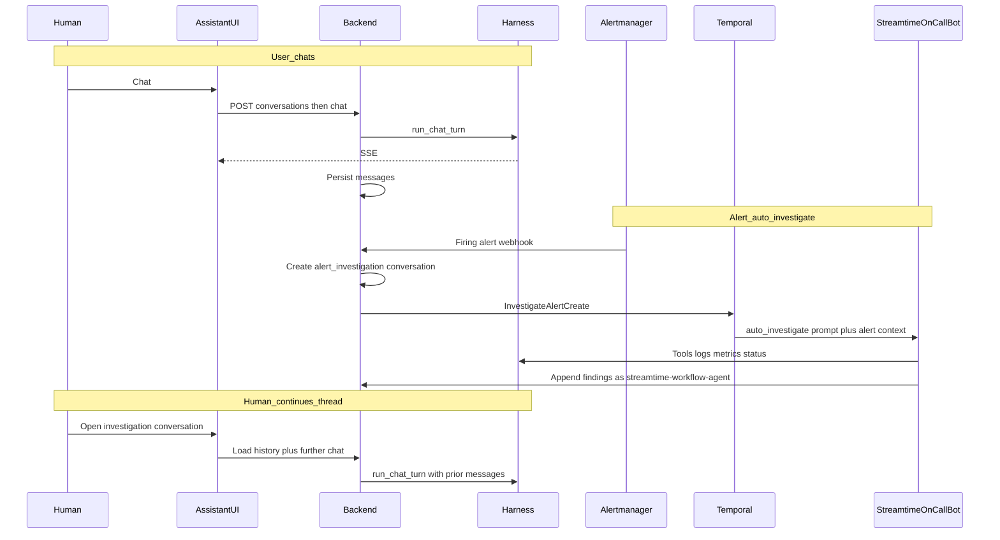

# Plan: Threaded Assistant Conversations & Alert Investigations

## Summary

Persist Streamtime AI chats as **org-scoped conversation threads**. Humans chat freely; firing alerts **automatically open investigation conversations** where **StreamtimeOnCallBot** runs an observe-only investigation (logs/metrics, workload-aware) and posts findings into the same thread. Humans can open that thread later and keep prompting. After investigations exist, **embeddings + PgVector** enable similar-incident RAG.

**Interim baseline (committed):** in-process MCP + BYOK streaming harness (`assistant-ui`), tool-round continuation fixed. Conversation **messages are not yet persisted**. No pgvector today.

---

## Product flow (locked)

```text
1. Human ↔ Assistant
   Human starts/continues a chat → AssistantConversation(kind=user)
   Messages persist; stream via harness + tools

2. Alert → Auto investigation conversation
   Alertmanager firing webhook → create AssistantConversation(kind=alert_investigation)
   Temporal InvestigateAlertCreate → StreamtimeOnCallBot runs prompt `auto_investigate`
   Bot writes findings into that conversation (author_user = streamtime-workflow-agent)

3. Human continues investigation thread
   Operator opens the linked conversation and prompts further (same thread, same history)
```

Remediation / auto-fix is **out of scope**. Investigations mirror health-check prompts: gather evidence, reason strictly from tools, report outcomes.

---

## Goals

1. **Threaded chat persistence** — create / list / open conversations; messages survive reload; chat SSE appends to a conversation.
2. **Alert-triggered investigations** — firing alerts create conversations; StreamtimeOnCallBot investigates via `auto_investigate` and updates the thread.
3. **Human follow-through** — operators continue those investigation conversations with the assistant.
4. **Similar-incident RAG** — embed investigation outcomes (configurable model) into PgVector for consultation on later incidents.

## Non-goals (this plan)

- Cross-org sharing, multi-branch conversation trees
- Replacing BYOK settings or MCP config export
- Auto-remediation, runbooks that mutate clusters, or SOAR-style fix execution
- Replacing orchestrator identity `fleet-workflow-agent` (JWT/bootstrap stays separate)

---

## Current state

| Area | Today |
|------|--------|
| Chat transport | `POST …/assistant/chat/` SSE via `assistant_harness.run_chat_turn` |
| Tools / prompts | In-process `mcp_server` (`health_check_cluster`, `health_check_fleet`, …) |
| UI | `@assistant-ui/react`; sidebar history is localStorage stubs with **empty `messages`** |
| Alerts | `Alert` model; Alertmanager webhooks to `…/kafka/{id}/alerts/`; no investigation link |
| LLM keys | Per-user `UserAssistantLLMConfig` (BYOK) |
| Vectors | **Not present** (no pgvector / embedding pipeline) |

---

## Target architecture

```text
Organization
  └── AssistantConversation          # thread (identifier slug)
        kind: user | alert_investigation
        status: active | archived | closed
        created_by (User, nullable)
        alert (FK → Alert, nullable)
        workflow_id (Temporal, nullable)
        metadata (SchemaField)       # workload type, alert fingerprint, etc.
        └── AssistantMessage[]
              role: user | assistant | tool | system | workflow
              content (SchemaField: parts[])
              author_user / provenance
              tool_call_id / tool_name (denorm)
  └── AssistantIncidentEmbedding     # Phase 4 (RAG)
        conversation FK / alert FK
        embedding vector (pgvector)
        model_id / provider
        text_snapshot (what was embedded)
        metadata (labels, workload, severity)
```

**Workflow agent identity (locked):**

- Email/username: `streamtime-workflow-agent@{fleet_manager_domain}`
- UI brand: **StreamtimeOnCallBot**
- `author_user` + `provenance=workflow` on bot posts
- Distinct from orchestrator `fleet-workflow-agent@…`

**Message content** uses harness / assistant-ui parts (`text`, `tool-call`, `tool-result`).



---

## API surface (org-scoped)

| Method | Path | Purpose |
|--------|------|---------|
| `GET/POST` | `/organizations/{org}/assistant/conversations/` | List / create thread |
| `GET/PATCH/DELETE` | `/organizations/{org}/assistant/conversations/{id}/` | Detail / rename / archive |
| `GET` | `/organizations/{org}/assistant/conversations/{id}/messages/` | Paginated messages |
| `POST` | `/organizations/{org}/assistant/chat/` | Stream turn; **require** `conversation` identifier; persist turns |
| `POST` | `/organizations/{org}/assistant/conversations/{id}/messages/` | Append note or kick follow-up |
| `GET` | `/organizations/{org}/alerts/stats/` | KPI: firing, open/pending investigations, resolved (24h) |
| `GET` | `/organizations/{org}/alerts/{alert_id}/investigation/` | Resolve linked investigation (404 if none) |
| `POST` | `/organizations/{org}/alerts/{alert_id}/investigation/` | Get-or-create investigation (+ dispatch Create) |
| `POST` | `/organizations/{org}/alerts/{alert_id}/investigation/run/` | RPC: run StreamtimeOnCallBot for that alert |
| `POST` | `/organizations/{org}/alerts/{alert_id}/investigation/discuss/` | RPC: create kind=user chat referencing investigation (Talk about this) |

Investigations stay `AssistantConversation(kind=alert_investigation)` but are **not** opened as chat threads. UI: `/diagnostics/alerts/{alertId}/investigation` (report only). **Talk about this incident** creates a separate `kind=user` chat with a hidden system seed + MCP tool `get_incident_report` for refresh.
| `GET` | `/organizations/{org}/assistant/similar-incidents/` | Phase 4: RAG query by alert/text (after embeddings) |

Investigation conversations store structured findings on `metadata.findings`:
`triaged_severity`, `affected_components`, `summary`, `evidence`, `recommended_next_steps`
(plus `metadata.findings_status`: pending | complete | partial | failed). The auto-investigate brief is persisted as `role=system` (hidden in UI).

Closing an investigation (`POST …/investigation/cancel/` or UI **Close investigation**) sets `status=closed` and writes `closed_at`, `closed_by`, `close_reason`, and `time_to_close_seconds` for IR KPIs (avg/median TTC, closed last 24h).

Conventions: UUID PK + `identifier` slug; `OrganizationMixin` + `OrganizationPermission`; thin views → services; workflows via `CommandDispatchService` only. Action endpoints are **RPC under the owning noun** (`…/alerts/{id}/investigation/{verb}/`) — not conversation-scoped verbs like `…/conversations/{id}/run-investigation/`.

---

## Phase 1 — Persist user chats

**Deliverables**

1. Schemas — `core/schemas/assistant_conversation_schema.py` (message parts, metadata).
2. Models — `AssistantConversation`, `AssistantMessage`; auditlog + reversion; migration.
3. Service — create / append / load history for harness.
4. Views/URLs — CRUD + messages; chat request requires `conversation` identifier.
5. Harness — persist user message at start; persist assistant/tool segments; load history.
6. Frontend — drop localStorage; New Chat → POST; select → hydrate; pass `conversation` on chat.

**Exit criteria:** threads list/open across reload; tool rounds visible when reopened; `kind=user` visible to **creator + org admins**.

**Files:** [`core/models.py`](fleet-manager-backend/core/models.py), new `assistant_conversation.py`, [`assistant_harness.py`](fleet-manager-backend/core/services/assistant_harness.py), [`core/views/assistant/`](fleet-manager-backend/core/views/assistant/), [`health-assistant/`](fleet-manager-frontend/src/features/health-assistant/).

---

## Phase 2 — Investigation thread API

**Deliverables**

1. `kind=alert_investigation` + nullable `alert` FK (one open investigation per alert fingerprint + cooldown).
2. Resolve-by-alert endpoint; alert UI **Open investigation**.
3. Manual create/link for testing without Temporal.
4. Visibility: org members who can view the alert can read/continue the investigation thread.

**Exit criteria:** conversation ↔ alert round-trip via API and UI.

---

## Phase 3 — Auto investigate (observe-only)

**Deliverables**

1. **Org/service LLM** for bot runs (not a random user’s BYOK).
2. Bootstrap `streamtime-workflow-agent@…`; all bot messages authored as **StreamtimeOnCallBot**.
3. New MCP prompt **`auto_investigate`** in [`mcp_server/prompts.py`](fleet-manager-backend/mcp_server/prompts.py) (same registration pattern as `health_check_cluster` / `health_check_fleet`):
   - **Inputs:** alert payload (name, labels, annotations, severity, starts_at), org, kafka/fleet identifiers, **workload type** (Strimzi/CFK/Redpanda/…).
   - **Broad observe-only brief:** Investigate the alert in context of the workload. Reason **strictly** from available MCP tools (status, metrics, logs, firing alerts). Do not invent data. Do not propose or execute remediation/fixes — report findings only (summary, evidence, likely contributing factors, confidence, recommended *human* next checks).
   - Workload-specific tool/metric hints (branch by provider) without becoming a separate prompt per SKU in v1.
4. Temporal (CUD):
   - `InvestigateAlertCreate` — seed conversation with alert context + run `auto_investigate` via harness; append StreamtimeOnCallBot messages
   - `InvestigateAlertUpdate` — re-run investigation (deferred if needed)
   - `InvestigateAlertCancel` — cancel + close conversation
5. Webhook path on **firing** Alert create/update: GetOrCreate conversation → dispatch Create; idempotent on `WorkflowAlreadyStartedError`.
6. Register workflow inputs in `WORKFLOW_INPUT_REGISTRY` + entity extractors.

**Exit criteria**

- Firing alert → investigation conversation with StreamtimeOnCallBot report (no remediation actions)
- Integration test with mocked LLM + log/metric tools

**Config (`GlobalConfiguration`)**

- `assistant_investigation_enabled`
- `assistant_investigation_cooldown_seconds`
- `assistant_investigation_max_tool_rounds`

---

## Phase 4 — Similar-incident RAG (PgVector)

**Deliverables**

1. Enable **pgvector** for Postgres deployments (migration + documented SQLite/bundled limitation: embeddings disabled or no-op when not Postgres).
2. Model `AssistantIncidentEmbedding` (vector column, FKs, provider/model id, text snapshot).
3. On investigation completion (and optionally on finalize), build a canonical text blob (alert fingerprint + labels + bot report summary + key tool evidence) and **embed** it.
4. Embedding model: **configurable** via org AI settings and/or `GlobalConfiguration` (provider + embedding model id + credentials). Same BYOK/org-config philosophy as chat; distinct field(s) from chat `model_name`.
5. Retrieval tool or harness hook: given a new alert / operator query, k-NN similar past investigations (org-scoped) injected as RAG context into later `auto_investigate` or human chat turns.
6. API: similar-incidents query for UI “Similar past incidents”.

**Exit criteria:** completing an investigation stores an embedding; a later alert can retrieve similar prior investigations under the configured embedding model.

---

## Phase 5 — Collaboration UX

**Deliverables**

1. Sidebar: **Chats** vs **Investigations**.
2. Render bot posts as **StreamtimeOnCallBot**.
3. Live refresh while investigation runs; status chip.
4. Human continue-in-thread (already possible via chat API); optional Temporal `human_input` signal for in-flight runs.
5. Cancel investigation; deep links `/assistant?conversation=…` and from alert.

**Exit criteria:** operator opens auto-created investigation and continues the conversation successfully.

---

## Phase 6 — Hardening

- Message pagination + retention / archival
- Multi-tenant RBAC tests
- Scrub secrets from stored tool payloads / embedding text
- Langfuse: conversation ↔ trace/session
- Rate limits on chat + investigation kicks + embed jobs
- OpenAPI + CLI/MCP read tools for conversations / similar incidents

---

## Key design decisions

| Decision | Choice | Rationale |
|----------|--------|-----------|
| Identifier in URLs | `identifier` slug | Platform convention |
| Persist timing | User msg at request start; assistant/tool after segments | Reload-safe progress |
| Bot identity | `streamtime-workflow-agent` / **StreamtimeOnCallBot** | Distinct on-call attribution |
| Auto prompt | MCP prompt `auto_investigate` | Same pattern as health checks |
| Investigation scope | Logs/metrics/status only; report only | No remediation |
| Workload awareness | Alert + cluster workload in prompt/metadata | Correct tool/metric expectations |
| Investigation LLM | Org/service config | Not dependent on human BYOK |
| One investigation / alert | GetOrCreate + cooldown | Webhook storms |
| RAG timing | Own phase after auto-investigate | Need real investigation text first |
| Embedding model | Configurable provider + model | Operator choice / BYOK-aligned |
| Frontend SoT | Server conversations | Fixes empty history |

---

## Risks & mitigations

| Risk | Mitigation |
|------|------------|
| Message schema drift | Frozen Pydantic `MessagePart` + adapter tests |
| Webhook storms | Idempotent workflow start + cooldown |
| Hallucinated causes | Prompt: use only tool data; cite tool results |
| pgvector / SQLite | Gate embeddings on Postgres; document bundled mode |
| Embedding provider cost | Config defaults + opt-in; embed on complete not every token |
| Large tool payloads | Truncate before store/embed |

---

## Implementation order

1. Phase 1 — persist user chats (**next**)
2. Phase 2 — investigation thread API
3. Phase 3 — `auto_investigate` + Temporal + webhook
4. Phase 4 — PgVector embeddings + similar-incident RAG
5. Phase 5 — collaboration UX polish
6. Phase 6 — hardening

---

## Test plan (per phase)

- **P1:** CRUD conversations; chat persists; reload hydrates; cross-org 403
- **P2:** Alert ↔ conversation link; Open investigation
- **P3:** Create workflow posts as StreamtimeOnCallBot; prompt forbids remediation; mocked metrics/logs
- **P4:** Embed on complete; k-NN returns prior org incidents; wrong-org isolated
- **P5:** Continue investigation thread from UI end-to-end

---

## Resolved defaults

1. User chats: **creator + org admins**.
2. Conversations: **archive-only**.
3. Assignees/watchers: **Phase 5**.
4. Auto investigate: **observe/report only** via prompt `auto_investigate` (health-check style).
5. Bot author: **`streamtime-workflow-agent@…` / StreamtimeOnCallBot**.
6. Orchestrator JWT user `fleet-workflow-agent` **unchanged**.
7. RAG/PgVector: **Phase 4** after auto-investigate; embedding model **configurable** (provider + model id).
