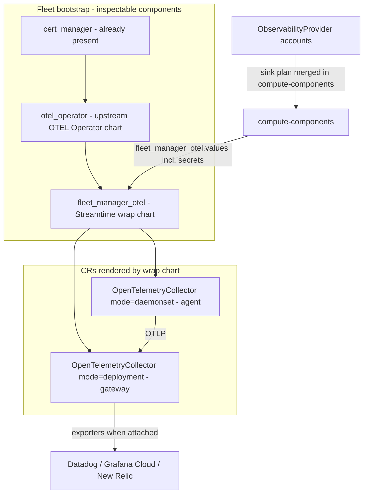

# BYO Observability (OTEL Operator)

Branch: `feat/BYO-Observability` (from `main`).

**Canonical egress:** customer-provider shipping of **metrics and logs** goes only through **OpenTelemetry Collectors** managed by the **OpenTelemetry Operator**, installed on every fleet at bootstrap. In-fleet Prometheus + Loki stay Streamtime’s scrape/store/UI path. Traces are **out of scope**.

**Two Helm releases (non-negotiable):**

1. **Operator chart** — deploys the OpenTelemetry Operator controller + CRDs only. Does **not** create collector instances.
2. **Wrap chart** (`fleet-manager-otel`) — **over and beyond** the operator: the only place that renders `OpenTelemetryCollector` CRs (agent + gateway), Secrets, and provider exporter config.

Same split as `grafana_operator` vs `fleet-manager-dashboard-fleet`. Do **not** install collectors via the standalone `opentelemetry-collector` Helm chart, and do **not** apply raw CRs outside the wrap chart.

**Source of truth:** `compute-components` resolves full Helm values for both components — including provider secrets in wrap-chart values. Bootstrap and apply consume that payload; no parallel secret-only side channel.

**Out of architecture:** Prometheus `remote_write`, Promtail vendor clients, Datadog Agent / sidecars, vendor-specific agents.

## Product shape (mirror Alert Channels)

| Concern | Alert Channels | Observability providers |
|---|---|---|
| Org settings | Create Slack/PagerDuty/… accounts | Create Datadog / Grafana Cloud / New Relic accounts |
| Attach | Multi-select on fleet / Kafka create | Multi-select on **fleet** create: “How should this fleet be monitored?” |
| Zero selected | Streamtime alerts only | Operator + collectors still run (standard intake); **no** customer exporters on gateway CR |
| Many selected | Fan-out to each channel | Gateway `OpenTelemetryCollector` CR gets **one exporter per account** |
| Secrets | Stored on org entity; redacted on Settings GET | Same on Settings GET; **full secrets included** in `compute-components` wrap values |

Operator flow:

1. Settings → **Observability** — create org-scoped accounts.
2. Fleet create → optional multi-select; bootstrap always installs operator + wrap chart.
3. Fleet bootstrap UI / `compute-components` shows both components (versions, values) — **inspectable**.
4. Fleet detail → **Endpoints** tab: Prometheus, Loki, OTEL URLs + named secrets.
5. Attach/detach later → `ApplyObservabilityWorkflow` re-renders wrap-chart values (exporter exporters) and upgrades that release.

## Bootstrap architecture (operator + wrap chart)

Mirror `grafana_operator` + `fleet-manager-dashboard-fleet`:



| Bootstrap key | Helm release | What it installs | Install order | Conditional |
|---|---|---|---|---|
| `otel_operator` | Operator chart only | Controller + CRDs — **no** `OpenTelemetryCollector` CRs | **81** (after `cert_manager` @ 80) | No — always |
| `fleet_manager_otel` | **Separate wrap chart** | Templates `OpenTelemetryCollector` CRs (+ Secrets) from values | **82** (after operator) | No — always |

Uninstall LIFO: wrap chart **before** operator (same as dashboard CRs before grafana-operator) so finalizers clear.

### 1. `otel_operator` — upstream operator

- Chart: `open-telemetry/opentelemetry-operator` (Helm repo `https://open-telemetry.github.io/opentelemetry-helm-charts`).
- Namespace: `opentelemetry-operator-system` (or `monitoring` if we standardize — prefer upstream default namespace unless fleet convention forces `monitoring`).
- Values: pin `manager.collectorImage` to **contrib** image (`otel/opentelemetry-collector-contrib` or `ghcr.io/open-telemetry/opentelemetry-collector-releases/opentelemetry-collector-contrib`) so Datadog exporter + filelog exist.
- CRDs: chart installs `OpenTelemetryCollector` (`opentelemetry.io/v1beta1`). Do not `--skip-crds`; use chart’s `crds.create` if needed.
- Registered in `_COMPONENT_REGISTRY_MAP`, `BootstrapConfigSchema`, `BootstrapConfigEditor` — **visible/editable in fleet bootstrap** like Grafana Operator.

### 2. `fleet_manager_otel` — wrap chart for CRs (required)

New chart under `charts/fleet-manager-otel/` (name lock: **fleet-manager-otel**).

This is a **second Helm chart**, not values on the operator chart. Operator install alone does nothing useful for intake/egress until this wrap chart is applied.

**Renders (Helm templates → CRs):**

| Template | Kind | Purpose |
|---|---|---|
| `otel-agent.yaml` | `OpenTelemetryCollector` | `spec.mode: daemonset` — filelog + light processors; exporters only `otlp` → gateway service |
| `otel-gateway.yaml` | `OpenTelemetryCollector` | `spec.mode: deployment` — OTLP receive; standard processors; **provider exporters** from values |
| `otel-secrets.yaml` | `Secret` | Vendor API keys / tokens from values (envFrom / secretKeyRef into gateway) |
| Optional Kong bits | HTTPRoute / plugin refs | Prefer extending `fleet-manager-infra-shared` for `/otel` routes |

**Values shape** (produced by `compute-components`, then Helm-installed as-is):

```yaml
# Standard (always)
agent:
  enabled: true
  resources: { ... }
  config: { receivers, processors, exporters: { otlp → gateway } }

gateway:
  enabled: true
  replicas: 2
  resources: { ... }
  config:
    receivers: { otlp, prometheus? }
    processors: { memory_limiter, batch, k8sattributes, ... }
    exporters: {}
    service:
      pipelines:
        metrics: { receivers: [...], processors: [...], exporters: [] }
        logs:    { receivers: [...], processors: [...], exporters: [] }

# From ObservabilityProvider sink plan — includes secrets
providers:
  - identifier: acct-datadog-prod
    vendor: datadog
    exporter: { ... }      # plugin-generated fragment (api.key etc.)
  - identifier: acct-nr-eu
    vendor: newrelic
    exporter: { ... }
```

Wrap chart templates **merge** `providers[]` into gateway `spec.config.exporters` and append exporter names onto metrics/logs pipelines. One gateway CR, N exporters — not N collector installs.

### `compute-components` as source of truth

| Rule | Detail |
|---|---|
| SoT | Backend `compute-components` builds the full `fleet_manager_otel` (and `otel_operator`) component payloads: chart version, registry, **complete values including provider secrets**. |
| Bootstrap / apply | Orchestrator installs/upgrades from that payload. Prefer **not** re-deriving sink plans in a second path; if an activity loads accounts, it must feed the **same** merge used by `compute-components`. |
| Inspectability | Fleet bootstrap UI and API show the resolved wrap values (providers + exporters). Secrets in this path are acceptable — not a blocker; keep ObservabilityProvider **Settings GET** redacted as today. |
| Attach/detach | Mutate fleet↔provider links → call `compute-components` again → upgrade wrap release from new values. |
| No secret side channel | Do not invent a parallel “secrets-only” activity that bypasses compute-components for the wrap chart. |

### Custom-component / fleet bootstrap integration

Same path as every other bootstrap component:

1. `_COMPONENT_REGISTRY_MAP` entries for `otel_operator` and `fleet_manager_otel` (two keys, two releases).
2. `BootstrapConfigSchema` fields for both — version, registry_url, values overrides.
3. Frontend `BootstrapConfigEditor` entries — “OpenTelemetry Operator”, “OpenTelemetry Collectors”.
4. `compute-components` resolves package versions **and** merges ObservabilityProvider sink plan into wrap `values.providers` (with secrets).
5. Teardown LIFO: `fleet-manager-otel` before `otel_operator`.
6. `installed-components` bookkeeping for both releases.

## Standard collector config (inside wrap chart CRs)

### Roles

| Role | CR mode | Job |
|---|---|---|
| Agent | `daemonset` | Pod logs (`filelog`); light processors; OTLP to gateway only — **no vendor secrets on nodes** |
| Gateway | `deployment` | OTLP metrics/logs intake; scale-oriented processors; all customer exporters |

### Receivers / processors / baseline exporters

| Signal path | Detail |
|---|---|
| Metrics in | OTLP on gateway; optional `prometheus` scrape of in-cluster federation (**no** Prometheus remote_write) |
| Logs in | Agent `filelog` → gateway; OTLP logs on gateway |
| Processors | `memory_limiter`, `batch`, `k8sattributes`, resource attrs for org/fleet |
| Baseline out | Agent → gateway OTLP only; gateway SaaS exporters empty until providers attached |
| Traces | **Not configured** |

### Scaling

| Concern | Plan |
|---|---|
| Gateway replicas | Start 2; HPA by CPU; max formula vs KU tier |
| Resources | Gateway scales with KU; agents fixed/small |
| Exporter queues | Retry + queue on vendor exporters; `memory_limiter` backpressure |
| Fan-out | N providers ≈ N× egress — document preferring few accounts on large fleets |

## Packages (required for all of the above)

Every artifact must be a first-class package-catalog citizen (same as grafana-operator / dashboard-fleet).

| Artifact | Package / repo | Preload work |
|---|---|---|
| OpenTelemetry Operator chart | Tracked Helm repo `open-telemetry` → chart `opentelemetry-operator` | `package_rules.yaml` rule; preferred registry `https://open-telemetry.github.io/opentelemetry-helm-charts`; default version pin; `preload/helm_repos/` entry if needed for airgap |
| Wrap chart `fleet-manager-otel` | OCI `ghcr.io/streamtime-ai/fleet-manager-otel` (+ local registry mirror `streamtime/fleet-manager-otel`) | Chart in `charts/fleet-manager-otel/`; package rule; tracked repo; `preload/helm_repos/oci__*.json` |
| Collector contrib image | Image used by operator `manager.collectorImage` | `preload/registry_images.yaml` entry; mirrored with other bootstrap images |
| Operator manager image | From operator chart | `registry_images.yaml` (or covered by chart image list sync — ensure mirror) |
| Optional kube RBAC/sidecar images | As required by operator chart | Same registry_images coverage |

**Package rules (plan sketch):**

```yaml
- name: "OpenTelemetry Operator"
  repository: "opentelemetry-operator"   # confirm exact tracked repository string
  version_constraint: ">=0.58.0"         # v1beta1 CRD line
  preferred_registry: "https://open-telemetry.github.io/opentelemetry-helm-charts"
  default_version: "<pin>"
  priority: 10

- name: "Fleet Manager OTEL"
  repository: "streamtime-ai/fleet-manager-otel"
  version_constraint: ">=0.1.0"
  preferred_registry: "ghcr.io"
  default_version: "0.1.0"
  priority: 10
```

Airgap / mirror: include both charts and images in the same preload/sync path used for grafana-operator and fleet-manager-dashboard-fleet.

## Provider auth → wrap-chart `providers[]` (v1)

Plugins emit exporter fragments only (metrics + logs). `compute-components` merges them into wrap `values.providers` (secrets included); the wrap chart templates them into the gateway CR.

### Datadog

| Field | Secret? | Notes |
|---|---|---|
| `api_key` | yes | |
| `site` | no | site enum |

Exporter: `datadog/<account_id>` with `api.key` / `api.site`. Pipelines: metrics + logs.

### Grafana Cloud

| Field | Secret? | Notes |
|---|---|---|
| `otlp_endpoint` | no | `https://otlp-gateway-<region>.grafana.net/otlp` |
| `instance_id` | no | Basic username |
| `access_token` | yes | Metrics + logs write scopes |

Exporter: `otlphttp/grafana/<account_id>` + `basicauth` extension. Replace current Prometheus/Loki URL schema on this branch.

### New Relic

| Field | Secret? | Notes |
|---|---|---|
| `license_key` | yes | |
| `region` | no | `US` \| `EU` → `otlp.nr-data.net` / `otlp.eu01.nr-data.net` |

Exporter: `otlphttp/newrelic/<account_id>` with header `api-key: <license_key>`.

## Fleet Endpoints tab (every fleet)

Reuse Kafka **Endpoints** UX on Infrastructure detail:

| Type | URL | Secret key on `.../shared-credentials` |
|---|---|---|
| `metrics` | Customer gateway Prometheus (existing) | `metrics` |
| `logs` | Customer gateway Loki (existing) | `logs` |
| `otel` | Customer gateway → OTEL gateway OTLP HTTP (new; via infra-shared) | `otel` (new) |
| `otel-grpc` | Optional | same or dedicated |

Always present (operator + collectors always installed), independent of BYO account attach.

## Kong / infra-shared

Extend `fleet-manager-infra-shared` (existing package — already packaged) with OTEL HTTPRoute + Basic auth plugin, same pattern as `/metrics` and `/logs`. Persist `Endpoint` rows at bootstrap.

## Sink plan contract

- Plugins → `providers[]` fragments (metrics + logs exporters, with credential fields).
- `compute-components` merges those into `fleet_manager_otel.values` — **this is the SoT** the agent Helm-installs (secrets included).
- No remote_write / Promtail fields.
- Collectors always on via wrap chart; attach/detach only changes wrap values then upgrades that release.

## UX / API

- Settings Observability accounts (GET still redacts secrets); fleet multi-select; Endpoints tab.
- Bootstrap: **both** Helm components visible; wrap values (incl. providers/secrets) come from `compute-components`.

## Implementation checklist (plan only)

1. Chart `charts/fleet-manager-otel` — **only** path that templates agent + gateway `OpenTelemetryCollector` CRs; provider merge; Helm tests.
2. Register `otel_operator` + `fleet_manager_otel` as **two** bootstrap components; teardown LIFO wrap → operator.
3. **Packages** for operator chart, wrap chart, and images (rules, tracked repos, preload, registry_images).
4. Wire ObservabilityProvider sink merge **inside** `compute-components` for `fleet_manager_otel.values` (secrets included); bootstrap/apply use that payload only.
5. `ApplyObservabilityWorkflow`: recompute components → upgrade wrap release.
6. infra-shared: `/otel` route; Endpoint + shared-credentials `otel` key.
7. Fleet Endpoints tab UI.
8. Align vendor plugins to OTEL-only exporter fragments; CLI + MCP Settings reads stay redacted.

## Out of scope (v1)

- Traces
- Prometheus remote_write / Datadog Agent / Promtail dual-write
- Standalone opentelemetry-collector Helm chart
- Applying `OpenTelemetryCollector` CRs outside `fleet-manager-otel`
- Replacing Prometheus / Loki / Grafana Operator
- Querying SaaS from Streamtime UI

## Success criteria

- Two Helm installs per fleet: **operator** (controller) + **fleet-manager-otel** (CR wrap); CRs never exist without the wrap chart.
- `compute-components` is SoT for wrap values including provider secrets; bootstrap/apply do not bypass it.
- Both components inspectable in Bootstrap Config; packages for operator, wrap chart, and images.
- Endpoints tab exposes Prometheus, Loki, OTEL + named secrets.
- Metrics/logs dual-write to chosen vendors via OTEL only; Streamtime paths unchanged.
