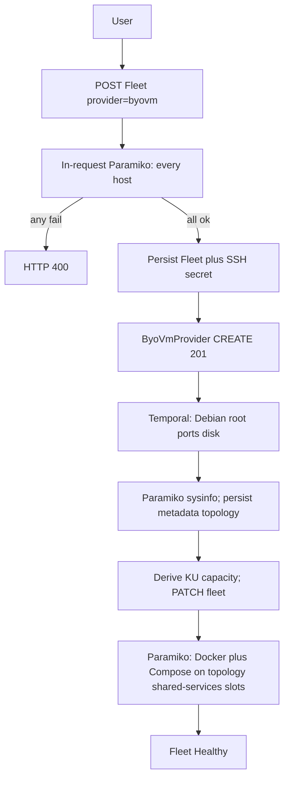
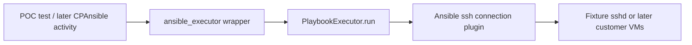

# BYO VM fleet creation (tranche 1)

New branch remains `feat/byo-vm-kafka`. This tranche multiplexes `Fleet` for Kubernetes vs customer VMs and stops when **shared services are installed and the fleet is `Healthy`**. No Kafka SKU, no cp-ansible, no agent.

Depends on nothing. Tranche 2 ([kafka-on-byo-vms.md](kafka-on-byo-vms.md)) consumes a Healthy VM fleet.

> **Superseded in one place:** the per-host log shipper is Grafana Alloy, not
> Promtail (end of life 2 Mar 2026). Same container shape, same Loki push URL,
> same `fleet_host` / `job=docker` labels — see
> [promtail-to-alloy.md](promtail-to-alloy.md). Read "Promtail" below as "Alloy".

## Success criteria

- User sees a fleet provider card labeled **BYOVM** (API key `byovm`, same naming style as **BYOK**).
- User picks a **topology SKU** (not host roles). The SKU is filtered by org environment. Hosts are connection details only (name, FQDN, IP, SSH) in **slot order**; the topology stamps roles. Advanced config, not placement.
- Create request **SSH-connects to every inventory host** with the uploaded private key. Any failure → HTTP 400 listing the host name and a user-facing remedy. No Temporal dispatch on failure.
- On SSH success: persist fleet + SSH secret, dispatch `ByoVmProvider` CREATE, return 201/202 immediately.
- Workflow installs **Docker** on hosts the topology marks as shared-services and runs Kong, Prometheus, Grafana, Loki, Alertmanager (and node_exporter / Promtail on **every** host) with **Docker Compose**, ports bound on the host. No Ansible roles or collections for these. Writes `metrics` / `logs` / `alerts` endpoints + `shared-credentials`; sets fleet `Healthy`.
- After SSH, collect host sysinfo (OS, CPU, RAM, disk) over Paramiko, **persist** topology on `Fleet.metadata`, and **derive** Kafka-unit capacity the same way BYOK does from discovery — not a user slider.
- **Foundational POC (gate):** exploratory tests prove ansible-core’s in-process Python API (`PlaybookExecutor`) can drive a play **over Ansible SSH** from the orchestrator worker (the tranche 2 contract). Shared-service install still does not use Ansible.
- Zero agent UI or agent workflows on VM fleets (list, detail, create, commands). Kubernetes fleets unchanged.

## Architecture



The Go agent is **not** used. Shared-service install does **not** use Ansible. Orchestrator activities use Paramiko for SSH sanity, sysinfo, Docker, and compose. Delete is `docker compose down`; VMs are not destroyed.

cp-ansible / `PlaybookExecutor` for Confluent Platform is **tranche 2**. Tranche 1 **must land a foundational Ansible SSH POC first** so tranche 2 is not the first time the worker is the control node and Ansible’s SSH plugin talks to a host. `connection=local` / debug-only is **not** that proof.

## Foundational Ansible Python API POC (tranche 1 gate)

Goal: prove the **exact transport contract** tranche 2 will use — orchestrator worker = Ansible control node; one `PlaybookExecutor.run()`; Ansible **SSH connection plugin** to inventory hosts. This is **not** how Loki/Kong/Prometheus are installed, and it is **not** one Temporal activity per host or per Ansible task.



**In scope**

- Add `ansible-core` to orchestrator `requirements.txt` (version compatible with later cp-ansible). Do **not** bake prometheus/grafana/confluent collections in this tranche.
- Thin wrapper ([`activities/ansible_executor.py`](fleet-manager-orchestrator/activities/ansible_executor.py)) using only: `DataLoader`, `InventoryManager`, `VariableManager`, `PlaybookExecutor`, `CallbackBase`, `ansible.context.CLIARGS`. Inventory + extra-vars from Python (`pathlib` / in-memory), never a shell. No `subprocess`, `ansible-playbook`, `ansible-galaxy`, `ansible-runner`.
- Heartbeat via `CallbackBase` (`v2_playbook_on_task_start` / `v2_runner_on_ok`) calling `activity.heartbeat`. PlaybookExecutor is blocking; it runs on the worker thread pool — same as tranche 2.

**Exploratory tests** (`test_ansible_python_api_poc.py`, run via orchestrator `./run-tests.sh`). Marked as a POC; they are a **merge gate**, not optional.

1. **SSH fixture** — ephemeral sshd (container or `sshd` on localhost with a generated key + `authorized_keys`). Not Paramiko as the play transport; not `connection=local`.
2. **Inventory** — 1–2 dummy hosts with `ansible_connection=ssh`, `ansible_host=127.0.0.1`, `ansible_port=<fixture>`, `ansible_user`, `ansible_ssh_private_key_file`. Optional second host on the same sshd proves fan-out is Ansible forks inside **one** `run()`, not extra Temporal activities.
3. **Play** — trivial remote tasks only (`ansible.builtin.ping` and/or `command: uname -a`). Assert `PlaybookExecutor.run()` succeeds and the remote command actually ran (stdout / ping pong).
4. **No CLI** — grep/import: wrapper must not import `subprocess` or `ansible_runner`; test process must not spawn `ansible-playbook`.
5. **Heartbeat** — callback fires; mock `activity.heartbeat`.

**Out of POC:** Docker/Compose via Ansible; Kong/Loki/Prometheus roles; calling `PlaybookExecutor` from `ByoVmProvider` CREATE; baking cp-ansible; real customer VMs.

Fail the tranche 1 PR if these tests are skipped, xfailed, use `connection=local` as the only path, or the wrapper shells out. Tranche 2 must not start until this gate is green.

## Shared services: Docker Compose (not Ansible)

Do **not** add prometheus-community / grafana.grafana collections, `ansible/kong/`, or any new Ansible role for Kong/Loki/Prometheus/Grafana/Alertmanager.

On each host the topology stamps with shared-service earmarks (and on **all** hosts for node_exporter + Promtail):

1. Install Docker Engine + Compose plugin (Debian, as root). Official Docker packages; not a custom Ansible role.
2. SFTP a generated compose project (checked-in templates under `fleet-manager-orchestrator/compose/shared-services/`). Include only the services that host is earmarked for; node_exporter + Promtail on every host.
3. `docker compose up -d`. **Expose on the host transparently:** `network_mode: host` (Linux) so process ports are the VM’s ports — Prometheus 9090, Loki 3100, Grafana 3000, Alertmanager **9094**, Kong 8000/8443, node_exporter 9100. No extra publish-port mapping layer.
4. Kong remains db-less: mount `kong.yml` (routes `/metrics` `/logs` `/alerts` `/grafana`). Upstreams are loopback when colocated (Dev SKUs, prod-minimal). On **prod-full**, Kong lives on `shared-ingress` and `/logs` proxies to Loki on `shared-logs` (`ansible_host`:3100). Custom certs as files on the host, mounted into Kong/Grafana. Promtail on every host points at the Loki host for that SKU.

Activity: Paramiko `exec_command` / SFTP only — not `/bin/ssh`, not `ansible-playbook`, not `subprocess` on the worker for a local docker CLI against the VMs.

GlobalConfiguration (raise if missing): `vm_ssh_connect_timeout_seconds` plus image tags/pins for `prometheus`, `grafana`, `loki`, `alertmanager`, `kong`, `node_exporter`, `promtail` (not Ansible collection versions).

## In-request SSH validation

Business logic in [`core/services/`](fleet-manager-backend/core/services/) (not serializer `validate_*`). Add `paramiko` to backend requirements.

On `FleetListView.post` when `provider=byovm`, after schema validation and before `save()` / dispatch:

1. Parse the uploaded private key; reject unreadable keys.
2. For **every** host slot in advanced-config inventory, in parallel (`asyncio.to_thread` + `asyncio.gather`): TCP connect to `ansible_host`:`ssh_port`, authenticate as `ssh_user` with that key. Honor `vm_ssh_connect_timeout_seconds` per host. Optional bastion uses Paramiko jump, still in-request. Count must equal the topology’s `vm_count`.
3. If any host fails: **do not persist**. HTTP 400 with per-host errors (plain language: cannot reach host, auth failed, timeout).
4. If all succeed: persist, write Secret `/organizations/{org}/fleet/{id}/ssh-private-key`, dispatch Temporal, return immediately.

Tests: all-hosts-ok dispatches; one-host-fail does not create a row and does not dispatch.

## UI (in scope this tranche)

All copy uses **BYOVM** as the provider name (settings `CLOUD_PROVIDERS['byovm']['name'] = 'BYOVM'`). Helper text stays plain language. Never show Ansible group names, workflow IDs, or “agent”.

### Provider catalog

- [`KubernetesFleetCreate.js`](fleet-manager-frontend/src/features/infrastructure/KubernetesFleetCreate.js) step 0 loads `sku/fleet/providers`. **BYOVM** must appear as a selectable card next to AWS / BYOK / OCI / GCP / Azure.
- Org allowlist ([`org_option_controls.py`](fleet-manager-backend/core/services/org_option_controls.py) + settings UI) includes `byovm` so the card can be enabled per org.
- [`InfrastructurePage.js`](fleet-manager-frontend/src/features/infrastructure/InfrastructurePage.js) provider label map (today hardcodes `byok: "BYOK"`) adds `byovm: "BYOVM"`.
- List/detail provider chip shows **BYOVM**, not `byovm` or “vm”.

### Create wizard — identity / placement (not inventory)

Same wizard as Kubernetes fleets. When `provider === "byovm"`:

- Name, Base Domain (dropdown filtered to domains with uploaded certs; `auto_create_certificates=false`). helperText: custom certificates required.
- Tenancy forced **Dedicated**; hide Max Tenants, Max Kafka Units, autoscale node-pool switch (those are K8s sizing).
- No cost preview (`FleetCostPreviewSync` already no-ops BYOK; same for BYOVM).
- Placement schema from `ByoVmProvider.get_placement_configs()`: no cloud account, region, VPC, or Helm bootstrap. Optional empty/minimal placement (domain already on the fleet row).
- Do **not** put the host table on this step.

After Save: navigate to fleet list or VM overview — **never** `/kubernetes-fleet/{id}/agent`. Status copy: “Checking hosts and installing monitoring”. Do not mount InstallAgent / kubeconfig / bootstrap dialogs.

### Create wizard — advanced config (topology + host slots)

[`DependentSchemaForm`](fleet-manager-frontend/src/features/infrastructure/KubernetesFleetCreate.js) for `advanced_config`. JSON Schema is **generated from Pydantic** (`ByoVmAdvancedConfigSchema.model_json_schema()`) plus a `uiSchema` overlay (titles, helperText, PEM widget). Do not hand-maintain a parallel field list in React.

- Topology dropdown is the schema driver: refetch advanced schema when `topology` changes so `hosts` becomes a **fixed-length** array (one row per slot, slot title read-only: “Kafka + Controller 1”, “Shared services”, …).
- User does **not** pick purpose, shared-service checkboxes, or Kafka roles. Those come from the topology SKU.
- Org environment gates the enum: development → Dev-minimal / Dev-full; non-prod and production → Prod-minimal / Prod-full.

SSH failures from POST surface on this step as field/host errors (which host, what to fix) — not a Temporal command page.

### Fleet list

[`InfrastructurePage.js`](fleet-manager-frontend/src/features/infrastructure/InfrastructurePage.js) Actions for a BYOVM row **omit**: kubeconfig download, Install / Bootstrap / Update agent, Refresh Metadata. Keep Overview, logs/metrics if those use fleet endpoints, delete (same guards as today).

### Fleet detail

[`InfrastructureDetailKubeHubLayout.js`](fleet-manager-frontend/src/features/infrastructure/InfrastructureDetailKubeHubLayout.js) / [`InfrastructureDetailPage.js`](fleet-manager-frontend/src/features/infrastructure/InfrastructureDetailPage.js):

- Show host inventory (slot title, stamped roles, address) from `advanced_config`, plus CPU / RAM / OS from persisted `metadata.topology` (read-only).
- Omit Agent Management tab; `/agent` redirects to overview.
- Omit AgentStatusCard, Helm releases, kubeconfig download, “No agent connected”.
- [`Breadcrumb.js`](fleet-manager-frontend/src/layout/Breadcrumb.js): no Agent Management crumb.
- [`CommandDetailPage.js`](fleet-manager-frontend/src/features/infrastructure/CommandDetailPage.js): no “Back to Agent Management”.

### Tests (must fail if UI leaks)

- Provider step renders a card whose accessible name is **BYOVM**.
- Advanced step: topology select (org-filtered: development → Dev-minimal / Dev-full; production / non-prod → Prod-minimal / Prod-full) and a **fixed** host list with slot titles; **no** purpose dropdown or shared-services checkboxes. Placement step has neither.
- Create does not navigate to `/agent`.
- List Actions for a `byovm` row has none of the agent/kubeconfig items.
- Detail has no Agent Management tab; `/agent` redirects.

## Topology SKUs (user does not choose roles)

Roles, stacking, and shared-service earmarks are **topology-owned**. A topology builder registry lets us add SKUs later without changing the fleet create form shape.

**Org gate** — `Organization.environment`:

| Org environment | Allowed topology identifiers |
|---|---|
| `development` | `dev-minimal`, `dev-full` |
| `non-prod`, `production` | `prod-minimal`, `prod-full` |

Unknown identifier, or a SKU not allowed for this org, → HTTP 400.

**v1 SKUs** (host array index = slot order; user fills connection fields only)

| SKU | UI title | VMs | Layout |
|---|---|---|---|
| `dev-minimal` | Dev minimal | 4 | 3× Kafka + KRaft **stacked**; 1× shared services (full Compose stack) |
| `dev-full` | Dev full | 7 | 3× Kafka + KRaft stacked; 1× shared services (full stack); 1× Kafka Connect; 1× Schema Registry; 1× Control Center |
| `prod-minimal` | Production minimal | 7 | 3× Kafka (brokers); 3× KRaft (controllers); 1× shared services (full stack) |
| `prod-full` | Production full | 13 | 3× Kafka; 3× KRaft; 2× Kafka Connect; 2× Schema Registry; 1× Control Center; 2× shared services (split below) |

Dev-full is **1 VM each** for Connect, Schema Registry, and Control Center (3+1+1+1+1 = 7). Do not colocate those three on two hosts.

**Stacked** = that VM is both `kafka` (broker) and `controller` (KRaft). **Dedicated** Kafka vs KRaft on prod SKUs = disjoint hosts.

**Slot keys (implement these literally in the plugins)**

`dev-minimal`: `kafka-controller-1..3` (`roles: [kafka, controller]`); `shared-services` (full Compose earmarks).

`dev-full`: same three stacked slots; `shared-services`; `kafka-connect-1`; `schema-registry-1`; `control-center-1`.

`prod-minimal`: `kafka-1..3`; `controller-1..3`; `shared-services`.

`prod-full`: `kafka-1..3`; `controller-1..3`; `kafka-connect-1..2`; `schema-registry-1..2`; `control-center-1`; `shared-ingress`; `shared-logs`.

**Prod-full shared-services split** (two hosts; Kong still one DNS name `shared-{fleet}.{domain}`):

- `shared-ingress`: Kong, Prometheus, Grafana, Alertmanager
- `shared-logs`: Loki

Kong `/logs` proxies to the Loki host. Dev SKUs and prod-minimal colocate the full stack on the single shared-services host.

**Topology builder** — new package [`fleet-manager-backend/vm_topology/`](fleet-manager-backend/vm_topology/), same plugin idea as `fleet_provider` / `observability_provider`:

```python
class VmTopologySlot:
    key: str              # kafka-1, shared-ingress
    title: str            # UI: "Kafka + Controller 1"
    roles: list[str]      # kafka, controller, kafka-connect, schema-registry, control-center, shared-services
    shared_services: list[str]  # prometheus, grafana, loki, kong, alertmanager (empty unless shared-services)

class BaseVmTopology:
    identifier: str
    display_name: str
    org_environments: tuple[str, ...]
    vm_count: int
    def slots(self) -> list[VmTopologySlot]: ...
```

Register in `settings.VM_TOPOLOGIES`. `ByoVmProvider.get_advanced_configs(partial)` reads org environment + selected `topology`, returns schema with `hosts.minItems = hosts.maxItems = vm_count` and per-index titles from `slots()`. Adding a SKU = new plugin class + registry entry; no wizard rewrite.

**SKU endpoint:** `GET /organizations/{org}/sku/fleet/providers/byovm/topologies/` → `{identifier, name, vm_count}` filtered by org environment (for tests and CLI; the advanced-config schema is the UI source of truth).

## Inputs (Pydantic; no user-chosen Kafka roles)

All user-supplied fleet config is `SanitizedPydanticModel` with `model_config = {"extra": "forbid"}`. Wire names below are API/schema fields. UI titles/helperText stay plain language.

**Placement** — [`ByoVmPlacementConfigSchema`](fleet-manager-backend/core/schemas/fleet_config_schema.py)

- Empty/minimal object (no `account`, `region`, Helm `bootstrap_config`). Add the class to `FleetPlacementConfigSchema` union. Dedicated + `max_tenants=1` are serializer-forced, not schema sliders.

**Advanced config** — same file, added to `FleetAdvancedConfigSchema` union.

`ByoVmBastionSchema`

- `host: str`
- `port: int = 22`
- `user: str`

`ByoVmHostSchema` — **connection only** (user-writable):

- `name: str` — DNS label under the fleet domain
- `fqdn: str`
- `ansible_host: str` — IP (name kept for cp-ansible inventory later; UI: “IP address”)
- `ssh_user: str`
- `ssh_port: int = 22`

Do **not** accept `purpose`, `roles`, or `shared_services` from the client (`extra=forbid`). The create/update service stamps them from `topology.slots[i]` onto host `i` before persist (store on the host object so tranche 2 does not re-index). Stamped fields are read-only on GET.

`ByoVmAdvancedConfigSchema`

- `topology: str` — must be a registered SKU allowed for this org
- `ssh_private_key: str` — write-only; stripped from stored JSON after Secret write
- `bastion: ByoVmBastionSchema | None`
- `hosts: list[ByoVmHostSchema]` — **exact** `len(hosts) == topology.vm_count` (not min_length=1)

`model_validator` / service:

- topology exists and is allowed for `organization.environment`
- host count matches `vm_count` (wrong count → 400 listing expected vs got)
- after stamp: shared-service coverage matches the SKU (full stack on one host, or prod-full split)

node_exporter + Promtail are not schema fields; they run on every host.

`ByoVmProvider.get_advanced_configs()` builds JSON Schema from the Pydantic model + topology slots (fixed host array, slot titles, PEM widget). `validate_advanced_configs` instantiates the Pydantic model then the topology plugin (do not re-implement slot rules in the serializer).

Forced at runtime: root / passwordless sudo. OS not a user field; Temporal asserts Debian (`ID=debian`).

## Host topology metadata and derived sizing (persist)

K8s fleets keep topology via discovery-probe metadata and derive KU (`FleetSizingService._derive_ku_capacity_from_probe` → `byok_capacity_kafka_units` / `max_kafka_units`). BYOVM has no agent; **Paramiko sysinfo is the probe**. Facts must be written to the database, not only activity logs.

**When:** `ByoVmProvider` CREATE after SSH sanity (every inventory host); again on Fleet UPDATE / check-hosts.

**Commands (examples; parse in Python, do not persist raw shell dumps as the only record):**

- OS: `/etc/os-release` (`ID`, `VERSION_ID`, `PRETTY_NAME`)
- Kernel: `uname -r`
- Arch: `uname -m`
- CPU: `nproc`; `lscpu` model/cores if present
- RAM: `/proc/meminfo` `MemTotal` / `MemAvailable`
- Disk: `df -B1 /` (or data mount)
- Hostname: `hostname -f`

**Persist (required)**

1. `Fleet.metadata["topology"]` (Pydantic dump, e.g. `ByoVmTopologyMetadata`):
   - `observed_at`, `source: "byovm-sysinfo"`
   - `hosts[]`: `name`, `os_id`, `os_version`, `kernel`, `arch`, `cpu_count`, `cpu_model`, `memory_bytes`, `memory_available_bytes`, `disk_free_bytes`, `hostname`
2. Map hosts into the same **nodes** shape the KU helper already understands (`allocatable_vcpu`, allocatable RAM) and call existing derivation — do not invent a second KU formula.
3. Write derived capacity on the fleet row (`max_kafka_units` and a dedicated field such as `vm_capacity_kafka_units`, parallel to `byok_capacity_kafka_units`; do not overload the BYOK field name). Read-only on the API. Hide the create-wizard KU slider; detail can show “derived from host CPU/RAM”.
4. `BackendActivities.update_fleet` (or a small dedicated PATCH) must succeed before the fleet is marked `Healthy`. Tests: create/update leaves `metadata["topology"].hosts` length = inventory; derived KU is non-null for hosts with CPU/RAM; a second probe overwrites `observed_at`.

Do **not** use `DiscoveryProbeWorkflow` or agent connection for this.

UI: fleet detail host table includes CPU, RAM, OS from `metadata.topology` (read-only).

## Fleet multiplex

- Additive `Fleet.platform`: `kubernetes` | `vm` (default `kubernetes`).
- Helper `Fleet.is_kubernetes` / `is_vm` — **the** K8s gate.
- `provider=byovm` ⇒ serializer sets `platform=vm`.
- VM CREATE **does** dispatch Temporal (unlike BYOK).
- VM delete: no `TeardownFleetClusterWorkflow`; dispatch `ByoVmProvider` DELETE. Block while Kafka exists (same as today).
- K8s SKUs (Strimzi/CFK/Redpanda/WarpStream) must exclude VM fleets so a Healthy VM fleet cannot be selected for Helm Kafka in this tranche either.

## Shared services (Healthy)

Kong (Compose, host network) on `shared-{fleet}.{domain}` (one DNS A record to the Kong host — the single shared-services VM, or prod-full `shared-ingress`; custom certs only):

- `/metrics` → Prometheus
- `/logs` → Loki
- `/alerts` → Alertmanager (**port 9094**, not 9093)
- `/grafana` → Grafana (`serve_from_sub_path`)

Write `FleetResources.endpoints` `metrics`/`logs`/`alerts` plus `shared-credentials`. Do not change `_resolve_gateway_endpoint` or platform kong-authz-proxy. No `grafana.{domain}` / `loki.{domain}`.

## File inventory (tranche 1)

**Do not touch:** Kafka cluster pages, MCP metric URLs, kong-authz-proxy, streamtime-agent, `fleet_workload/cpansible.py`, `fm_types/cp_ansible.py`, Kafka monitoring PromQL, CLI kafka create.

### New — backend

- `fleet-manager-backend/fleet_provider/byovm_provider.py`
- `fleet-manager-backend/vm_topology/` — `base.py` + `dev_minimal.py` / `dev_full.py` / `prod_minimal.py` / `prod_full.py`
- `fleet-manager-backend/core/services/vm_ssh_inventory.py`
- migrations: `Fleet.platform`, `FleetResources.ssh_private_key`, optional `vm_capacity_kafka_units`, seed SSH timeout + shared-service image tags
- tests: `test_byovm_provider.py`, `test_fleet_platform_gate.py`, `test_vm_ssh_inventory.py`, `test_byovm_topology_ku.py`, `test_vm_topologies.py` (slot counts, org-env gate, stamp roles, reject wrong host count)

### Modified — backend

- `core/models.py`, `core/schemas/fleet_config_schema.py`, `core/serializers.py`, `core/command_dispatch.py`
- `core/views/fleet/views.py`, `config.py`, `metrics.py` (kubeconfig 404)
- `fleet_manager/settings.py` — `CLOUD_PROVIDERS['byovm']`, `VM_TOPOLOGIES` registry
- `org_option_controls.py` if allowlists need `byovm`
- cert-manager / external-dns bootstrap skip when `is_vm`
- `fleet_workload/base.py` + strimzi/cfk/redpanda/warpstream — exclude VM fleets
- `requirements.txt` — `paramiko`
- `test_fleet_create_view.py`, `test_command_dispatch.py`

### New — orchestrator

- `workflows/byovm_provider.py`
- `activities/ssh_sanity.py`, `vm_sysinfo.py` (Paramiko facts → topology), `vm_docker_compose.py`, `vm_certs.py`
- `activities/ansible_executor.py` — POC wrapper only (not used by shared-service CREATE)
- `compose/shared-services/`
- `fm_types` / schema: `ByoVmTopologyMetadata` (shared with backend if needed)
- tests: `test_byovm_provider.py`, `test_ansible_python_api_poc.py` (**SSH fixture + PlaybookExecutor**; merge gate), grep no-subprocess on docker/sysinfo/ansible_executor modules

### Modified — orchestrator / image

- `worker.py`, `requirements.txt` (`paramiko`, `ansible-core` for POC + later cp-ansible; **no** collection bake in this tranche)

### Frontend / CLI

- [`KubernetesFleetCreate.js`](fleet-manager-frontend/src/features/infrastructure/KubernetesFleetCreate.js) — BYOVM card; hide K8s sizing; topology select + fixed host slots; no agent redirect
- [`InfrastructurePage.js`](fleet-manager-frontend/src/features/infrastructure/InfrastructurePage.js) — `byovm: "BYOVM"` label; strip agent Actions
- [`InfrastructureDetailPage.js`](fleet-manager-frontend/src/features/infrastructure/InfrastructureDetailPage.js), [`InfrastructureDetailKubeHubLayout.js`](fleet-manager-frontend/src/features/infrastructure/InfrastructureDetailKubeHubLayout.js) — host table, no agent tab/kubeconfig/Helm
- [`CommandDetailPage.js`](fleet-manager-frontend/src/features/infrastructure/CommandDetailPage.js), [`Breadcrumb.js`](fleet-manager-frontend/src/layout/Breadcrumb.js), [`routes.js`](fleet-manager-frontend/src/config/routes.js) (`/agent` redirect)
- Tests: `KubernetesFleetCreate.test.js`, `InfrastructurePage.test.js`, `InfrastructureDetailKubeHubLayout.test.js`, `InfrastructureDetailPage.test.js`, `CommandDetailPage.test.js`, `Breadcrumb.test.js`
- `streamtime-cli/.../commands/fleet.py` (+ `client.py` if payload fields need it)

## Out of scope (tranche 1)

Kafka / Java / JMX scrape patch / Kafka DNS names / Ubuntu/RHEL / VM provisioning / OpenCost / agent / Ansible roles for observability / using PlaybookExecutor to install Docker Compose stacks. (The Ansible SSH POC tests are **in** scope; wiring that executor into fleet CREATE is not.)
