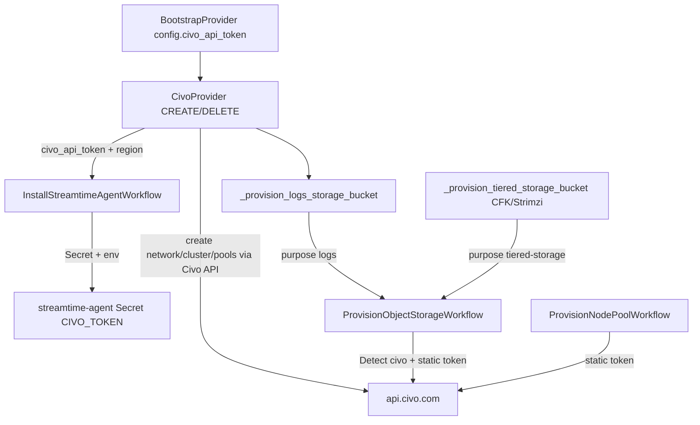

# Add Civo Bootstrap Provider

## Architecture

Civo has no IRSA/workload-identity equivalent. The same long-lived Civo API token stored on `BootstrapProvider.configuration` is used for orchestrator-side provisioning **and** injected into the agent (parallel to how AWS passes `irsa_role_arn`).

Object storage uses the **same agent workflow for both purposes**:

| Purpose | Orchestrator call site | Agent workflow |
|---|---|---|
| Loki logs | `FleetProviderBase._provision_logs_storage_bucket` | `ProvisionObjectStorageWorkflow` (`purpose: "logs"`) |
| Kafka tiered storage | `KafkaWorkloadBase._provision_tiered_storage_bucket` | `ProvisionObjectStorageWorkflow` (`purpose: "tiered-storage"`) |

Both call sites stay unchanged. CFK/Strimzi already use fleet-inferred `CloudStorageProvider` (no cloud picker in the UI) — the same path DigitalOcean fleets hit today (DO soft-skips as unsupported). Civo must **succeed** on that path and return OCI-style S3-compat HMAC credentials (`access_key` / `secret_key` / `endpoint`).



**Pattern match:** One Temporal workflow class `CivoProvider` with `action: CREATE|DELETE` (same as AWS/OCI — not three separate workflow classes). Cloud ops required by the skill live as orchestrator `@activity.defn`s + agent `cloud_provision` switch arms (backend ABC only requires schema/validate/sizing).

**SDKs:** Python [`civo`](https://github.com/civo/client-python) in orchestrator/backend activities; Go [`civogo`](https://github.com/civo/civogo) in the agent.

---

## 1. Backend plugin + registration

| File | Change |
|---|---|
| [`fleet-manager-backend/fleet_provider/civo_provider.py`](fleet-manager-backend/fleet_provider/civo_provider.py) | **New** `CivoProvider(BaseFleetProvider)`: `workflow_name='CivoProvider'`, `provider='civo'`, `get_credential()`, placement/advanced schemas, `list_networks` / validate, `get_whitelisted_regions()`, `size_fleet_compute`, `resolve_pricing` (static size table for `g4s.kube.*`) |
| [`fleet-manager-backend/fm_types/civo.py`](fleet-manager-backend/fm_types/civo.py) | **New** `CivoPlacementConfig` (`civo_region`), `CivoAdvancedConfig` (`civo_network_id`, `civo_cluster_type` k3s/talos, `civo_cni`, `civo_kubernetes_version`, `civo_logs_storage_bucket_name`, `bootstrap_config`) |
| [`fleet-manager-orchestrator/shared/fm_types/civo.py`](fleet-manager-orchestrator/shared/fm_types/civo.py) | Mirror backend types |
| [`fleet-manager-backend/core/schemas/bootstrap_provider_schema.py`](fleet-manager-backend/core/schemas/bootstrap_provider_schema.py) | `CivoCredentialsSchema` with `civo_api_token` (required, non-blank); add to union + `get_configuration_schema_for_provider()` |
| [`fleet-manager-backend/core/models.py`](fleet-manager-backend/core/models.py) | `PROVIDER_CHOICES` += `('civo', 'Civo')` |
| New migration under `core/migrations/` | Alter `BootstrapProvider.provider` choices |
| [`fleet-manager-backend/fleet_manager/settings.py`](fleet-manager-backend/fleet_manager/settings.py) | `CLOUD_PROVIDERS['civo']` |
| [`fleet-manager-backend/core/command_dispatch.py`](fleet-manager-backend/core/command_dispatch.py) | `CivoProviderInput`, `PROVIDER_WORKFLOW_MAPPING`, `WORKFLOW_INPUT_REGISTRY` |
| [`fleet-manager-backend/core/services/org_option_controls.py`](fleet-manager-backend/core/services/org_option_controls.py) | `CLOUD_VENDOR_COPY["civo"]` |
| [`fleet-manager-backend/core/serializers.py`](fleet-manager-backend/core/serializers.py) | Hardcoded provider `ChoiceField` includes `civo` |
| [`fleet-manager-backend/requirements.txt`](fleet-manager-backend/requirements.txt) | Add `civo` if plugin live-lists networks via API |

**Credential schema (plain language titles):** API token only — Civo tokens do not expire.

**Whitelisted regions (initial):** `LON1`, `NYC1`, `FRA1`, `PHX1` (hardcoded like AWS; no new GlobalConfiguration keys unless operator-tunable knobs appear later).

---

## 2. Orchestrator `CivoProvider` workflow + activities

| File | Change |
|---|---|
| [`fleet-manager-orchestrator/workflows/civo_provider.py`](fleet-manager-orchestrator/workflows/civo_provider.py) | **New** monolith (mirror AWS/OCI): workflow + activities |
| [`fleet-manager-orchestrator/workflows/providers/civo_provider.py`](fleet-manager-orchestrator/workflows/providers/civo_provider.py) | Re-export |
| [`fleet-manager-orchestrator/worker.py`](fleet-manager-orchestrator/worker.py) | Import + register all Civo `@activity.defn`s |
| [`fleet-manager-orchestrator/requirements.txt`](fleet-manager-orchestrator/requirements.txt) | Add `civo` |

### CREATE sequence
1. Status → Provisioning; load fleet + bootstrap `civo_api_token` + region from placement
2. **Network:** if `civo_network_id` omitted → `civo_create_network`; else use existing; bookkeep via `create_network` / `update_fleet`
3. **Firewall:** `civo_create_firewall` (API/control-plane ports) linked to network
4. **Sizing:** `get_fleet_sizing` → shared-services (+ workload if Shared tenancy) node counts/sizes mapped to Civo kube sizes
5. **Cluster:** `civo_create_cluster` (`network_id`, `firewall_id`, initial pools, CNI, version); poll until ready; capture kubeconfig from API response
6. Persist inventory in `fleet.metadata.civo_infra` (`network_id`, `firewall_id`, `cluster_id`, `pool_ids`, `region`) **before** later steps
7. Store kubeconfig secret; child **`InstallStreamtimeAgentWorkflow`** with `civo_api_token` + `civo_region` (not `irsa_role_arn`)
8. **`_provision_logs_storage_bucket`** — same helper as AWS/OCI (**no call-site change** to `ProvisionObjectStorageWorkflow`)
9. `bootstrap_cluster`; status ready

Kafka tiered storage is **not** provisioned during fleet CREATE. It runs later from CFK/Strimzi CREATE via `_provision_tiered_storage_bucket` → the same agent `ProvisionObjectStorageWorkflow` (see §4).

### DELETE sequence (IDs from metadata only)
1. `discover_fleet_inventory` / read `civo_infra`
2. `tear_down_cluster` → `_destroy_logs_storage_bucket`
3. Delete extra node pools → delete cluster → firewall → network (created-by-us only)
4. `cleanup_fleet_secrets`, delete agent API key, `delete_fleet`
5. Idempotent: Civo 404 / not-found = success

### Activities to implement (skill checklist)
`civo_create_network`, `civo_delete_network`, `civo_list_networks` (also used by backend plugin), `civo_create_firewall`, `civo_delete_firewall`, `civo_create_cluster`, `civo_delete_cluster`, `civo_create_node_pool`, `civo_delete_node_pool`, `civo_discover_fleet_inventory`, plus thin wrappers used by CREATE/DELETE. Object storage for Loki logs **and** Kafka tiered storage stays agent-side via `ProvisionObjectStorageWorkflow` / `DestroyObjectStorageWorkflow` (prefer agent destroy like AWS).

Stamp pool labels `streamtime.io/cloud-provider=civo` and `streamtime.io/region=<region>` at create time for reliable agent detection.

---

## 3. Agent static-token identity + cloud provision

### Helm / install (token like AWS role ARN)
| File | Change |
|---|---|
| [`charts/streamtime-agent/values.yaml`](charts/streamtime-agent/values.yaml) | `streamtime.civo.apiToken: ""`, `streamtime.civo.region: ""` |
| [`charts/streamtime-agent/templates/secret.yaml`](charts/streamtime-agent/templates/secret.yaml) | Optional key `civo-api-token` when token set |
| [`charts/streamtime-agent/templates/deployment.yaml`](charts/streamtime-agent/templates/deployment.yaml) | Env `CIVO_TOKEN` ← `secretKeyRef`; `CIVO_REGION` from values/`extraEnv` |
| Chart unit tests under `charts/streamtime-agent/tests/` | Cover secret + env wiring |
| [`fleet-manager-orchestrator/workflows/install_streamtime_agent.py`](fleet-manager-orchestrator/workflows/install_streamtime_agent.py) | If `workflow_input["civo_api_token"]`: `--set streamtime.civo.apiToken=...` and `streamtime.civo.region=...` (alongside existing `irsa_role_arn` annotation path; no WI annotations for Civo) |

### Detection + acquire
| File | Change |
|---|---|
| [`streamtime-agent/internal/activities/discovery.go`](streamtime-agent/internal/activities/discovery.go) | Detect `civo` via `streamtime.io/cloud-provider=civo` and/or `k8s.io/cloud-provider=civo`; add to `providerPriority` |
| [`streamtime-agent/internal/workflows/workload_identity.go`](streamtime-agent/internal/workflows/workload_identity.go) | `isSupportedWorkloadIdentityProvider` includes `civo` |
| [`streamtime-agent/internal/activities/workload_identity.go`](streamtime-agent/internal/activities/workload_identity.go) | `acquireCivo` / `validateCivo`: require non-empty `CIVO_TOKEN` (no expiry); return provider=`civo`, region from `CIVO_REGION` or node labels; `PermissionsValidated=true` when token present |
| [`streamtime-agent/go.mod`](streamtime-agent/go.mod) | Add `github.com/civo/civogo` |

### Cloud provision activities (`case "civo"`)
| File | Change |
|---|---|
| [`streamtime-agent/internal/activities/cloud_provision.go`](streamtime-agent/internal/activities/cloud_provision.go) | Object store create/lookup/empty/destroy via Civo Object Store API; `CreateStorageIAMBinding` no-op success (no IAM); new `CreateCivoStorageCredentials` (mirror `CreateOCIStorageCredentials`); node pool create/scale/destroy via Kubernetes pools API using `CIVO_TOKEN` |
| [`streamtime-agent/internal/workflows/cloud_provision.go`](streamtime-agent/internal/workflows/cloud_provision.go) | After bucket+IAM for `provider == "civo"`, run credential activity and return `access_key` / `secret_key` / `endpoint` — used by **both** Loki logs and Kafka tiered storage consumers |
| [`streamtime-agent/internal/worker/runner.go`](streamtime-agent/internal/worker/runner.go) | Register `CreateCivoStorageCredentials` if introduced as a distinct activity |

`ProvisionObjectStorageWorkflow` soft-skip path will **not** trigger for Civo once detection + acquire succeed (today DigitalOcean soft-skips here; Civo must not).

---

## 4. Kafka tiered storage (fleet-inferred `CloudStorageProvider`)

CFK and Strimzi do **not** expose a cloud picker for tiered storage. Users enable "Cloud storage" (`CloudStorageProvider` with bucket name + create flag). At provision time the orchestrator calls `_provision_tiered_storage_bucket` → agent `ProvisionObjectStorageWorkflow` with `purpose: "tiered-storage"` — the **same** child workflow DigitalOcean fleets already invoke (DO currently returns `skipped: true`).

Civo must be treated like **OCI** on the consumer side: enable tiered storage with S3-compat HMAC keys + endpoint (no IRSA).

### Orchestrator consumers

| File | Change |
|---|---|
| [`fleet-manager-orchestrator/workflows/base.py`](fleet-manager-orchestrator/workflows/base.py) | Docstring for `_provision_tiered_storage_bucket`: document `civo` returns `access_key` / `secret_key` / `endpoint` (same fields as OCI). Call site itself stays unchanged. |
| [`fleet-manager-orchestrator/workflows/cfk.py`](fleet-manager-orchestrator/workflows/cfk.py) | After `storage_result`, add `elif storage_result["provider"] == "civo":` branch mirroring OCI (`enabled: True`, `provider: "S3"`, `cloud: "civo"`, `aws.accessKey`/`secretKey`, `endpoint`). Update the "only AWS and OCI" warning. DELETE continues via `_destroy_tiered_storage_bucket` (agent `DestroyObjectStorageWorkflow` — works once agent supports `civo`). |
| [`fleet-manager-orchestrator/workflows/strimzi.py`](fleet-manager-orchestrator/workflows/strimzi.py) | Same `provider == "civo"` enablement as OCI (keys + endpoint). Update unsupported-provider warning. |

Example shape (mirror OCI in CFK):

```python
elif storage_result["provider"] == "civo":
    cfk_tiered_storage_values = {
        "enabled": True,
        "provider": "S3",
        "bucketName": storage_result["bucket_name"],
        "cloud": "civo",
        "aws": {
            "accessKey": storage_result.get("access_key"),
            "secretKey": storage_result.get("secret_key"),
            "region": storage_result.get("region") or "us-east-1",
        },
        "endpoint": storage_result.get("endpoint"),
    }
```

`_provision_tiered_storage_bucket` / `_destroy_tiered_storage_bucket` call sites remain unchanged — no new workflow, no credentials passed from the orchestrator (agent uses `CIVO_TOKEN`).

### Charts (S3-compat secret, like OCI)

| File | Change |
|---|---|
| [`charts/fleet-manager-cfk/templates/tiered-storage-secret.yaml`](charts/fleet-manager-cfk/templates/tiered-storage-secret.yaml) | Extend gate from `eq cloud "oci"` to also `eq cloud "civo"` (same accessKey/secretKey secret material) |
| [`charts/fleet-manager-strimzi/templates/tiered-storage-secret.yaml`](charts/fleet-manager-strimzi/templates/tiered-storage-secret.yaml) | Same |
| Related Kafka CR / values templates that reference `tieredStorage.cloud` / endpoint | Include `civo` wherever OCI S3-compat is special-cased |
| Chart unit tests | Cases for `cloud: civo` secret rendering |

### Backend preflight

| File | Change |
|---|---|
| [`fleet-manager-backend/fleet_workload/base.py`](fleet-manager-backend/fleet_workload/base.py) | `_validate_tiered_storage_bucket_availability`: add `elif provider == "civo"` using bootstrap `civo_api_token` + region to check Object Store name availability (or document deferred if API lacks a cheap existence check — then no-op with comment, matching "other providers" until implemented) |

### Explicit non-changes for tiered storage

- **No** new `CivoTieredStorageProvider` / frontend cloud enum — keep unified `CloudStorageProvider`
- **No** Redpanda account-based tiered types in this work (legacy path; out of scope)
- **No** change to how `_provision_tiered_storage_bucket` invokes `ProvisionObjectStorageWorkflow`

---

## 5. Frontend / MCP / CLI (thin)

| File | Change |
|---|---|
| [`fleet-manager-frontend/public/images/civo.png`](fleet-manager-frontend/public/images/civo.png) | Provider logo (SKU cards use `/images/${provider}.png`) |
| [`fleet-manager-frontend/src/features/infrastructure/KubernetesFleetCreate.js`](fleet-manager-frontend/src/features/infrastructure/KubernetesFleetCreate.js) | `normalizeAdvancedConfigForProvider`: omit null/`__CREATE_NEW_NETWORK__` for `civo_network_id` |
| Matching frontend tests | Extend helper tests |
| [`fleet-manager-mcp/server.py`](fleet-manager-mcp/server.py) | Docs/examples list `civo`; optional `list_civo_regions` tool |
| [`streamtime-cli/streamtime_cli/commands/provider.py`](streamtime-cli/streamtime_cli/commands/provider.py) + [`fleet.py`](streamtime-cli/streamtime_cli/commands/fleet.py) | Help strings include `civo` |

Placement/advanced/credential forms remain schema-driven (no hardcoded field lists). Kafka tiered storage UI stays as the existing "Cloud storage" schema — no Civo-specific form fields.

---

## 6. Tests

| Area | Files |
|---|---|
| Backend | `fleet_provider/tests/test_civo_provider.py`, `fm_types/tests/test_civo.py`, schema/bootstrap provider tests, command_dispatch registry; optional tiered-storage preflight for civo |
| Orchestrator | `tests/test_civo_provider_run.py`, activity unit tests with mocked Civo client; extend delete-ordering if applicable; **`test_cfk_workload_run.py` / `test_strimzi_workload_run.py`**: Civo happy path enables tiered storage with keys/endpoint (contrast existing DigitalOcean skip test) |
| Agent | discovery + WI acquire/validate + cloud_provision civo cases (bucket + credentials); chart template tests |
| Charts | CFK/Strimzi `tiered-storage-secret` tests for `cloud: civo` |
| Integration (follow-up smoke) | `integration-tests/02_infrastructure_API/test_civo_fleet.py` skeleton mirroring AWS/OCI |

Use each sub-repo `./run-tests.sh`.

---

## Implementation order

1. Credentials schema + `PROVIDER_CHOICES` + migration + `CLOUD_PROVIDERS` + command dispatch  
2. `fm_types/civo.py` + backend plugin (schemas loadable via SKU endpoints)  
3. Agent: Helm token inject + detect/acquire + object-store/node-pool + `CreateCivoStorageCredentials`  
4. Orchestrator `CivoProvider` CREATE/DELETE + install wiring + worker registration  
5. **Tiered storage:** CFK/Strimzi `provider == "civo"` branches + chart secrets + backend preflight  
6. Frontend normalizer + logo; CLI/MCP string updates  
7. Unit tests end-to-end of the above surfaces (including CFK/Strimzi Civo tiered-storage enablement)

## Out of scope / explicit non-goals

- No IRSA/WI Dynamic Group setup for Civo  
- No change to `_provision_logs_storage_bucket` or `_provision_tiered_storage_bucket` invocation of `ProvisionObjectStorageWorkflow`  
- No separate short-lived agent token — reuse the account API token (Civo tokens have no expiry)  
- UPDATE action on the provider workflow is not required (matches AWS/OCI; scale uses agent `ProvisionNodePoolWorkflow` / `ScaleNodePoolWorkflow`)  
- No new frontend tiered-storage cloud picker / `CivoTieredStorageProvider` type  
- Redpanda legacy account-based tiered storage not updated in this work  
- DigitalOcean Spaces / making DO succeed at object storage is not part of this plan (DO remains soft-skip)
