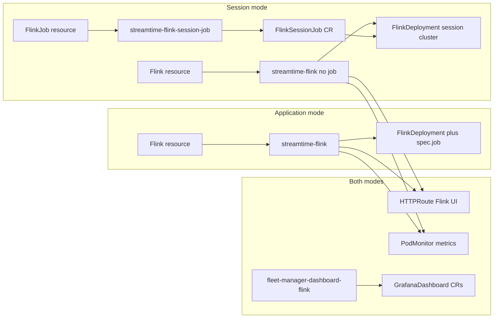

# Flink Session Mode and Session Jobs

## Current state

Today a `Flink` row is one Application-mode unit: [`FlinkAdvancedConfigSchema`](fleet-manager-backend/core/schemas/flink_schema.py) **requires** `application_jar`, [`charts/streamtime-flink/templates/flinkdeployment.yaml`](charts/streamtime-flink/templates/flinkdeployment.yaml) emits `spec.job` when that jar is set, and CUD is `FlinkCreate/Update/DeleteWorkflow` → agent `DeployFlinkWorkloadWorkflow` / `TeardownFlinkWorkloadWorkflow`. There is no deployment-mode field, no job child resource, no HTTPRoute for the Flink UI, and no PodMonitor / fleet Grafana dashboard install.

Apache Flink Kubernetes Operator already supports this split:

- **Application:** `FlinkDeployment` with `spec.job`
- **Session:** `FlinkDeployment` **without** `spec.job`, plus one `FlinkSessionJob` CR per job (`spec.deploymentName` → the session cluster)



**Greenfield assumption:** there are no existing Flink deployments or stored `Flink` rows to preserve. Do **not** write data migrations, backfills, dual-write, or API fallbacks for old payloads that omit `mode`.

**Schema migration still required:** Django `makemigrations` for `Flink.mode`, `Flink.ui_url`, and `FlinkJob` (AddField + CreateModel only). No `RunPython`.

**API contract:** `mode` is **required** on Flink create (`application` | `session`). Advanced configuration is validated strictly against that mode. Session clusters accept any number of jobs.

**Metrics approach (chosen):** Flink’s built-in **Prometheus reporter** (`metrics.reporter.prom.*` in `flinkConfiguration`, port **9249**) + **PodMonitor**. This is the Flink-native path that feeds the existing `flink_*` PromQL dashboards. Not a Kafka-style JMX exporter sidecar.

---

## 1. Backend model and schemas

### `Flink.mode` and `Flink.ui_url` ([`core/models.py`](fleet-manager-backend/core/models.py))

```python
MODE_CHOICES = [("application", "Application"), ("session", "Session")]
mode = models.CharField(max_length=16, choices=MODE_CHOICES)
ui_url = models.TextField(
    blank=True, null=True,
    help_text="HTTPS URL of the Flink Web UI (set by the create workflow after HTTPRoute is ready).",
)
```

- `mode`: **required** on create; writable on create, **read-only on PATCH/PUT**.
- `ui_url`: **read-only** on the API for clients; written by orchestrator via `update_flink` after deploy. Cleared on delete.

Also add `@reversion.register()` on `Flink` and on the new job model.

### Mode-specific advanced config ([`core/schemas/flink_schema.py`](fleet-manager-backend/core/schemas/flink_schema.py))

Keep one `SchemaField`. Split validation in the serializer:

| Mode | Required | Forbidden |
|---|---|---|
| `application` | `application_jar` (plus job fields: args, parallelism, `upgrade_mode`, savepoint) | — |
| `session` | — (cluster-only config) | `application_jar`, `application_args`, `parallelism`, `upgrade_mode`, `savepoint_strategy` |

Shared cluster fields on both: `image`, `kafka`, `flink_conf`, JM/TM resources/replicas, `chart_config`, volumes, security.

- `application_jar` is optional on the stored schema (Session omits it); **serializer requires it when `mode=application`**.
- `FlinkCreateSchema` / `FlinkResponseSchema` include required `mode` and response `ui_url`.

### New `FlinkJob` model ([`core/models.py`](fleet-manager-backend/core/models.py))

Org-scoped child of a **session** `Flink`:

- UUID PK, `identifier` (`validate_identifier`), `organization` FK, `flink` FK (`related_name="jobs"`, `on_delete=CASCADE`), `author`, `description`, `tags`, `status` (same choices as Flink), timestamps
- `advanced_configuration = SchemaField(schema=FlinkJobAdvancedConfigSchema)` — job-only: `application_jar` (required), `application_args`, `parallelism`, `upgrade_mode`, `savepoint_strategy`, optional `flink_conf` overrides, **`chart_config.main`** (`version`, `registry_url`, `values`)
- `unique_together = [("flink", "identifier")]`
- `auditlog.register` + `@reversion.register`

New file: [`core/schemas/flink_job_schema.py`](fleet-manager-backend/core/schemas/flink_job_schema.py).

### Job create guards

In `FlinkJob` create serializer/service:

1. Parent `Flink` must exist, `mode == "session"`, and `status` not Deleting.
2. Prefer parent `status == Healthy` before dispatch (orchestrator also enforces).
3. Application-mode parent → **HTTP 400** (“Jobs can only be created on a session cluster.”).

### Migration (schema-only)

`python manage.py makemigrations`: AddField `mode`, AddField `ui_url`, CreateModel `FlinkJob`. **No data migration.**

---

## 2. API: serializers, views, URLs, dispatch

### Serializers ([`core/serializers.py`](fleet-manager-backend/core/serializers.py))

- Extend `FlinkSerializer`: `mode` (create-only write), `ui_url` (read-only), mode-aware advanced config validation, `jobs_count` read-only.
- New `FlinkJobSerializer`: nested `flink` from URL kwargs; `select_related("flink", "organization", "fleet")` as needed.

### URLs ([`fleet_manager/urls.py`](fleet-manager-backend/fleet_manager/urls.py))

```
organizations/<org>/flinks/<flink_id>/jobs/
organizations/<org>/flinks/<flink_id>/jobs/<job_id>/
organizations/<org>/flinks/<flink_id>/jobs/<job_id>/compute-components/
organizations/<org>/flinks/<flink_id>/jobs/<job_id>/status/

organizations/<org>/sku/flink/session-job/advanced-configuration/
organizations/<org>/sku/flink/session-job/advanced-configuration/validate/
```

Flink SKU advanced endpoints ([`core/views/flink/config.py`](fleet-manager-backend/core/views/flink/config.py)): read `mode` from POST body; return **application** schema (jar required) vs **session** schema (cluster fields only — no jar).

### Views / command dispatch

- New [`core/views/flink/jobs.py`](fleet-manager-backend/core/views/flink/jobs.py): thin adrf CUD; dispatch 202.
- Subjects: `/organizations/{org}/flinks/{flink_id}/jobs/{job_id}/command/FlinkJob{Create|Update|Delete}Workflow`
- [`core/command_dispatch.py`](fleet-manager-backend/core/command_dispatch.py): `FlinkJobWorkflowInput`; register three workflows; parse job subject **before** flink subject; inject `flink_id` + `job_id`.
- Workflow terminate/kill for flink jobs in [`core/views/workflows/views.py`](fleet-manager-backend/core/views/workflows/views.py).

### Compute components ([`flink_components.py`](fleet-manager-backend/core/services/flink_components.py))

For **both** modes, inject into Helm values (like Kafka Connect / Strimzi):

- `flink.flink_conf` metrics reporter keys (if not already set by user):
  - `metrics.reporters: prom`
  - `metrics.reporter.prom.factory.class: org.apache.flink.metrics.prometheus.PrometheusReporterFactory`
  - `metrics.reporter.prom.port: 9249`
- `kongGatewayApi.sharedGatewayName` / `sharedGatewayNamespace` / `listenerName` from the Flink’s fleet
- `ingress.hostname`: `flink-ui-{flink_id}.{base_domain}` (fleet DNS / domain resolution, same source as Kafka UI hosts)
- For `mode=session`: omit jar/args/parallelism/`upgrade_mode` so `spec.job` is omitted

New [`flink_job_components.py`](fleet-manager-backend/core/services/flink_job_components.py) for session-job chart (no HTTPRoute on the job chart — UI is cluster-scoped).

[`preload/package_rules.yaml`](fleet-manager-backend/preload/package_rules.yaml): Streamtime Flink Session Job + Streamtime Flink Dashboard rules (`preferred_registry: ghcr.io`).

---

## 3. Helm charts

### [`charts/streamtime-flink`](charts/streamtime-flink/) (both modes)

1. **Session vs application:** omit `spec.job` when jar empty; unit tests for both.
2. **Metrics:**
   - Ensure JM/TM pod template exposes metrics (operator-managed pods pick up `flinkConfiguration` reporter).
   - New `templates/podmonitor.yaml` selecting Flink JM/TM pods (operator labels), port `9249`, path `/metrics`, scrape interval matching Kafka PodMonitors.
3. **Flink UI HTTPRoute** (new `templates/flink-ui-httproute.yaml`), pattern from [`streamtime-kafkaconnect/templates/httproute.yaml`](charts/streamtime-kafkaconnect/templates/httproute.yaml):
   - `parentRefs` → fleet Kong shared gateway
   - `hostnames` / `external-dns` annotation from `ingress.hostname`
   - `backendRefs` → Flink REST Service `{release}-rest` port **8081** (operator convention for JobManager REST / Web UI)
   - Values: `ingress.hostname`, `kongGatewayApi.*`

### New [`charts/streamtime-flink-session-job/`](charts/streamtime-flink-session-job/)

`FlinkSessionJob` CR; release `{job_id}-flink-job`; namespace `{flink_id}`; `spec.deploymentName` = session FlinkDeployment name.

### New [`charts/fleet-manager-dashboard-flink/`](charts/fleet-manager-dashboard-flink/)

Mirror [`fleet-manager-dashboard-kafka`](charts/fleet-manager-dashboard-kafka/):

- `GrafanaDashboard` CRs from adapted JSON (source: [`monitoring/grafana/provisioning/dashboards/FlinkOverview.json`](monitoring/grafana/provisioning/dashboards/FlinkOverview.json), `FlinkJobs.json`, `FlinkCheckpoints.json`)
- UIDs stay `flink-overview`, `flink-jobs`, `flink-checkpoints` so the existing Monitoring tab paths keep working
- `$namespace` / datasource UID substitution like the Kafka dashboard chart
- Release: `{flink_id}-dashboard-flink` in fleet `monitoring` namespace (same pattern as `{kafka_id}-dashboard-kafka`)

---

## 4. Orchestrator

### [`workflows/flink.py`](fleet-manager-orchestrator/workflows/flink.py)

**Create (both modes):**

1. Resolve fleet + compute-components (includes hostname, gateway, metrics conf).
2. Deploy agent `DeployFlinkWorkloadWorkflow` (streamtime-flink chart).
3. Install dashboard chart as a second Helm release via agent (or same deploy charts list): `{flink_id}-dashboard-flink`.
4. PATCH Flink: `status=Healthy`, **`ui_url=https://{ingress.hostname}`**.

**Update:** redeploy / upgrade charts; refresh `ui_url` if hostname changes.

**Delete:**

1. If `mode == session`, list/teardown jobs first.
2. Uninstall dashboard release + streamtime-flink release.
3. Clear `ui_url`; delete Flink row when hard-delete requested.

### New [`workflows/flink_job.py`](fleet-manager-orchestrator/workflows/flink_job.py)

| Workflow | Agent child |
|---|---|
| `FlinkJobCreateWorkflow` | `DeployFlinkJobWorkloadWorkflow` (parent must be session + Healthy) |
| `FlinkJobUpdateWorkflow` | `UpdateFlinkJobWorkloadWorkflow` (Helm upgrade) |
| `FlinkJobDeleteWorkflow` | `TeardownFlinkJobWorkloadWorkflow` (uninstall job release only) |

SDK: `get_flink_job`, `list_flink_jobs`, `update_flink_job`, `delete_flink_job`, `get_flink_job_compute_components`. Ensure `update_flink` can set `ui_url`.

---

## 5. Streamtime-agent (Go)

New [`internal/workflows/flink_job.go`](streamtime-agent/internal/workflows/flink_job.go):

- Deploy / Update / Teardown job workflows (Helm only; no namespace delete on job teardown).
- Register in [`runner.go`](streamtime-agent/internal/worker/runner.go).
- Status wait on `flinksessionjobs`; cluster wait unchanged on `flinkdeployments`.
- [`status.go`](streamtime-agent/internal/activities/status.go): list `FlinkSessionJob` as well as `FlinkDeployment`.

Cluster Deploy already installs whatever charts the orchestrator passes (metrics PodMonitor + HTTPRoute come from the streamtime-flink chart templates).

---

## 6. Frontend

- **Create** ([`FlinkCreate.js`](fleet-manager-frontend/src/features/flink/FlinkCreate.js)): required Deployment mode; mode-specific advanced schema (session has no jar / no max jobs); keep cluster `FlinkChartPicker`.
- **List** ([`FlinkPage.js`](fleet-manager-frontend/src/features/flink/FlinkPage.js)): mode column; optional Open Flink UI action when `ui_url` present.
- **Detail** ([`FlinkDetail.js`](fleet-manager-frontend/src/features/flink/FlinkDetail.js)):
  - **Open Flink UI** button (`href={flink.ui_url}`, `target="_blank"`, `rel="noopener noreferrer"`) — same pattern as Kafka `console_url` / `PageActionsButton`; disabled with helper text when `ui_url` is empty (still provisioning).
  - Session: Jobs tab + nested routes; hide application jar fields.
  - Monitoring tab: keep existing Grafana iframe UIDs (now backed by real scrape + fleet GrafanaDashboard install).
- **Job create/detail:** `FlinkJobChartPicker` (ghcr.io preferred, registry:5000 local) writing `chart_config.main`; schema-driven job form.
- Hooks + [`routes.js`](fleet-manager-frontend/src/config/routes.js) nested job routes.

UI copy: “Deployment mode”, “Open Flink UI”, “Job JAR path”, “Version”, “Registry” — never workflow IDs or CRD names.

---

## 7. Other API consumers

| Consumer | Change |
|---|---|
| Orchestrator SDK | Job CRUD + `ui_url` on update_flink |
| MCP | list/get Flink + session jobs (include `ui_url`) |
| CLI | `flink` + `flink job` commands |
| Smoke | Application create with `mode: application` + jar; session create with `mode: session` + job dispatch |

---

## Implementation order

1. Schemas + `mode` + `ui_url` + `FlinkJob` + schema-only migration + serializer validation
2. SKU advanced schemas by mode
3. Helm: metrics PodMonitor + HTTPRoute on streamtime-flink; session-job chart; dashboard-flink chart
4. Agent job workflows
5. Orchestrator: write `ui_url`, install dashboards, FlinkJob CUD, session delete cascade
6. API exercise (curl) before UI
7. Frontend: mode, Open Flink UI, jobs + chart picker
8. MCP + CLI + smoke

---

## Files changed (complete)

**Backend**

- [`fleet-manager-backend/core/models.py`](fleet-manager-backend/core/models.py)
- [`fleet-manager-backend/core/schemas/flink_schema.py`](fleet-manager-backend/core/schemas/flink_schema.py)
- `fleet-manager-backend/core/schemas/flink_job_schema.py` (new)
- [`fleet-manager-backend/core/serializers.py`](fleet-manager-backend/core/serializers.py)
- [`fleet-manager-backend/core/views/flink/views.py`](fleet-manager-backend/core/views/flink/views.py)
- [`fleet-manager-backend/core/views/flink/config.py`](fleet-manager-backend/core/views/flink/config.py)
- [`fleet-manager-backend/core/views/flink/__init__.py`](fleet-manager-backend/core/views/flink/__init__.py)
- `fleet-manager-backend/core/views/flink/jobs.py` (new)
- [`fleet-manager-backend/core/command_dispatch.py`](fleet-manager-backend/core/command_dispatch.py)
- [`fleet-manager-backend/core/services/flink_components.py`](fleet-manager-backend/core/services/flink_components.py)
- `fleet-manager-backend/core/services/flink_job_components.py` (new)
- [`fleet-manager-backend/core/views/workflows/views.py`](fleet-manager-backend/core/views/workflows/views.py)
- [`fleet-manager-backend/fleet_manager/urls.py`](fleet-manager-backend/fleet_manager/urls.py)
- [`fleet-manager-backend/preload/package_rules.yaml`](fleet-manager-backend/preload/package_rules.yaml)
- `fleet-manager-backend/core/migrations/0xxx_flink_mode_ui_job.py` (schema-only)
- [`fleet-manager-backend/core/tests/test_flink.py`](fleet-manager-backend/core/tests/test_flink.py)
- `fleet-manager-backend/core/tests/test_flink_job.py` (new)
- [`fleet-manager-backend/core/tests/views/test_flink_sku.py`](fleet-manager-backend/core/tests/views/test_flink_sku.py)
- [`fleet-manager-backend/core/tests/views/test_flink_compute_components.py`](fleet-manager-backend/core/tests/views/test_flink_compute_components.py)

**Helm**

- [`charts/streamtime-flink/templates/flinkdeployment.yaml`](charts/streamtime-flink/templates/flinkdeployment.yaml)
- `charts/streamtime-flink/templates/podmonitor.yaml` (new)
- `charts/streamtime-flink/templates/flink-ui-httproute.yaml` (new)
- [`charts/streamtime-flink/values.yaml`](charts/streamtime-flink/values.yaml)
- [`charts/streamtime-flink/tests/flinkdeployment_test.yaml`](charts/streamtime-flink/tests/flinkdeployment_test.yaml)
- `charts/streamtime-flink-session-job/` (new)
- `charts/fleet-manager-dashboard-flink/` (new; JSON adapted from `monitoring/grafana/provisioning/dashboards/`)

**Orchestrator**

- [`fleet-manager-orchestrator/workflows/flink.py`](fleet-manager-orchestrator/workflows/flink.py)
- `fleet-manager-orchestrator/workflows/flink_job.py` (new)
- [`fleet-manager-orchestrator/shared/fm_types/flink_workload.py`](fleet-manager-orchestrator/shared/fm_types/flink_workload.py)
- [`fleet-manager-orchestrator/activities/sdk.py`](fleet-manager-orchestrator/activities/sdk.py)
- [`fleet-manager-orchestrator/activities/backend.py`](fleet-manager-orchestrator/activities/backend.py)
- [`fleet-manager-orchestrator/worker.py`](fleet-manager-orchestrator/worker.py)
- Orchestrator tests

**Agent**

- `streamtime-agent/internal/workflows/flink_job.go` (new)
- `streamtime-agent/internal/workflows/flink_job_test.go` (new)
- [`streamtime-agent/internal/worker/runner.go`](streamtime-agent/internal/worker/runner.go)
- [`streamtime-agent/internal/activities/status.go`](streamtime-agent/internal/activities/status.go)

**Frontend**

- [`fleet-manager-frontend/src/features/flink/FlinkCreate.js`](fleet-manager-frontend/src/features/flink/FlinkCreate.js)
- [`fleet-manager-frontend/src/features/flink/FlinkPage.js`](fleet-manager-frontend/src/features/flink/FlinkPage.js)
- [`fleet-manager-frontend/src/features/flink/FlinkDetail.js`](fleet-manager-frontend/src/features/flink/FlinkDetail.js)
- `fleet-manager-frontend/src/features/flink/FlinkJobCreate.js` (new)
- `fleet-manager-frontend/src/features/flink/FlinkJobDetail.js` (new)
- `fleet-manager-frontend/src/features/flink/components/FlinkJobChartPicker.jsx` (new)
- `fleet-manager-frontend/src/features/flink/components/__tests__/FlinkJobChartPicker.test.jsx` (new)
- [`fleet-manager-frontend/src/hooks/flink.js`](fleet-manager-frontend/src/hooks/flink.js)
- [`fleet-manager-frontend/src/config/routes.js`](fleet-manager-frontend/src/config/routes.js)

**MCP / CLI / smoke**

- [`fleet-manager-mcp/server.py`](fleet-manager-mcp/server.py)
- `streamtime-cli/streamtime_cli/commands/flink.py` (new)
- [`integration-tests/test_smoke_suite.py`](integration-tests/test_smoke_suite.py)

---

## Out of scope / explicit non-goals

- `max_jobs` / job-count enforcement
- Changing Application-mode semantics (still one job inside `FlinkDeployment`)
- Allowing `FlinkJob` on Application clusters
- Changing Flink `mode` after create
- Kafka-style JMX exporter sidecar (use Flink Prometheus reporter instead)
- Data migrations or legacy payload shims
- Reworking unused cluster `UpdateFlinkWorkloadWorkflow` (optional follow-up)
