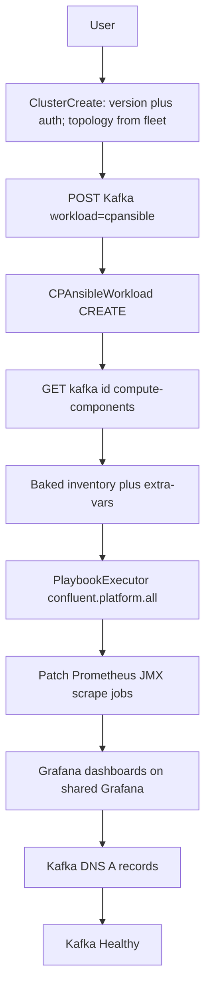

# Kafka on BYO VMs (tranche 2)

Depends on tranche 1: a `platform=vm` fleet that is already `Healthy` with Kong + Prometheus + Grafana + Loki + Alertmanager and `metrics`/`logs`/`alerts` endpoints, **and** the tranche 1 Ansible SSH `PlaybookExecutor` POC (ephemeral sshd, not `connection=local`) is green. Plan: [byo-vm-fleet.md](byo-vm-fleet.md). Same branch `feat/byo-vm-kafka`. Do **not** start this tranche if that POC was skipped.

This tranche deploys **Confluent Platform (VM)** (`cpansible`): KRaft + Kafka, plus Schema Registry / Control Center / Connect **only when the fleet topology includes those slots**. Backend **`compute-components/`** is the source of truth: it emits a fully baked cp-ansible inventory + extra-vars from **stamped fleet topology**, not from form pickers. The orchestrator must not reassemble inventory from raw form fields.

## Success criteria

- User sees Kafka SKU **Confluent Platform (VM)** (`workload=cpansible`); fleet picker is Healthy **BYOVM** fleets only (existing `fleet-selection/` API, SKU-gated — see below).
- Advanced config: **version + authentication only**. Host roles come from the fleet **topology SKU** (stamped in tranche 1). No controller/broker/SR/CC pickers. No SSH re-entry. No Helm chart editor.
- `GET/POST .../kafka/{id}/compute-components/` for `cpansible` returns inventory in **cp-ansible `hosts.yml` shape** (groups + `all.vars`). Workflow consumes that payload only.
- CREATE installs CP (custom certs, JMX on, OpenJDK 17). Kafka `Healthy`.
- **Do not change** `KafkaClusterDetail.js` / `ClusterDetailPage.js`. Add `cpansible` PromQL in `monitoring.py`.
- UPDATE via packages endpoint (`confluent_package_version`). DELETE uninstalls CP; fleet shared services remain.

## Architecture



No agent. Ansible Python API (`PlaybookExecutor` + Ansible **ssh** connection plugin) is **for cp-ansible only** (not used for shared services). Tranche 1 already proved that path against a fixture sshd; this tranche reuses the same `ansible_executor` wrapper against real fleet hosts. Bake `confluent.platform` at image build. GC key `cp_ansible_collection_version` (raise if missing).

JMX scrape jobs: patch the **Docker** Prometheus `prometheus.yml` on the monitoring host via Paramiko (same compose project), not an Ansible role.

## UI (in scope)

Plain language only. Never show Ansible group names (`kafka_broker`), workflow IDs, or “agent”.

### SKU + fleet selection

- [`ClusterCreate.js`](fleet-manager-frontend/src/features/clusters/ClusterCreate.js): SKU card **Confluent Platform (VM)** from kafka SKU catalog (`KAFKA_CLUSTER_PROVIDERS['cpansible']['name']`).
- **Reuse** `POST .../sku/kafka/providers/{sku}/fleet-selection/` and `/validate/` — same `cluster_id` picker and create payload `fleet_selection: { cluster_id }`. No new endpoint, no new scheduler. Host assignment is **not** on this step (or any step).
- When `workload=cpansible`: pin `cloud_provider=byovm`, pin tenancy **Dedicated**, hide region (same as BYOK). Hide Kafka-units slider and cost preview; still POST `kafka_units` (e.g. `1`) because [`KafkaFleetSelectionRequestSerializer`](fleet-manager-backend/core/views/kafka/config.py) requires it. No agent-connected prerequisite.
- Hide [`KafkaChartVersionsEditor`](fleet-manager-frontend/src/components/BootstrapConfig) / `advanced_config.chart_config` — there are no Helm charts.

## Fleet selection (existing pipeline, SKU-gated)

Today [`FleetSelectionView`](fleet-manager-backend/core/views/kafka/config.py) lists `Fleet` rows with `provider=cloud_provider` + tenancy, ranks via `FleetSelectionService` (remaining Kafka units), then the SKU plugin’s `get_selection_configs` emits a `cluster_id` enum. `filter_eligible_clusters` keeps `Healthy` fleets with enough remaining KU and a free tenant slot.

`cpansible` uses that same path (`.../providers/cpansible/fleet-selection/`). Changes are **eligibility + wizard gating**, not a new selection model.

**Cloud-provider list (the main leak today)** — [`list_kafka_cloud_provider_options`](fleet-manager-backend/core/services/org_option_controls.py) returns every `CLOUD_PROVIDERS` key. Gate by SKU:

- `cpansible` → only `byovm` (plus org allowlist). Add BYOVM to `CLOUD_VENDOR_COPY`.
- Helm SKUs (`strimzi` / `cfk` / `redpanda` / `warpstream` / …) → omit `byovm`. AWS/GCP/BYOK must not appear for `cpansible`.

**`CPAnsibleWorkload.get_selection_configs` / `validate_selection_configs`**

- Eligible: `provider=byovm` / `platform=vm`, `Healthy`, Dedicated, remaining KU from persisted `max_kafka_units` / `vm_capacity_kafka_units` (Plan 1 sysinfo), `active_tenants < max_tenants` (Plan 1 `max_tenants=1` → one Kafka cluster per fleet).
- Schema: `cluster_id` enum of those identifiers (plain-language title: “Fleet”). Default first / recommended from `FleetSelectionService` as today.
- Validate: reject a Kubernetes fleet id (and any non-Healthy / non-Dedicated BYOVM). No agent check.

**Helm SKUs (inverse)** — `filter_eligible_clusters` and/or the fleet-selection queryset must **drop `platform=vm`** even if the client posts `cloud_provider=byovm`. Validate must reject a BYOVM fleet id for Strimzi/CFK/etc. (Plan 1 already lists this; implement/assert here if not already green.)

**Best-fit / first-fit** — unchanged. It still ranks by remaining KU; BYOVM capacity is the derived number from Plan 1.

**Optional (advanced, not selection):** refuse `get_advanced_configs` if the chosen fleet has no topology SKU or the SKU’s slots lack ≥3 controller and ≥1 kafka roles (all v1 SKUs satisfy this). Do not put a host table on the fleet-selection step.

**Tests**

- `cpansible` fleet-selection with `cloud_provider=byovm` returns only Healthy Dedicated BYOVM ids; a Healthy Kubernetes fleet is absent.
- `cpansible` + `cloud_provider=aws` (or `byok`) → 400/403.
- `strimzi` (etc.) fleet-selection never includes a `byovm` fleet; validate of a VM `cluster_id` fails.
- UI: after picking Confluent Platform (VM), cloud-provider cards are BYOVM only; region and Kafka-units slider hidden; fleet dropdown has no Kubernetes fleets.

### Advanced config (no host assignment)

Schema from `POST .../sku/kafka/providers/cpansible/advanced-configuration/` (plugin `get_advanced_configs(selection_config)`).

User-writable fields only:

- Confluent Platform version
- Authentication (default Scram)
- Optional custom broker/controller properties as an escape hatch

Show a **read-only recap** of the fleet topology (SKU title, VM count, slot titles + host names already on the fleet). That is confirmation, not a picker. Do **not** emit multi-selects for Controllers / Brokers / Schema Registry / Control Center / Connect.

Do **not** re-ask SSH key, jump host, or shared-service earmarks (fleet already has those). helperText on every field.

Save payload is **version/auth only**. The baker reads stamped `roles` on `fleet.advanced_config.hosts`. Inventory baking is not done in the browser.

### After create

Navigate to the existing Kafka cluster list/detail (unchanged pages). No agent install step.

### Tests

- SKU card accessible name is exactly `Confluent Platform (VM)`.
- After picking that SKU: only BYOVM cloud-provider card; region and Kafka-units slider hidden; fleet dropdown has no Kubernetes fleets.
- Advanced form has version/auth only; a read-only topology recap is allowed; **no** host multi-selects. Placement/selection does not contain a host table.
- Chart versions editor is not mounted for `cpansible`.
- Create does not require or link to agent management.

## Topology → inventory (user does not choose Kafka roles)

Tranche 1 stamped `roles` (and slot keys) onto each fleet host. Tranche 2 **never** asks the user to re-assign them.

| Fleet topology | cp-ansible groups present |
|---|---|
| `dev-minimal` | `kafka_controller` + `kafka_broker` on the **same** 3 hosts (stacked). No SR / CC / Connect. |
| `dev-full` | Same stacked 3; plus `kafka_connect` (1), `schema_registry` (1), `control_center` (1). |
| `prod-minimal` | 3 dedicated `kafka_broker` + 3 dedicated `kafka_controller`. No SR / CC / Connect. |
| `prod-full` | 3 brokers, 3 controllers, 2 Connect, 2 Schema Registry, 1 Control Center. |

Omit empty groups from inventory (do not emit `schema_registry: { hosts: {} }` as a required group). Minimal SKUs are Kafka + KRaft only.

**Connect is in scope** when the topology has `kafka-connect` slots (`dev-full`, `prod-full`). ksqlDB, REST Proxy, and Replicator stay out of scope.

Shared-services hosts never appear in CP groups.

## Inputs (API)

Reuse fleet `advanced_config.hosts` (name, **stamped** `roles`, FQDN, IP, SSH user/port, shared services). Kafka `advanced_config` (`extra=forbid`):

- `confluent_package_version`, `sasl_protocol` (default `scram`)
- optional custom properties

Reject client-supplied `controllers` / `brokers` / `schema_registry` / `control_center` / `kafka_connect` lists. Roles come only from the fleet topology.

Forced at bake time (not user toggles): `ssl_custom_certs=true`, `self_signed=false`, `jmxexporter_enabled=true`, `install_java=true`, `debian_java_package_name=openjdk-17-jdk`, `ansible_become`, package install.

## compute-components (backend is source of truth)

Today [`KafkaComputeComponentsView`](fleet-manager-backend/core/views/shared/kafka_workload_charts.py) only allows Helm types (`strimzi`, `cfk`, `redpanda`, `warpstream`) and returns chart `resolved_version` / `resolved_values`.

**Add `cpansible`.** Do not run the Helm package-rule pipeline for it.

Cluster-scoped (canonical, used by the workflow):

- `GET/POST /organizations/{org}/kafka/{kafka_id}/compute-components/`

Create-time preview (optional, same baker): extend workload-scoped compute-components to accept `workload_type=cpansible` plus fleet id + draft advanced_config if needed; after the Kafka row exists, cluster-scoped GET is what Temporal calls.

Baker service (e.g. [`core/services/cpansible_inventory.py`](fleet-manager-backend/core/services/cpansible_inventory.py)):

1. Load fleet hosts + SSH metadata (not the private key) + topology identifier.
2. Map **stamped** host `roles` → cp-ansible groups: `controller` → `kafka_controller`, `kafka` → `kafka_broker`, `schema-registry` → `schema_registry`, `control-center` → `control_center`, `kafka-connect` → `kafka_connect`. Stacked hosts appear in **both** controller and broker groups.
3. Emit inventory matching [cp-ansible `hosts_example.yml`](https://github.com/confluentinc/cp-ansible/blob/master/hosts_example.yml): `all.children.<group>.hosts.<name>` with `ansible_host`, `ansible_user`, `ansible_port`, `ansible_become=true`. Skip groups the SKU does not include.
4. Emit `all.vars` from Pydantic `CpAnsibleAllVars.model_dump()` (version, ssl_*, jmxexporter_*, sasl, java). Cert file paths are placeholders the activity fills after materializing PEMs. **Never** put the SSH private key or PEMs in the JSON.
5. Include advertised hostnames / listener mapping derived from fleet domain + host FQDNs.

Response shape (same top-level `{ "components": { ... } }` as Helm SKUs):

```json
{
  "components": {
    "cpansible": {
      "confluent_package_version": "8.0.0",
      "inventory": { "all": { "vars": {}, "children": { "kafka_controller": {}, "kafka_broker": {}, "schema_registry": {}, "control_center": {}, "kafka_connect": {} } } },
      "extra_vars": {}
    }
  }
}
```

`extra_vars` may duplicate `all.vars` if that is easier for `PlaybookExecutor`; keep one Pydantic model so they cannot drift.

Orchestrator `CPAnsibleWorkload`: `BackendActivities.get_kafka_compute_components` → feed `inventory` + `extra_vars` into `PlaybookExecutor`. If compute-components is missing groups or hosts, fail the workflow; do not invent hosts.

Tests: given a BYOVM fleet with topology `dev-minimal`, compute-components has stacked controller+broker on the same 3 names and **no** SR/CC/Connect groups; `dev-full` / `prod-full` include those groups from stamped slots; `prod-minimal` has disjoint broker vs controller names; client role lists are ignored/rejected; SSH PEM absent from body; Helm `resolved_registry_url` absent.

## Workflows

- `CPAnsibleWorkload` CREATE / UPDATE / DELETE on `fleet-manager-tasks`.
- CREATE/UPDATE: compute-components → materialize certs onto control node → `PlaybookExecutor` `confluent.platform.all`.
- DNS: `{kafka}-b{i}.{domain}`, `{kafka}-bootstrap.{domain}`; plus `{kafka}-schema-registry.{domain}` / `{kafka}-control-center.{domain}` / Connect names **only when those slots exist** on the fleet topology.
- After playbook: scrape controller `:8079`, broker `:8080`; dashboards on `https://shared-{fleet}.{domain}/grafana`.

## File inventory (tranche 2)

**Do not touch:** KafkaClusterDetail.js, ClusterDetailPage.js, MCP utils URLs, kong-authz-proxy, streamtime-agent.

### New — backend

- `fleet_workload/cpansible.py`
- `fm_types/cp_ansible.py`
- `core/services/cpansible_inventory.py`
- seed `cp_ansible_collection_version`
- tests: `test_cpansible_workload.py`, `test_cpansible_monitoring.py`, `test_cpansible_compute_components.py`, `test_cpansible_fleet_selection.py`

### Modified — backend

- `kafka_advanced_config_schema.py`, `command_dispatch.py`, `settings.py` (`name`: `Confluent Platform (VM)`)
- `core/views/kafka/config.py` (SKU-gate cloud providers; examples for `byovm`), `org_option_controls.py` (`CLOUD_VENDOR_COPY` + SKU-aware cloud list), `monitoring.py`, `packages.py`, `views.py`
- `core/views/shared/kafka_workload_charts.py` — allow `cpansible`; branch baker vs Helm
- `core/services/kafka_workload_charts.py` — skip chart resolve for `cpansible`

### New — orchestrator

- `workflows/cpansible.py`
- `shared/fm_types/cp_ansible.py`
- tests: `test_cpansible_workload.py` (asserts workflow uses compute-components inventory, does not rebuild it)
- Dockerfile: bake cp-ansible collection

### Frontend / CLI

- `ClusterCreate.js` + `ClusterCreate` tests (SKU, pin BYOVM/Dedicated, hide region/KU slider, **no** host pickers, read-only topology recap, no chart editor)
- `streamtime-cli/.../commands/kafka.py`

## Out of scope

Ubuntu/RHEL, ksqlDB/REST/Replicator, OpenCost, broker expansion, custom JDK, air-gapped mirrors, Grafana Alloy/Mimir/Cloud, Kafka detail pages. Connect **is in scope** for `dev-full` and `prod-full` only. User-chosen Kafka host roles are out of scope (topology SKUs own them).
