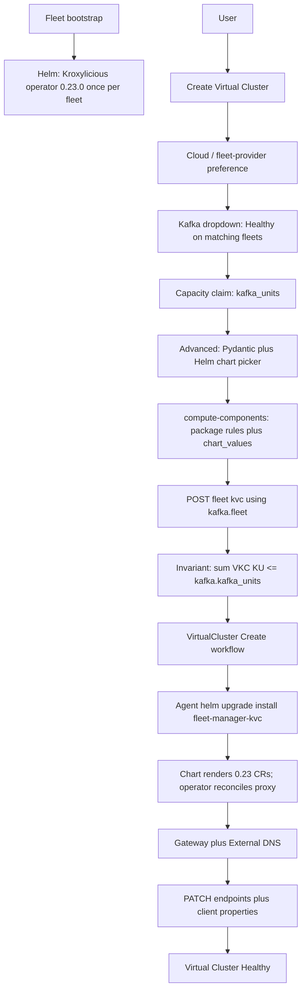

# Virtual Clusters (Kroxylicious 0.23.0)

Branch: `feat/kroxylicious-virtual-clusters` (from `main`). Operator pin: **0.23.0** ([download](https://kroxylicious.io/kroxylicious/download/), images `quay.io/kroxylicious/{operator,proxy,webhook}:0.23.0`).

This is **not** a greenfield API. Org-level `VirtualKafkaCluster` (provider `kroxy`), preview UI, and a **combined** `VirtualKafkaClusterWorkflow` already exist. There is **no** orchestrator workflow, **no** agent apply path, **no** fleet bootstrap of the operator, and **no** published bootstrap endpoints. This tranche completes that path on Kroxylicious **operator 0.23.0** and makes Virtual Clusters feel like Kafka.

UI copy: **Virtual Cluster**. Never show Kroxylicious, `kroxy`, CRD kinds, or workflow IDs.

## Success criteria

- Kroxylicious **operator 0.23.0** (CRDs + operator + admission webhook) is installed on **fleet bootstrap** with the other operators. Version from `GlobalConfiguration` (`kroxylicious_operator_version`); raise if missing. Do not hardcode in activities.
- Creating a Virtual Cluster is a **Helm SKU**: SKU card → **cloud / fleet-provider preference** (filters backing Kafka) → **Kafka dropdown** → **capacity claim (Kafka units)** → advanced config (Pydantic + **Helm chart picker**) → **compute-components** → `helm upgrade --install` → `Healthy`. **No fleet selection step** — fleet is taken from the chosen Kafka.
- **Invariant:** each Virtual Cluster claims Kafka units at setup; the **sum of claims on a backing Kafka must not exceed that Kafka’s physical `kafka_units`**. Create/update reject oversubscription.
- Each Virtual Cluster lives in **its own Kubernetes namespace** on the fleet cluster (not the backing Kafka namespace, not the operator namespace).
- Bootstrap **endpoints** are persisted and shown (same External DNS / Gateway path as Kafka). Client properties published. Produce/consume against the virtual bootstrap **works** (integration test).
- Detail UI looks/feels like Kafka (overview, endpoints, logs). **No metrics** for the virtual cluster. **No** physical Kafka metrics on this UI.
- **Logs** for the proxy pods (Loki, namespace-scoped) are wired.
- Proxy → backing cluster uses the **internal** Strimzi / Confluent Platform listener: **mTLS or PLAINTEXT**, whichever that SKU already exposes. Do not invent a new listener on the physical cluster.
- Client → virtual cluster (phase 1): **SASL/OAUTHBEARER** only. Later mechanisms are out of scope.
- Canonical API for every virtual cluster on a fleet:
  `organizations/{org}/fleet/{fleet}/kafka/kvc/`
  `organizations/{org}/fleet/{fleet}/kafka/kvc/{virtual_cluster}/`

## Architecture




**Two Helm packages, different scope:**


| Package                                                     | When                 | Namespace             | Configurable                                                                                                                                                               |
| ----------------------------------------------------------- | -------------------- | --------------------- | -------------------------------------------------------------------------------------------------------------------------------------------------------------------------- |
| Kroxylicious **operator** (`charts/kroxylicious-operator/`) | Fleet bootstrap only | `kroxylicious-system` | Operator image/version, webhook, resources. **Not** virtual-cluster spec.                                                                                                  |
| Virtual Cluster workload (`charts/fleet-manager-kvc/`)      | Every CREATE/UPDATE  | `kvc-{identifier}`    | Values **mirror Kroxylicious CRs** (especially `VirtualKafkaCluster`). Same compute-components / package-rule / `chart_config` pipeline as CFK and Apache Kafka (Strimzi). |


The operator does **not** install a proxy. The **kvc chart** installs the CRs; the operator reconciles Deployment/Service. Do not raw-`kubectl apply` CRs in activities — Helm is the artefact.

## Current gaps (must close)


| Layer     | Today                                                                                                      | Required                                                                                                              |
| --------- | ---------------------------------------------------------------------------------------------------------- | --------------------------------------------------------------------------------------------------------------------- |
| Bootstrap | `_COMPONENT_REGISTRY` has Strimzi/CFK/Envoy/Kong; no Kroxylicious                                          | Add `kroxylicious` component; install on every Kubernetes fleet bootstrap                                             |
| Workflows | Combined `VirtualKafkaClusterWorkflow` CREATE/DELETE in `command_dispatch` only; **no** orchestrator class | Three `@workflow.defn`: Create / Update / Delete                                                                      |
| Agent     | No Kroxylicious apply                                                                                      | `helm upgrade --install` `fleet-manager-kvc`; wait VirtualKafkaCluster Ready; collect Gateway host                    |
| Model | `VirtualKafkaCluster` (org + kafka + auto fleet, `advanced_config` oauth/filters) | Keep row; fleet **derived from `kafka.fleet`**; add **`kafka_units` claim**; add `VirtualClusterResources` |
| API | `GET/POST .../virtual-kafka/` | Canonical **fleet-nested** `.../fleet/{fleet}/kafka/kvc/`; org list may remain as a thin alias |
| Create UI | Pick backing Kafka; no chart picker | Cloud preference → filtered Kafka dropdown; **KU claim**; **`KafkaChartVersionsEditor`**; no fleet picker |
| Capacity | None | **Invariant + scheduling:** Σ VKC `kafka_units` on a backing Kafka ≤ `Kafka.kafka_units` |
| Detail UI | List/create under preview flag | Kafka-like detail: endpoints, logs; hide metrics/cost |
| Auth | Schema has `oauth_provider_id` | Wire `OauthBearerValidation` `KafkaProtocolFilter` + TLS on ingress |


## Kroxylicious 0.23.0 contract

Install from the official **operator** archive (YAML). There is no first-party Helm chart. **Wrap** `kroxylicious-operator-0.23.0` (CRDs, operator Deployment, webhook) in `charts/kroxylicious-operator/` so fleet bootstrap stays Helm-only. Pin images to `0.23.0`. Admission webhook is **in** this chart (required by the operator).

CRDs (`kroxylicious.io/v1alpha1`) rendered **by the kvc Helm chart** from values (not hand-built in Python at apply time):

- `KafkaProxy` — proxy instance (`replicas`, `infrastructure.proxyContainer`, `spec.network`)
- `KafkaService` — backing bootstrap (internal listener / `strimziClusterRef`)
- `VirtualKafkaCluster` — logical cluster; `proxyRef`, `targetKafkaServiceRef`, `ingresses[]`, `filterRefs[]` (same namespace)
- `KafkaProxyIngress` — `clusterIP` and/or `loadBalancer` (TLS on VirtualKafkaCluster ingress entries)
- `KafkaProtocolFilter` — `OauthBearerValidation` (`jwksEndpointUrl`, issuer, audience)

0.23.0 also has `spec.strimziClusterRef` on `KafkaService` for in-cluster Strimzi. Use it **only** for Strimzi SKUs when the ref is in-cluster; CFK / other SKUs use `bootstrapServers` + TLS trust from the existing internal listener.

Do **not** use the preview routing API (`KROXYLICIOUS_UNLOCK_ROUTING`).

## Virtual Cluster Helm SKU (`charts/fleet-manager-kvc/`)

Same shape as `[charts/fleet-manager-cfk](charts/fleet-manager-cfk/)` and `[charts/fleet-manager-strimzi](charts/fleet-manager-strimzi/)`: in-repo chart, tracked package, version via package rules, `chart_config` overlays, compute-components merge.

**Templates** emit the five CR kinds (+ TLS Secret refs, optional Gateway/TLSRoute if we keep DNS in this chart vs infra-shared). One Helm release per Virtual Cluster. Release name = identifier. Namespace = `kvc-{identifier}`.

**Values ↔ Kroxylicious spec.** Pydantic `KroxyliciousVirtualClusterValues` / `KroxyAdvancedConfig` in `fm_types/kroxy.py` (copied on backend like `cfk.py`). Field names **are** the Helm keys (`alias` / `serialization_alias`); `model_dump(by_alias=True)` is what compute-components puts in `resolved_values`. Nested blocks map 1:1 onto CR `spec` so we do not maintain a second mapping in the agent.


| Helm values (chart)                                                                                                                                                 | Kroxylicious CR                                                                  |
| ------------------------------------------------------------------------------------------------------------------------------------------------------------------- | -------------------------------------------------------------------------------- |
| `proxy` (`replicas`, `resources`, `network.proxy`, `network.management`)                                                                                            | `KafkaProxy.spec`                                                                |
| `kafkaService` (`bootstrapServers` **or** `strimziClusterRef`, `tls.trustAnchorRef`)                                                                                | `KafkaService.spec`                                                              |
| `virtualKafkaCluster.proxyRef`                                                                                                                                      | `VirtualKafkaCluster.spec.proxyRef` (chart default: release name)                |
| `virtualKafkaCluster.targetKafkaServiceRef`                                                                                                                         | `VirtualKafkaCluster.spec.targetKafkaCluster` / `targetKafkaServiceRef`          |
| `virtualKafkaCluster.ingresses[]` (`ingressRef`, `tls.certificateRef`, `tls.protocols`, `tls.cipherSuites`, `tls.tlsClientAuthentication`, `tls.trustAnchorRef`)    | `VirtualKafkaCluster.spec.ingresses[]`                                           |
| `virtualKafkaCluster.filterRefs[]`                                                                                                                                  | `VirtualKafkaCluster.spec.filterRefs[]`                                          |
| `ingresses.{clusterIP,loadBalancer}` (`protocol`)                                                                                                                   | `KafkaProxyIngress.spec`                                                         |
| `filters.oauthBearerValidation` (`jwksEndpointUrl`, `jwksEndpointRefreshMs`, `expectedIssuer`, `expectedAudience`, `subClaimName`, `scopeClaimName`, cache/backoff) | `KafkaProtocolFilter` type `OauthBearerValidation`                               |
| `oauth` / `chart_config`                                                                                                                                            | Same pattern as CFK/Strimzi (provider id in UI; baker fills JWKS from OAuth row) |


Forced at bake (not user toggles): northbound TLS + SASL/OAUTHBEARER; custom certs (`certificateRef` to a Secret Helm does not inline PEMs); southbound listener from backing SKU. `openShiftRoute` ingress type is out of scope.

Advanced-config UI JSON Schema = `KroxyAdvancedConfig.model_json_schema()` + uiSchema (plain-language titles). Include `chart_config` for version/values override like Strimzi. Escape-hatch: additional Helm keys under a documented `extra` **only if** they exist on the 0.23 CRD — prefer explicit fields for every `VirtualKafkaCluster.spec` property.

Tests: values fixture → helm template → YAML kinds/names/refs match 0.23 examples; unknown CR fields fail Pydantic (`extra=forbid`).

## Fleet bootstrap (operator only)

Add to `[bootstrap_resolver.py](fleet-manager-backend/core/services/bootstrap_resolver.py)` `_COMPONENT_REGISTRY`:

- key `kroxylicious`
- chart from in-repo / tracked package `kroxylicious-operator`
- namespace e.g. `kroxylicious-system` (operator only)
- `install_order` after Envoy Gateway / cert bits the webhook needs (after `envoy_gateway`, before or beside Strimzi)
- `values_configurable: true`

`_COMPONENT_REGISTRY['kroxylicious'].repository` must **match** the tracked Package path (same convention as Strimzi/Envoy). Image rewrite via existing registry override path. Kubernetes fleets only. BYOVM fleets skip this component.

Bootstrap rerun must be idempotent (`helm upgrade --install`). Do not uninstall on later chart failure if live virtual clusters exist (`rollback_on_failure: false` once workloads exist — same idea as Envoy).

## Packages / catalog (required — two entries)

Operator and kvc are **separate** Helm packages. Do not fold operator images into the kvc chart. Follow Strimzi/CFK: inventory → rules → sync → compute-components. **No silent hardcoded chart URL** if a Package/rule is missing — raise.

**Charts** (user runs push; do not push on their behalf):

- `charts/kroxylicious-operator/` → `./scripts/build-and-push-chart.sh kroxylicious-operator`
- `charts/fleet-manager-kvc/` → `./scripts/build-and-push-chart.sh fleet-manager-kvc`

(`all` picks up both once `Chart.yaml` exists.) OCI repo names match CFK: `streamtime-ai/kroxylicious-operator` and `streamtime-ai/fleet-manager-kvc` on `ghcr.io`.

`[preload/package_inventory.yaml](fleet-manager-backend/preload/package_inventory.yaml)` — two `helm_chart` rows:

```yaml
- repository: "streamtime-ai/kroxylicious-operator"
  registry_url: "ghcr.io"
  tags_to_track: ["0.23.*", "latest"]
  artifact_type: "helm_chart"
  admin_status: "supported"

- repository: "streamtime-ai/fleet-manager-kvc"
  registry_url: "ghcr.io"
  tags_to_track: ["*", "latest"]
  artifact_type: "helm_chart"
  admin_status: "supported"
```

Local/dev may add `registry:5000` twins with `admin_status: active` like other streamtime charts.

`[preload/package_rules.yaml](fleet-manager-backend/preload/package_rules.yaml)` — next to Fleet Manager CFK/Strimzi:

```yaml
- name: "Kroxylicious Operator"
  repository: "streamtime-ai/kroxylicious-operator"
  version_constraint: ">=0.23.0,<0.24.0"
  target_status: "supported"
  preferred_registry: "ghcr.io"
  default_version: "0.23.0"
  priority: 10

- name: "Fleet Manager Virtual Cluster"
  repository: "streamtime-ai/fleet-manager-kvc"
  version_constraint: ">=0.1.0"
  target_status: "supported"
  preferred_registry: "ghcr.io"
  default_version: "<first pushed chart version>"
  priority: 10
```

Rule `repository` **equals** inventory `repository` **equals** `_COMPONENT_REGISTRY` / compute-components lookup. Operator `default_version` tracks the wrapped 0.23.0 archive; kvc chart version is **our** SemVer, independent of operator tag.

`[preload/registry_images.yaml](fleet-manager-backend/preload/registry_images.yaml)` — pin + rewrite quay images used by the **operator** chart (and proxy image the operator launches):

- `quay.io/kroxylicious/operator:0.23.0`
- `quay.io/kroxylicious/proxy:0.23.0`
- `quay.io/kroxylicious/webhook:0.23.0`

Component `kroxylicious` for bootstrap; kvc values may reference proxy tag via the same pins if the operator chart does not already inject it.

**Value merge** (later wins, same as Kafka SKUs): `package.default_values` → tracked-repo `template_values` → `package.template_values` → user `chart_values` / `chart_config`.

**After merge:** catalog sync (`TrackedRepository` sync / import inventory) so compute-components can resolve `resolved_version` + `resolved_registry_url`. Fail create if either package is missing.

`GlobalConfiguration.kroxylicious_operator_version=0.23.0` is the **image/app** pin inside the operator chart values, not a substitute for the Helm package rule.

## Create / update / delete (workloads)

Follow Kafka: **three** workflows. No combined action enum.

**Create** (`VirtualClusterCreateWorkflow` on `fleet-manager-tasks`, then agent child on the fleet queue):

1. Snapshot fleet, backing Kafka, OAuth, certs, **compute-components** (`components.main` = `fleet-manager-kvc`).
2. Agent: `helm upgrade --install` into `kvc-{identifier}` using `resolved_registry_url` / `resolved_version` / `resolved_values` only (do not rebuild values in the activity).
3. Materialize TLS Secret for **ingress** before or as a chart-managed Secret from vault refs — **never** PEMs in compute-components JSON.
4. Wait `VirtualKafkaCluster` Ready (heartbeat). Operator creates the proxy Deployment.
5. Attach Gateway + External DNS the same way Kafka bootstrap hostnames are published (chart values or infra-shared, one place only).
6. PATCH `VirtualClusterResources.endpoints` + `client_properties`. Status `Healthy`.

**Update:** same Helm upgrade with new `resolved_values`. Namespace already exists.

**Delete:** Helm uninstall + delete namespace (succeed if gone); remove DNS; delete row. Operator stays (fleet-scoped). Block fleet delete while any `kvc` exists.

Agent uses existing Helm activities (`upgrade --install`, uninstall). **Do not** kubectl-apply CRs beside Helm.

## compute-components

Use the **same Kafka workload pipeline** as Strimzi/CFK (`[kafka_workload_charts.py](fleet-manager-backend/core/views/shared/kafka_workload_charts.py)`): package-rule default version, preferred registry, `chart_config` / POST `chart_values` merge, image rewrite.

- Add `kroxy` (or `kvc`) to `SUPPORTED_KAFKA_WORKLOAD_TYPES` **or** a dedicated virtual-cluster charts view that returns the **same JSON shape**:

```json
{
  "components": {
    "main": {
      "resolved_version": "...",
      "resolved_registry_url": "...",
      "resolved_values": { }
    }
  }
}
```

- `resolved_values` **is** the `fleet-manager-kvc` values document (Pydantic dump). It must contain the VirtualKafkaCluster/KafkaService/ingress/filter blocks above after bake (southbound bootstrap filled from the backing cluster; OAuth JWKS from the selected provider). Empty/missing required CR fields → 400.
- Cluster-scoped: `GET/POST .../fleet/{fleet}/kafka/kvc/{id}/compute-components/`
- Create-time: workload-scoped with `workload_type=kroxy` + fleet + backing kafka + draft advanced_config
- **Never** put OAuth client secrets or PEMs in the JSON (Secret interpolation / vault paths only, same as Kroxylicious `${secret:...}` if needed).

Sizing: proxy `replicas` / resources live in Helm values (not Kafka-unit sliders). Hide cost preview.

Tests: given advanced_config, `resolved_values.virtualKafkaCluster` matches the Pydantic model; Helm template of those values produces valid 0.23 CRs; Strimzi `resolved_values` path is not used.

## APIs

Canonical (required):


| Method             | Path                                                |
| ------------------ | --------------------------------------------------- |
| GET, POST          | `organizations/{org}/fleet/{fleet}/kafka/kvc/`      |
| GET, PATCH, DELETE | `organizations/{org}/fleet/{fleet}/kafka/kvc/{id}/` |
| GET, POST          | `.../kvc/{id}/compute-components/`                  |
| GET                | `.../kvc/{id}/logs/`                                |
| GET                | `.../kvc/{id}/status/`                              |


SKU schemas / create filters:

- **No** `fleet-selection/` step for Virtual Cluster. Do not ask the user to pick a fleet `cluster_id`.
- Placement / preference: **cloud provider** (and region when not BYOK), same vocabulary as Kafka create (`cloud_provider` / fleet `provider`). That preference only **narrows the backing Kafka dropdown**.
- Backing Kafka enum: Healthy Kafka clusters whose fleet matches that preference (`fleet.provider` / platform kubernetes), and whose fleet already has the Kroxylicious operator (bootstrap installed). Exclude BYOVM / `platform=vm`. Label: cluster name + plain-language SKU title (not `strimzi`).
- On create: client posts `kafka_id`, **`kafka_units`** (capacity claim), + advanced_config including `chart_config`. Serializer sets `fleet` from `kafka.fleet`. Reject if Kafka has no fleet or fleet is not Healthy / not operator-ready. Reject if claim fails the capacity invariant (below).
- Advanced-configuration schema: OAuth + full kvc Helm/Pydantic fields + **`chart_config`**. Forced custom certs.
- Show [`KafkaChartVersionsEditor`](fleet-manager-frontend/src/components/BootstrapConfig/KafkaChartVersionsEditor.js) on create (same as ClusterCreate advanced step): workload/key for `fleet-manager-kvc` (`kroxy` / `kvc`), registry + version picker from package rules. Persist under `advanced_config.chart_config`.

## Capacity invariant & scheduling

**Invariant (hard):** for every physical `Kafka` K,

```
sum(VirtualKafkaCluster.kafka_units where kafka=K and status not in Deleting)
  ≤ K.kafka_units
```

Claims are set **at setup** (create) and may change on update; both paths enforce the same check. Default claim ≥ 1. UI copy: “Cluster capacity” / “Kafka units” — not internal field slugs.

**Remaining capacity** (scheduling input):

```
remaining(K) = K.kafka_units − sum(active VKC claims on K)
```

**Scheduling / admission**

1. When listing backing Kafka options for a preference, annotate (or filter) with `remaining` / `kafka_units`. Prefer showing remaining in the dropdown helperText (“3 of 10 units available”). Optionally hide or disable Kafka with `remaining < 1`.
2. On create: require `1 ≤ kafka_units ≤ remaining(selected Kafka)`. HTTP 400 with plain-language remedy if oversubscribed (name the backing cluster and remaining units).
3. On update that **increases** claim: same check against remaining **excluding this row’s current claim**. Decreases always allowed (subject to ≥ 1).
4. Concurrent creates: enforce in the serializer/service with a DB transaction (select_for_update on the backing Kafka row, or equivalent) so two parallel POSTs cannot both pass a stale remaining check.
5. Delete (or terminal Deleting → gone): frees the claim immediately for scheduling; workflow uninstall does not keep capacity reserved after the row is gone.
6. Physical Kafka **shrink** of `kafka_units` below current Σ VKC claims: reject the Kafka update (or require VKCs to be reduced first). Do not silently orphan oversubscription.
7. This invariant is **independent of fleet** `max_kafka_units` / fleet utilization. Fleet accounting stays physical Kafka only; VKC claims carve capacity **inside** one Kafka’s `kafka_units`, they do not double-count against the fleet pool.

**Not in scope for phase 1:** runtime enforcement via Kroxylicious quotas / rate limits tied to KU; fair-share rebalancing. Claim is bookkeeping + admission only.

Tests: create at remaining boundary succeeds; remaining+1 → 400; two concurrent claims that would exceed → one fails; update bump over remaining → 400; delete frees capacity for a subsequent create; Kafka shrink below Σ → 400.

Register a separate SKU catalog entry **Virtual Cluster** — do **not** list it as a physical Kafka SKU (Strimzi/CFK). Reuse the Kafka create **shell** where it helps (cloud cards, chart editor, KU control), not the fleet-selection step.

Org-level `.../virtual-kafka/` (refactor-apis Phase 3 item 4, renamed from `virtual-kafka-clusters/`): keep as list-across-fleets **or** 301/alias to fleet-nested routes. New clients use `kvc`. `/regression-check` before removing the old path.

Command dispatch `subject`: `/organizations/{org}/fleet/{fleet}/kafka/kvc/{id}/command/{WorkflowName}`. Replace combined `VirtualKafkaClusterWorkflow`.

## Auth

**Southbound (proxy → physical Kafka):** copy the backing SKU’s **internal** listener. Strimzi/CFK already expose PLAINTEXT and/or mTLS inside the cluster. `KafkaService` gets that bootstrap + optional `tls.trustAnchorRef`. No SASL to the physical cluster in phase 1 unless the only internal listener is SASL (then fail closed with a plain-language error: backing cluster must expose an internal mTLS or PLAINTEXT listener).

**Northbound (client → virtual cluster), phase 1:** SASL/OAUTHBEARER.

- `KafkaProtocolFilter` type `OauthBearerValidation` from org OAuth provider (JWKS URL, issuer, audience).
- Ingress TLS required (custom certs).
- Publish `sasl.mechanism=OAUTHBEARER` in `client_properties`.
- SCRAM/PLAIN/mTLS for clients: later phase.

## UI

Reuse Kafka create **shell** pieces that apply: cloud-provider cards, schema forms, **`KafkaChartVersionsEditor`**. Do **not** mount the fleet-selection step.

- Catalog card: **Virtual Cluster** (feature flag `virtualKafkaClusters` until GA).
- Preference: cloud / fleet-provider (AWS, BYOK, …) — filters Kafka options only. Region when needed (hide for BYOK). No fleet dropdown.
- Backing Kafka: single dropdown of Healthy clusters on fleets matching that preference (operator present). Show remaining capacity. Changing preference clears an invalid selection.
- Capacity: Kafka-units control (slider/input) capped at `remaining` for the selected backing cluster. helperText explains it cannot exceed the physical cluster’s capacity.
- Advanced: OAuth + VirtualKafkaCluster/ingress/filters/proxy fields **and** Helm chart picker (`KafkaChartVersionsEditor` for `fleet-manager-kvc` / `chart_config`) — same UX as other Helm SKUs. helperText on every field.
- After create: detail shows claimed units vs backing cluster capacity; endpoints, client config, logs. Omit metrics, usage, cost.
- List: org-wide and/or fleet-scoped. Nav label **Virtual Clusters**.

Logs: Loki query `namespace="kvc-{id}"` (or the actual namespace convention). Reuse Kafka logs page with that label set.

## Verification

- Unit: Pydantic ↔ Helm values ↔ `helm template` CRs; Kafka dropdown filtered by cloud preference; fleet derived from kafka; **capacity invariant** (boundary, oversubscribe, concurrent, shrink); OAUTHBEARER in `resolved_values`; no secrets in compute-components.
- API: create with `kafka_id` + `kafka_units` (no fleet field); POST lands under `.../fleet/{kafka.fleet}/kafka/kvc/`; oversubscribe → 400.
- Integration (kind): bootstrap installs operator 0.23.0; create kvc; produce/consume through published bootstrap with OAUTHBEARER (or documented test IdP). Logs non-empty after traffic.
- UI: no fleet picker; chart versions editor mounted; KU claim capped to remaining; Kafka list changes when cloud preference changes; card name **Virtual Cluster**; no metrics widgets.

## Files (indicative)

**Backend:** `fleet_workload/kroxy.py`, `fm_types/kroxy.py` (values = CR spec), `core/services/kafka_workload_charts.py` (or `kroxylicious_components.py` using the same merge helpers), `core/services/virtual_cluster_southbound.py`, fleet `kvc` views, `VirtualClusterResources`, migration, `bootstrap_resolver` **operator** entry, seed GC `kroxylicious_operator_version`, **`preload/package_inventory.yaml` + `package_rules.yaml` + `registry_images.yaml`**, command_dispatch three workflows, tests.

**Orchestrator:** `workflows/virtual_cluster_{create,update,delete}.py` — consume compute-components Helm payload like Strimzi.

**Agent:** Helm install/upgrade/uninstall `fleet-manager-kvc`; wait Ready; read Gateway host.

**Charts / packages:** `charts/kroxylicious-operator/`; `charts/fleet-manager-kvc/`; inventory + rules + registry image pins (see **Packages / catalog**). User: `./scripts/build-and-push-chart.sh kroxylicious-operator` and `fleet-manager-kvc`.

**Frontend:** Kafka-like create/detail; cloud preference → filtered Kafka dropdown (no fleet step); schema-driven advanced form; **`KafkaChartVersionsEditor`**; fleet-nested API; logs; hide metrics.

**CLI/MCP:** list/get/create via `fleet/{id}/kafka/kvc/` if those clients expose Kafka.

## Out of scope

SCRAM/PLAIN/mTLS **clients**; physical Kafka metrics on the virtual UI; virtual-cluster metrics; topic ACL UI; preview Kroxylicious routers; operator on BYOVM; moving physical Kafka into the kvc namespace.