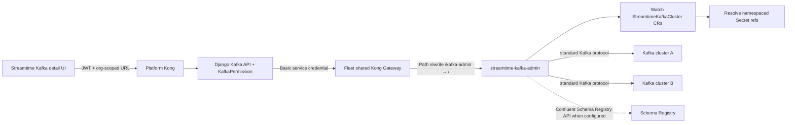

# Native Kafka UI in Streamtime

## Outcome

Add one fleet-local, stateless Go service and a native Streamtime frontend
alongside the existing provider consoles and Kafbat deployment.

- One `streamtime-kafka-admin` Deployment per Kubernetes fleet.
- The service discovers every Streamtime-managed Kafka cluster in that fleet and
  connects only through its internal listener.
- Topic list/create/update/delete, optional Confluent-compatible Schema Registry
  integration, and bounded message browsing are available through an org-scoped
  Django API.
- The service is installed during fleet bootstrap and is reachable only through
  the fleet's existing shared Kong Gateway.
- The Kafka cluster detail page gains Topics, Topic configuration, and Messages
  views.

This is not a Temporal command API. Topic operations are synchronous Kafka admin
requests; they must not be dispatched as workflows.

## Existing foundations

- `streamtime-agent/api/v1alpha1/streamtimekafkacluster_types.go` already defines a
  provider-neutral `StreamtimeKafkaCluster` CRD, but it currently carries only the
  provider and status.
- `streamtime-agent/internal/activities/discovery.go` has provider-specific CFK and
  Strimzi discovery, but it does not expose reusable connection/authentication data.
- `charts/fleet-manager-infra-shared/` creates one Kong Gateway per fleet. Routes
  from workload namespaces may attach to it.
- Fleet bootstrap is assembled by
  `fleet-manager-backend/core/services/bootstrap_resolver.py`, installed by
  `fleet-manager-orchestrator/workflows/fleet_provider_base.py`, and persisted as
  fleet endpoints after installation.
- Fleet shared-service credentials already live at
  `/organizations/{org}/fleet/{fleet}/shared-credentials`.
- The backend already has a read-only, provider-specific implementation in
  `core/services/kafka_topic_config.py` and
  `core/views/kafka/topics.py`. Keep its URL compatible while changing its
  implementation to the native service.
- `charts/fleet-manager-strimzi/` already deploys Kafbat Kafka UI. It remains
  available alongside the native Streamtime UI in this tranche.

## Architecture



### Security boundary

- Browsers never receive fleet shared-service credentials and never call the
  fleet-local service directly.
- Django loads the Kafka row with `select_related("fleet", "organization")`,
  applies `KafkaPermission`, verifies that the requested Kafka belongs to the
  selected org/fleet, and proxies only to the registered `kafka_admin` endpoint.
- Fleet Kong protects `/kafka-admin` with its stock Basic Auth plugin. The
  credential is generated once and stored under the `kafka_admin` key in the
  existing fleet shared-credentials secret.
- The Go Deployment uses a dedicated ServiceAccount. It may list/watch
  `StreamtimeKafkaCluster` objects and read only referenced Kafka credential
  Secrets. It does not reuse the broad agent ServiceAccount.
- Add a NetworkPolicy that allows HTTP ingress only from the fleet Kong data
  plane and Kafka egress to cluster-internal endpoints/DNS.
- Logs must not contain message values, keys, headers, credentials, or decoded
  Secret data.

## Canonical cluster discovery contract

Extend the existing CRD instead of guessing Services from provider naming
conventions:

```yaml
apiVersion: agent.streamtime.ai/v1alpha1
kind: StreamtimeKafkaCluster
metadata:
  name: orders
  namespace: orders
  labels:
    streamtime.ai/managed: "true"
spec:
  provider: strimzi # optional diagnostic metadata; never selects runtime behavior
  connection:
    bootstrapServers:
      - kafka-fm-kafka-bootstrap.orders.svc.cluster.local:9093
    securityProtocol: SSL
    tls:
      secretName: streamtime-kafka-admin
      caKey: ca.crt
      certificateKey: user.crt
      privateKeyKey: user.key
  schemaRegistry:
    url: https://schema-registry.orders.svc.cluster.local:8081
    authentication:
      type: basic
      secretName: streamtime-schema-registry
      usernameKey: username
      passwordKey: password
```

The exact schema must support:

- stable Kafka identifier (`metadata.name`) and namespace;
- optional provider string for diagnostics only; the service must not branch on
  it or maintain provider adapters;
- one or more internal bootstrap servers;
- `PLAINTEXT`, `SSL`, `SASL_PLAINTEXT`, and `SASL_SSL`;
- SASL mechanism and username/password Secret key selectors;
- TLS CA/client certificate/private-key Secret key selectors;
- optional server name and consumer isolation level;
- optional Confluent-compatible Schema Registry URL, TLS settings, and
  basic/bearer authentication Secret key selectors;
- no plaintext credentials.

Provisioning CREATE and UPDATE paths upsert this CR only after the internal
listener and dedicated admin principal are ready. DELETE removes it before the
Kafka namespace/credentials. Existing deployed clusters require one normal
workload update to backfill the CR; the fleet service must report an empty list,
not infer unsafe defaults, when no registrations exist.

Each provisioning workflow must publish the same provider-neutral registration
contract and create a least-privilege Kafka principal capable of:

- describing the cluster/topics/configs;
- creating topics;
- deleting topics;
- increasing partition count;
- incrementally altering topic configs;
- reading topic data without committing consumer-group offsets.

Provisioning implementations must explicitly prove the internal listener address,
credential Secret references, and optional Schema Registry connection in tests.
After registration, the Go service uses only standard Kafka protocol and the
Confluent Schema Registry HTTP API. It must work unchanged with any Kafka-compatible
broker implementing the required protocol operations. Do not reconstruct
connections from a public endpoint or naming convention inside the Go service.

## Go service

Create a standalone `streamtime-kafka-admin/` Go module and image rather than
adding an inbound HTTP server to the Temporal agent. Use a pure-Go Kafka client
(`franz-go`) so the runtime remains a statically linked, distroless single binary.

Suggested packages:

- `cmd/server/main.go`: config, signal handling, HTTP server.
- `internal/discovery`: informer/cache for `StreamtimeKafkaCluster`.
- `internal/client`: validated per-cluster client factory and bounded cache;
  invalidate on CR/Secret resource-version changes.
- `internal/topics`: AdminClient operations and error normalization.
- `internal/messages`: manual partition reads and opaque cursor handling.
- `internal/schemaregistry`: Confluent API client, schema cache, wire-format
  inspection, and safe decoding.
- `internal/httpapi`: routes, validation, request IDs, JSON limits, health.

Runtime properties:

- no backend or Temporal connectivity;
- Kubernetes in-cluster config only;
- startup succeeds with zero Kafka clusters;
- readiness means the CRD informer has synced, not that every Kafka cluster is
  healthy;
- per-cluster failures are isolated and shown by `GET /clusters`;
- request timeout, connection timeout, maximum body size, maximum decoded message
  size, and client-cache bounds are mandatory;
- expose Prometheus request/error/Kafka latency metrics without topic or message
  payload labels.

### Fleet-local REST contract

Prefix all routes with `/api/v1`.

- `GET /healthz`, `GET /readyz`, `GET /metrics`
- `GET /api/v1/clusters`
- `GET /api/v1/clusters/{cluster}/topics?page=1&page_size=50`
- `POST /api/v1/clusters/{cluster}/topics`
- `GET /api/v1/clusters/{cluster}/topics/{topic}`
- `PATCH /api/v1/clusters/{cluster}/topics/{topic}`
- `DELETE /api/v1/clusters/{cluster}/topics/{topic}`
- `GET /api/v1/clusters/{cluster}/topics/{topic}/messages`
- `GET /api/v1/clusters/{cluster}/schemas/subjects`
- `GET /api/v1/clusters/{cluster}/schemas/subjects/{subject}/versions`
- `GET /api/v1/clusters/{cluster}/schemas/subjects/{subject}/versions/{version}`

Create body:

- `name`
- `partitions`
- `replication_factor`
- optional string map `configs`

Patch body:

- optional `partitions` (increase only);
- `configs.set` string map;
- `configs.delete` list.

Delete semantics:

- require `confirm=true` and the exact topic name in a small confirmation body;
- use the Kafka `DeleteTopics` protocol operation and wait only for the bounded
  broker acknowledgement, not physical log removal;
- treat a topic already absent as an idempotent success;
- return `409 topic_deletion_disabled` when the broker disables topic deletion.

Replication-factor reassignment remains out of scope. Reject unknown fields.
Return stable error codes such as `cluster_unavailable`, `topic_not_found`,
`invalid_topic_update`, `topic_deletion_disabled`, and `request_timeout`; never
leak broker addresses or credential details.

### Message pagination

Kafka has no global topic offset, so the API must define pagination rather than
pretending a topic has one linear cursor.

- Page size is fixed at 10 messages.
- `position=beginning` starts from each partition's earliest offset and returns
  forward pages.
- `position=latest` returns the newest available messages and pages backward.
- The opaque `cursor` contains a version, direction, topic identity, and
  per-partition offsets. Validate it against the route and current partition set.
- Fetch partitions without a consumer group and never commit offsets.
- Merge records deterministically by timestamp, partition, then offset. Document
  that Kafka provides no total ordering across partitions.
- Default to `read_committed`.
- Return key/value as UTF-8 when valid and Base64 otherwise, with explicit
  encoding fields. Include partition, offset, timestamp, and headers.
- Bound fetch bytes and truncate/flag an individual oversized record rather than
  allowing an unbounded response.
- Return `next_cursor: null` at the applicable log boundary. A cursor invalidated
  by retention returns `409 cursor_expired`, allowing the UI to restart at
  beginning/latest.

### Schema Registry integration

Schema Registry is an optional cluster capability. Its absence or failure must
not prevent topic administration or raw message browsing.

- Use the Confluent-compatible Schema Registry REST contract. Compatible implementations
  such as Redpanda Schema Registry work without provider-specific branches.
- `GET /clusters` reports `capabilities.schema_registry` and a health/error state,
  never credentials or the internal URL.
- Provide read-only subject/version/schema endpoints for the UI. Schema
  registration, compatibility changes, and subject/version deletion are not part
  of this tranche.
- Cache schema-by-ID and subject metadata with bounded TTL and entries. Invalidate
  naturally by ID/version; never persist schemas in Django.
- Detect the Confluent wire-format magic byte and schema ID for message keys and
  values. Decode Avro, JSON Schema, and Protobuf when possible.
- For Protobuf, honor Confluent message indexes. For references, recursively fetch
  referenced subjects/versions with cycle and depth limits.
- Return both the original encoded bytes and a separate decoded representation,
  including `schema_id`, `schema_type`, `subject` when known, and a decode error
  when decoding fails. A malformed payload falls back to UTF-8/Base64 and does
  not fail the page.
- Do not assume `{topic}-key` or `{topic}-value` is the active subject strategy;
  resolve by schema ID first and expose matching subjects as metadata.
- Apply the same TLS verification, Secret references, response-size limits,
  timeouts, and log redaction as Kafka connections.

## Fleet bootstrap and Kong

Add `charts/streamtime-kafka-admin/`:

- Deployment, Service, ServiceAccount, least-privilege RBAC, NetworkPolicy,
  PodMonitor/ServiceMonitor, PDB, resources, probes, and credential Secret;
- HTTPRoute attached to
  `kong-gateway` in the fleet namespace on hostname
  `shared-{fleet}.{domain}`, matching `/kafka-admin`;
- URLRewrite strips `/kafka-admin`;
- Basic Auth KongPlugin, KongConsumer, and credential Secret;
- values schema and helm-unittest coverage.

Add a bootstrap component after `fleet_manager_infra_shared`:

- package/image resolution through the existing package-rule pipeline;
- `streamtime_kafka_admin` chart/image GlobalConfiguration/package entries, with
  no hardcoded deploy-time version;
- values populated in
  `fleet-manager-orchestrator/workflows/fleet_provider_base.py`;
- generate/reuse `shared_credentials.kafka_admin`; existing fleet secrets do not
  contain this key, so UPDATE must soft-fill only the missing key while preserving
  every existing metrics/cost/alerts/logs/otel/dashboard credential;
- persist fleet endpoint:
  `type="kafka_admin"`,
  `address="https://shared-{fleet}.{domain}/kafka-admin"`;
- add the release to fleet teardown before shared Kong is removed;
- update installed-component bookkeeping and drift tests.

Do not create another Gateway or LoadBalancer.

## Package management and release lifecycle

The service is a first-class managed package, not an image tag embedded in
bootstrap code.

- Publish `streamtime-kafka-admin` as a multi-architecture OCI image and
  `streamtime-kafka-admin` as an OCI Helm chart.
- Add tracked repositories for both artifact types to package preload/seed data.
- Add enabled PackageRules for the image and chart with explicit supported
  default versions and preferred registries. Resolution must work with both the
  local registry mirror and GHCR namespace forms.
- Bootstrap `compute-components` resolves the chart version/repository through
  `PackageRuleService`; the resolved chart values resolve the image repository
  and tag through the image package rule. No `latest` or source-tree chart
  version is accepted at runtime.
- Record both resolved chart and image package identities in installed-component
  bookkeeping so drift and update previews show what is running.
- Expose operator-configurable chart values through the existing Package Preset
  mechanism only for resources, replicas/PDB, log level, timeouts/cache bounds,
  and node placement. Kafka credentials, endpoints, and Kong credentials are
  computed and non-configurable.
- A fleet update recomputes package rules and performs an idempotent Helm upgrade.
  Existing fleets can pin a supported version through the same package/preset
  controls used by other bootstrap components.
- Package sync/import must discover newly published image/chart tags; unsupported
  or untracked versions must be rejected before workflow dispatch.
- Add image SBOM/provenance/signing and vulnerability scanning consistently with
  other production images. The distroless runtime runs non-root and contains only
  the service binary and CA certificates.
- Extend local build/push tooling and CI so service tests, image publication,
  chart testing, and chart publication run on the same release tag. The user
  continues to run build-and-push scripts manually.

## Backend API

Keep views thin and async. Add a service that:

1. loads `kafka.resources`, `fleet.resources`, and organization data safely;
2. resolves the fleet `kafka_admin` endpoint;
3. reads `shared_credentials.kafka_admin` through `SecretsManager`;
4. calls the fleet endpoint directly (the established topic-configuration
   pattern, not the platform Kong fleet-endpoint proxy) with
   `httpx.AsyncClient`, TLS verification, strict timeout, response-size bound,
   and Basic auth;
5. validates/normalizes the upstream response with Pydantic before returning it;
6. maps upstream errors to stable client-safe HTTP responses.

Org-scoped public routes:

- `GET/POST /organizations/{org}/kafka/{kafka_id}/topics/`
- `GET/PATCH/DELETE /organizations/{org}/kafka/{kafka_id}/topics/{topic}/`
- `GET /organizations/{org}/kafka/{kafka_id}/topics/{topic}/messages/`
- `GET /organizations/{org}/kafka/{kafka_id}/schemas/subjects/`
- `GET /organizations/{org}/kafka/{kafka_id}/schemas/subjects/{subject}/versions/`
- `GET /organizations/{org}/kafka/{kafka_id}/schemas/subjects/{subject}/versions/{version}/`

Compatibility:

- retain
  `GET /organizations/{org}/kafka/{kafka_id}/topic-configuration/`;
- implement it as a compatibility adapter over the new topic list/detail service;
- do not remove its current response fields in this tranche;
- mark it deprecated in OpenAPI after all in-repo consumers move.

Use `KafkaPermission`; read-only roles may list/view/consume/read schemas, while
topic create/update/delete requires the existing Kafka operator/admin write
permission. Percent-encode cluster/topic/subject path segments and reject
ambiguous decoded slashes.

## Frontend

Add `src/features/kafka-admin/` with:

- `services/kafkaAdminService.js`;
- TanStack Query hooks and mutation invalidation;
- `KafkaTopicsPage`;
- `TopicCreateDialog`;
- `TopicConfigurationPanel`;
- `TopicDeleteDialog`;
- `MessageBrowser`.
- `SchemaRegistryPanel`.

Integrate a plain-language `Topics` tab into
`features/clusters/KafkaClusterDetail.js`.

Minimal UX:

- searchable, server-paginated topic table with name, partitions, replication
  factor, and an action to open details;
- create dialog with Topic name, Partitions, Replication factor, and optional
  configuration rows; helper text on every field;
- topic detail with read-only metadata and editable configuration rows;
- partition changes clearly state that only increases are supported;
- destructive topic deletion requires typing the exact topic name, explains that
  the action is permanent, and is hidden for read-only roles;
- Messages panel with `Beginning` / `Latest` selector, ten rows per page, Next
  (and Previous only when cursor history exists client-side), partition/offset/
  timestamp, key, headers, and value;
- render schema-decoded Avro/JSON Schema/Protobuf values when available, JSON
  prettily when valid, otherwise text/Base64 with encoding and schema badges;
  never execute HTML;
- show a Schemas section only when Schema Registry is configured, with subjects,
  versions, schema type, references, and formatted read-only schema text;
- useful empty/loading/partial-cluster/error states, including cursor expiry.

The UI calls only the org-scoped Django URLs through the existing platform Kong
client. It must not compose `shared-{fleet}` URLs or read shared credentials.

## Files and contract fields changed

This inventory is the expected implementation surface. Exact test filenames may
be consolidated, but these subsystems must be covered.

### New files/directories

- `streamtime-kafka-admin/go.mod`, `go.sum`, `Dockerfile`
- `streamtime-kafka-admin/cmd/server/main.go`
- `streamtime-kafka-admin/internal/{config,discovery,client,topics,messages,schemaregistry,httpapi}/`
- `streamtime-kafka-admin/**/*_test.go`
- `charts/streamtime-kafka-admin/Chart.yaml`
- `charts/streamtime-kafka-admin/values.yaml`
- `charts/streamtime-kafka-admin/values.schema.json`
- `charts/streamtime-kafka-admin/templates/` for Deployment, Service,
  ServiceAccount/RBAC, NetworkPolicy, PDB, monitoring, Kong auth, and HTTPRoute
- `charts/streamtime-kafka-admin/tests/`
- `.github/workflows/test-streamtime-kafka-admin.yaml`
- `.github/workflows/build-streamtime-kafka-admin.yaml`
- `fleet-manager-backend/core/services/kafka_admin.py`
- `fleet-manager-backend/core/schemas/kafka_admin_schema.py`
- backend service/API/package tests for the new contracts
- `fleet-manager-frontend/src/features/kafka-admin/` and its tests

### Modified files

- `streamtime-agent/api/v1alpha1/streamtimekafkacluster_types.go`
- `streamtime-agent/api/v1alpha1/zz_generated.deepcopy.go`
- `streamtime-agent/config/crd/streamtimekafkacluster.yaml`
- `charts/streamtime-operator/templates/crd.yaml` and CRD tests
- the shared Kafka provisioning helper plus each currently deployable Kafka
  CREATE/UPDATE/DELETE workflow that writes/removes the registration CR; expected
  current workflow entry points include
  `streamtime-agent/internal/workflows/{strimzi,cfk,redpanda,warpstream}.go` and
  their Python parents where connection material is assembled
- `fleet-manager-backend/core/services/bootstrap_resolver.py`
- `fleet-manager-backend/core/services/preload.py` and/or the package seed
  migration used for tracked repositories and PackageRules
- `fleet-manager-backend/core/services/kafka_topic_config.py`
- `fleet-manager-backend/core/views/kafka/topics.py`
- `fleet-manager-backend/core/views/kafka/__init__.py`
- `fleet-manager-backend/fleet_manager/urls.py`
- `fleet-manager-orchestrator/workflows/fleet_provider_base.py`
- `fleet-manager-orchestrator/shared/fm_types/{bootstrap,helm_values}.py`
- orchestrator generated API client/spec snapshots after OpenAPI regeneration
- `fleet-manager-frontend/src/features/clusters/KafkaClusterDetail.js`
- `streamtime-sdk/typescript/api-types.d.ts`
- `.github/workflows/test-helm-charts.yaml`
- `.github/workflows/build-helm-charts.yaml` (chart discovery should include the
  new chart automatically; assert rather than special-case it)
- `scripts/build-and-push-streamtime.sh` or a dedicated equivalent for the new
  image, `scripts/build-and-push-chart.sh`, and registry package-sync coverage

Kafbat chart files remain unchanged.

### Persisted/API field additions

- `StreamtimeKafkaCluster.spec.provider`: becomes optional diagnostic metadata;
  no runtime dispatch depends on it.
- `StreamtimeKafkaCluster.spec.connection`: bootstrap servers, protocol, SASL,
  TLS, server name, isolation, and namespaced Secret key selectors.
- `StreamtimeKafkaCluster.spec.schemaRegistry`: optional URL, TLS, and
  basic/bearer Secret key selectors.
- Fleet shared-credentials secret: additive `kafka_admin: {username, password}`.
- Fleet resources endpoints: additive
  `{type: "kafka_admin", address, dns_record}`.
- Bootstrap compute-components: additive `streamtime_kafka_admin` component with
  resolved chart/image package identity and computed values.
- Installed components: additive chart/image version and registry records for
  `streamtime-kafka-admin`.
- Public OpenAPI: additive topic create/update/delete/message and read-only
  Schema Registry routes/schemas; the existing topic-configuration response
  remains compatible.
- Message response: additive raw/decoded payload fields, encoding, schema ID/type,
  subject metadata, decode error, and opaque next cursor.
- Frontend query keys/cache: additive topic, message-cursor, and schema subject/
  version keys scoped by organization and Kafka identifier.

No Django model field is required for topics, messages, or schemas; all remain
live cluster data. A Django migration is needed only for package seed data, not a
new bookkeeping table.

## Delivery sequence

1. **Discovery contract**
   - Extend CRD/type/deepcopy/chart CRD.
   - Add provider-neutral CREATE/UPDATE/DELETE registration and dedicated
     credentials to every currently deployable Kafka workflow.
   - Prove each deployable workload with the same registration contract tests.
2. **Go API**
   - Implement discovery/cache, Kafka client configuration, topic APIs, message
     cursor semantics, topic deletion, Schema Registry client/decoding, limits,
     metrics, and unit/integration tests.
3. **Fleet deployment**
   - Add image/chart package publication and rules, bootstrap values, Kong
     route/auth, endpoint bookkeeping, update and teardown behavior.
4. **Backend BFF**
   - Add schemas/service/views/URLs/OpenAPI and preserve the old read endpoint.
5. **Frontend**
   - Add Topics tab, topic forms/config panel, and ten-message browser.
6. **Existing-cluster rollout**
   - Backfill existing clusters through normal workload updates and verify
     discovery. Keep Kafbat resources and endpoints unchanged.

## Verification

### Go

- fake Kubernetes informer tests: add/update/delete CRs; Secret rotation
  invalidates clients; malformed registrations are isolated;
- Kafka protocol tests against containerized Kafka: list/create, partition
  increase, config set/delete, topic delete/already-absent/deletion-disabled,
  permission failure, timeout;
- multi-partition message tests for beginning/latest, stable ten-record pages,
  retention-expired cursor, binary payloads, read-committed filtering, oversized
  records, and no committed group offsets;
- Confluent-compatible Schema Registry tests for unavailable registry,
  auth/TLS, subject/version listing, cache behavior, Avro/JSON Schema/Protobuf
  decoding, references, malformed wire payloads, and raw fallback;
- race detector, static analysis, graceful shutdown, and image non-root checks.

### Charts/bootstrap

- helm-unittest for route parentRef, hostname/path rewrite, Basic Auth attachment,
  RBAC, NetworkPolicy, probes, image override, and no extra Gateway/LB;
- backend bootstrap resolver tests for package resolution and install order;
- package preload/sync/rule tests for local and GHCR image/chart repositories,
  supported-version enforcement, preset overrides, and installed package identity;
- orchestrator tests for credential reuse, secret persistence, endpoint
  bookkeeping, installed components, update idempotency, and teardown order.

### Backend

- positive and negative service tests with mocked external HTTP only;
- org isolation and role tests for every route/method;
- cluster/fleet mismatch, missing endpoint/secret, upstream 401/404/409/5xx,
  timeout, malformed/oversized response, and encoded topic names;
- compatibility tests for the existing `topic-configuration` response;
- regenerate OpenAPI client snapshots/types after the additive API change.

### Frontend

- Topics tab routing and role-based action visibility;
- list pagination/search, create/update validation and mutation invalidation;
- typed topic-delete confirmation, permission visibility, and idempotent removal;
- message beginning/latest navigation, cursor history/expiry, JSON/text/Base64,
  schema-decoded/raw fallback, empty/loading/error states;
- conditional Schema Registry subject/version browser;
- assert the browser never calls a fleet shared hostname.

### End to end

For each Kafka workload that can currently be deployed:

1. bootstrap fleet and assert one healthy `streamtime-kafka-admin` Deployment;
2. create two Kafka clusters in different namespaces on the same fleet;
3. assert `GET /clusters` discovers both through CR registration;
4. create a topic, increase partitions, set/delete a config, then delete a
   disposable topic and verify idempotent deletion;
5. produce records to multiple partitions and verify beginning/latest pages of
   exactly ten without offset commits; when Schema Registry exists, verify
   Confluent-wire Avro/JSON Schema/Protobuf decoding and raw fallback;
6. verify a second organization and a read-only user cannot mutate;
7. rotate a Kafka credential Secret and confirm reconnect without pod restart;
8. delete one cluster and confirm it disappears while the other remains usable;
9. update and delete the fleet and confirm idempotent service cleanup.

## Success criteria

- Exactly one fleet-local Go admin service manages all registered Kafka clusters
  in that fleet through internal listeners.
- Every configured Kubernetes Kafka provider publishes the canonical connection
  CR with no plaintext secret material.
- Topic list/create/update/delete, optional Schema Registry browsing/decoding,
  and ten-message beginning/latest browsing work through org-scoped Streamtime
  APIs.
- The service's runtime behavior is provider-neutral and based only on standard
  Kafka protocol plus the optional Confluent Schema Registry API.
- Image/chart packages participate in tracked repositories, package rules,
  presets, version resolution, installed-component bookkeeping, update, and
  teardown.
- Fleet bootstrap, update, endpoint bookkeeping, shared Kong exposure, and
  teardown are idempotent.
- Authorization and credentials remain server-side; no new public unauthenticated
  route exists.
- The native frontend coexists with Kafbat and all provider consoles.

## Out of scope

- replication-factor reassignment or partition decrease;
- producing messages;
- Schema Registry writes, compatibility-policy changes, and subject/version
  deletion;
- consumer-group management or committed-offset mutation;
- streaming/tailing via WebSocket or SSE;
- removing or changing the existing Kafbat deployment, route, or endpoint;
- non-Kubernetes/BYO-VM Kafka fleets in this tranche.
