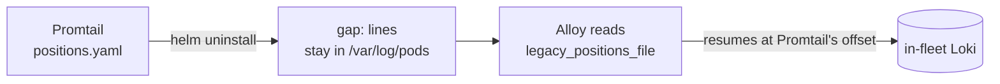

# Promtail → Grafana Alloy (in-fleet log shipper)

Promtail is end of life as of **2 March 2026** — no security fixes, no
compatibility guarantee against future Loki versions. It is the log shipper in
the fleet bootstrap stack, feeding in-fleet Loki, which backs every Streamtime
log surface. The `grafana/promtail` 6.17.1 chart we pin now renders with
`WARNING: This chart is deprecated`.

**Decision: replace it with Grafana Alloy on every fleet.** Alloy is Grafana's
named successor, `alloy convert` translates our existing Promtail config, and
the labels Loki stores do not change — so no consumer, dashboard, or stored
query is touched.

**This is a swap, not an architecture change.** Same DaemonSet shape, same Loki
push API, same labels, same bootstrap component slot.

**Promtail is removed outright — no dual-shipper period.** Review decision
(21 Sep 2026): no selection key, no automated migration, no rollback-to-promtail
path. New clusters bootstrap with Alloy. Clusters built before this are migrated
**by hand**: uninstall `kafka-fleet-manager-promtail`, then re-run bootstrap, at
which point Alloy resumes from the positions file promtail left behind.

**Not BYO Observability.** BYOO ships customer logs through the OTEL agent →
gateway → vendor. It never used Promtail and is untouched here. Consolidating
both onto one OTEL agent was evaluated and rejected: see
[Rejected: consolidate onto the OTEL agent](#rejected-consolidate-onto-the-otel-agent).

---

## Why Alloy and not the OTEL collector

Measured on a single-node kind cluster, one agent at a time, all pushing to the
same Loki 3.6.4. Four pods writing ~270-byte Kafka-style lines. 120 s windows
after a 45 s warm-up, kubelet stats API. Every Loki-bound run delivered ≥99.4 %
of lines.

| Agent (per node) | CPU @200/s | CPU @4k/s | Memory | Loki CPU @4k/s |
|---|---|---|---|---|
| Promtail 3.5.1 (today) | 17m | 135m | 43–49 MiB | 35m |
| **Alloy 1.19.2** (incl. config-reloader) | **12m** | **87m** | 71–77 MiB | **30m** |
| OTEL contrib 0.158 → Loki (OTLP) | 17m | 99–101m | 79–114 MiB | 80–91m |
| OTEL → Loki + BYOO gateway (one agent, both jobs) | 23m | 113m | 100–126 MiB | 76m |
| OTEL Operator controller, idle | 1m | — | 19 MiB | — |

Loki idles at ~5.5m. Treat the ratios as the result, not the absolute
millicores — a real node runs more pods and more files.

- **Lowest agent CPU** of every option — 35 % under Promtail at 4k lines/s.
- **No new Loki cost.** Alloy uses the same push API. OTLP intake cost Loki
  2.5–3× the CPU for the same lines (dropping per-line metadata recovered only
  15–20 %), which would land on the `write` pods — and our Loki preset sets no
  CPU/memory requests at all today, so those pods are BestEffort.
- **Labels unchanged**, so no consumer work and no query rewriting.
- **journald keeps working** (`loki.source.journal`). The OTEL contrib image
  ships no `journalctl`, so that path would need a custom image.
- **Costs:** ~30 MiB/node more than Promtail, and a 211 MB image (vs 65 MB)
  that slows first pull on node scale-up.

---

## What promtail was wired into (all removed)

| Concern | Location |
|---|---|
| Component registry | `core/services/bootstrap_resolver.py:212` (`promtail`, order 60, release `kafka-fleet-manager-promtail`, ns `monitoring`) |
| Preset (default/development/production/openshift) | `preload/helm_repos/helm__grafana_github_io_helm-charts__promtail.json` |
| Package rule | `preload/package_rules.yaml:124` (`>=6.0.0,<7.0.0`, default 6.17.1) |
| Runtime values (Loki push URL) | `workflows/fleet_provider_base.py:159` |
| Fleet config schema | `core/schemas/fleet_config_schema.py:404` |
| Bootstrap UI | `components/BootstrapConfig/BootstrapConfigEditor.js:60` |
| Values typing | `shared/fm_types/helm_values.py:323` |
| Teardown | `shared/fm_types/bootstrap.py:137` |
| BYOVM (Docker Compose, per VM) | `activities/byovm.py:25,196,546,572,612,631` |

Labels promtail put on every line — **the contract this migration preserves**:
`namespace`, `pod`, `container`, `app`, `instance`, `component`, `job`
(`namespace/app`), `node_name`, `stream`, `filename`; plus the journal scrape
(`job="systemd-journal"`, `unit`, `hostname`, `level`).

Consumers that depend on them: Kafka logs view
(`core/views/kafka/monitoring.py`), KVC logs (`{namespace="kvc-…"}`), MCP
(`mcp_server/tools.py:284`), CLI (`commands/logs.py:_inject_namespace`), the
event dashboard (`{container="event-exporter"}`), and every ad-hoc Grafana query.

---

## Cutover mechanics (measured, not assumed)

`alloy convert --source-format=promtail` emits
`legacy_positions_file = "/run/promtail/positions.yaml"` on its own, so Alloy
resumes exactly where Promtail stopped.

Verified on the bench: Promtail ran 2 min, was removed, 30 s passed, then Alloy
started with `/run/promtail` mounted. Alloy logged *"successfully converted
legacy positions file to the new format"* and read **15,640** generator lines —
resume-from-offsets predicts ~15,600, re-read-from-start ~52,000. Loki received
**24,000/24,000** lines across the switch window and **42,200/42,200** for the
whole run: no gap, no duplicates.

So the order is **stop Promtail, then start Alloy** — the opposite of what the
OTEL path would need. Lines written in between wait in the kubelet's files
(default 5 × 10 MiB per container), so nothing is lost unless a container writes
more than that before Alloy is ready.



---

## What shipped

| Area | Change |
|---|---|
| Component | `alloy` replaces `promtail` in `_COMPONENT_REGISTRY_MAP`, release `kafka-fleet-manager-alloy`, order 60 |
| Preset | `preload/helm_repos/…__alloy.json`, generated by `alloy convert` over the old promtail preset, plus host mounts, journal, resources and an openshift variant |
| Package rule | `Alloy` `>=1.12.0,<2.0.0`, default 1.12.1 |
| Runtime values | `LOKI_URL` env injected by `_apply_runtime_values` (the config reads it with `sys.env()`) |
| Schema / UI | `alloy` replaces `promtail` in `BootstrapConfigSchema` and `BOOTSTRAP_COMPONENTS` |
| Teardown | `kafka-fleet-manager-alloy` |
| BYOVM | `grafana/alloy` container, positions on a named volume, seeded once from the sizes on disk |
| Removed | promtail component, preset, package rule, schema field, UI entry, `PromtailValues`, teardown entry, and its `trim-fleet-charts.sh` references |

### Migrating an existing cluster, by hand

```bash
helm uninstall kafka-fleet-manager-promtail -n monitoring
# then re-run the fleet's bootstrap; Alloy installs and resumes from
# /run/promtail/positions.yaml, so no line is shipped twice and none is lost
```

Uninstall first, then install. Alloy reads promtail's positions file on first
start and resumes at those offsets; lines written in between wait in the
kubelet's log files. Installing first would leave both agents tailing the same
files and duplicate everything in that window.

The `/run/promtail` read-only mount and `legacy_positions_file` stay in the
preset for exactly this handover. They cost one host mount and can be dropped
once no cluster is being migrated.

On BYOVM there is nothing to hand over -- promtail kept its positions inside its
own container's /tmp -- so the reconcile writes a promtail-format positions file
from the current size of each docker log and Alloy imports that instead.
`tail_from_end` would have done the same job on the day of the swap and then
kept applying to every file created afterwards, dropping the first lines of any
container started later; a review caught it (P1) before it shipped.

Both preload sources carry the component: the split file under
`preload/helm_repos/` and the monolith `preload/helm_repos.json` the loader
falls back to when that directory is absent. Tracking it in only one meant the
fallback resolved no shipper at all, which fails bootstrap outright rather than
merely losing logs (P2).

### Verified live

- **Migrated cluster** (kind, 21 Sep 2026): promtail → Alloy in ~40 s, Alloy
  logged *"successfully converted legacy positions file"*, per-minute line
  counts held at ~2,000 across the switch with no dip and no doubling, every
  label preserved.
- **New cluster** (`valid-urial`): bootstraps straight onto Alloy, 0 restarts,
  0 error lines, logs flowing from 6 namespaces, Alloy recorded in installed
  components.
- **Bench**: Alloy read 15,640 lines after the handover where resume predicts
  ~15,600 and a re-read predicts ~52,000; Loki counts exact in both windows.

### Still to prove on a real cluster

- **journald.** kind's journal is volatile and empty, so zero journal lines
  there proved nothing. On EKS/OKE/GKE confirm `{job="systemd-journal"}` returns
  data with `unit`, `hostname`, `level`.
- **OpenShift.** The preset (`container_logreader_t`, `hostmount-anyuid-v2`,
  literal-name SCC binding) has never run on a real cluster.
- **SELinux nodes** (OKE/Oracle Linux): `spc_t` mirrors promtail's fix for AVC
  denials on journald and pod logs.
- **Tainted node pools.** The preset carries promtail's three tolerations, not
  the BYOO agent's blanket `operator: Exists`. A Kafka broker pool is routinely
  tainted, and a log agent that cannot schedule loses that node's logs silently.
  Check `kubectl get ds` desired == node count, and widen if not.
- **Memory.** `256Mi` is sized from a 4-pod bench (Alloy used 71–77 MiB at 4k
  lines/s). Record peak on a busy node and set requests/limit from that.

## Out of scope

- **BYO Observability / the OTEL agent and gateway.** Untouched. On fleets with
  sinks, nodes run Alloy *and* the OTEL agent — the BYOO agent cost is already
  accepted today.
- **Loki chart migration.** The OSS Loki chart moved to
  `grafana-community/helm-charts` on 16 Mar 2026 (forked at 6.55.0);
  `grafana/loki` on grafana.github.io is now GEL-only. We pin `>=6.0.0,<7.0.0`
  from the old repo, and the community chart is at 18.x with bundled MinIO due
  for removal 2026-10-31 — our preset enables MinIO when a fleet has no cloud
  bucket. **Own ticket, arguably more urgent than this one.**
- `bitnamilegacy/kubernetes-event-exporter:1.7.0` (the event dashboard's log
  source) receives no updates — own ticket.

## Rejected: consolidate onto the OTEL agent

Folding in-fleet logs into the BYOO agent would remove a DaemonSet from fleets
that have sinks. Rejected because the OTEL Operator is only to be installed on
fleets with custom observability sinks, so most fleets would need a *new* plain
OTEL DaemonSet — no longer consolidation, and measurably heavier: +15 % agent
CPU, up to +40 MiB/node, and 2.5–3× Loki ingest CPU. It would also need label
mapping in Loki, a journald workaround, checkpoint storage, and would make the
log path depend on whether a customer account is attached.

Note for whoever picks up BYOO next: today `otel_operator` and
`fleet_manager_otel` are **unconditional** (`bootstrap_resolver.py:331,357`;
plan says "No — always"), which contradicts that sink-only rule. Separately,
the operator registers a mutating webhook on every Pod CREATE in every namespace
(no selector, 10 s timeout), `k8sattributes` in the wrap chart has no node
filter (every agent watches every pod in the cluster), and
`build_fleet_teardown_releases` uninstalls neither OTEL release.

## Success criteria

1. Every fleet ships logs with Alloy; no Promtail release anywhere.
2. Loki's label set and every existing LogQL query are unchanged.
3. The cutover loses no lines and produces no duplicates, on every distribution.
4. journald logs still reach Loki on non-OpenShift fleets.
5. Loki ingest CPU is unchanged from the Promtail baseline.
6. No promtail left in the codebase.

## Open decisions

- Accept ~30 MiB/node more memory than Promtail for ~35 % less CPU and a
  supported agent. (Recommended: yes.)
- Alloy's metric names differ from Promtail's — `alloy convert` warns about this.
  Confirm nothing alerts on `promtail_*` before Phase 4. (Repo grep: no
  dashboard or alert rule references them.)
- Keep the config-reloader sidecar (10m/50Mi/node) or disable it and let chart
  upgrades roll pods.
