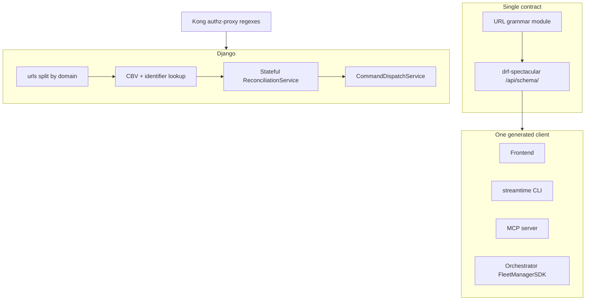

# Refactor APIs

## Outcome

Make the public HTTP contract match the grammar already written in
`CLAUDE.md` / the backend skill, then stop every consumer from inventing its
own path strings.

Target grammar:

```
/{tenant}/{collection}/{identifier}/{sub-collection}/{sub-identifier}/
```

- Tenant is always `organizations/{org_identifier}`.
- Collection names are stable nouns. No verbs in path segments.
- Detail lookup is the `identifier` slug, never a UUID, never a query param.
- Nesting follows ownership and stops at an aggregate's direct child.
  Placement and advanced-config are singleton configuration children of
  the real Fleet/workload resource; no routes nest beneath those children.
  Resource lifecycle generally uses HTTP methods and Operation resources.
  `POST /{resource}/{identifier}/reconcile/` is the one documented
  lifecycle-command exception and the only create/update workflow dispatch
  boundary.
- No `/api/` prefix on resource URLs. `/api/schema/` stays as OpenAPI docs.
- Public HTTP paths never expose Temporal workflow type names or require
  callers to construct workflow subjects.
- Temporal workflow types use compact verb-object names without redundant
  `Workflow`, `Activity`, `Handler`, or service-name suffixes.

This is a contract refactor, not a feature. Every path, kwarg, or lookup
change is assessed with `/regression-check` and lands in the same PR as every
consumer of that path.

## Locked decisions

| # | Choice | Meaning |
|---|---|---|
| 1 | **1A** | Keep `fleet/` and `kafka/` singular. Rename `flinks` → `flink`, `kafka-connects` → `kafka-connect`, `kafka-replicators` → `kafka-replicator`, `virtual-kafka-clusters` → `virtual-kafka`. |
| 2 | **A** | Coordinated monorepo deploy. No dual-path aliases, no `/v2/`. CLI wheel same day. |
| 3 | **Superseded by explicit reconcile** | Public create/update persists the real resource through collection/item methods. Reconcile and teardown return Operation resources. Workflow type names and subjects remain internal. |
| 4 | **Slug** | Packages get `GET/PATCH/DELETE /packages/{identifier}/`. Drop `?package=`. Model field + migration if no slug exists. |
| 5 | **API-first** | Fleet and workload callers create/update the real resource, optionally through advertised wizard forms, then explicitly call its reconcile endpoint. Backend supplies eligible choices/defaults, validates the concrete selection, resolves package/chart details, and handles dispatch/operation bookkeeping. |
| 6 | **Compact Temporal names** | Externally registered types use verb-object names such as `InstallStreamtime`; Python/Go implementation class names may differ, but public APIs never require them. |
| 7 | **Preserve UI journey** | Keep the current Fleet/workload wizard steps and functional outcomes. Replace the service calls beneath those screens with the real resource's placement and advanced-config APIs; representations advertise the next valid forms and links. |
| 8 | **Stateful explicit reconcile** | Create and update persist desired state without dispatch. API clients must call `POST /{collection}/{identifier}/reconcile/`. It rejects incomplete/invalid state with actionable forms, no-ops an observed unchanged generation, deduplicates active work, and dispatches only a valid pending generation. DELETE marks desired absence and invokes the same reconciliation service automatically. |

Decision 2's “no aliases” rule applies to public HTTP paths. Temporal workers
must temporarily register old and new workflow type strings because Temporal
history is immutable and running/replayed executions still schedule the old
type. Those worker-internal aliases are not REST aliases and are not exposed
to new API callers.

Decision 7 preserves behavior and user journey, not the current HTTP call
graph. Existing pages, fields, step order, validation feedback, review, and
final Create action remain recognizable. Frontend hooks stop encoding
provider orchestration and instead follow the resource representation. The
visible final Create action persists the last stage and invokes reconcile.
This is a service-layer integration change, not a visual redesign.

## Why now

`fleet_manager/urls.py` is ~1490 lines and already contradicts its own header
("proper pluralization", "REST-compliant"). Live drift:

- Highest-traffic collections are singular (`fleet/`, `kafka/`); later SKUs
  are plural (`flinks/`, `kafka-connects/`). Tests and provision scripts
  already guess `/fleets/` and miss.
- Fourteen Kafka monitoring/billing endpoints are still function views;
  fleet equivalents are class-based.
- Packages have no detail URL (`?package=` on the list path). Helm repos,
  package-rules, alerts, and commands still use UUID in the path.
- Workflow control exists three times: `/commands/dispatch/`,
  `/commands/{run_id}/cancel/`, and `/{entity}/workflow/cancel/{runId}/`
  (`run_id` vs camelCase `runId`).
- CommandDispatch subjects use `fleet/{id}/tenants/{cluster}/command/…`
  while HTTP uses `kafka/`. Replicator/connect/VKC subjects omit `/command/`.
- Kong plugin, Helm ingress, and MCP already disagree with `urls.py`
  (`/clusters/`, `/infrastructure/`, `/metric/` vs `/metrics/query/`).

There is no API version prefix today. Any rename is instantly breaking for
installed CLI wheels and for Kong regexes.

## Existing foundations (keep)

- Org-scoped routing and `OrganizationMixin`.
- `identifier` slug + `validate_identifier` on provisioned resources
  (org, fleet, kafka, flink, replicator, connect, VKC, bootstrap provider,
  alert channel, observability provider, oauth provider, policy).
- `CommandDispatchService` + subject
  `/organizations/{org}/{resource}/{id}/command/{WorkflowName}`.
- Internal Pydantic schema registry and current generic schema endpoint.
  Keep the registry, but replace its public technical-name routing with
  resource-scoped configuration profiles.
- Generated OpenAPI client in the orchestrator
  (`streamtime-sdk/`) and test-harness.
  It is incomplete (schema bugs force ~70 handwritten SDK fallbacks) but it
  is the seed for one client.
- Kong catch-all proxy. Only a handful of regexes in
  `kong-authz-proxy/handler.lua` are path-specific.

Do not change Temporal subject shape in the same tranche as HTTP cleanup
unless the orchestrator and agent are updated together. Deployed agents do
not call Django HTTP; they do key off workflow IDs.

## Non-goals

- Redesigning unrelated domain fields. Fleet/Kafka create, update, delete,
  status, error, links, pagination, and Operation response shapes are in
  scope because they are necessary for an API-first contract.
- Setup/onboarding RPC (`/setup/…`) — keep as an auth-free bootstrap API.
- Grafana `/api/public/dashboards/…` (Grafana's own API).
- Adding `/v2/` unless Decision 2 selects Option D.
- Renaming internal Python/Go symbols solely for aesthetics. Registered
  Temporal type strings are renamed where they are externally visible or
  leak into API contracts; implementation symbols may follow when safe.

## Architecture



Source of truth for paths is a Python URL grammar module imported by Django
urls **and** used to assert OpenAPI path list in tests. Clients are generated
from OpenAPI. Handwritten `f"/organizations/{org}/fleet/"` strings become a
lint failure.

## Canonical URL grammar

| Kind | Shape | Example |
|---|---|---|
| Collection | `/{collection}/` | `/organizations/root/fleet/` |
| Item | `/{collection}/{identifier}/` | `/organizations/root/fleet/prod/` |
| Sub-collection | `/{collection}/{id}/{sub}/` | `/organizations/root/kafka/orders/credentials/` |
| Sub-item | `/{collection}/{id}/{sub}/{sub-id}/` | `/organizations/root/kafka/orders/credentials/admin/` |
| Strictly-owned nested collection | `/{collection}/{id}/{singleton}/{sub}/` | `/organizations/root/fleet/prod/agent/verifications/` |
| Configuration profiles | `/{collection}/configuration-profiles/` | `/organizations/root/kafka/configuration-profiles/` |
| Configuration profile | `/{collection}/configuration-profiles/{type}/` | `/organizations/root/kafka/configuration-profiles/strimzi/` |
| Create | `POST /{collection}/` | persist real desired-state resource; `201 Created`, no workflow |
| Update | `PATCH /{collection}/{id}/` | persist desired state and increment generation; `200`, no workflow |
| Placement | `PUT/PATCH /{collection}/{id}/placement/` | real resource's typed placement stage |
| Advanced config | `PUT/PATCH /{collection}/{id}/advanced-config/` | real resource's typed advanced stage |
| Reconcile | `POST /{collection}/{id}/reconcile/` | validate and converge current generation; `202` + Operation |
| Delete | `DELETE /{collection}/{id}/` | logical delete + automatic reconciliation; physical delete after cleanup |
| Operation | `GET /operations/{id}/` | stable phase/status/progress/errors/resource links |
| Operation cancel | `DELETE /operations/{id}/` | request cancellation where supported |
| Singleton | `/{name}/` | `license/`, `tunnel-config/`, `container-registry/` |

Rules:

1. **Pluralization is a product decision (Decision 1).** Do not mix. Today
   `fleet`/`kafka` are singular and `flinks`/`kafka-connects` are plural.
2. **Path kwargs are always `identifier`** (and `org_identifier` for the
   tenant). Never `fleet_id`, `kafka_id`, `pk`, `id`, `runId` in URLs.
3. **UUIDs stay in JSON bodies and query filters**, not in paths. Resources
   that have no slug today get one (`validate_identifier` or
   `validate_identifier_32`) or are addressed by a natural key already
   unique in the org (username, alertname, domain, secret URI).
4. **Verbs are HTTP methods.** `POST` to the collection creates, `PATCH`
   changes desired state, and `DELETE` requests teardown. Retire
   `/validate/`, `/sync/`, `/ensure/`, `/apply/`, `/restart/` as path
   segments once an equivalent resource representation exists. The selected
   exception is `POST /{item}/reconcile/`, an explicit, idempotent convergence
   command that API clients must call after create/update.
5. **Nest only for strict ownership.** Flink jobs become either
   `/flink-jobs/{id}/` with `flink` in the body, or stay nested as
   `/flink/{id}/jobs/{id}/`.
   `…/jobs/{id}/compute-components/` is an action, not a third resource —
   fold it into the job item or its Operation. Fleet/workload resources may
   own direct singleton configuration children (`placement`,
   `advanced-config`); nothing nests below those singleton children.
   A strictly-owned singleton aggregate may own a meaningful collection,
   such as `/fleet/{id}/agent/verifications/`; do not flatten it merely to
   satisfy an arbitrary depth limit. HATEOAS links mean clients do not
   construct these paths.
6. **OpenAPI is mandatory.** Every view: `@extend_schema`, `operation_id`,
   typed responses. The generated client must compile without SDK escape
   hatches for new endpoints.

## Decision 1 — Collection names

This is the highest blast-radius choice. Kong, Temporal subjects, CLI, MCP,
frontend, and scripts all hardcode `fleet/` and `kafka/`.

**Option 1A — Keep `fleet` and `kafka` singular; fold outliers to match.**

| Today | Target |
|---|---|
| `fleet/` | `fleet/` (unchanged) |
| `kafka/` | `kafka/` (unchanged) |
| `flinks/` | `flink/` |
| `kafka-connects/` | `kafka-connect/` |
| `kafka-replicators/` | `kafka-replicator/` |
| `virtual-kafka-clusters/` | `virtual-kafka/` |
| `networks/` | `network/` **or** keep plural for true collections of many |

Matches how operators speak ("the prod fleet", "the orders kafka").
Minimizes Kong + Temporal churn. `flinks/` → `flink/` is a breaking rename
with a small consumer set.

**Option 1B — All collections plural.**

`fleets/`, `kafkas/`, `flinks/`, `networks/`. Linguistically REST-correct.
Breaks Kong `fleet/…/endpoints/`, every Temporal subject, every script,
and the comments that already get this wrong (`/fleets/` in provision
scripts vs live `/fleet/`).

**Option 1C — Freeze names as they are; only fix identity, verbs, and
nesting.** Smallest diff. Leaves `fleet` vs `flinks` as a permanent
inconsistency.

**Locked: 1A.** Do not pluralize `fleet` or `kafka`. Align later SKUs to
the same singular collection style as the two resources every client
already knows.

## Decision 2 — How to ship breaking path changes

Per `/regression-check`. CLI wheels are out-of-band. Kong regexes ship
with the gateway chart. Deployed agents do not speak this HTTP.

**Option A — Coordinated monorepo deploy, no aliases.** Frontend, SDK,
MCP, Kong, tests, Helm, scripts in one release. CLI is a same-day wheel
publish. Safe only if no customer CLI can lag.

**Option B — Dual paths for one release.** New path is canonical; old path
returns `308` (or the same view) with `Sunset` / `Deprecation` headers.
Remove aliases in the following release. Doubles OpenAPI surface while
aliases live.

**Option D — `/v2/` prefix.** Use only if CLI/MCP must keep working for
months without a bump. There is no `/v1/` today, so this introduces the
first version segment and forces Kong org-extract regexes to change
anyway.

**Locked: A.** Breaking HTTP phases 2–5 are a single coordinated release: backend,
gateway/Kong, frontend, orchestrator SDK, MCP, CLI wheel, Helm, scripts,
and tests land together. No dual paths, no `308` aliases, no `/v2/`.

CLI must publish the matching wheel the same day. If a customer CLI cannot
be bumped in lockstep, stop and revisit Option B before merging.

Do not add silent fallbacks, `or`-chained env vars, or dual JSON fields to
paper over a rename.

## Decision 3 — Public lifecycle and internal workflows

Today:

| API | Path | Notes |
|---|---|---|
| Start | `POST /commands/dispatch/` | body contains the subject string |
| Start (legacy) | `POST /commands/{command_handler}/` | |
| Run control | `/commands/{run_id}/cancel\|terminate\|signal/` | snake_case |
| Run detail | `/commands/{uuid:command_id}/` | different id space |
| Legacy RPC | `/{entity}/workflow/{verb}/{runId}/` | camelCase, unconstrained `{entity}` |

Canonical subject (not currently an HTTP route):

```
/organizations/{org}/{collection}/{identifier}/command/{WorkflowName}
```

The previously selected direct
`POST /{collection}/{id}/command/{WorkflowName}/` route is RPC-style and
would expose an orchestration implementation detail. The newer requirement
for a fully RESTful, API-first surface supersedes that choice for public
resource lifecycle.

**Locked replacement:**

- `POST /fleet/` or `POST /kafka/` creates the real desired-state resource
  and returns `201 Created`; it does not dispatch.
- `PATCH /{collection}/{identifier}/` and its placement/advanced-config
  singleton APIs update the real resource; they do not dispatch.
- `POST /{collection}/{identifier}/reconcile/` authoritatively validates and
  dispatches convergence, returning `202 Accepted`, `Location`, and an
  Operation representation.
- `DELETE /{collection}/{identifier}/` always requests teardown and returns
  an Operation. Delete-workflow URLs and `x-delete-resource` are removed.
- `GET /operations/{id}/` is the only polling contract. The representation
  includes `id`, `kind`, `resource`, `phase`, `status`, `progress`,
  `created_at`, `started_at`, `finished_at`, typed errors, and links.
- `DELETE /operations/{id}/` requests cancellation. Unsupported
  cancellation returns a standard `409` problem document.
- `CommandDispatchService`, subjects, workflow IDs, run IDs, and Temporal
  workflow types are backend implementation details. An administrative
  command API may remain for diagnostics, but normal Fleet/Kafka clients do
  not use it.

**Do not change in-flight Temporal workflow IDs.** New starts use the new
internal naming contract; old runs remain readable through their Operation
record and existing Temporal identifiers until retention expires.

## API-first Fleet and workload contract

### Audit result

The frontend currently behaves as a provisioning DSL rather than a thin API
client.

Fleet create performs roughly 12–20 calls: provider catalog, domains,
package status, monitoring accounts, pricing, placement schema resolution,
placement validation, advanced schema resolution, advanced validation,
registry options, package versions, presets, repository rules, and finally
`POST /fleet/`. It also knows provider-specific bootstrap keys, bucket-name
defaults, package support filters, tenancy/capacity constraints, BYOK
placeholder values, and the organization-environment-to-preset mapping.

Kafka create performs roughly 10–18 calls: workload/provider catalogs,
alert channels, pricing, fleet selection, fleet-selection validation,
advanced schema resolution, validation, package/chart lookup, and finally
`POST /kafka/`. It hardcodes chart repository knowledge, provider branches,
storage defaults, labels derived from tenancy metadata, and delayed refresh
timers.

This creates two correctness bugs:

1. The UI resolves package/chart choices while the orchestrator later calls
   `compute-components`; these can disagree.
2. Fleet workflow dispatch failure is logged after the row is created but
   the API still returns `201`, leaving an untracked partial state.

### Target Fleet API

```http
GET    /organizations/{org}/fleet/
GET    /organizations/{org}/fleet/{identifier}/
POST   /organizations/{org}/fleet/
PATCH  /organizations/{org}/fleet/{identifier}/
DELETE /organizations/{org}/fleet/{identifier}/
```

The initial create request contains at least the identity and provider/profile
needed to establish contextual configuration. It persists the actual Fleet
in `incomplete` or `valid` configuration state and returns `201`. Placement,
advanced overrides, monitoring accounts, and package intent may be supplied
inline or through the resource's advertised wizard forms. The backend
normalizes each write but performs complete provider-dependent resolution,
snapshots deployment input, creates the Operation/outbox, and dispatches only
when the client calls the Fleet reconcile endpoint.

BYOK uses the same request. `agent_required` and an agent-install link are
returned as capabilities; callers do not know a special wizard sequence.

### Target Kafka/workload API

```http
GET    /organizations/{org}/kafka/
GET    /organizations/{org}/kafka/{identifier}/
POST   /organizations/{org}/kafka/
PATCH  /organizations/{org}/kafka/{identifier}/
DELETE /organizations/{org}/kafka/{identifier}/
```

The request contains workload intent, capacity/retention objectives,
a concrete Fleet identifier, concrete advanced configuration, and optional
package overrides. It may be supplied inline or step-wise on the persisted
Kafka resource. The server supplies eligible Fleet choices and defaults
through forms, but the selected Fleet must be persisted before reconcile.
On reconcile, the backend performs relationship validation, chart
preflight, `compute-components`, snapshotting, and dispatch.

Flink, Kafka Connect, Replicator, Virtual Kafka, and future workloads adopt
the same desired-state + Operation contract. They do not each invent a
different workflow-delete or command-dispatch path.

### Schema registry and explicit configuration stages

The existing schema registry is the right foundation, but not yet a
replacement for contextual configuration APIs:

- it currently registers only Kafka Connect, Kafka Replicator, and Virtual
  Kafka;
- each registration maps one endpoint to one static Pydantic class and
  returns `model_json_schema()`;
- it has no public schema catalog despite an internal `list_endpoints()`;
- it cannot currently resolve org/provider-dependent enum choices or
  validate external state.

Keep it as the internal **static type registry**, then expose those types in
the context of their parent resource:

```http
GET /organizations/{org}/fleet/configuration-profiles/
GET /organizations/{org}/fleet/configuration-profiles/{provider}/
GET /organizations/{org}/kafka/configuration-profiles/
GET /organizations/{org}/kafka/configuration-profiles/{workload}/
GET /organizations/{org}/flink/configuration-profiles/
GET /organizations/{org}/kafka-connect/configuration-profiles/
GET /organizations/{org}/kafka-replicator/configuration-profiles/
GET /organizations/{org}/virtual-kafka/configuration-profiles/
```

The collection lists applicable providers/workloads and their capabilities.
The item returns one cohesive profile containing create, placement, and
advanced Pydantic JSON Schemas, schema versions, UI hints, prerequisites,
and links/templates for eligible parent resources and other contextual
choices. A caller discovers `strimzi` from the Kafka collection and follows
its profile; it never needs to guess names such as `kafka-advanced`.

Collection responses and OpenAPI descriptions include
`rel="describedby"` links to the applicable profile. Existing resources
include the selected profile link. The current generic `/schemas/{name}/`
routes are retired after all registered types are exposed through their
parent collection.

Placement and advanced configuration remain important documented types.
Expose those stages directly on the real resource. There is no separate
draft model or draft URL tree.

### Real-resource wizard interface

```http
POST   /organizations/{org}/fleet/
GET    /organizations/{org}/fleet/{identifier}/
PATCH  /organizations/{org}/fleet/{identifier}/
DELETE /organizations/{org}/fleet/{identifier}/
GET    /organizations/{org}/fleet/{identifier}/placement/
PUT    /organizations/{org}/fleet/{identifier}/placement/
PATCH  /organizations/{org}/fleet/{identifier}/placement/
GET    /organizations/{org}/fleet/{identifier}/advanced-config/
PUT    /organizations/{org}/fleet/{identifier}/advanced-config/
PATCH  /organizations/{org}/fleet/{identifier}/advanced-config/
POST   /organizations/{org}/fleet/{identifier}/reconcile/

POST   /organizations/{org}/kafka/
GET    /organizations/{org}/kafka/{identifier}/
PATCH  /organizations/{org}/kafka/{identifier}/
DELETE /organizations/{org}/kafka/{identifier}/
GET    /organizations/{org}/kafka/{identifier}/placement/
PUT    /organizations/{org}/kafka/{identifier}/placement/
PATCH  /organizations/{org}/kafka/{identifier}/placement/
GET    /organizations/{org}/kafka/{identifier}/advanced-config/
PUT    /organizations/{org}/kafka/{identifier}/advanced-config/
PATCH  /organizations/{org}/kafka/{identifier}/advanced-config/
POST   /organizations/{org}/kafka/{identifier}/reconcile/
```

`POST` to the collection creates the actual org-scoped Fleet/workload row,
reserves its identifier, and returns `201 Created` with its item URI. It
does not create an Operation or dispatch Temporal. The request may contain
only the basic identity/profile fields needed to establish contextual
schemas, or a complete desired state for non-interactive clients.

The real resource records:

- `configuration_state`: `incomplete`, `valid`, or `invalid`;
- `generation`: incremented whenever deployable desired state changes;
- `observed_generation`: latest generation successfully reconciled;
- `desired_lifecycle`: `present` or `absent`;
- `reconciliation_state`: `never_reconciled`, `pending`, `queued`,
  `running`, `succeeded`, or `failed`;
- the selected profile and typed placement/advanced configuration.

Placement and advanced config are typed singleton sub-resources of the real
resource. `PUT` creates/replaces a complete stage; `PATCH` changes partial
values with `If-Match`. These writes normalize and validate their stage,
increment `generation` when desired state changes, set reconciliation to
`pending`, and never dispatch a workflow. Updating placement invalidates
advanced configuration when its schema/context depends on placement.
Structurally invalid submitted values are rejected without replacing the
last valid stage value. Cross-stage, contextual, or externally-invalidated
state is represented as `configuration_state=invalid`.

Collection `POST` therefore has two valid modes:

1. **Fully formed:** submit every required field, placement, and advanced
   configuration in one request. The server validates all supplied values,
   persists the real resource as `valid`, and advertises reconcile.
2. **Step-wise:** submit the minimum identity and profile discriminator.
   The server persists the real resource as `incomplete`, then advertises
   the placement, advanced-config, and any other required forms in order.

Both modes return `201 Created` and neither dispatches. The distinction is
resource completeness, not a different endpoint or model.

The root and stage responses are HATEOAS-style form representations. Typed
`_links` and `_forms` tell interactive clients what they may submit next.
The form schema is the contextual Pydantic JSON Schema already usable by the
current dynamic form renderer:

```json
{
  "identifier": "orders",
  "configuration_state": "incomplete",
  "generation": 7,
  "observed_generation": 0,
  "configuration": {
    "missing": [
      {
        "path": "advanced_config",
        "detail": "Advanced configuration is required for the selected Strimzi profile.",
        "describedby": "/organizations/root/kafka/configuration-profiles/strimzi/#advanced-config"
      }
    ],
    "errors": []
  },
  "_links": {
    "self": {
      "href": "/organizations/root/kafka/orders/"
    },
    "describedby": {
      "href": "/organizations/root/kafka/configuration-profiles/strimzi/"
    },
    "placement": {
      "href": "/organizations/root/kafka/orders/placement/"
    }
  },
  "_forms": {
    "placement": {
      "href": "/organizations/root/kafka/orders/placement/",
      "method": "PUT",
      "content_type": "application/json",
      "schema_version": "strimzi-placement-v3",
      "schema": {
        "type": "object",
        "properties": {}
      },
      "value": {},
      "submit_label": "Continue"
    }
  }
}
```

`_forms` contains only transitions currently allowed by resource state and
caller permissions. A successful stage write returns normalized values,
field findings, a new ETag/generation, and the next form. Validation errors
return Problem Details with field errors and the form metadata needed to
render the same wizard step.

Once the actual resource is complete, it advertises reconcile:

```json
{
  "identifier": "orders",
  "configuration_state": "valid",
  "generation": 11,
  "observed_generation": 0,
  "_forms": {
    "reconcile": {
      "href": "/organizations/root/kafka/orders/reconcile/",
      "method": "POST",
      "content_type": "application/json",
      "body": {
        "generation": 11
      },
      "submit_label": "Create"
    }
  }
}
```

The UI continues to label this final action “Create” during initial
provisioning. API clients are explicitly documented to call reconcile after
creating or changing desired state. An automation client may create a
complete resource in one collection POST, then call reconcile as its second
request; it does not need to walk the wizard forms.

An abandoned wizard leaves a real `incomplete` resource. The UI Cancel
action calls DELETE. It follows the same logical-delete contract, but the
reconciliation service completes cleanup without Temporal because the
resource was never observed externally. List/detail responses expose
incomplete state so clients can resume or delete it; no hidden expiry
removes a real resource.

### Explicit reconcile dispatch boundary

Creating the resource and all root/placement/advanced-config updates are
bookkeeping only. `POST /{collection}/{identifier}/reconcile/` is the sole
create/update workflow dispatch boundary.

Reconcile is stateful, not an unconditional command. It computes a decision
from `configuration_state`, requested `generation`, `observed_generation`,
`desired_lifecycle`, `reconciliation_state`, and the active/latest
Operation:

- **Incomplete:** return `409 configuration_incomplete`; include every
  missing requirement, why it is required, the profile/schema link, and the
  exact `_forms` needed to complete it. Create no Operation or outbox.
- **Invalid:** return `422 configuration_invalid`; include stable
  field/cross-field error codes, remediation, schema/profile links, and
  applicable correction forms. Create no Operation or outbox.
- **Unchanged:** when the current generation is already observed
  successfully and no drift/deletion is pending, return `200` with
  `status=unchanged`, `dispatched=false`, and the latest Operation link.
  Create no Operation, outbox, or Temporal execution.
- **Already active:** for the same generation, return `202` and the existing
  Operation. For a different generation while an Operation is active,
  return `409 reconciliation_in_progress` with that Operation and retry
  guidance.
- **Pending valid change:** snapshot and enqueue exactly one reconciliation
  for the current generation.
- **Previous failure:** `observed_generation` has not advanced, so retrying
  the same desired generation may create a new Operation with a new
  idempotency key; the failed Operation remains in history.

Reconcile executes this sequence for a pending valid change:

1. Lock the real resource with `SELECT ... FOR UPDATE` and verify
   organization ownership, `If-Match`/generation, and that no conflicting
   reconciliation is active.
2. Apply the stateful guards above before constructing workflow input.
3. Authoritatively validate completeness, placement against current
   inventory/capacity, org-scoped references, and provider/workload
   compatibility. Resolve advanced defaults, packages, components, and
   pricing assumptions.
4. Materialize the complete immutable workflow-input snapshot for the
   requested generation.
5. In one database transaction, create one queued Operation and one
   transactional outbox record, associate both with the resource/generation,
   set reconciliation state to `queued`, and commit.
6. Return `202 Accepted` with the Operation `Location` and resource link.
7. A separate dispatcher claims the outbox record, resolves the internal
   workflow mapping, and invokes `CommandDispatchService`.

The reconcile service maps the resource's history to separate lifecycle
workflow types:

```text
observed_generation == 0  -> Create<Resource>
observed_generation > 0   -> Update<Resource>
DELETE item               -> Delete<Resource>
```

The caller never supplies workflow type, workflow ID, task queue, provider
implementation, or CREATE/UPDATE action.

Require `Idempotency-Key` and the intended `generation` on reconcile. The
same key/generation returns the existing Operation; reuse with different
input returns `409`. A stale generation returns `412`; an active conflicting
Operation returns `409`. This prevents double-clicks and retrying clients
from starting duplicate workflows.

An incomplete response is directly actionable:

```json
{
  "type": "/problems/configuration-incomplete",
  "status": 409,
  "code": "configuration_incomplete",
  "detail": "Kafka 'orders' is missing configuration required for reconciliation.",
  "generation": 7,
  "missing": [
    {
      "path": "advanced_config",
      "code": "required_for_profile",
      "detail": "Advanced configuration is required for the selected Strimzi profile.",
      "describedby": "/organizations/root/kafka/configuration-profiles/strimzi/#advanced-config"
    }
  ],
  "_links": {
    "resource": {
      "href": "/organizations/root/kafka/orders/"
    }
  },
  "_forms": {
    "advanced_config": {
      "href": "/organizations/root/kafka/orders/advanced-config/",
      "method": "PUT",
      "schema_version": "strimzi-advanced-v4",
      "schema": {
        "type": "object",
        "properties": {}
      }
    }
  }
}
```

An unchanged response is explicit and side-effect free:

```json
{
  "status": "unchanged",
  "dispatched": false,
  "generation": 11,
  "observed_generation": 11,
  "latest_operation": {
    "href": "/organizations/root/operations/01j-create-orders/",
    "status": "succeeded"
  }
}
```

Successful reconcile returns:

```http
HTTP/1.1 202 Accepted
Location: /organizations/{org}/operations/{operation-identifier}/
Content-Location: /organizations/{org}/kafka/{identifier}/
Link: </organizations/{org}/kafka/{identifier}/>; rel="resource"
```

Do not rely only on Django `transaction.on_commit()`: a process crash after
database commit but before Temporal start would lose the operation.
PostgreSQL and Temporal do not share a distributed transaction, so the
outbox plus deterministic Operation-based Temporal workflow ID provides
effectively-once dispatch:

- if the dispatcher crashes before Temporal start, the outbox is retried;
- if it crashes after Temporal start but before marking delivered, retrying
  receives `WorkflowAlreadyStartedError`, treated as successful delivery;
- workflow activities remain independently idempotent because dispatch
  deduplication cannot guarantee external cloud side effects exactly once.

Remove Kafka model signals, Fleet view-level dispatch, and update-time
side-effect dispatch. All create/update starts pass through reconcile.

### Logical delete and final physical deletion

`DELETE /{collection}/{identifier}/` is the special lifecycle case. It
atomically:

1. locks the real resource and rejects blockers;
2. changes `desired_lifecycle` from `present` to `absent`;
3. marks the resource `deleting` and prevents further configuration writes;
4. increments generation;
5. invokes the same stateful reconciliation service automatically;
6. creates/returns the Delete Operation and outbox record with `202`.

The row remains addressable while cleanup runs. Successful Delete
reconciliation physically deletes it only after all external resources are
confirmed absent. The Operation retains a tombstone containing the org,
resource type, identifier, final generation, and deletion result after the
foreign key is cleared. Failed cleanup leaves the logical resource in
`deleting` with actionable Operation errors and permits an idempotent DELETE
retry.

Repeated DELETE while the same deletion generation is queued/running
returns the existing Operation and starts nothing. If the resource has
never been reconciled, the reconciliation service determines that no
external teardown workflow is needed, completes a backend-only Delete
Operation, and physically deletes the row. Thus DELETE always follows the
logical-delete/reconcile contract without starting a pointless Temporal
workflow.

### Concrete placement and advanced configuration

The persisted resource contains concrete configuration—never unresolved
`auto`, `constraints`, `strategy`, or `explicit` wrapper variants.

For example, Kafka placement stores the selected Fleet:

```json
{
  "fleet": "production-east"
}
```

Fleet placement stores the provider-specific concrete region, account,
network, and related values defined by its profile. Advanced configuration
is the provider/workload-specific Pydantic object itself, without a
`type=explicit` wrapper.

The server still does substantial work before the client writes those
values:

- configuration profiles supply JSON Schema constraints, defaults, and UI
  hints;
- `_forms` contain normalized current/default values;
- eligible references are supplied as typed choices or linked filtered
  collections;
- changing an upstream value regenerates dependent constraints and
  invalidates incompatible stored values;
- stage writes validate and persist the selected concrete result.

Accepting a server-supplied default means submitting the concrete default
value advertised by the form. Reconcile never silently chooses a Fleet,
region, network, account, or advanced mode. Schema defaults for scalar
fields may be materialized during normalization, but the persisted
generation and workflow snapshot are always complete and concrete.

On reconcile, the backend authoritatively revalidates org ownership,
current capacity, tenancy, provider/workload compatibility, status,
capabilities, labels, and advanced configuration. An ineligible concrete
reference returns a typed `422` Problem such as `fleet_not_eligible`, with
the field path, rejection reasons, remediation, and a link/form containing
current eligible choices. It creates no Operation or outbox.

The selected concrete references and complete normalized configuration are
persisted in the immutable deployment snapshot and exposed read-only in the
resource/Operation response.

### Public eligibility contract

Every reference offered by a placement/configuration form must be
discoverable through an ordinary documented collection. Kafka placement
uses the Fleet list API, for example:

```http
GET /organizations/{org}/fleet/\
?identifier__in=production-east,production-west\
&provider=aws\
&region__in=us-east-1,us-west-2\
&tenancy_mode=Shared\
&available_kafka_units__gte=3\
&capability=tiered-storage\
&label.environment=production\
&workload=strimzi
```

The Fleet list returns only matching resources using the standard paginated
shape. Each item includes current available capacity, relevant capabilities,
and an eligibility summary for the supplied workload requirements.

Use typed DRF filter serializers/filtersets so OpenAPI generates the exact
query contract. Profile/form choice resolution and Fleet filtering share
the same eligibility service; do not maintain parallel rules.

Apply the same rule to every placement reference:

- bootstrap providers/accounts filter by provider, capability, and status;
- networks filter by provider/account/region and required properties;
- base domains filter by status/certificate readiness;
- storage/observability providers filter by compatibility and availability;
- workload/provider profiles filter by supported placement capabilities.

If a write contract accepts a reference that cannot be discovered
through a public GET collection, the contract is incomplete.

Filtered GET results are advisory snapshots: eligibility can change between
discovery and POST. Exact callers may include the selected Fleet's ETag via
an `placement.if_match` field (or an equivalent typed version token). A
stale token returns `412 Precondition Failed`; absence of a token still
causes authoritative eligibility validation at create time.

For Fleet creation, the same pattern applies to provider placement and
advanced configuration. The selected provider and all required concrete
placement values are present before reconcile.

The frontend uses the real resource's placement then advanced sub-resources
as its visible interim steps. It obtains their types and public filter
templates from the selected configuration profile. It does not call
separate `/validate/`, preparation, or evaluation actions. Stage validation
is advisory; reconcile always performs authoritative complete validation.

Package preset/rule resolution and `compute-components` occur during
reconcile after concrete configuration is complete. Pricing may be returned
by a side-effect-free quote resource, but pricing is not a prerequisite for
creation.

### Discoverability

Every Fleet/workload representation includes typed links and capabilities:

- `self`, `operations`, `metrics`, `status`, `credentials`, `endpoints`;
- `allowed_updates`, `deletable`, `blocked_by`, `agent_required`;
- latest Operation summary and provisioning status;
- child resource links rather than requiring guessed nested paths.

OpenAPI includes complete request/response examples, enums, nullable and
required semantics, standard pagination, and a single RFC 9457-style
problem response with stable `code`, `detail`, `field_errors`, and
`remediation`.

## A priori knowledge and missing contract audit

### P0 — correctness and machine-readable contracts

1. **Standard errors:** every 4xx/5xx uses one RFC 9457-style Problem
   Details serializer. Remove stringified `serializer.errors`, raw error
   dictionaries, `{message}`, and endpoint-specific error wrappers.
2. **Standard lists:** every collection returns
   `{count, next, previous, results}`. Remove commands' bare `run_ids`,
   summary arrays, `{results,count}` variant, packages' `latest=true`
   single-item array, and hook-side `results ?? array` normalization.
3. **Typed CRUD OpenAPI:** Fleet, Kafka, Networks, Credentials, Packages,
   Flink, Connect, Replicator, and Virtual Kafka get distinct create,
   replace, patch, retrieve, list, Operation, and Problem schemas. Every
   method has a stable `operation_id`, request body, all response statuses,
   examples, and tags.
4. **Idempotency:** collection POST and reconcile accept
   `Idempotency-Key`. Create deduplicates real-resource creation. Reconcile
   deduplicates by resource generation and returns the existing Operation;
   key reuse with different input returns `409`.
5. **Atomic dispatch visibility:** reconcile locks the resource and commits
   its resolved snapshot + Operation + outbox atomically. Dispatch happens
   after commit. Dispatch failure transitions the Operation to failed with a
   typed error; it is never logged-only after a successful reconcile.
6. **Relationship validation:** all referenced Fleet, provider, network,
   domain, monitoring account, credential, package, and parent resources are
   resolved within the URL organization. Serializer querysets cannot be
   global (`BootstrapProvider.objects.all()` is invalid here).
7. **State/precondition validation:** create/update/delete validates allowed
   resource transitions and blockers. `If-Match`/ETag protects PATCH where
   concurrent desired-state changes would race.

### P1 — schemas and capabilities

- Extend the internal registry with Fleet placement/advanced, Kafka
  placement/advanced, Flink, bootstrap provider, Connect, Replicator, and
  Virtual Kafka Pydantic types. Remove duplicate legacy hand-built schemas.
- Expose registry entries through each parent collection's
  `/configuration-profiles/` sub-resource, not a global `/schemas/`
  taxonomy. Profiles document the concrete placement and advanced
  configuration schemas and link to ordinary filtered collections for
  eligible Fleets, accounts, networks, credentials, and other contextual
  choices.
- Resource `capabilities` describe allowed desired-state updates and links,
  not Temporal command-handler names or subject templates.
- Credential capabilities publish the supported workload × authentication ×
  credential-type matrix. Move that validation out of views into a strict
  serializer/service.
- Align provider/workload enums everywhere. The bootstrap serializer
  currently accepts `digitalocean` while its OpenAPI create schema omits it.
  Compute-components currently allows only
  `strimzi|cfk|redpanda|warpstream` while dispatch registries also mention
  AutoMQ, Leafcuttr, and Tansu.
- Add non-empty cross-field validation for Kafka Connect and Virtual Kafka;
  replace placeholder `validate()` methods.
- Canonicalize bootstrap config shape and package preset environment names.
  The frontend must not synthesize `{provider}_bootstrap_config` keys or map
  `development→dev` / `production→prod`.

### Known frontend knowledge to remove

- Workflow types/subjects and status handler strings in ActionsMenu,
  agentWorkflowService, AgentManagementPage, Connect delete, and status
  history filters.
- Provider-specific bootstrap keys, legacy key fallbacks, cloud bucket-name
  defaults, network sentinel values, and BYOK capacity placeholders.
- Hardcoded Kafka chart repositories, workload/authentication capability
  branches, storage-tier defaults, package support filters, preset names,
  and package merge assumptions.
- Poll intervals, 10/15-minute messages, delayed sessionStorage refetches,
  `404 means no status`, and `X-Status-Last-Updated` interpretation.
- Hard-delete headers and resource-specific workflow-delete routes.
- Defensive list-shape normalization and undocumented query parameters.

### Agent and asynchronous attempt resources

`AgentConnection` is one-to-one with Fleet and has no independent public
identity, so model it as the Fleet's singleton `agent` sub-resource:

```http
GET   /organizations/{org}/fleet/{fleet}/agent/
PATCH /organizations/{org}/fleet/{fleet}/agent/
POST  /organizations/{org}/fleet/{fleet}/agent/reconcile/
POST  /organizations/{org}/fleet/{fleet}/agent/verifications/
```

Do not preserve `/agent/connection/verify/`: `connection` is redundant
nesting beneath the Agent representation and `verify` is an action verb.
Creating a verification attempt under
`/agent/verifications/` is the resource-oriented API. It returns `202` with
an Operation; the internal registered type may be
`VerifyAgentConnection`, but that name never appears in the URL or body.

The Agent's desired installation/configuration changes use PATCH followed
by its stateful reconcile endpoint. Verification is different: it is an
explicit observation attempt, not a desired-state change. Therefore the
“workflow dispatch only from reconcile” rule applies to create/update
**convergence workflows**, not literally every asynchronous workflow in the
system. Forcing probes, verifications, refreshes, and diagnostics through
reconcile would violate the no-change guard and obscure their result
history.

Apply the same classification elsewhere:

- current/cached facts use `GET` on a representation;
- desired-state changes use `PATCH` followed by reconcile;
- asynchronous checks create noun-based attempt resources such as
  `/fleet/{id}/probes/`, `/agent/verifications/`, or
  `/status-refreshes/`;
- owned inventory uses collections such as `/agent/packages/` or
  `/fleet/{id}/releases/`;
- inherently imperative repeatable work, such as restarting a release,
  creates an attempt resource (`/releases/{id}/restarts/`) rather than
  exposing a workflow verb/type.

If Agent later gains independent tenancy, credentials, or an identifier not
derived from Fleet, promote it to `/agents/{identifier}/`. The current
one-to-one ownership does not justify that extra top-level collection.

## Compact Temporal naming contract

Temporal registered names are an internal wire contract, distinct from
Python/Go symbol names and from the REST API. Canonical names are compact
PascalCase verb-object strings. Do not include `Workflow`, `Activity`,
`Handler`, redundant `Streamtime`, or redundant `Workload`.

### Initial rename map

| Current registered type | Canonical type |
|---|---|
| `InstallStreamtimeAgentWorkflow` | `InstallAgent` |
| `UpdateStreamtimeAgentWorkflow` (Python) / `UpdateAgentWorkflow` (Go) | `UpdateAgent` |
| `VerifyAgentWorkflow` | `VerifyAgentConnection` |
| `DiscoveryProbeWorkflow` | `ProbeFleet` |
| `StreamtimeInfoWorkflow` | `GetAgentInfo` |
| `GetComprehensiveFleetStatusWorkflow` | `GetFleetStatus` |
| `GetComprehensiveClusterStatusWorkflow` | `GetKafkaStatus` |
| `ListHelmReleasesWorkflow` | `ListReleases` |
| `UpgradeHelmReleaseWorkflow` | `UpgradeRelease` |
| `RestartHelmReleaseDeploymentsWorkflow` | `RestartRelease` |
| `PackageSyncWorkflow` | `SyncPackages` |
| `NetworkProvisioningWorkflow` | `ProvisionNetwork` |
| `ApplyObservabilityWorkflow` | `ApplyObservability` |
| `ApplyAlertRulesWorkflow` | `ApplyAlertRules` |
| `RunImageMirrorWorkflow` | `MirrorImages` |
| `FlinkCreateWorkflow` / `FlinkUpdateWorkflow` / `FlinkDeleteWorkflow` | `CreateFlink` / `UpdateFlink` / `DeleteFlink` |
| `FlinkJobCreateWorkflow` / `FlinkJobUpdateWorkflow` / `FlinkJobDeleteWorkflow` | `CreateFlinkJob` / `UpdateFlinkJob` / `DeleteFlinkJob` |
| `ProvisionObjectStorageWorkflow` | `ProvisionObjectStorage` |
| `Provision/Scale/DestroyNodePoolWorkflow` | `Provision/Scale/DestroyNodePool` |
| `ValidateWorkloadIdentityWorkflow` | `ValidateWorkloadIdentity` |

`CreateFlink` is the compact internal name for today's
`FlinkCreateWorkflow`. It is selected by the first successful
`POST /flink/{identifier}/reconcile/` and converges the persisted Flink
resource by resolving its Fleet/components and deploying the Flink workload.
It is distinct from `CreateFlinkJob`, which creates a job beneath a
session-mode Flink resource. Neither Temporal type is a public endpoint.

Keep cloud provider top-level names (`AwsProvider`, `GcpProvider`,
`OciProvider`, `AzureProvider`, `DigitalOceanProvider`, `ByokProvider`,
`ByoVmProvider`) in the first tranche: they are already compact and have
large historical/subject blast radius. Revisit them only when provider
workflows are split into explicit Fleet Create/Update/Delete types.

At the orchestrator boundary, preserve verb-object resource lifecycle
semantics with `CreateFleet` / `UpdateFleet` / `DeleteFleet`,
`CreateKafka` / `UpdateKafka` / `DeleteKafka`,
`CreateFlink` / `UpdateFlink` / `DeleteFlink`,
`CreateKafkaConnect` / `UpdateKafkaConnect` / `DeleteKafkaConnect`,
`CreateKafkaReplicator` / `UpdateKafkaReplicator` /
`DeleteKafkaReplicator`, and `CreateVirtualKafka` /
`UpdateVirtualKafka` / `DeleteVirtualKafka`.

Provider/agent child workflows use compact implementation verbs distinct
from the top-level resource workflow, for example:

- `ProvisionAwsFleet`, `ReconcileAwsFleet`, `TeardownAwsFleet`;
- `ApplyCFK`, `ReconcileCFK`, `TeardownCFK`;
- `ApplyStrimzi`, `ReconcileStrimzi`, `TeardownStrimzi`;
- equivalent Redpanda, WarpStream, Flink, Connect, Replicator, and Virtual
  Kafka implementations.

This keeps the REST-triggered lifecycle stable while allowing provider
implementations to evolve without changing the API-to-workflow mapping.

Do not mechanically strip suffixes where this collides with an activity
name. `DiscoveryProbeWorkflow` cannot become `DiscoveryProbe` while an
activity has that registered name; use `ProbeFleet`.

### Temporal migration

1. Add a checked manifest of every Python and Go registered workflow type,
   task queue, input model, and owner. CI verifies:
   - every dispatch-registry key has a worker implementation;
   - every child-workflow string is registered on the target queue;
   - every registered type has an input schema.
2. Fix existing registry holes before renaming:
   `VirtualKafkaClusterWorkflow`, `ApplyAlertRoutingWorkflow`,
   `LeafcuttrWorkload`, and `TansuWorkload` currently have no discovered
   orchestrator implementation.
3. Register old and new names to the same compatible implementation on both
   workers. New backend starts use only canonical names.
4. Update child-workflow strings, provider/workload mappings, direct agent
   queue routing, `WORKFLOW_INPUT_REGISTRY`, tests, docs, and any stored
   status mapping in the coordinated release.
5. Keep old worker registrations until no old execution can generate a new
   task and the replay/retention policy permits removal. Completed histories
   retain their original type forever.
6. Do not rewrite active workflow IDs. Historical `AgentCommand.command_handler`,
   `command_aggregate`, and `AgentConnection.workflow_type` remain readable
   through a display-name normalization layer; a reviewed data migration may
   canonicalize completed database rows later.
7. Use `workflow.patched()` for logic changes that accompany a rename.
   A type-name alias alone does not require changing deterministic history.

## SDK regeneration impact

### Current reality

`test-harness/regen-sdk.sh` is the only generator. It obtains the
drf-spectacular spec from `/api/schema/?format=json` or generates it offline,
then creates:

- the shared Python package under
  `streamtime-sdk/.../generated/`
  (currently about 615 files); and
- `streamtime-sdk/typescript/api-types.d.ts` (types only, no
  runtime request client).

Regeneration updates generated path literals, operation modules, models,
enums, and declarations. It **does not update call sites**. An
`operation_id` rename can actually break orchestrator imports immediately.
Route renames leave handwritten frontend, CLI, MCP, integration-test, shell,
Kong, Helm, and SDK escape-hatch paths unchanged until manually migrated.
Temporal types, worker registrations, command registries, subject parsers,
history, and persisted database values are outside OpenAPI entirely.

Additional current gaps:

- `openapi-python-client` is invoked through unpinned `uvx`;
- no GitHub workflow regenerates and fails on a dirty diff;
- frontend declarations are JSDoc hints only;
- CLI and MCP do not consume the generated Python package;
- orchestrator `FleetManagerSDK` has roughly 44 `_make_request`, 28
  `_svc.request`, 9 `_svc_write`, and 70 total handwritten escape hatches;
- stale test-harness fuzz paths still point at the old snapshot location.

### Status (2026-09-08)

The checked-in generated tree hasn't been regenerated since `141fc84d7`
(2026-09-02), before this branch's first commit — every path change this
branch has landed (Phase 0 normalization, Packages/Helm-repo/members/
package-rules natural-key routing, Catalog/Secrets/tracked-repo Phase 2
work, the command-detail POST fix) shipped without a matching regen.
Confirmed by actually running it once mid-branch: a full regen touches
~510-615 files in one diff (the entire accumulated backlog, not just
what changed since the last regen), since `openapi-python-client` only
supports whole-tree regeneration, not per-endpoint. The two concretely
stale endpoints found by review (`organizations_packages_partial_update`
still PATCHing bare `/packages/`; the Helm-repository type still keyed by
`{id}`) were confirmed to have **zero live callers** in the orchestrator
or frontend — genuinely stale, but not currently causing a runtime bug.
Deliberately deferred rather than committed mid-branch: regenerating now
would just go stale again the moment the next phase (charges/health/
benchmarks/networks, still unstarted) lands. Do the regen once, as its
own dedicated commit, right before this branch merges — not before.

### Required generation pipeline

1. Move/rename the entrypoint to `scripts/regen-api-clients.sh` and pin exact
   drf-spectacular, `openapi-python-client`, and `openapi-typescript`
   versions. Offline schema generation is the deterministic CI source;
   fetching live schema remains an explicit developer option.
2. Generate the committed OpenAPI snapshot, Python runtime client, and a
   TypeScript **runtime** client integrated with the existing axios auth/401
   behavior—not declarations alone.
3. Make CLI and MCP depend on the shared generated Python client. Delete the
   MCP duplicate SDK. Keep thin domain façades only where they add
   pagination, authentication, or API-first operations without raw paths.
4. Replace orchestrator escape hatches by fixing source OpenAPI defects:
   read-only required fields, multipart/JSON ambiguity, missing query
   parameters, untyped compute-components, and PATCH model collisions.
5. Fix test-harness snapshot references and delete the stale generated tree.
6. Add CI:
   - generate spec and clients with pinned tools;
   - fail on any generated/snapshot diff;
   - compile/import Python and TypeScript clients;
   - run generated client smoke tests;
   - reject raw `/organizations/` path literals outside Django URL modules,
     generated clients, Kong's audited routing module, and explicit test
     fixtures.
7. For every API change: backend/OpenAPI first, regenerate, fix typed
   compilation, then manually update non-generated infrastructure and
   Temporal contracts. Regeneration is a detector and artifact producer,
   never assumed to be automatic remediation.

## Decision 4 — Package identity

Today list/create/patch/delete share
`/packages/?package=encoded_registry://encoded_repo/encoded_tag`.
Filter options live at `/packages-filter-options/` (sibling, not nested).

Target: packages are a normal collection.

```
GET    /packages/
GET    /packages/{identifier}/
PATCH  /packages/{identifier}/
DELETE /packages/{identifier}/
GET    /packages/{identifier}/presets/{preset_name}/
GET    /packages/filter-options/
```

**Locked.** `identifier` is a new slug (or a deterministic encoding of
registry/repo/tag that fits `validate_identifier_32`). UUID `?id=` lookup
is removed. This needs a model field + migration if no slug exists
(Option C for stored data, scoped to Package rows only).

## Inventory (current)

Counts from `fleet_manager/urls.py` on `main`.

| Style | Count |
|---|---|
| `path()` entries | ~100 |
| DefaultRouter ViewSets | 15 |
| First-party function views | 14 + health lambda |
| Explicit `<uuid:…>` converters | 7 routes |
| Verb path segments | ~60 |

### Collection naming (org-scoped)

Singular: `fleet`, `kafka`, `license`, `tunnel-config`, `system-config`,
`container-registry`, `certificate-authority`, `billing`, `sku`,
`benchstress`, `kafka-workload`, `cluster-history`.

Plural: `members`, `catalogs`, `base-domains`, `oauth-providers`,
`alert-channels`, `observability-providers`, `bills`, `api-keys`,
`secrets`, `charges`, `tracked-repositories`, `helm-repositories`,
`packages`, `package-rules`, `commands`, `audit-logs`,
`bootstrap-providers`, `networks`, `kafka-replicators`, `kafka-connects`,
`virtual-kafka-clusters`, `flinks`, `cluster-health-reports`, `workflows`,
`alerts`, `metrics`.

### UUID / non-slug lookup

`tracked-repository` rules, helm-repositories, package-rules, kafka/fleet
alert PKs, command detail, members, catalogs, bills, api-keys, secrets,
charges, cluster-history, node-pools, networks, kafka health, benchmarks.

Fleet **detail** uses `<str:identifier>`; almost every fleet sub-route
uses `<str:fleet_id>`. Kafka is the same split (`identifier` vs
`kafka_id`). Same slug, different kwarg — a constant source of view bugs.

### Already broken vs `urls.py`

| Caller | Path it uses | Live Django |
|---|---|---|
| `charts/fleet-manager/templates/alert-ingress.yaml` | `/clusters/(.*)/alert/` | `/kafka/{id}/alerts/` and `/fleet/{id}/alerts/` |
| `charts/fleet-manager/templates/endpoints-ingress.yaml` | `/infrastructure/(.*)/endpoints/` | Kong-only `/fleet/{id}/endpoints/` (not in Django) |
| `charts/streamtime-agent/values.yaml` | `fleetURI: …/infrastructure/default/` | Temporal identity; stale vs `fleet/` |
| MCP `utils.py` | `/fleet/{id}/metric/`, `/kafka/{id}/metric/` | `/metrics/overview/`, `/metrics/query/` |
| Kong `kong.trial.yaml` / `kong.singlenode.yaml` | `/api/health/`, `/api/setup/` | `/health/`, `/setup/` (strip_path hides this if Kong is right) |
| Provision script comments | `/fleets/{id}/kubeconfig/` | `/fleet/{id}/kubeconfig/` |
| Middleware tests | `/organizations/…/fleets/` | not a real route |

Phase 0 fixes the live mismatches without waiting on Decisions 1–4.

### Consumers (blast radius)

| Consumer | Path style | ~Hardcoded fragments | OpenAPI-driven? |
|---|---|---|---|
| Frontend | axios + scattered template strings | ~150 unique | JSDoc types only |
| Orchestrator SDK | hybrid generated + `_make_request` | ~70 | Partial |
| CLI | `_url()` + command fragments | ~80 | No (schema fetch is display-only) |
| MCP | in-process (`fleet-manager-backend/mcp_server/`), not a separate consumer | 0 | N/A |
| Integration tests | string concat | hundreds | No |
| Kong authz-proxy | regexes | ~10 critical | N/A |
| Scripts / test-harness | curl / HarnessClient | dozens | Harness: partial |
| streamtime-agent | no Django HTTP | 0 | N/A |

CLI is a wheel/Docker image. Treat as external for Option A vs B.

**MCP row updated 2026-09-08** — see "Branch maintenance" below: the
standalone `fleet-manager-mcp/` FastMCP package (the "duplicate handwritten
SDK" this row used to describe) no longer exists on `main`. It was replaced
wholesale by an in-process `fleet-manager-backend/mcp_server/` module, so
MCP is no longer a separate HTTP-calling consumer for this plan's purposes.

## Branch maintenance — rebase onto updated main (2026-09-08)

`plan/refactor-apis` was rebased onto a substantially updated `main`
(`4ba0c45ca`, ~15,500 new lines across 118 files pulled in via Kroxylicious,
in-process MCP/Assistant, and Alert-investigation feature work landed while
this branch was in progress). All 5 of this branch's commits replayed
cleanly after manual conflict resolution; no branch work was lost.

Key reconciliation points:

- **In-process MCP.** `fleet-manager-mcp/` (the standalone FastMCP package)
  was deleted on `main` in favor of `fleet-manager-backend/mcp_server/`.
  This branch's `fleet-manager-mcp/utils.py` edits — the Phase 0 MCP
  metrics-path fix and the Flink `flinks/`→`flink/` rename — were **not
  ported**, not silently dropped: the new `mcp_server/tools.py` already
  queries Prometheus directly via Kong for metrics (never had the
  stale-path bug the Phase 0 fix addressed), and has no Flink tool coverage
  at all yet, so there was nothing to rename. Confirmed by diffing both
  functions' implementations before resolving the conflicts as deletions.
- **Virtual Kafka Cluster routing.** `main`'s own Kroxylicious work (commit
  `ac5b43ebe`) independently made VKC fleet-nested and canonical
  (`fleet/{fleet_id}/kafka/kvc/...`) while explicitly keeping
  `/virtual-kafka-clusters/` as a documented legacy alias for CLI/frontend
  compatibility. This supersedes the flat `virtual-kafka-clusters/` →
  `virtual-kafka/` rename this session had started applying separately
  (outside this rebase, before the rebase was discovered) — that separate
  work has since been discarded in favor of `main`'s design; the legacy
  alias stays `/virtual-kafka-clusters/`, unchanged. Phase 3 item 4 is
  reverted to "not started" (see below) — Decision 1's literal flat rename
  no longer applies now that a fleet-nested canonical shape exists.
  `core/command_dispatch.py`'s `virtual_cluster_pattern` matches the
  fleet-nested shape.
  **Update (2026-09-21):** superseded again — explicit follow-up
  instruction was to rename the legacy alias itself (not the canonical
  shape, which this merge correctly kept fleet-nested). Item 4 is done;
  see its own entry below for the full writeup.
- **`fleet_manager/urls.py` / `core/urls/*.py`.** Hand-merged `main`'s new
  routes into the per-domain split: created `core/urls/assistant.py` (7
  Assistant AI routes); extended `core/urls/alerts.py` (alerts/stats + 6
  Alert-investigation routes) and `core/urls/kafka_workloads.py` (VKC
  fleet-nested canonical + placement/advanced-config routes). Verified via
  `manage.py check`, a full resolver walk (326 named routes, no unexpected
  duplicates), and a regenerated `openapi_paths_manifest.json`.
- **`core/command_dispatch.py`.** Merged `main`'s new `alert_pattern`
  (Alert-investigation command dispatch) with this branch's Flink
  dual-pattern / fleet-scoped-flink work; both now coexist.
- **Django migration graph.** The rebase produced two genuinely divergent
  leaf nodes (`0142_package_identifier_finalize` from this branch,
  `0144_merge_20260905_1945` from `main`) — resolved with a proper
  `makemigrations --merge` (`0145_merge_20260908_1009.py`), not a hand
  edit. Applying it then hit `main`'s own `kafka_units` migration data-safety
  guard, blocked by one stray `VirtualKafkaCluster` test row left over from
  this session's earlier VKC-rename verification; deleted after explicit
  confirmation.
- **Post-rebase stash cleanup.** A separate, earlier uncommitted attempt at
  the flat `virtual-kafka-clusters/` → `virtual-kafka/` rename (started
  before this rebase was discovered) got reapplied via `git stash pop`
  after the rebase completed, silently reintroducing the superseded flat
  design into `core/urls/kafka_workloads.py`, the CLI, and the fuzz-test
  exclusion regex without a flagged conflict (non-overlapping hunks). Found
  by diffing every "cleanly merged" file against `HEAD` explicitly, not by
  trusting the absence of conflict markers. All reverted back to `main`'s
  fleet-nested design; the obsolete `VirtualKafkaClusterSubjectDualPatternTest`
  test class (asserting the old flat shape) was removed.
- **Verified clean post-rebase:** 57/57 (kafka + workflow views),
  112/112 (alert-channel + investigation views), OpenAPI manifest test, and
  the Flink dual-pattern regression tests. Two pre-existing, unrelated
  failures confirmed **not** caused by this rebase (byte-identical source
  files on `main` alone): the `AssistantConfiguration` orphaned-table flush
  issue (its fix migration was deliberately removed earlier this session
  per explicit instruction), and 4 `FlinkAdvancedConfigSchema`
  web_ui/savepoint test failures already broken on `main`.

## Phases

### Phase 0 — Stop the bleeding (no grammar change)

Ship independently. **Done.**

- ✅ Fixed Helm `alert-ingress.yaml` to the live `kafka|fleet/…/alerts/`
  paths (`charts/fleet-manager/templates/alert-ingress.yaml` +
  its test fixture).
- ✅ Fixed `endpoints-ingress.yaml` against the Kong plugin's
  `/fleet/{id}/endpoints/{type}` shape (+ test fixture).
- ✅ Pointed MCP metric helpers at `/metrics/query/` and
  `/metrics/available/`, added `FleetAvailableMetricsView` /
  `FleetMetricQueryView` to `core/views/fleet/metrics.py` and wired them in
  `fleet_manager/urls.py` (pre-Phase-1 split), with a new
  `core/tests/views/test_fleet_views.py` covering the routes resolve.
  Also fixed `charts/streamtime-agent/values.yaml`'s stale `fleetURI`.
- ✅ Deleted/rewrote tests referencing `/fleets/` (middleware + license
  tests) and the frontend `BootstrapInstructions` test.
- ✅ Added `.cursor/plans/refactor-apis.md` (this file) as the contract.
- ✅ Added `core/tests/test_openapi_path_manifest.py` +
  `core/tests/fixtures/openapi_paths_manifest.json` (path count moves as
  routes are deliberately added/removed — 257 as of the catalogs
  narrowing below; generated live via `SchemaGenerator`, methods per
  path): asserts no path is
  silently added/removed and no path's HTTP methods silently change.
  Deliberate changes regenerate the fixture (documented in the test's
  module docstring); 2/2 passing against current state.

### Phase 1 — Hygiene, zero path changes

Safe under Option A. **Done except item 3** (kwarg rename, deferred as
low value/high blast-radius).

1. ✅ Done. Split `fleet_manager/urls.py` (~1500 lines) into 17
   `core/urls/<domain>.py` modules, included from the project urls in the
   same order. Verified byte-for-byte identical path strings, route names,
   and match order via automated diff against the pre-split file (all 210
   `path()` calls, all 228 `name=` occurrences). Deleted the unreferenced
   `core/urls.py` router stub (confirmed dead: `ROOT_URLCONF` never
   imported it, no other file did either).
2. ✅ Done. Converted all 11 remaining Kafka function views
   (`monitoring.py`: `KafkaOverviewMetricsView`, `KafkaFiringAlertsView`,
   `KafkaAvailableMetricsView`, `KafkaMetricQueryView`, `KafkaStatusView`,
   `KafkaLogsView`, `KafkaCostView`; `billing.py`: `KafkaUsageView`,
   `KafkaUsageChargesView`; `utils.py`: `KafkaProviderView`,
   `KafkaManifestsView`) to `APIView` subclasses with `@extend_schema`,
   matching the `FleetStatusView`/`FleetOverviewMetricsView` pattern
   exactly (including explicit `async def get/post`, since ADRF's
   `async_dispatch` would otherwise silently thread-wrap any leftover sync
   default). Removed dead `get_cluster_*` Python aliases in the same file
   (confirmed unused: MCP/orchestrator have same-named methods, but they're
   independent HTTP-calling functions in other repos, not importers of
   these Python symbols). Verified via `manage.py check`, route `resolve()`
   checks, and the existing `test_kafka_views.py`/`test_org_option_controls.py`
   suites (45 passed).
3. ⬜ Not started. Rename path kwargs to `identifier` internally
   (`fleet_id`/`kafka_id` → `identifier`; ~45 files, zero path-byte
   change). Assessed as high blast-radius for zero externally-visible
   benefit — deferred, low priority relative to the outcome.

   **Re-audited 2026-09-18, confirmed still not worth it (deferred, not
   attempted):** the real scope is larger than the original ~45-file
   estimate and the risk profile is worse than "mechanical." Findings:
   - One hard naming collision: `fleet/<str:fleet_id>/kafka/kvc/<str:identifier>/`
     (`core/urls/kafka_workloads.py`, `VirtualKafkaClusterRetrieveView`) already
     has an `identifier` segment for the VKC's own id — `fleet_id` can't also
     become bare `identifier` there. Would need `fleet_identifier` instead
     (matching the `fleet_identifier`/`kafka_identifier` convention
     `core/views/shared/mixins.py`/`core/views/fleet/mixins.py` already use for
     exactly this "parent scope alongside a more specific resource id" shape),
     applied consistently across every route `VirtualClusterFleetScopeMixin`
     backs (including the fleet-nested list route, which has no collision on
     its own but shares the mixin).
   - Auditing every `<str:fleet_id>`/`<str:kafka_id>` occurrence against its
     sibling URL segments (`core/urls/{kafka,fleet,baselines,webhooks,kafka_workloads}.py`,
     96 occurrences total) shows roughly a third are this same "parent scope
     next to a distinct sub-resource id" shape (benchmarks, health, topics,
     credentials, alert-rules, VKC compute-components/logs/status, webhook
     alerts) and need the `fleet_identifier`/`kafka_identifier` form, not bare
     `identifier` — this isn't a single uniform substitution.
   - Far more consumers use `fleet_id`/`kafka_id` as a **direct method/function
     parameter** (`async def get(self, request, org_identifier, kafka_id)`)
     than as a `self.kwargs.get(...)` dict lookup — found across
     `core/views/kafka/{monitoring,billing,utils,benchmarks}.py`,
     `core/views/shared/{baseline_metrics,misc,utils}.py`,
     `core/views/flink/views.py`, `core/views/clickhouse/views.py`, and more.
     Django's dispatch (`self.get(request, **kwargs)`) requires the parameter
     name to exactly match the URL kwarg name, so renaming the URL converter
     forces a signature rename too -- and several of these functions reuse
     that parameter as a bare local variable dozens of lines into the method
     body (f-strings, `NotFound(...)` messages, further calls), which is a
     different, higher-risk edit than a dict-key string swap (a safe mitigation
     exists -- rename the parameter, then alias it back to the original name
     as the function's first line -- but that's still a per-function judgment
     call, not a blind substitution).
   - Also needs: ~27 test files' `reverse(..., kwargs={"fleet_id": ...})`/
     `{"kafka_id": ...}` calls updated to match, every affected
     `OpenApiParameter(name='fleet_id', ...)` schema annotation updated, and
     `core/tests/fixtures/openapi_paths_manifest.json` regenerated (the
     manifest's path templates embed the kwarg name as `{fleet_id}`/
     `{kafka_id}` -- drf-spectacular echoes the Django URL converter name
     straight into the OpenAPI path string, so this genuinely isn't
     "zero-byte" at the schema level, only at the literal-request-URL level).
   - Net: true scope is meaningfully larger than the original ~45-file/
     "mechanical" estimate, with real per-file naming judgment (bare
     `identifier` vs `fleet_identifier`/`kafka_identifier`) and real risk in
     the direct-parameter files. Presented this to the user with the two
     revised options (a bounded first slice, or the full sweep); user chose
     to leave it deferred as-is rather than spend the now-larger effort on
     something the plan already scored as low-value. No files touched.
4. ✅ Done. Removed unused Create/Update/Destroy aliases that were not
   routed (`FleetCreateView`, `KafkaCreateView`, `KafkaUpdateView`/
   `KafkaDestroyView`, `BootstrapProviderCreateView`/`UpdateView`/
   `DestroyView`, `NetworkCreateView`/`UpdateView`/`DestroyView`,
   `KafkaHealthCreateView`/`UpdateView`/`DestroyView`,
   `KafkaBenchmarkCreateView`/`UpdateView`/`DestroyView`,
   `KafkaCredentialCreateView`) and the fully-dead `LabelViewSet`.
5. ✅ Done. Narrowed `OrganizationViewSet` to list+create only — its
   router-generated retrieve/update/destroy at `/organizations/{identifier}/`
   were masked/unreachable behind `OrganizationDetailView` and only
   cluttered the OpenAPI schema. Verified via schema diff: exactly one dead
   path removed (`/organizations/{identifier}/`), nothing else changed.
6. ✅ Done. Closed both named OpenAPI holes:
   - APIKey `key_hash`: `APIKeySerializer`/`APIKEYSerializer` used
     `fields = '__all__'` + runtime `self.fields.pop('key_hash'/'author')`
     in `__init__`, which drf-spectacular's static introspection can't see
     — so `key_hash`/`author` stayed phantom fields in the generated
     schema, forcing `openapi-python-client`'s constructor to require a
     value real requests/responses never carry. Switched both serializers
     to explicit `fields = [...]` lists that never mention `key_hash`/
     `author` at all — confirmed via a regenerated schema dump that both
     `APIKey` and `APIKEY` components now only expose
     `[id, organization, (author_identifier|key), name, role, created_at,
     updated_at]`. Also added a return type hint to
     `get_author_identifier` to close the adjacent "unable to resolve
     type hint" warning.
   - multipart vs JSON: DRF's built-in `DEFAULT_PARSER_CLASSES` (JSON +
     Form + MultiPart) applies to every view since the project never
     overrode it, so every write endpoint's schema advertised three
     request content types. `openapi-python-client`'s generated
     `_get_kwargs()` then set `json`/`data`/`files` simultaneously and
     multipart won (last one wins), silently mis-encoding strict-typed
     fields (confirmed by the orchestrator's own comment: `StrictIntegerField`
     rejects the stringified multipart value). Set
     `DEFAULT_PARSER_CLASSES = [JSONParser]` in `fleet_manager/settings.py`
     — verified no endpoint actually needs multipart (`FileUploadView`,
     the only would-be consumer, is `NOT_IMPLEMENTED`/501). Also set
     `TEST_REQUEST_DEFAULT_FORMAT = 'json'` since DRF's `APITestCase`
     client defaults to multipart when a test omits `format=`, which would
     otherwise silently break every such test against the new JSON-only
     parser.
7. ✅ Done. `commands/<uuid:command_id>/` (`AgentCommandDetailView`) 404'd
   at the routing layer for any non-UUID Temporal run_id before the view's
   own UUID-then-run_id fallback lookup ever ran — a real, live bug: the
   orchestrator's `get_agent_command`/`update_agent_command`
   (`activities/sdk.py`) call this route with "UUID or run_id" by its own
   comment. Widened the converter to `<str:command_id>` (kept the kwarg
   name — a full `run_id` rename was judged unnecessary churn beyond the
   type fix, and is covered by item 3's broader, deferred kwarg-rename
   effort). This makes `commands/<str:command_handler>/`
   (`AgentCommandSendView`) permanently unreachable underneath it, but
   that route already had zero real consumers (frontend/orchestrator/CLI/
   MCP all clean; its only test coverage calls the view class directly,
   bypassing URL routing entirely) — removed the dead route, kept the view
   class and its tests intact. Added a regression test proving a non-UUID
   run_id now resolves via the real HTTP client end to end. Manifest
   (`core/tests/fixtures/openapi_paths_manifest.json`) regenerated to
   match — diffed to confirm the *only* change is the removed
   `command_handler` path.

Exit: `urls.py` is navigable (✅), OpenAPI generates (✅), no client path
edits required except MCP Phase 0 (✅). Reached, except item 3's deferred
internal kwarg rename.

### Phase 2 — Resource identity

Breaking. Option A: no aliases. Same PR updates every consumer.

**Every item that was a same-PR, same-repo-blast-radius fix is done**
(packages, helm repositories, package-rules, tracked-repo rules, members,
bills, node-pools, cluster-history, catalogs, deprecated
`agent/packages/restart` body, and — as of 2026-09-18 — charges/health/
benchmarks/networks, each given a real generated `identifier` plus a
coordinated multi-repo consumer update and an orchestrator generated-client
regen; see their own entries below for the two different identifier
strategies used). What's left — secrets+Kong (`handler.lua`
change), tracked-repo `/id/<uuid>/` (Temporal determinism-sensitive), and
`/schemas/{name}/` removal — is audited and documented below as either
blocked on other phases or deliberately deferred as a larger, separately
scoped checkpoint, not left unaddressed by oversight.

- Packages: slug path (Decision 4). Migrate rows. Move
  `packages-filter-options/` under `packages/filter-options/`.
- Helm repositories, package-rules, tracked-repo rules, members, bills,
  catalogs, charges, cluster-history, node-pools, networks, health,
  benchmarks: add `identifier` or a documented natural key; switch
  `lookup_field`.
  - ✅ Done: Helm repositories (`HelmRepositoryViewSet` → org-scoped `name`,
    `<path:name>`, org-collision-safe lookup helper), package-rules
    (`PackageRuleViewSet` → globally-unique `name`, `<path:name>`),
    tracked-repo rules (`TrackedRepositoryRulesViewSet` → same `name`,
    `<str:name>` to avoid ambiguity with the preceding greedy
    `<path:repository>` segment), members (`OrganizationMemberViewSet` →
    `email` via `lookup_field`/`lookup_value_regex` override; this also
    fixed a pre-existing bug where the frontend's delete-member call already
    sent an email into what was a UUID-only lookup). Each landed with
    backend+frontend consumer updates and new/updated tests.
  - ✅ Done (narrowed instead of given a fake identifier): bills
    (`BillViewSet`), node-pools (`NodePoolViewSet`), cluster-history
    (`ClusterHistoryViewSet`). Consumer sweep (frontend, CLI, MCP,
    orchestrator, backend tests) found zero live callers of their
    UUID-addressed retrieve/update/destroy actions — `create_fleet_nodepool`
    in the orchestrator SDK is explicitly commented "dead activity (no
    current call sites)". Since none of the three have a natural key, and
    Rule 3's violation is specifically the `{id}` in a GET/PATCH/DELETE
    path (not POST-to-collection, which never carries an id), each was
    narrowed to list+create only (bills, node-pools) or list-only
    (cluster-history, already read-only) rather than given a fabricated
    identifier for rows nobody addresses individually. Landed with an
    updated/added test per resource confirming the detail route no longer
    resolves (`NoReverseMatch`).
  - ✅ Done (2026-09-18): charges (`Charge`/`ChargeViewSet`), health
    (`ClusterHealth`/`KafkaHealthRetrieveView`), and benchmarks
    (`ClusterBenchmark`/`KafkaBenchmarkRetrieveView` — the resource
    `get_kafka_benchmark` actually addresses; the plan's original text said
    `KafkaBenchmarkResultViewSet`, but that ViewSet is for the *nested*
    `benchmarks/{id}/results/{id}/` child resource, not what any real
    consumer addresses individually today — audited, zero real callers,
    left alone). Confirmed live per the original audit: orchestrator SDK's
    `update_usage_charges`/`update_cluster_health_report` (hand-written
    f-strings) and `get_kafka_benchmark` (the **generated** typed client).

    **Design decision, different from Network's**: none of these three has
    a `name`-like field — they're repeated, system-generated records (a
    usage-charge line, a health check report, a benchmark run) where even
    two rows for the same resource can have identical field values, so
    Network's sanitize-with-collision-suffix approach doesn't apply and
    Package's content-hash doesn't either (nothing about them is stable
    *content* to hash). Used a simpler, lower-risk pattern instead:
    `identifier` is **server-generated in `save()`**, derived from the
    row's own already-unique `id` (`self.id.hex[:24]`) whenever blank —
    deterministic, always unique by construction, needs no
    collision-checking backfill *or* serializer validation at all (unlike
    Network's `validate()` override). Marked read-only on all three
    serializers so a client-supplied value is silently ignored, matching
    that these are never user-named. Same `unique_together`/migration
    three-phase shape as `0161_network_identifier` otherwise; three
    migrations (`0162`/`0163`/`0164`), each with a trivial single-pass
    backfill (no collision logic needed, since the identifier is derived
    from an already-unique field).

    **Consumer sweep result — genuinely lighter than Network's**: all
    three's orchestrator PATCH/GET calls (`update_usage_charges`,
    `update_cluster_health_report`) are hand-written f-strings that already
    pass the row's raw `id` under a local dict key (confirmed by reading
    the calling workflow, `workflows/billing.py:314`'s
    `input_data["identifier"] = latest_charge["id"]` — "identifier" there
    was always just this activity payload's own key-naming choice, not a
    reference to a real model field, since the field didn't exist before
    this change) — **zero orchestrator code changes needed** for charges or
    health, since `KafkaHealthRetrieveView.get_object()`/`ChargeViewSet.get_object()`
    accept the legacy raw UUID permanently (same dual-lookup pattern as
    `NetworkRetrieveView`, applied to each). Only `get_kafka_benchmark`
    needed a one-line fix (`id=cluster_benchmark_id` →
    `identifier=cluster_benchmark_id`, forced by the renamed URL kwarg
    echoing into the generated function's parameter name — value
    unchanged). Frontend: zero create-payload changes needed either (server
    always generates `identifier`), only 3 stale JSDoc operationId
    path-param typedef references fixed
    (`hooks/{clusters,benchstress}.js`'s `["path"]["id"]` →
    `["path"]["identifier"]`, same drf-spectacular-echoes-the-URL-kwarg
    gotcha as every prior item). CLI/MCP: swept, no consumers of any of the
    three exist at all.

    **Real, pre-existing bug found and fixed while implementing** (not
    caused by this change, just first exercised by it):
    `KafkaBenchmarkRetrieveView` had **no explicit async `put`/`patch`/
    `delete` overrides at all** — unlike every sibling
    `RetrieveUpdateDestroyAPIView` in this codebase (`NetworkRetrieveView`,
    `KafkaHealthRetrieveView`), which all explicitly wrap `update`/
    `partial_update`/`delete` in `sync_to_async`. ADRF's implicit fallback
    for a missing async method doesn't safely wrap a `get_object()` that
    makes real synchronous ORM calls — true of the view's *original*
    default `get_object()` too, not just the new dual-lookup override — so
    PUT/PATCH/DELETE on Kafka Benchmarks raised `SynchronousOnlyOperation`
    (500) for every caller, silently, with zero prior test coverage to
    catch it. Added the three missing overrides, matching the established
    pattern exactly.

    Tests: `test_charge_views.py` (9, new), `test_cluster_health_views.py`
    (7, new), `test_cluster_benchmark_views.py` (7, new) = 23 new backend
    tests (auto-generated-on-create, client-supplied-identifier-ignored,
    get/patch/delete by identifier and by legacy UUID, unknown/malformed
    lookup 404s, cross-org isolation). Pre-existing
    `test_benchmark_serialization.py` updated (4 `reverse()` calls' `"id"`
    kwarg key → `"identifier"`, same rename as the URL converter, value
    left as the raw UUID) — confirms the dual-lookup covers this file's own
    existing UUID-based assertions unchanged. Full sweep (39 tests) passes
    except the one already-existing, unrelated `test_compare_returns_aggregated_metrics`
    failure (a metric-unit-parsing bug in `KafkaBenchmarkComparisonAPIView`,
    predates this session per `git log`/`git blame`, in code this change
    never touched). Orchestrator full suite (1150 tests) stash-bisected
    against the identical 24-pre-existing-failure baseline across all three
    of this item's SDK regen passes (one per resource), zero regressions
    each time. Frontend: `BenchStress.test.js`/`BenchstressChartPicker.test.js`
    (32), `ClusterHealthReports.test.js`/`ClusterHealthReportDetail.test.js`
    (14) pass unchanged. `manage.py check` clean; OpenAPI manifest
    regenerated after each resource (351 → 351 paths each time — only the
    path templates' `{id}` → `{identifier}` changed).
  - ✅ Done (2026-09-18): networks (`Network`/`NetworkRetrieveView`).
    Confirmed live on all three fronts per the original audit — frontend
    (`hooks/networks.js` get/update/delete by `networkKey`), orchestrator
    (`activities/sdk.py`'s `update_network` hand-written PATCH by
    `network_db_id`; `delete_network` via the **generated** typed client's
    `organizations_networks_destroy`), CLI (`commands/network.py` get/delete
    by `network_id`). `Network.name` existed but wasn't unique and there was
    no other natural key — this is the reference implementation the
    remaining charges/health/benchmarks item above should follow the shape
    of, not literally reuse (see its own note on why their identifier
    strategy has to differ).

    - **Migration** (`0161_network_identifier`, hand-written): adds
      `identifier` (`validate_identifier`, 24 chars) nullable/blank first,
      `RunPython` backfill, then `AlterField` (non-null) +
      `AlterUniqueTogether(("organization", "identifier"))` — same
      three-phase shape as every other identity migration in this branch.
      Backfill sanitizes `name` (lowercase, non-alnum→dash, collapse/trim
      dashes, 24-char cap) with a deterministic id-derived suffix on
      collision or an empty result (falls back to `"network"`). Zero
      existing rows in every environment this was developed against, so a
      dedicated test suite
      (`core/tests/test_network_identifier_migration.py`, 10 cases)
      exercises the backfill directly against the real post-migration model
      instead of relying on `migrate` having anything to migrate.
    - **Workflow subject deliberately NOT touched**: `NetworkProvisioningWorkflow`'s
      subject/`workflow_input` still addresses the row by `network_db_id`
      (the raw UUID) — no Temporal-determinism risk taken on. Instead
      `NetworkRetrieveView.get_object()` was overridden to accept *either*
      `identifier` or a raw UUID permanently (not a transitional shim): try
      `identifier` first, fall back to `id` only when the lookup value is
      actually UUID-shaped (otherwise Django's `UUIDField` raises a 400 on
      a malformed string instead of a clean 404 for an unknown identifier).
      This is what let every existing UUID-based consumer
      (`update_network`'s hand-written PATCH, the frontend's/CLI's existing
      `networkKey`/`network_id` call sites) keep working entirely
      unchanged — only `delete_network`'s **generated**-client call needed
      a one-line fix (`id=network_id` → `identifier=network_id`, forced by
      drf-spectacular echoing the renamed URL kwarg into the generated
      function's parameter name; the *value* passed is unchanged).
    - **Real, required consumer fix found while implementing**:
      `create_network` is called from two **live** workflows
      (`aws_provider.py`, `oci_provider.py`, registering the fleet's VPC/VCN
      as a Network row during fleet provisioning) — both needed an
      `identifier` added to the payload dict now that it's required, or
      every AWS/OCI fleet creation would have started failing at that step.
      Used `fleet_id` verbatim (not a derived `f"{fleet_id}-vpc"` slug,
      which could exceed the 24-char cap for a fleet already at the limit
      inherited from `Fleet.identifier`'s own cap) — safe since each call
      site creates exactly one Network per fleet. A third call site
      (`fleet_provider.py`) turned out to be **dead code**, entirely inside
      a top-level triple-quoted string never executed — confirmed by
      finding the matching closing `'''` — so left untouched.
    - **Serializer gap found and fixed**: `NetworkSerializer.organization`
      is read-only (set server-side from the URL), which is part of
      `Network.Meta.unique_together` — DRF's automatic
      `UniqueTogetherValidator` silently skips itself whenever a read-only
      field is in the constraint, so a duplicate `(organization,
      identifier)` was hitting the database directly and surfacing as a
      raw `IntegrityError` (500) instead of a clean 400. Fixed with the
      same "inject organization into `data` before validation" pattern
      already established elsewhere in this file
      (`AlertChannelSerializer`/`PolicySerializer`'s own identical
      `validate()` overrides) — a manual existence-check query, not
      DRF's automatic validator.
    - **Frontend**: `NetworkManagement.js`'s create dialog had no Identifier
      field at all (identifier didn't exist before this) — added one
      (client-side `^[a-z0-9][a-z0-9-]{0,23}$` validation, matching this
      codebase's own established inline-regex convention rather than a
      shared helper, since none exists) plus wired it into the create
      payload; without this, every network creation through the UI would
      have started 400ing. `hooks/networks.js`'s stale JSDoc operationId
      path-param references (`["path"]["id"]` → `["path"]["identifier"]`,
      same drf-spectacular-echoes-the-URL-kwarg gotcha as the generated
      Python client) fixed too.
    - **CLI**: `commands/network.py`'s `get`/`delete` need no code change
      (dual-lookup covers the existing `network_id` argument as-is,
      confirmed via `--config` for `create` being an opaque pass-through
      JSON blob the caller supplies, not field-by-field flags) — help text
      updated to say "identifier or UUID" / that `create`'s JSON must
      include `identifier`.
    - **MCP**: swept, no Network consumer exists at all.
    - Tests: `test_network_views.py` (12, new — create requires/rejects-
      duplicate identifier, get/patch/delete by identifier and by legacy
      UUID, unknown identifier and malformed-UUID-shaped value both 404,
      cross-org isolation) + `test_network_identifier_migration.py` (10,
      new) = 24 backend tests; `NetworkManagement.test.js` gained 3 (missing
      identifier / invalid identifier / payload includes identifier) for
      19 frontend tests total across the two network test files; both
      pass. Orchestrator: `test_aws_provider_run.py`/
      `test_oci_provider_run.py`/`test_backend_error_boundaries.py` (44
      tests) pass, and the full orchestrator suite (1150 tests) was
      stash-bisected against this exact same identical 24-pre-existing-
      failure baseline both before and after this change's own SDK regen.
      `manage.py check` clean; OpenAPI manifest regenerated (351 → 351
      paths — the network detail path's template changed from `{id}` to
      `{identifier}`, not a path add/remove).
  - ✅ Done (narrowed instead of given a fake identifier): catalogs
    (`CatalogViewSet`). Consumer sweep (frontend, orchestrator generated
    client, CLI, MCP, backend tests) found zero real callers of the
    UUID-addressed retrieve/update/destroy actions — only the generated
    orchestrator client's own stub files reference those paths, with no
    call site invoking them. Catalog has no natural key (`name` isn't
    unique), so narrowed to list+create only, matching the bills/
    node-pools/cluster-history precedent. Landed with a new test
    (`test_catalog_views.py`) confirming the detail route no longer
    resolves (`NoReverseMatch`). Left as-is: the separate
    `catalogs/{chargeback_id}/download/` route (`OrganizationChargebackView`)
    is a live frontend consumer and does pass a `Catalog.id` UUID as the
    path value, but its URL converter is already `<str:...>` (not
    `<uuid:...>`), and the handler itself unconditionally returns 501
    (MinIO support was removed) — there is no working functionality
    behind it today. Giving `Catalog` a real generated identifier
    (Packages content-hash precedent) to fully close this is the same
    scope as the charges/health/benchmarks item below; deferred there
    rather than duplicated here, since fixing it now would mean building
    identifier support for a download endpoint that never succeeds.
- Secrets: keep URI/natural key; drop UUID-only detail. Kong
  `secrets/by-path/?uri=` becomes `GET /secrets/{uri}/` or a list
  filter — pick one in the PR and update `handler.lua` in the same
  change.
- ⬜ Blocked, not just unstarted: `/schemas/{name}/`, legacy `/schema/{name}/`,
  ad-hoc `*-config-schema/`, and SKU schema routes can't be removed yet —
  the plan explicitly gates this on the same Pydantic types being available
  under each parent collection's `/configuration-profiles/`, which is Phase 4
  work and doesn't exist yet.
- ✅ Done: removed deprecated `POST …/agent/packages/restart/` body `release`.
  Consumer sweep (frontend, orchestrator, CLI, MCP) found zero callers of the
  no-package-in-URL variant. Simplified `AgentPackagesRestartView` to require
  `package` from the URL only, dropped `PackageRestartSerializer.release`,
  removed the URL route, replaced the two legacy-path tests with one
  confirming the route no longer resolves (`NoReverseMatch`).
- ⬜ Not started, turned out not to be cheap: tracked-repo `/id/<uuid>/` has
  a live consumer — the Temporal activity `mark_tracked_repository_synced`
  (`fleet-manager-orchestrator/activities/backend.py`), called from
  `workflows/package_sync.py` at two call sites after every sync. Fixing it
  means changing an activity's input signature and both workflow call
  sites, which the plan's own Temporal migration rules
  (`workflow.patched()`, don't rewrite in-flight workflow IDs) treat as a
  determinism-sensitive change — comparable in risk to the charges/health/
  benchmarks items above, not a simple route deletion. No code touched for
  this item.

Every renamed path: frontend, SDK, CLI, MCP, integration tests, scripts,
Kong whitelist, Helm ingress — same PR.

### Phase 3 — Names and nesting (Decision 1A)

Skip 1B/1C. Concrete renames:

1. ✅ Done. `flinks/` → `flink/` including CommandDispatch + FlinkJob
   subjects. All 7 route patterns in `core/urls/flink.py` renamed (route
   names unchanged). `CommandDispatchService._extract_entities_from_aggregate`
   updated with dual-pattern parsing for all three Flink subject shapes —
   flat (`/flink/{id}/command/{handler}`), job-level
   (`/flink/{id}/jobs/{job}/command/{handler}`), and fleet-scoped
   (`/fleet/{fleet}/flink/{id}/command/{handler}`, used by the comprehensive
   status dispatch) — each accepting both `/flink/` and the old `/flinks/`
   so in-flight/historical workflow subjects keep resolving; every new
   dispatch only ever constructs `/flink/`. Updated all 6 consumers:
   `fleet-manager-frontend/src/hooks/flink.js`,
   `fleet-manager-orchestrator/activities/sdk.py` (9 SDK methods),
   `streamtime-cli/streamtime_cli/commands/flink.py` (9 call sites),
   `fleet-manager-mcp/utils.py` (4 endpoint constructions), and both
   `test_smoke_suite.py` copies (`fleet-manager-backend/` and the separately
   git-tracked `integration-tests/`, kept byte-identical). Verified via
   unit tests (`FlinkSubjectDualPatternTest` ×6, `test_flink.py`,
   `test_flink_status_views.py`), live `resolve()`/`reverse()` checks, and a
   full live CRUD E2E pass. A follow-up hardening review, prompted by two
   external code-review findings, closed two gaps this rename exposed:
   `DeleteWorkflowView` didn't route the new singular `entity="flink"`
   (frontend/CLI delete calls were falling through to the generic Kafka
   branch), and `_reconcile_entity_status_on_terminate` had the same
   singular/plural gap. Regression tests added:
   `TestDeleteWorkflowViewFlinkEntity` (asserts the actual dispatched
   `workflow_id`/`entity_type` for both `flink` and `flinks`, no longer
   tolerating a `400` as a passing outcome the way an earlier scratch test
   did before it was deleted).
2. ✅ Done (2026-09-18). `kafka-connects/` → `kafka-connect/`.
3. ✅ Done (2026-09-18). `kafka-replicators/` → `kafka-replicator/`.
   Both were previously blocked on the orchestrator's generated SDK client
   (`streamtime-api-client`) — some of its calls for these two resources go
   through hand-written f-strings (fixable without regen) but others
   through the **generated** typed client
   (`streamtime_api_client.generated.api.kafka_connect`/`kafka_replicators`),
   which can't be hand-patched for a multi-function URL rename the way the
   earlier narrow enum stopgaps were. Unblocked this session: installed
   `uv`/`uvx` (via the official installer, `~/.local/bin`, isolated from
   system Python — `pip install uv` hit PEP 668's
   externally-managed-environment guard) and ran `test-harness/regen-sdk.sh
   --force` twice (once pre-rename to catch the SDK up to this whole
   session's prior uncommitted Kafka reconcile-boundary work, once
   post-rename) — verified clean both times via orchestrator test-suite
   stash-bisection (identical 24 pre-existing failures before/after, zero
   regressions either run).

   Scope, mirroring item 1's flink-rename checklist exactly:
   - **URLs**: `core/urls/kafka_workloads.py` (17 route strings).
   - **CommandDispatch subjects**: `core/command_dispatch.py`'s
     `replicator_pattern`/`connect_pattern`/`connect_command_pattern`/
     `kafka_connector_pattern` all gained a `s?` suffix (mirrors item 1's
     `flinks?` precedent exactly) — a historical/in-flight workflow subject
     dispatched before this rename still resolves; every new dispatch only
     ever constructs the singular form. Subject **construction** sites
     (`core/views/kafka/connect.py`, `connectors.py`, `replicators.py`)
     updated to always build the new singular shape.
   - **Generic workflow-entity dispatch** (`core/views/workflows/views.py`):
     `_reconcile_entity_status_on_terminate`, `delete_workflow_with_continue`,
     and `DeleteWorkflowView.post` all had a `kafka-replicators`-only
     string comparison — each widened to dual-accept
     (`entity_type in ("kafka-replicator", "kafka-replicators")`), same
     precedent as item 1's own `flink`/`flinks` fix. Also found and fixed
     an adjacent, pre-existing gap while touching this exact code: none of
     these three had **any** `kafka-connect`/`kafka-connects` branch at all
     (the `KafkaConnect` import in `_reconcile_entity_status_on_terminate`
     was dead — imported, never used) — so a terminated KafkaConnect
     workflow never had its status reconciled to `"Error"`, and
     `DeleteWorkflowView` for `entity="kafka-connects"` silently fell
     through to the generic `else` branch and mis-dispatched it as
     `entity_type="kafka"`. Added the missing branches (workflow name
     `"KafkaConnectWorkflow"`, matching what `core/views/kafka/connect.py`'s
     own DELETE dispatch already uses).
   - **Deliberately NOT renamed**: `core/services/kafka_connect_components.py`'s
     two `kafka-connects/...` literals are Vault secret-storage path
     prefixes (`fleet_secrets_manager`), not URL/subject strings — same
     hyphenated word, completely independent namespace. Renaming these
     would orphan any existing KafkaConnect's stored credentials (a data
     migration concern, not a code rename) for zero benefit, since nothing
     requires the Vault path convention to match the public URL. Left
     untouched, confirmed via `git diff` that these files show no changes.
     Frontend UI routes (`config/routes.js`, `SideNavbar.js`, and every
     `navigate(...)` call in the `kafka-connect`/`kafka-replicator` feature
     pages) were also deliberately left alone — pure React Router browser
     paths, unrelated to the backend collection name Decision 1A locks.
   - **Consumers updated**: frontend `hooks/{connect,kafkaConnectors,replicators}.js`
     (API call URLs) + their JSDoc `@typedef` `operations[...]` operationId
     string keys (openapi-typescript derives these from the same URL
     segments, so they silently went stale too --
     `organizations_kafka_connects_list` → `organizations_kafka_connect_list`,
     etc. -- caught by diffing the regenerated `api-types.d.ts`'s own
     `operations` keys); orchestrator `activities/sdk.py` (7 hand-written
     endpoints) + `workflows/kafka_connect.py`/`kafka_replicator.py`
     (comment-only -- their actual workflow-id parsing is position-based
     (`parts[3]`), not string-literal-matching, so functionally unaffected
     by singular vs. plural); CLI `commands/kafka_extras.py` (19 call
     sites); `test-harness/` (engine tests, fixture JSON `secret_path`
     values, `fuzz/exclusions.py`'s allow-list regex, `README.md`).
     `integration-tests/` swept, no hits.
   - **Regenerated**: orchestrator Python SDK, frontend TS types
     (`api-types.d.ts`), `_spec_snapshot.json`, and
     `core/tests/fixtures/openapi_paths_manifest.json` (351 → 351 paths,
     17 removed + 17 added, net zero, exactly the renamed routes).
   - **GAPS.md updated**: the pre-existing 3-way `Patched<X>` model-name
     collision (`kafka-connects`/`kafka-replicators`/`virtual-kafka-clusters`
     PATCH/PUT endpoints, blocking Python codegen for all three) narrowed to
     just `kafka-replicator`'s PATCH after the rename — `kafka-connect`'s
     PATCH and `virtual-kafka-clusters`' PUT both generate cleanly now
     (renaming happened to change which schema names collide).
     **Update (2026-09-21):** item 4's `virtual-kafka-clusters/` →
     `virtual-kafka/` rename reshuffled spec-traversal order again and
     reintroduced the VKC PUT collision (plus surfaced two more,
     unrelated, previously-undocumented ones — ClickHouse and Flink); see
     item 4's own writeup and the current GAPS.md for the up-to-date list.
     This codegen collision set is evidently unstable across any path
     rename anywhere in the spec, not something fixable by naming choices
     on any one resource.
   - Tests: backend
     (`test_kafka_connect.py`/`test_kafka_connector.py`/
     `test_kafka_replicator_components.py`/
     `test_kafka_replicator_compute_components.py`/
     `test_kafka_replicator_service.py`/`test_kafka_connect_plugin_schema.py`/
     `test_kafka_connect_schema.py`/`test_kafka_replicator_schema.py`/
     `test_workflow_views.py`/`test_openapi_path_manifest.py`/
     `test_kafka_list_view.py`/`test_fleet_views.py`, 165 tests) all pass;
     orchestrator full suite (1150 tests) identical pre-existing 24
     failures before and after regen, confirmed via two separate
     stash-bisection runs; frontend hook + feature test suites (109 tests
     across 9 files) pass. `manage.py check` clean throughout.
   - **Bug found in review, fixed 2026-09-21**: this rename's SDK regen
     replaced the generated modules under `streamtime_api_client.generated.api.kafka_replicators`/
     `kafka_connect` with singular names
     (`organizations_kafka_replicator_retrieve`/`_destroy`,
     `organizations_kafka_connect_retrieve`/`_destroy`), but
     `fleet-manager-orchestrator/activities/sdk.py`'s
     `get_kafka_replicator`/`delete_kafka_replicator`/`delete_kafka_connect`/
     `get_kafka_connect` still imported the old plural module names
     (`organizations_kafka_replicators_retrieve`/`_destroy`,
     `organizations_kafka_connects_retrieve`/`_destroy`) — a P1, since
     those four modules no longer existed under those names at all, so
     every call raised `ImportError` before making a request (reproduced
     directly). This had been sitting broken since the 2026-09-18 regen;
     none of that day's or since's test runs caught it because nothing
     exercises these specific hand-written-import call sites (they're not
     covered by `test_kafka_connect.py`/`test_kafka_replicator_*` — those
     hit `_make_request` paths, not these four). Fixed the four imports;
     also corrected a stale sibling comment above `update_kafka_replicator`
     that wrongly claimed GAPS.md's collision for this resource had
     "resolved" (it's currently back in GAPS.md's list, see item 4's own
     note below). Verified: all four imports succeed standalone; full
     orchestrator suite still exactly the same 24 pre-existing failures,
     1126 passed.
4. ✅ Done (2026-09-21). Superseded my own earlier 2026-09-18 "no rename
   needed" call above — re-scoped on explicit instruction to rename the
   legacy alias itself rather than leave it. The canonical route stays
   fleet-nested (`fleet/{fleet_id}/kafka/kvc/{identifier}/`, unchanged); the
   org-level legacy alias (list-across-fleets, no canonical equivalent) was
   renamed `virtual-kafka-clusters/` -> `virtual-kafka/` in
   `core/urls/kafka_workloads.py`, keeping the already-singular route
   *names* (`virtual-kafka-cluster-list`/`-detail`) unchanged — only the
   path string moved. Decision 2's locked "no aliases, single coordinated
   release" applied: every real consumer updated in the same change, no
   dual-path period.
   - Comments/docstrings updated to match: `core/views/kafka/virtual_cluster.py`
     (module docstring + both view docstrings), `core/command_dispatch.py`
     (one comment; no regex change needed — the dispatch subject is always
     constructed fleet-nested regardless of which URL route the request
     arrived through, so `_extract_entities_from_aggregate()` never matched
     the legacy shape to begin with).
   - Real consumers updated: `streamtime-cli`'s `kafka_extras.py` (4 raw
     `client.get/post/delete` literals under the `virtual-kafka-cluster`
     Typer command group — the CLI's own command-group name is a separate,
     unrelated UX choice, left as-is); frontend
     `shared/services/virtualKafkaClusterService.js` (`getVirtualKafkaClusters`,
     the one method that still hits the org-level list) and its test;
     `hooks/virtualKafkaClusters.js`'s JSDoc `operations[...]` typedef,
     updated post-regen to the new `organizations_virtual_kafka_*`
     operationIds (drf-spectacular derives operationIds from the URL path
     when none is set explicitly, so the rename changed them from
     `organizations_virtual_kafka_clusters_*`).
   - Backend test `test_virtual_cluster_views.py`: only a docstring needed
     updating — its `reverse()` calls use the (unchanged) route names, so
     no functional breakage. While in this file, fixed two tests
     (`test_legacy_and_fleet_nested_list_both_include_cluster`,
     `test_fleet_nested_list_excludes_other_fleets_clusters`) that predated
     this session (git blame: PR #1264) and had never actually passed since
     `DEFAULT_PAGINATION_CLASS` was set project-wide (PR #525, also
     pre-dates this session) — they asserted on `response.data` directly
     instead of `response.data['results']`, so `.data` (a 4-key pagination
     envelope dict) either iterated as string keys (`TypeError`) or reported
     `len() == 4` instead of item count. Pre-existing bug, unrelated to this
     rename, fixed opportunistically since it was in a file already being
     touched.
   - Frontend UI route files (`config/routes.js`, `Breadcrumb.js`,
     `SideNavbar.js`, `VirtualKafkaClusterPage.js` + their tests)
     individually confirmed to be pure React Router browser paths
     (`component:`/`roles:`/`metadata:` shape, no `apiService` calls) —
     out of scope, per the same precedent established for the
     kafka-connect/kafka-replicator renames.
   - Docs updated ("all places docs include"): `test-harness/README.md`,
     `.claude/commands/test-harness.md` (both stale "as of 2026-07-13"
     uncovered-operations snapshots — literal updated, snapshot date left
     as-is since it's a historical marker, not a live fact),
     `test-harness/fuzz/exclusions.py`'s `WORKFLOW_DISPATCH_PATH_REGEX`
     (a real path-matching regex against the live schema, not just prose),
     `.cursor/plans/kroxylicious-virtual-clusters.md` (confirmed — same
     org-level list-across-fleets route, two references updated),
     `fleet-manager-orchestrator/streamtime-api-client/streamtime_api_client/GAPS.md`.
   - SDK/manifest regen: `./test-harness/regen-sdk.sh --force`, then the
     established 3-step manifest rebuild. The manifest diff also picked up
     unrelated drift already pending from earlier Phase 3/4 work this
     session (kafka-connect(s)/kafka-replicator(s), `id`->`identifier` on
     Charge/ClusterHealth/ClusterBenchmark/Network, Kafka M11's
     `configuration-profiles/`, Fleet's dropped `/kafka/` list route) that
     hadn't been regenerated yet — all expected, none caused by this change.
   - **New codegen gap surfaced by the rename** (documented in GAPS.md, not
     fixed — matches the existing accepted category for
     `kafka-replicator`'s PATCH): renaming the alias path shifted
     spec-traversal order enough to reintroduce a `VirtualKafkaClusterUpdateSchema`
     duplicate-model collision on the canonical route's PUT (openapi-python-client
     skips generating that one endpoint). Two more pre-existing, previously
     undocumented collisions (`ClickHouseUpdateSchema`, `FlinkUpdateSchema`)
     turned up in the same regen, unrelated to VKC — also now documented.
     No functional impact: `FleetManagerSDK.update_virtual_kafka_cluster`
     already used the raw `request()` escape hatch, never the typed client,
     for this endpoint.
   - Verification: `core.tests.test_virtual_cluster_command_dispatch` +
     `core.tests.views.test_virtual_cluster_views` (27/27, including the
     2 pagination fixes) and `test_openapi_path_manifest` (2/2) pass;
     frontend `virtualKafkaClusterService.test.js` (7/7) passes; `manage.py
     check` clean. Full backend `./run-tests.sh` run separately surfaced
     ~69 failures unrelated to this change (missing preload-manifest seed
     data in a freshly-recreated dev DB, one pre-existing Flink schema bug,
     etc., across domains this task never touched) — flagged to the user,
     not fixed here as out of scope for a URL-rename task.
5. 🟡 Partially done (2026-09-18): the item's own prerequisite — Kafka
   provider/workload discovery, schemas, and capabilities available from
   `/kafka/configuration-profiles/` — is now built (Phase 4's Kafka M11,
   documented in full under that Phase's own section below). The actual
   `/sku/…` tree **removal** + consumer migration (frontend wizard,
   `streamtime-cli`, MCP, any other `/sku/kafka/...` caller) was
   deliberately **not** attempted in this same pass — a real, separately-
   scoped breaking migration in its own right (Decision 2's "no aliases,
   single coordinated release" applies), not a quick follow-on to building
   the read-only discovery endpoint. Still outstanding:
   - Sweep every `/sku/kafka/...`/`/sku/fleet/...`/`/sku/{flink,clickhouse}/...`
     consumer (frontend wizard steps, CLI, MCP) and confirm which are
     actually replaceable by `configuration-profiles/` today vs. still need
     something `/sku/` provides that the new endpoint doesn't (e.g.
     `fleet-selection`/`fleet-selection/validate`, which
     `configuration-profiles/` was never meant to replace — see Decision-
     equivalent discussion in Phase 4's Kafka M11 write-up).
   - Fleet's own `/sku/fleet/...` tree has had `/fleet/configuration-
     profiles/` available since M11 landed and was **also never removed**
     — the "blocked on Phase 4" framing undersold that even Fleet's own
     side of this item was still open independent of Kafka's M11 gap.
   - This also does *not* by itself unblock Phase 2's `/schemas/{name}/`
     removal item (see that item's own note) — that one additionally needs
     Flink/ClickHouse/Connect/Replicator's own `configuration-profiles/`
     equivalents, none of which exist, Kafka's new one included only
     covering Kafka's own schema routes.
6. ✅ Confirmed, no change needed. Flink jobs already keep
   `/flink/{id}/jobs/{id}/` (allowed sub-resource) after item 1's rename —
   matches the locked nesting decision as-is. `compute-components` as a
   `GET` on the job item/command is still outstanding.
7. ✅ Done (2026-09-18). Decided `GET kafka/?fleet=`, removed
   `GET fleet/{id}/kafka/`. Rationale: the canonical URL grammar's own
   Rule 5 ("nest only for strict ownership") doesn't apply here — a Kafka
   cluster is independently addressable at `/kafka/{identifier}/` already
   and has no exclusive lifecycle tie to its Fleet (no cascade-delete), so
   the nested route was a filter masquerading as a sub-resource, not
   genuine ownership nesting (unlike Virtual Kafka Clusters' identical-
   looking `fleet/{id}/kafka/kvc/...`, which *is* strictly fleet-owned and
   was left alone).
   - Added `KafkaFilter` (`core/filters.py`, mirrors `FleetFilter`'s M12
     shape): `fleet` (exact match on `fleet__identifier`), plus
     `identifier`/`workload`/`status` (icontains, matching `FleetFilter`'s
     existing `identifier`/`provider`/`status`). Wired via
     `filter_backends`/`filterset_class` on `KafkaListView` — purely
     additive to `list()`, no change to `create()`/other methods.
   - Removed `FleetClustersListView` (`core/views/fleet/views.py`), its
     `fleet-clusters` URL route (`core/urls/fleet.py`), and its exports
     (`core/views/fleet/__init__.py`) — Decision 2's locked "Option A: no
     aliases" applied.
   - Consumer sweep found exactly 2 real callers (frontend has no other
     hits; MCP/integration-tests/test-harness/orchestrator generated
     client have none either — the generated-client hits that *do* exist
     are all the unrelated VKC `fleet/{id}/kafka/kvc/...` routes):
     - Frontend: `hooks/fleet.js`'s `getFleetKafkas`/`useGetFleetKafkas`,
       consumed by `InfrastructureDetailKubeHubLayout.js` (Fleet detail
       page's kafka-list widget). Updated the function's internals only
       (`GET /kafka/?fleet={id}` instead of `GET /fleet/{id}/kafka/`) —
       function/hook names kept identical, so the consuming component
       needed zero changes.
     - CLI: `streamtime kafka list --fleet <id>` (`commands/kafka.py`) —
       updated to `client.get("kafka/", params={"fleet": fleet})`.
   - Deliberate behavior change from the removed endpoint: an unknown or
     wrong-org fleet identifier now returns an empty list (200), not 404 —
     correct REST filter semantics (a filter value matching nothing is an
     empty collection, not a missing resource), and matches how Fleet's
     own `organization=` filter already behaves (no existence validation
     either). Documented on `KafkaFilter` itself and in the replacement
     test's docstring.
   - Tests: `core/tests/test_fleet_clusters_api.py` (all 4 cases were
     specifically about the removed endpoint's 404 validation) deleted;
     replaced by `TestKafkaListViewFleetFilter` in
     `core/tests/test_kafka_list_view.py` (fleet filter matches/doesn't
     leak cross-fleet or cross-org rows/unknown-fleet-returns-empty-not-404/
     no-filter-returns-everything/workload+status filters) and
     `TestFleetClustersRouteRemoved` in `core/tests/views/test_fleet_views.py`
     (confirms `reverse('fleet-clusters', ...)` now raises
     `NoReverseMatch`). Frontend: added a precise `apiService.get` call-args
     assertion to `hooks/__tests__/fleet.test.js`'s existing
     `getFleetKafkas` case. `core/tests/fixtures/openapi_paths_manifest.json`
     regenerated (352 → 351 paths, exactly the one path removed, per the
     manifest test's own documented procedure).
   - Full suite run: `test_kafka_list_view.py`, `test_fleet_views.py`,
     `test_openapi_path_manifest.py` (41 tests) all pass; broader
     `test_kafka_create_view.py`/`test_kafka_views.py` sweep (87 tests)
     shows only the same 3 pre-existing, unrelated OAuth/CFK failures
     already confirmed elsewhere in this branch's work. Frontend:
     `hooks/__tests__/fleet.test.js` (10) and
     `InfrastructureDetailKubeHubLayout.test.js` (17) pass unchanged.
   - Not touched: the orchestrator's generated SDK snapshot
     (`streamtime-api-client/.../_spec_snapshot.json`) still lists the old
     path — same `uvx`-unavailable regen blocker as every other Phase 2/3
     generated-client item; harmless since nothing in the generated client
     ever called this specific path (only the unrelated VKC routes share
     the `fleet/{id}/kafka/...` prefix).
8. ⬜ Not started. `me/organizations/` move. Audited 2026-09-08: not a
   simple rename. `UserOrganizationListView` conflates two things — list
   the current user's orgs, and create a new org via identity-provider
   signup — with different permission scoping than the existing bare
   `/organizations/` (`OrganizationViewSet`, admin-only list+create).
   Consumers include `fleet-manager-frontend/src/auth/authUtils.js` (core
   login/onboarding flow) and the orchestrator's **generated**
   `streamtime-sdk` (same hand-edit-forbidden/regen-deferred
   blocker as kafka-connect/kafka-replicator, items 2–3). High
   blast-radius, security-sensitive — needs a design discussion before any
   code change, not mechanical execution.

**Checkpoint 2026-09-08: stopping Phase 3 here.** Of the 8 concrete items,
1 and 6 are done, and everything else is blocked or needs a real design
decision rather than mechanical execution (2–3: SDK regen; 4: superseded by
main's own design, see "Branch maintenance" above; 5: blocked on Phase 4;
7–8: undecided/high-risk, described above). Per the user's explicit choice,
moving to a different phase rather than pushing further into 7/8 without a
design decision first.

**Update 2026-09-18:** items 2–3's SDK-regen blocker is resolved (`uv`/`uvx`
installed this session — see item 2/3's own entry above for the full
regen + rename writeup); both are now done. Item 7 is also done (its own
entry above). Items 4/5/8 are unchanged: 4 stays superseded (nothing to
rename), 5 stays blocked on Phase 4's Kafka `configuration-profiles`
endpoint not existing yet, 8 still needs the security-sensitive design
discussion described below before any code change.

1B/1C are rejected. Do not pluralize `fleet` or `kafka`.

### Phase 4 — API-first composition

**Status (Fleet: full M0-M13 wizard/HATEOAS composition, done. Kafka:
reconcile-boundary core landed 2026-09-17, scoped narrower than Fleet's —
see "Kafka reconcile boundary" below; M11 (configuration-profiles) landed
2026-09-18, see "Kafka configuration-profiles (M11)" below. Kafka still has
no M5/M10/M12 (staged placement/advanced-config sub-resources, `_links`/
`_forms` HATEOAS envelope, eligibility filters). Flink/Connect/Replicator/VKC
reconcile-boundary migrations all landed 2026-09-21 — batch fully complete;
none of them got Kafka's M5/M10/M12 either, same deliberately-narrower scope).**

### Completed

**M0-M13 (all 14 milestones):**

- M0 — characterization tests pinning down pre-refactor behavior.
- M1 — Fleet state-machine fields (`configuration_state`/`generation`/`observed_generation`/`desired_lifecycle`/`reconciliation_state`, migration 0146).
- M2 — `FleetReconcileOperation` outbox model (migration 0147, unique on fleet+generation+kind+idempotency_key so a failed attempt is retryable under a new key).
- M3 — provider validation consolidated into `FleetConfigurationService` (`Fleet.clean()` deliberately left untouched — ~20 tests depend on its two real divergences from the other 5 call sites).
- M4 — generation-aware CommandDispatch subject (`build_fleet_reconcile_subject`).
- M5 — placement/advanced-config singleton stage sub-resources with ETag/If-Match.
- M6 — the actual bug fix: `POST /fleet/` never dispatches now, only persists + computes `configuration_state`.
- M7 — `POST /fleet/{id}/reconcile/` (full decision matrix, Idempotency-Key dedup, `select_for_update` concurrency-proven).
- M8 — outbox dispatch: immediate post-commit attempt + a real periodic sweep (`FleetReconcileSweepWorkflow`, orchestrator, cron every minute).
- M9 — DELETE folded into the same `FleetReconcileService` (`kind_override="delete"`, configuration-state gates skipped for delete, repeat-DELETE idempotent while in-flight and retryable after a failure).
- M10 — `_links`/`_forms` HATEOAS envelope + RFC 9457 Problem Details (Fleet-scoped only).
- M11 — `configuration-profiles` endpoint.
- M12 — `identifier__in`/`available_kafka_units__gte`/`label.*=` Fleet list filters (`region__in`/`capability=` deliberately deferred — need their own design pass, per `placement_config` being a Union-typed Pydantic field).
- M13 — frontend adapter: `reconcileFleet` called after create, the two pre-flight validate calls downgraded from hard gates to advisory warnings.

**Post-implementation review (2026-09-09) — 4 gaps found against this section's own literal text, all fixed:**

1. Schema registry now registers `FleetPlacementConfigSchema`/`FleetAdvancedConfigSchema` at `GET /organizations/{org}/schemas/fleet-placement-config|fleet-advanced-config/` — discovery/documentation only, the context-aware `configuration-profiles` endpoint still resolves live via the provider plugin class.
2. `_forms.placement`/`_forms.advanced-config` now embed the live, provider-resolved `schema` + current `value`, for single-object Fleet representations only (list rows stay href-only).
3. `409 configuration_incomplete`/`422 configuration_invalid` reconcile responses now include a granular `missing`/`errors` array plus the full `_links`/`_forms` envelope.
4. `workflow_snapshot` reaching the workflow — **attempted, broke live, reverted same day** (see "Not completed" below for the full story; the revert itself is done and stable).

While fixing gap 4, also caught and fixed the same SchemaField Union-coercion artifact leaking into two more places beyond the original BYOK PATCH-merge bug: `_forms`'s embedded `value` and `workflow_snapshot`'s own capture in `reconcile()`.

**Other bugs found and fixed live, same day:**

- `FleetPayload` `extra="forbid"` (`fleet-manager-orchestrator/shared/fm_types/fleet.py`) broke every provider workflow fetching a fleet the moment M1/M10 added new response fields — fixed with `extra="ignore"`.
- `Fleet.status` lifecycle extension (user-requested UX): `Incomplete` → `Pending` (reconcile creates a dispatch attempt) → `Provisioning` (dispatch confirmed by Temporal) → `Healthy`/`Error` (unchanged, orchestrator's own completion callback). DELETE excluded from all three new transitions (migration `0148_fleet_status_incomplete`).
- SchemaField coercion guard's last unguarded spot — the raw top-level `placement_config`/`advanced_config` fields on `FleetSerializer`/`FleetGetSerializer.to_representation` (GET detail, GET list, PATCH/PUT). Fixed with `_guard_unset_schema_field` in `core/serializers.py`.
- Frontend "resume an incomplete/invalid fleet" UX (user-requested): `/kubernetes-fleet/:infrastructureId/edit` reuses the create wizard in resume mode, landing on the step `configuration_state` says is still pending. Satisfies this section's own "List/detail responses expose incomplete state so clients can resume or delete it" requirement, which M13 alone had not done.
- Frontend "Cancel" button in the wizard (user-requested): satisfies "An abandoned wizard leaves a real `incomplete` resource. The UI Cancel action calls DELETE."
- `deleteFleet` legacy-endpoint bug: `deleteFleet`/`useDeleteFleet` (used by the list page's Delete action too) was calling a legacy `POST .../fleet/workflow/delete/{id}/` endpoint that bypassed `FleetReconcileService` entirely — skipping blocker checks and the whole M9 contract, for every fleet, not just incomplete ones. **Fixed**: always calls the real `DELETE /fleet/{id}/` now.
- Never-reconciled fleet delete was dispatching a pointless workflow: `dispatch_pending_operation` had no shortcut for deleting a fleet that was never externally provisioned. Two wrong signals were tried and corrected before landing on the right one (`fleet.observed_generation == 0` and `fleet.status == "Incomplete"` both proved unreliable — see git history/session notes for why); the working signal is `fleet.reconciliation_state == "never_reconciled"`, captured once inside `reconcile()`'s own transaction onto `operation.workflow_snapshot["fleet_never_reconciled"]`.
- Stale generated SDK enum: `Status0BeEnum` (`streamtime-sdk/.../status_0_be_enum.py`) was generated before `Fleet.status` gained `"Incomplete"` — any workflow's `get_fleet` call against such a fleet raised `ValueError`. Hand-patched `INCOMPLETE = "Incomplete"` onto the enum directly.

### Not completed

- **`workflow_snapshot` does not reach the workflow.** Attempted (dispatch `args` + every `*ProviderInput` model declaring the field) — broke every CREATE/DELETE dispatch across all 7 providers live (every provider workflow's `@workflow.run` signature is `Dict[str, str]`, and Temporal decodes the *entire* payload against that type hint) and was reverted the same day. Provider workflows still resolve fleet config live via their own `get_fleet`/`FleetPayload` activity call. Needs the 7 provider workflows' `run()` signatures widened to `Dict[str, Any]` first — a dedicated, higher-risk pass, one provider at a time. **Deliberately not attempted in the 2026-09-21 "complete Phase 4" pass** — already failed live once with this exact blast radius; redoing it needs explicit sign-off, not an autonomous retry.

- ~~A real, successfully-provisioned (non-BYOK) fleet can never be soft-deleted at all, ever.~~ **Fixed** (found already resolved on inspection, 2026-09-21): `FleetReconcileService.reconcile()`'s `is_delete_request` bypass now unconditionally supersedes any active create/update Operation for a DELETE request (not gated on `ACTIVE_OPERATION_STALE_AFTER`), cancelling a genuinely-live workflow first if one exists — see `test_delete_of_healthy_fleet_is_not_blocked_by_its_own_stale_create_operation`/`test_delete_cancels_genuinely_live_create_workflow_before_teardown` in `test_fleet_detail_view.py`, both passing. This left a *related* but distinct gap, also just fixed (2026-09-21): `core/views/fleet/views.py`'s `_update_and_reconcile` never called `_close_out_running_operation` at all -- the one resource in this whole pattern missing it (Kafka/Flink/KafkaConnect/KafkaReplicator/VirtualKafkaCluster all gained it when their own reconcile boundaries were built off this same Fleet-originated pattern). Without it, `observed_generation`/`reconciliation_state` stayed wrong forever even for a genuinely `Healthy` fleet -- DELETE itself worked (via the supersede bypass above), but reconcile's own "unchanged" short-circuit (`observed_generation == generation AND reconciliation_state == "succeeded"`) could never fire, and the UI's completion state stayed stuck at "pending"/`observed_generation=0`. Added, mirroring Kafka's identical method exactly; 3 new tests in `test_fleet_detail_view.py` (`test_patch_status_healthy_closes_out_running_operation`/`..._error_fails_running_operation_without_advancing_observed_generation`/`..._healthy_with_no_running_operation_is_a_no_op`), all passing; full `test_fleet_detail_view.py` now 27/27.
- ~~Orchestrator's Python SDK not regenerated via the real pipeline (`uvx` unavailable).~~ **No longer true** (2026-09-21) — `uvx` is available in this environment now; `test-harness/regen-sdk.sh --force` runs clean, same 5 known/documented `Patched<X>Update` codegen collisions in GAPS.md, no new ones.
- ~~`fleet-manager-frontend/src/generated/api-types.d.ts` drifted.~~ **Fixed** — regenerated as part of the same pass above; current with the live schema.
- UI changes (M13 and all the same-day follow-on, plus everything built in the Flink/Connect/Replicator/VKC batch and the VKC step-wise wizard) still verified via unit/component tests only, not a live browser walkthrough — no browser-automation tool available in this environment. Still outstanding.
- M14 (stretch — replace hard-gate validate calls with `_forms` consumption, remove the BYOK hardcoded branch) not started, per the plan's own "only after M6-M13 are stable in production" gating. **Deliberately not started in the 2026-09-21 pass** — that gate is a judgment call on production stability, not something to self-certify.
- `fleet-manager-infra-shared` chart's Kong Gateway templates (source-correct) are not in the currently-published/deployed chart version (`1.1.14`) — confirmed live on multiple fresh fleets. Not a code bug and not part of this Phase's scope — fix is `./scripts/build-and-push-chart.sh fleet-manager-infra-shared`, which the user needs to run themselves per CLAUDE.md's build/push policy (build/push scripts are never run on the user's behalf). **Still outstanding, by design** — not attempted.
- Kafka's own M5/M10/M12 (staged placement/advanced-config sub-resources, `_links`/`_forms` HATEOAS envelope, eligibility filters) — and the identical gap for Flink/KafkaConnect/KafkaReplicator/VirtualKafkaCluster's own reconcile boundaries. **Deliberately out of scope, not an oversight**: each of these 5 resources already resolves its own placement (fleet/kafka selection) synchronously in one request with no pre-existing wizard-stage split to preserve the way Fleet's did, so there is no existing gap M5/M10/M12 would be closing for them — building it new would be a from-scratch feature addition (a multi-resource HATEOAS/staged-config system), not a "finish what M0-M13 started" item. Left for its own explicit ask.

### Kafka reconcile boundary (2026-09-17)

Ports Fleet's explicit-reconcile dispatch boundary (M1/M2/M4/M6-M9) to
Kafka. Deliberately narrower than Fleet's full M0-M13: no placement/
advanced-config staged sub-resources (M5), no `_forms`/schema-embedded
HATEOAS envelope (M10), no `configuration-profiles` endpoint (M11), no
eligibility filters (M12) — Kafka create already resolves fleet + workload
synchronously in one `POST /kafka/` call today (see "API-first Fleet and
workload contract" above), so there was no existing wizard-stage split to
preserve the way Fleet's placement/advanced-config steps needed one. Adding
that machinery for Kafka is future work, not attempted here.

**Done:**

- Kafka state-machine fields (`configuration_state`/`generation`/
  `observed_generation`/`desired_lifecycle`/`reconciliation_state`,
  migration `0158_kafka_reconcile_state_fields`, with existing rows
  backfilled to `generation=1` and mid-provisioning/error/deleting rows'
  `observed_generation` corrected in the same migration — Kafka has no
  prior deploy gap to correct after the fact the way Fleet's 0149 did, so
  this folds 0146+0149's equivalent into one migration).
- `KafkaReconcileOperation` outbox model (migration
  `0159_kafkareconcileoperation`, same `(kafka, generation, kind,
  idempotency_key)` unique constraint as `FleetReconcileOperation`).
- `core/services/kafka_configuration.py` — completeness classification
  (`incomplete` iff missing `fleet` or `workload`; Kafka's `advanced_config`
  is a plain `Dict[str, Any]` SchemaField, not a Pydantic Union across
  workload classes like Fleet's, so there is no SchemaField Union-coercion
  artifact to guard against here and `configuration_state` realistically
  never resolves `invalid` today).
- `core/services/kafka_reconcile.py` (`KafkaReconcileService`) — the same
  decision matrix as `FleetReconcileService.reconcile()`: incomplete/stale
  generation/active-operation dedup+conflict/abandoned-operation staleness
  bypass/unchanged no-op/create-or-update-or-delete kind derivation, all
  `select_for_update()`-locked, concurrency-proven (`TestKafkaReconcileConcurrency`).
- `core/services/kafka_reconcile_dispatch.py` — outbox dispatch via
  `CommandDispatchService`, resolving the workflow name per *workload* from
  `settings.KAFKA_CLUSTER_PROVIDERS[workload]["workflow"]` (e.g.
  `StrimziWorkload`/`CFKWorkload`) rather than per cloud provider. `kind="update"`
  is marked `update_not_supported`, mirroring Fleet's identical stub — the
  workload workflows only branch CREATE/DELETE via this path. This is
  distinct from `KafkaPackageUpgradeView`'s existing, separate UPDATE
  dispatch (`core/views/kafka/packages.py`, via `dispatch_kafka_workflow`
  directly) for chart/package version bumps, left untouched.
- `build_kafka_reconcile_subject()` + `kafka_generation_pattern` in
  `core/command_dispatch.py`, mirroring `build_fleet_reconcile_subject()`/
  `fleet_generation_pattern`.
- `POST /organizations/{org}/kafka/{identifier}/reconcile/` (`KafkaReconcileView`)
  and `POST /organizations/{org}/kafka/reconcile-sweep/` (`KafkaReconcileSweepView`,
  manually-triggered only — mirrors `FleetReconcileSweepView`, which also has
  no automatic periodic caller today despite this plan doc's earlier M8 status
  text; a `FleetReconcileSweepWorkflow`/`KafkaReconcileSweepWorkflow` Temporal
  cron does not exist in the orchestrator).
- `POST /kafka/` (`KafkaListView.post`) now only persists + computes
  `configuration_state`, never dispatches.
- `DELETE /kafka/{id}/` (`KafkaRetrieveView.delete`, soft-delete branch)
  routes through the same `KafkaReconcileService.reconcile(kind_override="delete")`
  entry point `POST /reconcile/` uses, mirroring `FleetRetrieveView.delete()`
  exactly (idempotent repeat-DELETE, failed-attempt retry-with-fresh-generation,
  never-reconciled-cluster purge-without-dispatch shortcut).
- Removed the Django-signal-based dispatch for Kafka (`core/signals.py`'s
  `kafka_post_save`/`kafka_post_delete`, previously the only place Kafka
  CREATE/DELETE workflows were dispatched from) — neutered to permanent
  no-ops, mirroring `fleet_post_save`/`fleet_post_delete`'s identical
  precedent. This fixes the same class of correctness bug the plan's own
  audit called out for Fleet: dispatch failure used to be logged-only after
  a successful `201`, leaving an untracked partial state; reconcile's
  Operation/outbox now makes that an observable `failed` Operation instead.
- Fixed `deleteCluster`'s frontend legacy-endpoint bug (`fleet-manager-frontend/src/hooks/clusters.js`):
  soft delete was calling `POST .../kafka/workflow/delete/{id}/`, the same
  generic RPC route Fleet's `deleteFleet` used to call before its own,
  identical fix — bypassing `KafkaReconcileService` entirely (blocker
  checks, Operation/outbox, everything). Now calls the real
  `DELETE /kafka/{id}/`.
- Frontend adapter: `ClusterCreate.js`'s `createClusterMutation.onSuccess`
  now calls the new `reconcileCluster`/`useReconcileCluster` hook
  (`hooks/clusters.js`) after create succeeds, mirroring
  `KubernetesFleetCreate.js`'s `reconcileFleetMutation` call exactly — a
  reconcile failure surfaces a warning toast instead of blocking navigation
  (the row is already durably persisted).
- Tests: `core/tests/services/test_kafka_reconcile_dispatch.py`,
  `core/tests/views/test_kafka_reconcile_view.py` (decision matrix +
  concurrency proof, mirroring the Fleet equivalents), updated
  `core/tests/test_signals.py`'s `KafkaSignalTest` (now asserts permanent
  no-op, mirroring `FleetSignalTest`) and `core/tests/test_kafka_detail_view.py`
  (soft-delete fixture now represents an already-provisioned cluster so
  DELETE exercises the real dispatch path, not the never-reconciled purge
  shortcut; added a regression test pinning the purge-without-dispatch
  case), and frontend `hooks/__tests__/clusters.test.js` for the
  `deleteCluster` endpoint fix. Full `core/tests/*kafka*`+signals suite run
  (854 tests): only 3 pre-existing failures unrelated to this change
  (confirmed via `git stash` bisection against unmodified code — two in
  `test_kafka_workload_charts_service.py`/`test_kafka_create_view.py`
  around chart/OAuth validation, one in `ClusterCreate.test.js` around a
  BYOVM card-selection assertion — none touch reconcile, signals, or
  create/delete dispatch).

**Not completed / deliberately deferred (mirrors Fleet's own "Not
completed" list where the same gap applies) — 3 of these 4 bullets are now
STALE, superseded by later same-day work
("Kafka PATCH generation bump + step-wise wizard adapter (2026-09-17)"
below) and never updated here until the 2026-09-21 "complete Phase 4" pass
caught the drift:**

- ~~No completion callback from the orchestrator exists for Kafka either...~~
  **Stale.** `core/views/kafka/views.py`'s `_update_and_reconcile` does call
  `_close_out_running_operation` (confirmed by reading the current file,
  2026-09-21) -- this landed as part of the PATCH generation-bump work
  below, same day, just never reflected back up into this bullet list.
  `KafkaReconcileService.reconcile()` also already has the identical
  `is_delete_request` supersede-on-active-operation bypass Fleet's own
  section above documents (mirrors it exactly) -- a successfully-provisioned
  Kafka cluster can be soft-deleted today.
- `workflow_snapshot` does not reach the workflow for Kafka either, for the
  same reason as Fleet's identical gap (the workload workflows' `@workflow.run`
  signatures aren't `Dict[str, Any]`) — genuinely still true, not attempted
  here since Fleet's own attempt broke live and was reverted; needs that
  prerequisite first, shared across both resources. **Still deliberately not
  attempted (2026-09-21 pass) for the same reason as Fleet's identical item.**
- ~~Kafka PATCH/PUT does not yet bump generation/reconciliation_state...~~
  **Stale.** It does (`_bump_if_changed` in `core/views/kafka/views.py`,
  confirmed 2026-09-21) -- same landing as the close-out fix above.
- No browser walkthrough — verified via unit/component tests only, same
  caveat as Fleet's M13. **Still true**, no browser-automation tool
  available in this environment.
- ~~Orchestrator/frontend generated clients not regenerated (uvx unavailable).~~
  **No longer true** (2026-09-21) — `uvx` is available now; both regenerated
  clean, see Fleet's identical note above.

- Create strict Fleet and Kafka desired-state request types that can be
  submitted directly without prior schema calls.
- Move provider-dependent normalization, bucket defaults, tenancy/capacity
  invariants, fleet selection, label derivation, package support policy,
  preset/environment mapping, registry selection, chart resolution, and
  `compute-components` into backend services.
- Extend the internal schema registry with Fleet/Kafka create, placement,
  and advanced Pydantic models. Expose them through resource-scoped
  configuration profiles.
- Add concrete provider/workload-specific placement and advanced
  configuration models to Fleet/Kafka create and stage contracts. Do not
  add `auto`, `constraints`, `strategy`, or `explicit` wrapper variants.
- Add configuration state, generation, observed generation, and
  reconciliation state to the real Fleet/Kafka/workload resources. Permit
  initial creation with the minimum identity/profile fields required for
  contextual configuration.
- Add placement and advanced-config singleton sub-resources directly under
  each real resource. Their ETag-protected writes never dispatch workflows.
- Return typed `_links` and `_forms` from every resource stage. Advertise only
  currently valid transitions; include contextual Pydantic JSON Schema,
  normalized values, field errors, target URI, method, and version.
- Add `POST /{resource}/{identifier}/reconcile/`. Revalidate the current
  generation and create its immutable snapshot + Operation + outbox in one
  transaction.
- Add typed eligibility filters to ordinary Fleet/provider/account/network
  collections. Reuse the form eligibility service for filter semantics and
  link canonical query templates from configuration profiles.
- Persist the immutable resolved deployment snapshot used by the workflow.
  The orchestrator receives that snapshot and does not re-resolve packages
  or operator configuration mid-workflow.
- Return selected Fleet, resolved package/component versions, pricing
  assumptions, warnings, and capabilities in typed representations.
- Migrate Flink, Connect, Replicator, and Virtual Kafka to the same strict
  concrete desired-state pattern where they currently repeat frontend
  wizard/package logic.
- Add a frontend resource-form adapter behind the existing Fleet/workload
  wizard components. Preserve pages, controls, step order, review, and
  final Create behavior; create the real resource during the wizard, replace
  hardcoded validation/schema ordering with advertised `_forms`, and make
  the final button call reconcile.
- Delete frontend provider branches, default generators, chart repository
  maps, and package merge logic after parity tests prove the backend
  composition service. Retain explicit placement → advanced sequencing, but
  derive it from links/schema metadata instead of hardcoding endpoint order.

### Kafka PATCH generation bump + step-wise wizard adapter (2026-09-17)

Closes the two items the Kafka reconcile boundary section above left
outstanding.

**`KafkaRetrieveView._update_and_reconcile`** (`core/views/kafka/views.py`)
mirrors `FleetRetrieveView._update_and_reconcile` exactly: PUT/PATCH now
diff a fixed deployable-field set (`fleet_id`, `workload`, `kafka_units`,
`tenancy_mode`, `cloud_provider`, `region`, `advanced_config`) before vs.
after the write, and if anything changed, bump `generation`, set
`reconciliation_state="pending"`, and recompute `configuration_state` via
`KafkaConfigurationService.compute_configuration_state`. Without this, a
cluster created "incomplete" (no fleet yet) would never transition to
"valid" after a later PATCH set its fleet, and `POST /reconcile/` would
keep returning `409 configuration_incomplete` forever for an actually-
complete cluster — exactly the gap that blocked the wizard adapter below.
Tests: `test_patch_kafka_status_only_does_not_bump_generation`,
`test_patch_kafka_units_bumps_generation_and_marks_pending`,
`test_patch_fleet_on_incomplete_kafka_recomputes_configuration_state_valid`
(`core/tests/test_kafka_detail_view.py`).

**Frontend step-wise wizard** (`fleet-manager-frontend/src/features/clusters/ClusterCreate.js`)
now mirrors `KubernetesFleetCreate.js`'s create-then-PATCH-per-step pattern
instead of a single `POST /kafka/` at the very end:

- Basic Configuration (step 1 → 2): `persistBasicConfig` creates the real
  Kafka resource (`POST /kafka/`) the first time through, or PATCHes it on
  a later revisit — identity/workload/sizing fields plus `labels` (create-
  only, computed from the SKU's tenancy-mode metadata already known by this
  point). `identifier` is dropped from the payload once already created
  (immutable server-side).
- Fleet Selection (step 2 → 3): after the existing advisory
  `.../fleet-selection/validate/` call succeeds, `PATCH /kafka/{id}/
  {fleet: ...}` persists the selection — this is the write that flips
  `configuration_state` "incomplete" → "valid" via the bump above.
- Advanced Configuration ("Deploy"): `handleSave` now `PATCH`es
  `{advanced_config}` only (everything else already persisted), then calls
  `POST /kafka/{id}/reconcile/` explicitly — the sole dispatch boundary,
  same as before. A reconcile failure surfaces a warning toast instead of
  blocking navigation, matching Fleet's identical contract.
- `hooks/clusters.js` gained `updateCluster`/`useUpdateCluster` (PATCH
  `/kafka/{id}/`, mirrors `updateFleet`/`useUpdateFleet`).

Known limitation, not fixed: going back to step 0 and picking a different
workload, then forward again, PATCHes `workload` onto the already-created
row in place rather than resetting placement/advanced state the way
Fleet's `providerChanged` branch does for provider switches. Lower risk for
Kafka (workload doesn't reshape identity fields the way Fleet's provider
does), left as a follow-up rather than blocking this change. No "Cancel
Setup" (delete an abandoned draft) was added either — Fleet's version
needed a confirmation dialog; out of scope for this pass, not requested.

Tests: updated `src/features/clusters/__tests__/ClusterCreate.test.js` (2
tests needed `apiService.patch` mocked — it wasn't mocked at all before,
since nothing in this component called it yet; "prevents duplicate deploy
submissions" now tracks the `advanced_config` PATCH instead of the retired
single-shot `POST /kafka/` call) and `src/hooks/__tests__/clusters.test.js`.

**Two live bugs found and fixed the same day, both surfaced by this same
create-then-PATCH pattern going live against a real CFK cluster:**

1. `KafkaPayload` (`fleet-manager-orchestrator/shared/fm_types/kafka.py`)
   had `Config.extra = "forbid"` — the moment the Kafka API response grew
   the reconcile state fields (`configuration_state`/`generation`/etc.),
   every workload workflow's `get_kafka`/status-update call started raising
   a Pydantic validation error. Exact same bug as `FleetPayload` hit
   earlier in this same phase; same fix — `extra = "ignore"` plus
   explicitly declaring the five new fields, mirroring `FleetPayload`
   exactly.
2. `BackendActivities.update_kafka` (`fleet-manager-orchestrator/activities/backend.py`)
   was typed `Union[KafkaPayload, Dict[str, Any]]`. Fixing bug 1 flipped
   which branch of that Union Temporal's data converter picks: a small
   partial-update dict like `{"organization": ..., "kafka": ..., "status":
   ...}` now *also* validates successfully as a `KafkaPayload` (extra
   fields ignored instead of rejected) — silently dropping `"kafka"` (not a
   `KafkaPayload` field; only `"identifier"` is) instead of falling through
   to the plain-dict branch. `activities/backend.py` then called
   `kafka_data.model_dump()` and got a dict with no `"kafka"` key,
   `KeyError`ing downstream in `FleetManagerSDK.update_kafka`. Reproduced
   live against a real CFK create (`slippery-toad`) stuck retrying forever
   on this exact error. Fixed by changing the activity's parameter type to
   plain `dict`, matching `update_fleet`'s identical, already-unambiguous
   signature — `update_kafka` never actually needed the `KafkaPayload`
   branch; every real caller already passes a small dict keyed by
   `"kafka"`. Both `civilian-whitefish` (delete) and `slippery-toad`
   (create) were manually recovered afterward (stuck `KafkaReconcileOperation`
   rows marked `failed` so a retry could claim a fresh generation) and
   re-ran to a genuinely terminal `Healthy`/purged state, confirmed via
   Temporal workflow history, not just application logs.
3. `KafkaListView.post()`'s workload chart-resolution preflight
   (`core/services/kafka_workload_charts.py` via
   `KafkaWorkloadChartsService.resolve_kafka_workload_charts`) ran
   unconditionally for `strimzi`/`cfk`/`redpanda`/`warpstream`, even for a
   step-wise create with no `advanced_config` yet -- it would then validate
   the org's chart *defaults* (registry/preset values merged with an empty
   user override), which can legitimately fail (e.g. a CFK preset with
   OAuth enabled by default and no default `oauth.clientId`, only meant to
   be supplied at the wizard's later Advanced Configuration step).
   Reproduced live: every step-wise CFK create failed with `"CFK:
   oauth.clientId is required..."` immediately after Basic Configuration,
   before the user ever reached Advanced Configuration. Fixed by gating the
   preflight on the `"advanced_config"` *key being present in the request
   at all* (not truthiness -- an explicit `{}` is still a deliberate
   "fully formed, no overrides" submission and must still preflight;
   `ClusterCreate.js`'s step-wise `persistBasicConfig` omits the key
   entirely, which is the actual distinguishing signal). Four existing
   tests that omitted `advanced_config`/used `{}` while asserting the
   preflight runs were updated to include the key explicitly (their real
   intent -- fleet/domain/agent_connection enrichment on a fully-formed
   request -- is unaffected). Added
   `test_create_kafka_step_wise_skips_chart_preflight_and_returns_incomplete`
   pinning the fix. Reconcile still doesn't run this chart validation
   itself (no regression -- it never did); a bad `advanced_config` supplied
   at the wizard's final step surfaces only when the actual provisioning
   workflow resolves compute-components, same as it always has for that
   step specifically.
4. `KafkaListView.post()`'s fleet auto-select (`if not data.get('fleet')
   and kafka_units/tenancy_mode/cloud_provider present: ...`) ran
   unconditionally too, same root issue as #3 but with a sharper failure
   mode: auto-selecting a fleet at step-wise create time immediately
   counted this cluster's `kafka_units` and tenant slot against that
   fleet's capacity (`Fleet.with_usage_metrics()`'s
   `Sum('kafka__kafka_units')`/`Count('kafka')` annotations sum over every
   related `Kafka` row unconditionally, including this one). Reproduced
   live: a single-tenant fleet (`max_tenants=1`) auto-selected at create
   immediately consumed its only tenant slot, so the wizard's very next
   Fleet Selection lookup for the *same* cluster saw zero eligible fleets
   -- including the one it had just been silently assigned to -- and
   failed with `"No eligible clusters for deployment"` before the user
   ever got to choose. Fixed with the same `advanced_config_supplied`
   (key-presence) gate as #3 -- both now share one computation at the top
   of `KafkaListView.post()`. A step-wise create now correctly leaves
   `fleet` unset (`configuration_state="incomplete"`) until the Fleet
   Selection step's `PATCH {fleet: ...}` sets it explicitly, so the
   cluster's own allocation never pollutes its own eligibility lookup.
   Three existing tests that omitted `advanced_config` while asserting
   auto-select behavior were updated to include the key explicitly (their
   real intent -- auto-select for a fully-formed request -- is unaffected).
   Added `test_create_kafka_step_wise_omits_fleet_auto_select` pinning the
   fix.

### Kafka status "Incomplete" + resume UX (2026-09-17)

Mirrors Fleet's identical M13 same-day follow-ons exactly (see "Other bugs
found and fixed live, same day" under Phase 4's Fleet section above).

- `Kafka.STATUS_CHOICES` gained `"Incomplete"` as the new create-time
  default (was `"Pending"`) -- migration `0160_kafka_status_incomplete`,
  hand-written like 0148 for Fleet, existing rows deliberately left
  untouched. `KafkaReconcileService.reconcile()` already flipped status to
  `"Pending"` on a real dispatch attempt (landed with the original
  reconcile-boundary work), so no reconcile-side change was needed --
  only the model default.
- Same live bug class hit a third time in this phase, found proactively
  this time instead of live: the orchestrator's `KafkaStatus` enum
  (`shared/fm_types/kafka.py`) and the generated SDK's `StatusA9EEnum`
  (`streamtime-api-client/.../status_a9e_enum.py`, found by grepping for
  `"UPGRADING"` to identify which of several obfuscated-name generated
  status enums is Kafka's) both predated `"Incomplete"` and would have
  raised a Pydantic enum-validation error the first time any workflow
  activity constructed a `KafkaPayload`/fetched a cluster still in that
  status. Patched both directly, same stopgap as `Status0BeEnum`'s fix for
  Fleet.
- Frontend resume UX, mirroring `KubernetesFleetCreate.js` exactly:
  - `ClusterCreate.js`: `useParams()`'s `:clusterId` presence switches into
    resume mode; `resumeStepForConfigurationState` maps Kafka's simpler
    two-state gate (`"incomplete"` -> Fleet Selection step,
    else -> Advanced Configuration) instead of Fleet's incomplete/invalid
    distinction. `initialValues` hydrates from the fetched cluster: a
    resume effect restores `createdCluster`, the SKU's tenancy-mode
    metadata (`handleCardClick`'s own job on a fresh create), pre-fetches
    whichever RJSF schema(s) the target step needs
    (`fetchFleetSelection`/`fetchAdvancedConfig`), and jumps to the right
    step -- guarded by a `resumeApplied` flag so a background refetch
    doesn't yank the user backward.
  - Added Cancel Setup: a `cancelClusterSetup`/`useCancelClusterSetup`
    hook (`hooks/clusters.js`, thin wrapper over `deleteCluster`, mirrors
    `cancelFleetSetup`), a confirmation dialog, and a "Cancel" button next
    to "Previous" in the wizard footer.
  - `ClustersPage.js` (list) and `KafkaClusterDetail.js` (detail) gained
    `needsClusterSetup`/`needsSetup` checks (`status === "Incomplete"` or
    `configuration_state !== "valid"`, mirrors `InfrastructurePage.js`'s
    `needsFleetSetup`) driving an identifier-link redirect, an Actions Menu
    "Complete Setup" entry, and a warning banner with a "Complete Setup"
    action respectively.
  - Route: `/kafka/:clusterId/complete-setup` renders the same
    `ClusterCreate` wizard component. **Not** `/kafka/:clusterId/edit`
    (Fleet's exact path shape) -- Kafka's own detail page already owns
    `/edit` for an unrelated, pre-existing "Manage" tab
    (`KafkaClusterDetail.js`'s internal `<Routes>`, rendering
    `ClusterEditPage` for editing an already-provisioned cluster). Adding
    the resume route at that same path first, before noticing the
    collision, would have silently shadowed that tab's content -- caught
    by checking the detail page's own internal route table before wiring
    routes.js, not by a test catching it.
- Tests: `KafkaClusterDetail.test.js` and `ClustersPage.test.js` full
  suites pass unchanged. Fixed one real gap surfaced while running
  `ClustersPage.test.js`: `"refetches the cluster list 10 seconds after a
  soft delete starts"` mocked `apiService.post` for the delete
  confirmation flow -- stale since the `deleteCluster` legacy-endpoint fix
  (this same Phase 4 Kafka section, `deleteCluster` now calls
  `apiService.delete`) landed without that test file being checked at the
  time. Updated to mock `apiService.delete` instead.

### Kafka reconcile review findings (2026-09-17)

An external review of the uncommitted Kafka reconcile diff (the two sections
above) surfaced three P1 findings. All three verified against the code and
fixed the same day.

- **Finding 1 -- Cluster Administrator role could no longer create clusters.**
  `ClusterCreate.js`'s `steps` ternary drops Fleet Selection/Advanced
  Configuration for this role (it only ever sees Basic Configuration + a
  final Deploy step), but `handleFormSubmit`'s Cluster Administrator branch
  still called `validateAdvancedConfig(...)`, which assumes the Advanced
  Configuration step's form state exists -- it never does for this role, so
  submit silently no-opped. Fixed by giving `persistBasicConfig` an
  `includeAdvancedConfig` option (sends `advanced_config: sanitized.advanced_config
  || {}` so the create is fully-formed, not step-wise) and adding a
  dedicated `handleClusterAdministratorSubmit` that calls
  `persistBasicConfig(values, { includeAdvancedConfig: true })` then the
  extracted `reconcileAndFinish(saved)` helper (shared with the normal
  `handleSave` path) in one step, matching this role's single-step create
  UX. Regression test added: `ClusterCreate.test.js`'s "Cluster Administrator
  role creates and reconciles in one submit" -- asserts the create POST body
  has `advanced_config` and that reconcile is called exactly once.
- **Finding 2 -- `optimization_goal`/`retention_days` didn't advance
  generation.** `_DEPLOYABLE_FIELDS` (`core/views/kafka/views.py`) and the
  `workflow_snapshot` dict (`core/services/kafka_reconcile.py`) were both
  missing these two fields despite them driving real provisioning decisions
  (CFK broker sizing, `core/services/kafka_workload_charts.py` disk sizing)
  -- a PATCH changing only one of them would leave `generation`/
  `reconciliation_state` untouched, so the edit would never get dispatched
  even though it changes what should be deployed. Added both to
  `_DEPLOYABLE_FIELDS` and the snapshot dict. Regression tests added to
  `test_kafka_detail_view.py`:
  `test_patch_optimization_goal_bumps_generation`,
  `test_patch_retention_days_bumps_generation`.
- **Finding 3 -- a stale queued operation could dispatch under the wrong
  generation.** `dispatch_pending_operation` (`core/services/kafka_reconcile_dispatch.py`)
  never actually sends `workflow_snapshot` as dispatch args (`request.args =
  {"action": action}` only -- the orchestrator workflow re-fetches the live
  Kafka row once it starts, same as Fleet's dispatch). This is fine when
  dispatch happens immediately post-commit (the normal path), but if the
  immediate attempt throws and the row sits `"queued"` for the sweep, a
  PATCH in between can bump `kafka.generation` further -- PATCH's own
  `_update_and_reconcile` never checks for an in-flight operation the way
  `KafkaReconcileService.reconcile()` does. The stale operation would then
  dispatch using the *live* (newer) row but record the outcome under its
  *old* generation/workflow ID, permanently wedging `observed_generation`
  behind the true live generation with no operation ever queued for the
  newer edit. Fixed with a staleness guard at the top of
  `dispatch_pending_operation`: if `kafka.generation != operation.generation`
  at dispatch time, the operation is failed with a new `generation_superseded`
  error code via a dedicated `_mark_stale_operation_superseded` helper --
  deliberately *not* `_mark_failed`, since that also sets
  `kafka.reconciliation_state = "failed"`, which would misreport the live
  generation's own state (typically still `"pending"` from the PATCH that
  advanced it) as a failure it never had. Regression test added:
  `test_kafka_reconcile_dispatch.py`'s
  `test_stale_generation_supersedes_operation_without_dispatching`.
- This same gap exists in Fleet's committed `fleet_reconcile_dispatch.py`
  (no staleness guard there either) -- out of scope here since the review
  was scoped to this branch's uncommitted Kafka diff, not Fleet's
  already-merged code. Worth a follow-up if the same race is judged worth
  closing on the Fleet side too.
- Full suite run after all three fixes: `test_kafka_detail_view.py`,
  `test_kafka_create_view.py`, `test_kafka_reconcile_dispatch.py`,
  `test_kafka_reconcile_view.py` -- only the 3 pre-existing, unrelated
  OAuth/CFK `advanced_config` validation failures remain (confirmed
  pre-existing earlier in this same session via `git stash` bisection).

### Second review pass (2026-09-18)

A follow-up review of the same uncommitted Kafka reconcile diff surfaced
three more findings (2 x P1, 1 x P2). All three verified against the code
and fixed.

- **P1 -- reconcile operations never completed after a successful
  workflow.** `dispatch_pending_operation`'s `_mark_running`
  (`core/services/kafka_reconcile_dispatch.py`) only ever advances the
  Operation to `"running"` and `kafka.status` to `"Provisioning"` -- there
  was no path that ever marked it `"succeeded"`, advanced
  `observed_generation`, or set `reconciliation_state="succeeded"`. The
  orchestrator's only callback (`update_kafka` activity, PATCHing just
  `{"status": ...}`) landed on `kafka.status` alone, since
  `reconciliation_state`/`observed_generation` are serializer read-only and
  not in `_DEPLOYABLE_FIELDS`. Consequence exactly as reported: the
  "running" Operation blocked every further reconcile for
  `ACTIVE_OPERATION_STALE_AFTER` (6h), after which `observed_generation`
  being permanently stuck at 0 caused reconcile to dispatch *another*
  `"create"`.
  This is the same, already-documented Phase 5 gap in Fleet's own merged
  `fleet_reconcile_dispatch.py` (`_mark_running`'s own comment: "That
  callback doesn't exist yet... Building that is Phase 5's job" --
  threading generation through every provider/workload workflow's
  completion path). Rather than build that full cross-repo pipeline here,
  fixed with a backend-only, Kafka-scoped mechanism that needs no
  orchestrator changes: `KafkaRetrieveView._update_and_reconcile`
  (`core/views/kafka/views.py`) now inspects the *same* PATCH the
  orchestrator's status callback already sends, and when the persisted
  `status` is a terminal `"Healthy"`/`"Error"`, calls a new
  `_close_out_running_operation` helper. `KafkaReconcileService.reconcile()`
  already guarantees at most one Operation is ever `"running"` for a given
  Kafka at a time, so a terminal status arriving here unambiguously
  belongs to *that* Operation: `"Healthy"` marks it `"succeeded"` and sets
  `kafka.observed_generation = operation.generation` (not `kafka.generation`
  -- correct even if a later, not-yet-reconciled PATCH has since advanced
  it further) plus `reconciliation_state="succeeded"`; `"Error"` marks it
  `"failed"` (`error.code="workflow_failed"`) and sets
  `reconciliation_state="failed"` without touching `observed_generation`.
  Scoped to `kind__in=("create","update")` -- a `"delete"` Operation's
  success is reported differently (the workflow's completion hard-deletes
  the row via `X-DELETE-RESOURCE`, cascading the Operation away with it),
  never via this PATCH path. Idempotent: a duplicate/retried status
  callback finds no `"running"` Operation left and no-ops. Regression
  tests: `test_kafka_detail_view.py`'s
  `test_patch_status_healthy_closes_out_running_operation`,
  `test_patch_status_error_fails_running_operation_without_advancing_observed_generation`,
  `test_patch_status_healthy_with_no_running_operation_is_a_no_op`.
- **P1 -- migration misclassified active/error legacy clusters as
  incomplete.** `0158_kafka_reconcile_state_fields.py`'s
  `backfill_existing_kafka_clusters` backfilled `generation`/
  `observed_generation` for `Deleting`/`Error`/`Provisioning` rows but left
  `configuration_state` at its new column default, `"incomplete"` -- wrong,
  since the old signal-based create required both `fleet` and `workload`
  before it would ever dispatch, so any row that reached one of those
  statuses already has both. Left uncorrected, the frontend would show a
  misleading "Complete Setup" prompt for an already-deployed cluster, and
  `KafkaReconcileService.reconcile()` would 409 `configuration_incomplete`
  on any future create/update reconcile for it. Fixed by adding
  `configuration_state="valid"` to that same backfill `.update()` call --
  `reconciliation_state` is deliberately left at its default
  `"never_reconciled"`, since whether the in-flight/failed attempt itself
  succeeded genuinely isn't known from the old signal-based rows alone.
  Fleet's identical migration (`0146_fleet_reconcile_state_fields.py`) has
  this exact same gap, uncorrected even by its own later legacy-backfill
  migration (`0149_backfill_legacy_inflight_fleets.py`, which only touches
  `observed_generation`) -- out of scope here, same reasoning as the
  staleness-guard finding above (scoped to this branch's uncommitted Kafka
  diff). Migration 0158 was already applied to the dev DB before this fix
  landed; checked for rows it would have affected
  (`Kafka.objects.filter(status__in=[...], configuration_state="incomplete")`)
  -- none existed, so no manual data backfill was needed on top of the
  corrected migration file.
- **P2 -- dispatch failures left no advertised retry path.**
  `ClusterCreate.js`'s post-create alert promises "You can retry from the
  cluster detail page" on a reconcile failure, but the "Complete Setup"/
  retry affordances (`KafkaClusterDetail.js`'s `needsSetup`,
  `ClustersPage.js`'s `needsClusterSetup`) only fired for
  `status === "Incomplete"` or a non-`"valid"` `configuration_state`. A
  *synchronous* dispatch failure (`kafka_reconcile_dispatch.py`'s
  `_mark_failed`, e.g. `no_workflow_mapping`/`dispatch_failed`) never
  reaches `_mark_running`, so `status` stays stuck at `"Pending"` forever
  with `configuration_state` still `"valid"` and `reconciliation_state`
  `"failed"` -- neither existing condition ever matched, stranding the
  user exactly as reported. Fixed by adding
  `row.reconciliation_state === "failed"` to both conditions. This reuses
  the existing "Complete Setup" wizard-resume affordance as the retry
  mechanism (rather than building a separate one): resuming at
  `configuration_state="valid"` lands on the Advanced Configuration step
  and re-submits, which calls `reconcile()` again -- since the failed
  Operation is no longer `"queued"`/`"dispatching"`/`"running"`, nothing
  blocks a fresh attempt, so it's a genuine retry, not just a UI dead end.
  `KafkaClusterDetail.js`'s banner also gained a distinct `reconcileFailed`
  copy/button ("Provisioning could not be started for this cluster. You
  can retry from here." / "Retry") instead of reusing the "setup is
  incomplete" wording, which would have been misleading for an
  already-complete configuration whose dispatch simply failed.
  `needsClusterSetup` was exported from `ClustersPage.js` (matching the
  file's existing `calculatePercent`/`FetchClusterMetrics` convention) for
  direct unit testing. Regression tests:
  `ClustersPage.test.js`'s new `needsClusterSetup` describe block (4
  cases); full `ClustersPage.test.js` (16) and `KafkaClusterDetail.test.js`
  (6) suites pass unchanged otherwise.
- Full backend suite re-run after all three fixes
  (`test_kafka_detail_view.py`, `test_kafka_create_view.py`,
  `test_kafka_reconcile_dispatch.py`, `test_kafka_reconcile_view.py`,
  `test_signals.py`): only the same 3 pre-existing OAuth/CFK
  `advanced_config` failures remain.

### Kafka configuration-profiles (M11) (2026-09-18)

Built as the prerequisite Phase 3 item 5 (`/sku/…` removal) was blocked
on. `GET /kafka/configuration-profiles/` (list) and
`GET /kafka/configuration-profiles/{provider_id}/` (detail), mirroring
Fleet's own M11 (`core/views/fleet/configuration_profiles.py`) exactly —
same read-only-reorganization-of-existing-infrastructure shape, same
graceful-degradation-on-unresolvable-schema philosophy. New file
`core/views/kafka/configuration_profiles.py`, registered in
`core/urls/kafka.py` **before** the `kafka/<str:identifier>/` catch-all
(same ordering hazard Fleet's own URL file already comments on for its
identical case — `configuration-profiles` would otherwise be swallowed as
a kafka identifier).

**Structural difference from Fleet's M11, and the resulting design
call**: Fleet's advanced-config schema resolves from `provider_id` +
placement alone. Kafka's (`KafkaAdvancedConfigView`,
`core/views/kafka/config.py`) additionally needs a real `Fleet` — to read
that fleet's installed operator version off `fleet.metadata` — because
Kafka has no nested provider-specific placement schema of its own (its
"placement" *is* the fleet FK, per `kafka_reconcile.py`'s own docstring).
Resolved by making the detail endpoint accept an **optional** `?fleet=`
query param:
- given: resolves the full schema exactly like `KafkaAdvancedConfigView`
  does mid-wizard, with that fleet's own installed operator version.
- omitted: still attempts resolution with `kafka_operator.version=None`,
  and falls back to a `{"detail": ...}` stub on any failure — the same
  graceful-degradation `FleetConfigurationProfileDetailView` already uses
  when a provider's schema can't resolve without context it doesn't have
  yet. Missing org-level context (no OAuth provider configured, etc.) is
  folded into this same fallback rather than the hard 404/400
  `KafkaAdvancedConfigView`'s mid-wizard POST enforces — appropriate for a
  discovery/preview call that may run before that context exists,
  deliberately looser than the wizard's own hard gate.

Deliberately a **separate implementation** from `KafkaAdvancedConfigView`
rather than a shared refactor of it (only `_get_kafka_provider_config` is
reused) — avoids any risk of regressing that already-live wizard endpoint
for the sake of this new, read-only, best-effort one.

**Not attempted in this pass** (explicitly deferred, per Phase 3 item 5's
own updated entry above): the actual `/sku/…` tree removal and its
consumer migration (frontend wizard, CLI, MCP). This lands only the
discovery/schema endpoint itself.

Tests: `core/tests/views/test_kafka_configuration_profiles.py` (6, new —
list 200, disabled/unknown workload rejected, detail with/without
`?fleet=` both 200, unknown and cross-org fleet both 404) mirrors
`test_fleet_configuration_profiles.py`'s existing shape. Full sweep
(`test_kafka_advanced_config_byok.py`, both configuration-profiles test
files, `test_openapi_path_manifest.py`, 15 tests total excluding the
manifest regen itself) passes. `core/tests/fixtures/openapi_paths_manifest.json`
regenerated (351 → 353 paths, exactly the 2 new routes). Orchestrator full
suite (1150 tests) stash-bisected against the identical 24-pre-existing-
failure baseline, zero regressions from this SDK regen either.
`manage.py check` clean.

### Flink reconcile boundary (2026-09-21)

First of the "Outstanding: Flink/Connect/Replicator/VKC not started" items
above to land. Mirrors Kafka's reconcile-boundary implementation
(`### Kafka reconcile boundary` above) file-for-file, with three
structural differences called out inline in each new file's own docstring:

1. **`fleet` is not a completeness gate.** Unlike Fleet/Kafka, Flink's
   `fleet` FK is nullable and auto-selected by `FlinkCreateWorkflow` itself
   at runtime if unset (`fleet-manager-orchestrator/workflows/flink.py`) --
   left unchanged, not moved to reconcile-time. Only
   `advanced_configuration` (the job/cluster definition) gates
   `configuration_state`. In practice this only matters for session-mode
   instances: `FlinkSerializer.validate()` already requires
   `application_jar` inside `advanced_configuration` at create time for
   application-mode (pre-existing, untouched), so "incomplete" is only
   reachable for session-mode creates -- mirrors Kafka's own "almost always
   resolves valid in practice" note for the identical structural reason.
2. **"update" is dispatched for real, not stubbed.** Kafka's workload
   workflows have no convergence branch for "update" (dispatch marks it
   `update_not_supported`). Flink already has three separate, real
   `@workflow.defn` classes including a working `FlinkUpdateWorkflow`
   (delegates to `FlinkCreateWorkflow` as a child workflow) -- this was
   already live behavior before this migration (the old
   `FlinkRetrieveView.put/patch` dispatched it directly), so reconcile
   preserves it rather than regressing it. `flink_reconcile_dispatch.py`
   resolves the workflow name directly by `operation.kind`
   (`_WORKFLOW_NAME_BY_KIND`), not a per-workload registry lookup the way
   Kafka's `KAFKA_CLUSTER_PROVIDERS` is, since every Flink instance uses
   the same three workflow classes regardless of provider.
3. **FlinkJob (session-mode sub-resource) is out of scope**, matching the
   precedent that Kafka's own sub-resources (KafkaConnect/KafkaReplicator/
   VirtualKafkaCluster) were not folded into Kafka's reconcile-boundary
   migration either -- `core/views/flink/jobs.py` still direct-dispatches
   `FlinkJobCreateWorkflow`/`UpdateWorkflow`/`DeleteWorkflow` unchanged.

**New files**: `core/services/flink_configuration.py`
(`FlinkConfigurationService.compute_configuration_state`, keyed on
`advanced_configuration` presence only), `core/services/flink_reconcile.py`
(`FlinkReconcileService`, the decision matrix),
`core/services/flink_reconcile_dispatch.py` (outbox dispatcher --
`dispatch_pending_operation`/`sweep_stale_operations`/`cancel_superseded_operation`),
`core/views/flink/reconcile.py` (`FlinkReconcileView` +
`FlinkReconcileSweepView`).

**Models**: `Flink` gains the same 5 fields as Fleet/Kafka
(`configuration_state`/`generation`/`observed_generation`/
`desired_lifecycle`/`reconciliation_state`) plus an `'Incomplete'` status
choice prepended to `STATUS_CHOICES` (mirroring Kafka's identical lifecycle
extension -- a fresh instance now starts `'Incomplete'`, not `'Pending'`).
New `FlinkReconcileOperation` model, identical shape to
`KafkaReconcileOperation`. One migration
(`0165_flink_reconcile_state_fields.py`) -- `makemigrations` also swept in
unrelated pre-existing schema-string drift on `BootstrapProvider.configuration`/
`Fleet.advanced_config`/`Fleet.placement_config`/`StreamtimeAIModelConfig.model_name`
(SchemaField metadata-only re-declarations, no actual DB column change,
harmless to bundle rather than hand-split out).

**`core/command_dispatch.py`**: `build_flink_reconcile_subject` +
`flink_generation_pattern` (`.../flink/{id}/generation/{n}/command/{handler}`),
positioned before the existing `flink_pattern` match in
`_extract_entities_from_aggregate` -- exact mirror of
`build_kafka_reconcile_subject`/`kafka_generation_pattern`'s positioning
ahead of `kafka_pattern`.

**`core/views/flink/views.py`**: `FlinkListView.post` persists only (201,
not 202 -- no more `_workflow_id` in the response); `FlinkRetrieveView.put`/
`.patch` route through a new `_update_and_reconcile` (mirrors
`KafkaRetrieveView`'s identical method) that bumps `generation` only when
`_DEPLOYABLE_FIELDS = ("fleet_id", "mode", "advanced_configuration")`
actually changed, and closes out a `running` create/update Operation when
the orchestrator's status-writeback PATCH reports `Healthy`/`Error`
(`_close_out_running_operation`, mirrors Kafka's identical method); `.delete`
routes through `FlinkReconcileService.reconcile(kind_override="delete")`
the same way `KafkaRetrieveView.delete` does -- idempotent generation bump,
204 regardless of dispatch outcome, X-DELETE-RESOURCE hard-delete branch
unchanged. `reconcile_flink_status()` (the pre-existing, Flink-only status-
drift-on-read corrector -- Kafka has no equivalent) updated to read the
exact `workflow_id` off the most recent `running` `FlinkReconcileOperation`
first, since dispatches are now generation-embedded and can't be guessed
the way its old fixed-subject-shape list assumed; falls back to that old
guessed-ID list for in-flight workflows dispatched before this migration.

**Frontend**: `hooks/flink.js` gains `reconcileFlink`/`useReconcileFlink`
(mirrors `reconcileCluster`/`useReconcileCluster` in `hooks/clusters.js`).
`FlinkCreate.js` (single-shot create, no step-wise wizard today unlike
Kafka/Fleet) now calls `reconcileFlinkMutation` inside
`createFlinkMutation`'s `onSuccess` -- without this, create would have
silently stopped provisioning anything the moment the backend stopped
auto-dispatching on POST. A reconcile failure doesn't block navigation
(row already persisted); it downgrades the success toast to a warning,
mirroring `ClusterCreate.js`'s `reconcileAndFinish` pattern exactly
(`severity: reconcileWarning ? "warning" : "success"`).
**Bug fixed in passing**: `deleteFlinkDeployment`'s soft-delete branch
called `POST .../flink/workflow/delete/{flinkId}/` -- a URL that was never
registered in `core/urls/flink.py` at any point in this repo's history
(confirmed via `git log`), so every non-hard-delete call from the frontend
was silently 404ing before this change. Fixed to a plain `DELETE` (no
header), which is now the correct soft-delete contract per this migration
-- mirrors `deleteCluster` in `hooks/clusters.js`.

**Tests**: `core/tests/views/test_flink_reconcile_view.py` (new, 15 tests)
and `core/tests/services/test_flink_reconcile_dispatch.py` (new, 8 tests)
mirror the Kafka equivalents' structure/class names, adapted for the
real-update-dispatch and no-fleet-gate differences above.
`core/tests/test_flink.py`'s `FlinkListAPITest`/`FlinkRetrieveAPITest`
updated for the new response codes/contract (201 not 202 on create, no
more forced-202 on PATCH/PUT, delete split into three tests --
never-reconciled-purges-without-workflow / reconciled-dispatches-real-
teardown / hard-delete-via-header, mirroring
`test_kafka_detail_view.py`'s identical three-way split). Full sweep
(`test_flink.py` + both new reconcile test files, 84 tests) passes except
the same 4 pre-existing `FlinkAdvancedConfigSchema` bugs already documented
elsewhere in this plan (`FlinkWebUISchema.enabled` AttributeError,
savepoint-strategy/checkpoint-dir translation) -- confirmed unrelated
(untouched by this change, already failing before it) and not fixed here.
`core/tests/views/test_flink_compute_components.py`/`test_flink_sku.py`/
`test_flink_status_views.py` (pre-existing, 20 tests) all still pass
unchanged. `test_openapi_path_manifest.py` passes after regen (353 → 355
paths, exactly the 2 new reconcile routes). Orchestrator full suite (1150
tests) identical pre-existing 24-failure baseline before and after this
SDK regen, zero regressions. Frontend `FlinkDetail.test.jsx` +
`FlinkChartPicker`/`FlinkJobChartPicker` tests (6, pre-existing, no direct
coverage of create/delete/reconcile flows to update) pass unchanged;
`hooks/flink.js` and `FlinkCreate.js` have no pre-existing test files.
`manage.py check` clean. ESLint clean (0 new errors/warnings) on both
changed frontend files.

**Deliberately not attempted here** (same boundary Kafka's own Phase 4
entry drew): Flink's own configuration-profiles/HATEOAS `_forms` envelope,
placement/advanced-config staged sub-resources, or eligibility filters --
Flink's advanced-configuration/fleet-selection preview endpoints already
exist (`core/views/flink/config.py`, pre-existing, untouched) and serve the
equivalent purpose today. FlinkJob's own reconcile-boundary migration (see
point 3 above). Connect/Replicator/VKC are still fully outstanding.

### KafkaConnect reconcile boundary (2026-09-21)

Second of the Flink/Connect/Replicator/VKC items to land, same day as
Flink's. Mirrors Kafka's reconcile-boundary implementation file-for-file
(new `core/services/kafka_connect_configuration.py`/`kafka_connect_reconcile.py`/
`kafka_connect_reconcile_dispatch.py`, `core/views/kafka/connect_reconcile.py`
with `KafkaConnectReconcileView`/`KafkaConnectReconcileSweepView`,
`KafkaConnectReconcileOperation` model + migration
`0166_kafka_connect_reconcile_state_fields.py`, `build_kafka_connect_reconcile_subject`
+ `kafka_connect_generation_pattern` in `command_dispatch.py`). Structural
differences from Kafka, called out in each new file's own docstring:

1. **Workflow name is always `"KafkaConnectWorkflow"`** (Kafka-style single
   combined workflow branching on `action`, confirmed via
   `fleet-manager-orchestrator/workflows/kafka_connect.py`), not a
   per-workload registry lookup -- Connect has only one provider (`skc`).
2. **"update" is unsupported, and for a stricter reason than Kafka's.**
   `KafkaConnectWorkflow`'s UPDATE branch doesn't silently no-op -- it hard
   `raise ApplicationError("UPDATE action not yet implemented")`.
   Dispatching it today would runtime-fail the workflow, not just skip a
   convergence step, so `kafka_connect_reconcile_dispatch.py` marks it
   `update_not_supported` at the dispatch layer, same outward behavior as
   Kafka's stub but for a different underlying reason.
3. **The DELETE contract had real, pre-existing gaps this migration fixed
   as a natural consequence**, not scope creep -- discovered while mapping
   the current implementation before writing any code:
   - `KafkaConnectRetrieveView.delete()` previously had **no
     `X-DELETE-RESOURCE` branch at all** -- it unconditionally hard-deleted
     the row via `self.destroy()` *before* even dispatching the teardown
     workflow. By the time `fleet-manager-orchestrator/activities/backend.py`'s
     `delete_kafka_connect` activity ran (which already correctly passed
     `{"X-Delete-Resource": "yes"}"`), the row was already gone, so every
     KafkaConnect delete workflow's final activity call 404'd -- silently,
     since the end-user-visible outcome (resource gone) looked fine either
     way. Root cause was one layer deeper still:
     `fleet-manager-orchestrator/activities/sdk.py`'s
     `FleetManagerSDK.delete_kafka_connect` used the typed codegen client
     (`organizations_kafka_connect_destroy.asyncio_detailed(...)`), which
     has no way to attach custom headers at all -- so the `headers` param
     `activities/backend.py` was already correctly passing through never
     reached the wire regardless of call order. Fixed to the same raw
     `self._svc.request("delete", endpoint, headers=headers)` pattern
     `delete_kafka`/`delete_flink`/`delete_fleet` already use, with a 404
     treated as already-deleted (mirrors `delete_kafka_connector`'s
     existing style in the same file).
   - **No guard against active `KafkaConnector` children existed** --
     deletion relied solely on `KafkaConnector.kafka_connect`'s
     `on_delete=CASCADE` to silently drop any child connectors with no
     check or warning. Added, mirroring `KafkaRetrieveView.delete()`'s
     identical guard against KafkaConnect/Replicator children.
   - The frontend's `hooks/connect.js` `deleteConnector` **bypassed the
     REST DELETE endpoint entirely**, POSTing straight to the generic
     `/organizations/{org}/commands/dispatch/` endpoint with a raw
     `KafkaConnectWorkflow`/`action: DELETE` payload. This "worked"
     mechanically (the orchestrator workflow still ran) but never touched
     `desired_lifecycle`/`generation`/Operation bookkeeping at all, so the
     DB row's own reconcile-boundary state would have permanently
     disagreed with reality post-migration. Fixed to a plain `DELETE`
     against the real endpoint, mirroring `deleteFlinkDeployment`/
     `deleteCluster`'s identical contract.
   - Also found and removed in passing: a stray `@extend_schema` decorator
     misplaced on the private `_validate_kafka_id` helper instead of `put`
     (dead documentation, drf-spectacular only introspects real view
     methods) -- the correctly-placed one now lives on `put` itself.
4. **POST's response contract was already correct and needed no change**
   -- `KafkaConnectListView.post` already returned 201 (not 202) with
   dispatch-failure-tolerant behavior before this migration, so removing
   the direct dispatch call and adding `configuration_state` computation
   was a pure subtraction/addition, not a response-shape change.
5. **PUT/PATCH already did zero dispatch before this migration** (a
   pre-existing gap, not a regression this introduces) -- so adding
   `_update_and_reconcile`'s generation-bump behavior is pure addition,
   verified by all 41 pre-existing `test_kafka_connect.py` tests passing
   unchanged (same response codes, same assertions).
6. **`kafka` (the backing Kafka cluster) and `advanced_config` are the
   completeness gate** (mirrors Kafka's fleet+workload gate) -- both
   already required by `KafkaConnectSerializer` on create (issue #1117), so
   in practice `configuration_state` only ever resolves "incomplete" for
   edge cases, same as Kafka's own equivalent note.
7. **`fleet` is not part of the gate or `_DEPLOYABLE_FIELDS`** -- like
   Flink, it's derived from `kafka.fleet` at workflow-run time
   (`determine_connect_fleet()` in the orchestrator), not user-selectable.
   `_DEPLOYABLE_FIELDS = ("kafka_id", "advanced_config")`.
8. **KafkaConnector (the child resource, session-mode analog of FlinkJob)
   is out of scope**, matching the FlinkJob precedent -- still
   direct-dispatches its own `KafkaConnectorCreateWorkflow`/`UpdateWorkflow`/
   `DeleteWorkflow`/etc. unchanged (`core/views/kafka/connectors.py`).

**Also found, not fixed (flagged, out of scope for this migration):**
`hooks/connect.js`'s `usePauseConnector`/`useResumeConnector`/`useRestartConnector`
dispatch `PAUSE`/`RESUME`/`RESTART` actions against the **parent**
KafkaConnect subject, but `KafkaConnectWorkflow.run()` only branches on
`CREATE`/`UPDATE`/`DELETE` and would `raise ApplicationError(f"Unsupported
action: {action}")` for anything else. Confirmed dead code -- grepped the
whole frontend, nothing calls these three hooks except their own test file.
Pre-existing, unrelated to the reconcile-boundary contract (pause/resume/
restart semantically belong to a specific child `KafkaConnector`, which
already has its own real workflows for this -- these three hooks look like
a leftover from before that split existed). Left untouched: fixing/removing
requires a design decision (redesign to target a connector, or delete),
not a mechanical part of this migration.

**Frontend**: `hooks/connect.js` gains `reconcileKafkaConnect`/
`useReconcileKafkaConnect` (mirrors `reconcileFlink`/`useReconcileFlink`).
`KafkaConnectCreateForm.jsx` (3-step wizard UI, but single-shot API call at
final submit -- not step-wise-persist like Kafka/Fleet's own wizards) now
calls `reconcileConnectMutation` inside `createConnectorMutation`'s
`onSuccess`, same "warn but don't block navigation" pattern as
`FlinkCreate.js`.

**Tests**: `core/tests/views/test_kafka_connect_reconcile_view.py` (new, 15
tests) and `core/tests/services/test_kafka_connect_reconcile_dispatch.py`
(new, 10 tests) mirror Kafka's reconcile test files' structure/class names
exactly (including the `update_not_supported` stub test, unlike Flink's
real-update-dispatch test). `core/tests/test_kafka_connect.py` gains a new
`KafkaConnectDeleteAPITest` class (4 tests: never-reconciled-purge /
reconciled-dispatch / hard-delete-via-header / child-connector-guard --
DELETE had no test coverage at all before this migration). All 41
pre-existing `test_kafka_connect.py` tests pass unchanged (66 total in that
file now). Frontend: `hooks/__tests__/connect.test.js` gains 3 new tests
(`deleteConnector` hits the real DELETE endpoint not `/commands/dispatch/`,
`reconcileKafkaConnect`'s request shape, `useReconcileKafkaConnect`'s cache
invalidation) -- 18 total, all pass. `KafkaConnectCreateForm.test.js`'s
mock for `useCreateConnector` was upgraded from a bare stub to one that
actually invokes the `onSuccess` callback the component passes (it
previously never exercised that wiring at all) -- all 7 tests still pass,
now with real coverage of the new reconcile-on-create call.
`test_openapi_path_manifest.py` passes after regen (355 → 357 paths,
exactly the 2 new reconcile routes). Orchestrator full suite (1150 tests)
identical pre-existing 24-failure baseline before and after this SDK
regen, zero regressions. `manage.py check` clean. ESLint clean (0 new
errors; 1 pre-existing unrelated warning) on both changed frontend files.
Full backend suite re-run in progress at time of writing to confirm
zero regressions org-wide (already independently confirmed for the Flink
migration's own full-suite run the same day).

**New codegen gap surfaced by this migration** (documented in GAPS.md, not
fixed -- same accepted category as Kafka-replicator/ClickHouse/Flink/VKC's
identical gaps): `PATCH /kafka-connect/{identifier}/` now collides on
`KafkaConnectUpdateSchema` between the `Patched<X>` schema and its base --
this endpoint had never appeared in GAPS.md's list before. No functional
impact: `update_kafka_connect`/`update_kafka_connector` already use the raw
`_make_request()`/`request()` escape hatch, never the typed client.

**Deliberately not attempted here** (same boundary every other Phase 4
entry has drawn): KafkaConnect's own configuration-profiles/HATEOAS
`_forms` envelope, placement/advanced-config staged sub-resources, or
eligibility filters. KafkaConnector's own reconcile-boundary migration (see
point 8 above). The dead pause/resume/restart hooks (see above). Replicator
and VKC are still fully outstanding.

### KafkaReplicator reconcile boundary (2026-09-21)

Third of the Flink/Connect/Replicator/VKC items, same day as the other two.
Mirrors KafkaConnect's implementation file-for-file (new
`core/services/kafka_replicator_configuration.py`/`kafka_replicator_reconcile.py`/
`kafka_replicator_reconcile_dispatch.py`, `core/views/kafka/replicator_reconcile.py`
with `KafkaReplicatorReconcileView`/`KafkaReplicatorReconcileSweepView`,
`KafkaReplicatorReconcileOperation` model + migration
`0167_kafka_replicator_reconcile_state_fields.py`,
`build_kafka_replicator_reconcile_subject` + `kafka_replicator_generation_pattern`
in `command_dispatch.py`). Structural differences, in each new file's own
docstring:

1. **Two-sided placement gate.** Unlike every other resource so far,
   KafkaReplicator has two independent placement slots -- source and
   destination, each either a Streamtime-managed Kafka cluster
   (`source_kafka`/`destination_kafka` FK) or an external cluster
   (`*_connection_details`). `compute_configuration_state()` requires both
   sides resolved (FK or connection details set). In practice this state is
   **unreachable via normal object creation**: the model's own `clean()`
   already hard-rejects a row with neither side set on every `.save()`
   ("Must provide either source_kafka or source_connection_details") --
   stricter than Kafka/Flink/KafkaConnect's "almost always valid in
   practice" gates, which were merely usually-satisfied, not structurally
   enforced. The corresponding test
   (`test_incomplete_configuration_returns_409_and_creates_no_operation`)
   has to force the state via a bare queryset `.update()` that bypasses
   `clean()`, documented inline as testing the reconcile service's
   defensive gate independently of whether the model would ever naturally
   reach it.
2. **`source_secret_path`/`destination_secret_path`'s existing hard
   validation was left untouched, not relaxed into the gate.** Unlike
   KafkaConnect's `advanced_config` (which was already optional at the
   model level, just required by the serializer), these two fields are
   `NOT NULL` at the model level with no default -- there is no way to
   persist an "incomplete, fill in later" row missing them even if the
   view stopped hard-validating their presence first. Left the existing
   pre-`serializer.save()` 400 check in `KafkaReplicatorListView.post`
   exactly as it was; `compute_configuration_state()` only covers the
   source/destination-resolution gate above.
3. **"update" is unsupported, for a THIRD distinct reason** (Kafka: no
   convergence branch exists; KafkaConnect: hard `ApplicationError`;
   KafkaReplicator: neither -- `KafkaReplicatorWorkflow`'s UPDATE branch is
   a **misleading no-op stub**, logging "Stub: UPDATE workflow is not
   fully implemented yet" and flipping status straight to `"Healthy"`
   without reconfiguring anything. Dispatching it for real would make
   reconcile falsely report a generation as "succeeded" when nothing
   changed on the actual cluster -- worse than an honest failure. Marked
   `update_not_supported` at the dispatch layer regardless, same outward
   contract as the other two.
4. **The DELETE contract had the same class of pre-existing gaps
   KafkaConnect's migration found and fixed, this time slightly worse**:
   - `KafkaReplicatorRetrieveView.delete()` had **no `X-DELETE-RESOURCE`
     branch at all** (not even a routing bug like KafkaConnect's -- a
     complete absence) -- it unconditionally hard-deleted the row
     immediately, before even dispatching the teardown workflow. Fixed by
     adding the branch, mirroring every other resource's identical pattern.
   - `fleet-manager-orchestrator/activities/sdk.py`'s
     `FleetManagerSDK.delete_kafka_replicator` had the **exact same
     typed-client bug** `delete_kafka_connect` had before its fix (used
     `organizations_kafka_replicator_destroy.asyncio_detailed(...)`,
     silently dropping the `X-Delete-Resource` header
     `activities/backend.py`'s wrapper was already correctly passing
     down). Fixed to the same raw `self._svc.request("delete", ...,
     headers=headers)` pattern, 404-tolerant.
   - No child-resource guard was needed or added -- confirmed via
     exhaustive grep that **KafkaReplicator has no child resources**
     (unlike KafkaConnect's KafkaConnector or Flink's FlinkJob).
   - The frontend's `hooks/replicators.js` `softDeleteReplicator`
     **bypassed the REST DELETE endpoint entirely**, via a THIRD distinct
     mechanism (KafkaConnect: raw POST to `/commands/dispatch/`; here:
     POST to the generic `.../kafka-replicator/workflow/delete/{runId}/`
     endpoint, which hits `DeleteWorkflowView` and re-dispatches the
     workflow directly without ever touching the DB row's
     `desired_lifecycle`/generation/Operation bookkeeping). `hardDeleteReplicator`
     already correctly called the real REST DELETE endpoint with the
     header -- only the soft-delete path needed fixing, now converged onto
     the same endpoint (header presence is the only difference between the
     two), mirroring `deleteConnector`/`deleteFlinkDeployment`/
     `deleteCluster`'s identical contract.
5. **POST's/PUT/PATCH's response contracts were already correct** --
   POST already returned 201 with dispatch-failure-tolerant behavior;
   PUT/PATCH already did zero dispatch (a pre-existing gap, not a
   regression this introduces). Both mirrored KafkaConnect's identical
   "pure addition" finding.
6. **`_DEPLOYABLE_FIELDS`** covers both placement slots plus the real
   configuration payload: `source_kafka_id, source_connection_details,
   destination_kafka_id, destination_connection_details, replication_mode,
   mirrormaker2_advanced_settings, cluster_link_advanced_settings`. `fleet`
   excluded (auto-selected, same as Flink/KafkaConnect's own fleet FKs).

**Tests**: **zero view/HTTP-level test coverage existed for KafkaReplicator
create/update/delete before this migration** (confirmed via repo-wide
grep) -- a strictly larger gap than KafkaConnect had (which at least had
create/update tests, just missing DELETE). New
`core/tests/views/test_kafka_replicator_views.py` (6 tests: create
persists-only, PATCH status without generation bump, PATCH replication_mode
with generation bump, and the three-way DELETE split) plus
`core/tests/views/test_kafka_replicator_reconcile_view.py` (15 tests) and
`core/tests/services/test_kafka_replicator_reconcile_dispatch.py` (9 tests)
mirror the KafkaConnect equivalents' structure. All pre-existing
service/schema/compute-components test files (`test_kafka_replicator_service.py`,
`test_kafka_replicator_schema.py`, `test_kafka_replicator_compute_components.py`,
`test_kafka_replicator_components.py`) pass unchanged. `test_openapi_path_manifest.py`
passes after regen (357 → 359 paths, exactly the 2 new reconcile routes).
Orchestrator full suite (1150 tests) identical pre-existing 24-failure
baseline before and after this SDK regen -- no new codegen collision
surfaced this time (the `kafka-replicator` PATCH collision was already
documented in GAPS.md from earlier work). `manage.py check` clean. Full
backend suite re-run in progress at time of writing.

**Frontend**: `hooks/replicators.js` gains `reconcileKafkaReplicator`/
`useReconcileKafkaReplicator` (mirrors `reconcileKafkaConnect`). `softDeleteReplicator`
now calls the real DELETE endpoint instead of the generic workflow-delete
one; `hardDeleteReplicator` unchanged (already correct). `KafkaReplicatorCreateForm.jsx`
(5-step wizard UI, single-shot API call at final submit like KafkaConnect's
own wizard) now calls `reconcileReplicatorMutation` inside
`createReplicatorMutation`'s `onSuccess`, same warn-but-navigate pattern.
`hooks/__tests__/replicators.test.js` gains 6 new tests (31 total, all
pass); `KafkaReplicatorCreateForm.test.js`'s mock for `useCreateReplicator`
already invoked the real `onSuccess` callback (unlike KafkaConnect's,
which needed upgrading first) -- just needed `useReconcileKafkaReplicator`/
`formatReplicatorError` added to the mock factory (19 tests, all pass).
ESLint clean (0 new errors; 3 pre-existing unrelated warnings).

**Deliberately not attempted here**: KafkaReplicator's own
configuration-profiles/HATEOAS `_forms` envelope, placement/advanced-config
staged sub-resources, or eligibility filters. The `select_fleet_for_replicator`
placeholder logic (pre-existing `TODO`, unrelated to this migration --
fleet selection still silently no-ops today, per the view's own
`logger.warning("Fleet selection failed (bypassed)")`). VKC is the only
remaining Flink/Connect/Replicator/VKC item.

### VirtualKafkaCluster reconcile boundary (2026-09-21)

Fourth and last of the Flink/Connect/Replicator/VKC items, same day as the
other three -- this closes out that entire batch. Mirrors Flink's
implementation file-for-file where the shape matches (new
`core/services/virtual_kafka_cluster_configuration.py`/
`virtual_kafka_cluster_reconcile.py`/`virtual_kafka_cluster_reconcile_dispatch.py`,
`core/views/kafka/virtual_cluster_reconcile.py` with
`VirtualKafkaClusterReconcileView`/`VirtualKafkaClusterReconcileSweepView`,
`VirtualKafkaClusterReconcileOperation` model + migration
`0168_vkc_reconcile_state_fields.py`,
`build_virtual_kafka_cluster_reconcile_subject` +
`virtual_kafka_cluster_generation_pattern` in `command_dispatch.py`).
Structural differences, in each new file's own docstring:

1. **Fleet-nested lookup, not org-scoped.** Unlike every other resource so
   far, VKC's canonical identity is fleet-scoped
   (`organizations/{org}/fleet/{fleet_id}/kafka/kvc/{id}/`), so
   `VirtualKafkaClusterReconcileService.reconcile()` takes an extra required
   `fleet_identifier` kwarg and filters on
   `organization__identifier`/`fleet__identifier`/`identifier` together
   (`.select_related("fleet")` added to the locking queryset). The new
   reconcile/reconcile-sweep routes are fleet-nested only, no legacy
   org-level alias -- matching the existing precedent that
   compute-components/logs/status "have no legacy equivalent" (see
   `core/views/kafka/virtual_cluster.py`'s own module docstring).
2. **The new reconcile subject shape doesn't match VKC's old plain
   subject's shape, deliberately.** VKC's pre-existing
   `virtual_cluster_pattern` has no `/command/{handler}` suffix at all
   (`_canonical_subject()` just built a bare fleet-nested URL). The new
   `virtual_kafka_cluster_generation_pattern` instead follows the same
   `.../generation/{n}/command/{workflow_name}` convention every other
   resource's reconcile subject uses, for consistency -- since this is new,
   forward-only functionality with no in-flight pre-migration subjects that
   need to keep resolving under the old shape.
3. **"update" genuinely dispatches, matching Flink's precedent, not
   Kafka/KafkaConnect/KafkaReplicator's stub.**
   `VirtualKafkaClusterWorkflow`'s UPDATE branch shares the entire CREATE
   code path in the orchestrator (re-provision, resolve
   compute-components, deploy via `UpdateVirtualClusterWorkloadWorkflow`
   instead of `DeployVirtualClusterWorkloadWorkflow`) and genuinely
   converges state -- this was already true before this migration (the old
   PUT/PATCH dispatched UPDATE directly), not new capability added here.
   `action` mapping is three-way (`create`/`update`/`delete` -> `CREATE`/
   `UPDATE`/`DELETE`), unlike the other three resources' two-way
   create/delete-only mapping.
4. **`_mark_running` sets `status="Provisioning"` for both create and
   update, with no per-kind differentiation** -- unlike Flink, whose
   dispatch splits `Provisioning` (create) vs `Updating` (update), VKC's
   `STATUS_CHOICES` has no `"Updating"` entry at all. Confirmed via the
   orchestrator's own `workflows/virtual_kafka_cluster.py` that it sets
   `"status": "Provisioning"` unconditionally for both CREATE and UPDATE
   (they share the same code branch), so the dispatcher matches that
   exactly rather than inventing a status the model doesn't have.
5. **`kafka` (the backing Kafka cluster) and `advanced_config` are the
   completeness gate**, mirroring Kafka/KafkaConnect's pattern -- both
   already force-required by `VirtualKafkaClusterSerializer` for ordinary
   (non-fleet-workflow-agent) callers on create, so in practice
   `configuration_state` only ever resolves "incomplete" for the
   fleet-workflow-agent identity's own writes, which are exempted from that
   requirement.
6. **The `kafka_units` capacity-claim invariant stays exactly where it
   already was, untouched.** `claim_kafka_units()` (inside
   `VirtualKafkaClusterSerializer.validate()`, called inside the view's
   existing `transaction.atomic()` block for both create and update) is
   admission control on the desired-state write itself, not a deployability
   gate for reconcile -- explicitly not moved or duplicated into
   `compute_configuration_state()` or the reconcile decision matrix.
7. **`_DEPLOYABLE_FIELDS = ("kafka_id", "provider", "kafka_units",
   "advanced_config")`** -- reuses the same field set the pre-existing
   `_CONFIG_CHANGING_FIELDS` constant already named (renamed for
   consistency with the other resources' `_update_and_reconcile`, same
   values). `fleet` excluded (auto-selected from `kafka.fleet`, same as
   Flink/KafkaConnect/KafkaReplicator's own fleet FKs).
8. **DELETE converged onto the standard reconcile-boundary contract,
   replacing the resource-specific one.** The old contract had its own
   `WorkflowAlreadyStartedError` -> 409 handling and its own
   `is_fleet_workflow_agent`-gated `X-DELETE-RESOURCE` hard-delete branch.
   The hard-delete branch (and its identity gate) is preserved exactly
   as-is -- that part was never reconcile-specific. The soft-delete path
   now routes through `VirtualKafkaClusterReconcileService.reconcile(kind_override="delete")`
   the same way the other three resources do: `WorkflowAlreadyStartedError`
   is no longer surfaced as an HTTP 409 from this view directly (the
   reconcile decision matrix's own idempotency-key/generation-conflict
   checks provide the equivalent protection through a different, more
   general mechanism -- same convention the other three resources already
   established). A cluster that was never reconciled before
   (`observed_generation=0`, no prior create/update Operation) is purged
   immediately instead of soft-deleted, via the same `vkc_never_reconciled`
   shortcut the other three resources use.
9. **No child-resource guard needed** -- confirmed VKC has no child
   resources (unlike KafkaConnect's KafkaConnector or Flink's FlinkJob).

**No delete-bypass or typed-client header-drop bug existed here** -- unlike
all three of the previous items, VKC came into this migration already
clean on both fronts: `delete_virtual_kafka_cluster` in
`fleet-manager-orchestrator/activities/sdk.py` already used the raw
`self._make_request(..., status_exceptions=[404])` path (not the typed
client), and `virtualKafkaClusterService.js`'s create/update/delete all
already called the correct REST endpoints directly with no
`/commands/dispatch/` or generic-workflow-endpoint bypass. Confirmed via
code inspection before writing any code, not assumed.

**Frontend**: `shared/services/virtualKafkaClusterService.js` gains
`reconcileVirtualKafkaCluster`; `hooks/virtualKafkaClusters.js` gains
`useReconcileVirtualKafkaCluster` (mirrors `useReconcileKafkaReplicator`'s
cache-invalidation shape). `VirtualKafkaClusterCreateForm.jsx` (3-step
wizard, single-shot API call at final submit) now calls
`reconcileVirtualKafkaClusterMutation` inside `createVirtualKafkaClusterMutation`'s
success path, same warn-but-navigate pattern as
`KafkaConnectCreateForm.jsx`/`KafkaReplicatorCreateForm.jsx`.

**Tests**: `core/tests/views/test_virtual_cluster_reconcile_view.py` (new,
17 tests, including a fleet-scoping 404 test the other resources don't
need) and `core/tests/services/test_virtual_kafka_cluster_reconcile_dispatch.py`
(new, 8 tests, including the real-update-dispatch case in place of the
other three resources' `update_not_supported` test) mirror
KafkaConnect/Flink's reconcile test files' structure. Existing
`core/tests/test_virtual_kafka_cluster_delete_view.py` was rewritten
end-to-end (its old two-phase-delete contract no longer applies) to the
same three-way DELETE split (never-reconciled-purge / reconciled-dispatch /
hard-delete-via-header) `test_kafka_replicator_views.py` established.
`core/tests/views/test_virtual_cluster_views.py`'s PATCH-dispatch tests
were rewritten (PATCH no longer dispatches directly -- generation-bump
assertions replace the old direct-dispatch-call assertions) and its
initial-status assertions updated from `'Pending'` to `'Incomplete'`
(the model's own `status` default changed as part of this migration, same
as the other three resources). All rewritten/new backend test files pass
(48 tests total across the 4 VKC-specific files). `manage.py check` clean.
`test_openapi_path_manifest.py` passes after regen (359 → 361 paths,
exactly the 2 new reconcile routes -- run together with a backlog regen
that also picked up Flink/KafkaConnect/KafkaReplicator's own
already-implemented-but-not-yet-regenerated reconcile routes from earlier
the same day). SDK regen surfaced no new codegen collisions --
`VirtualKafkaClusterUpdateSchema`'s PUT collision was already documented in
GAPS.md from the Phase 3 VKC rename. Orchestrator full suite (1150 tests)
identical pre-existing 24-failure baseline, zero regressions. Frontend:
`shared/services/__tests__/virtualKafkaClusterService.test.js` gains 1 new
test (9 total, all pass); `VirtualKafkaClusterCreateForm.test.js`'s
`createVirtualKafkaCluster` mock resolve value extended with
`identifier`/`generation` and a `reconcileVirtualKafkaCluster` mock added
(12 tests total, all pass, including real coverage of the new
reconcile-on-create call). ESLint clean on all changed non-test files (1
pre-existing unrelated warning on `VirtualKafkaClusterCreateForm.jsx`,
unchanged by this migration). Full backend suite re-run confirmed: 69
failed, 4166 passed, 6 skipped, 600 subtests passed (up from 4147 passed
before this migration -- the +19 is exactly the new VKC-specific tests
added; the 69-failure list is byte-identical to the established
pre-existing baseline, same test names, zero regressions).

**Deliberately not attempted here** (same boundary every other Phase 4
entry has drawn): VKC's own configuration-profiles/HATEOAS `_forms`
envelope, placement/advanced-config staged sub-resources beyond what
already existed, or eligibility filters beyond the existing
southbound-workload/capacity checks. This closes out the entire
Flink/Connect/Replicator/VKC batch -- nothing left outstanding in that
specific list.

**P0 bug found and fixed live, same day, across all four resources
(2026-09-21, reported by a user hitting it through the VKC create wizard
immediately after this batch shipped):** none of
`VirtualKafkaClusterSerializer`/`KafkaConnectSerializer`/
`KafkaReplicatorSerializer`/`FlinkSerializer`'s explicit `Meta.fields` list
included `generation` (or the other 4 reconcile-boundary fields) -- unlike
`KafkaSerializer`/`FleetSerializer`, which use `fields = "__all__"` and so
picked these fields up automatically. Every one of this batch's
`*CreateForm.jsx` components reads `created.generation` straight off the
POST create response to make the immediate `POST .../reconcile/` call that
actually dispatches provisioning; with `generation` silently absent from
the response body, that call always sent no `generation` key at all and
the reconcile endpoint's own `400 "'generation' (integer) is required"`
validation caught it -- meaning **every Flink/KafkaConnect/KafkaReplicator/VKC
create via the wizard UI silently failed to provision** from the moment
this batch shipped, never caught by any test in this batch because every
test's mocked create response already had an explicit `generation` value
hard-coded into it, masking that the real serializer never produced one.
Fixed by adding `generation`/`observed_generation`/`configuration_state`/
`desired_lifecycle`/`reconciliation_state` to all four serializers'
`Meta.fields` (read-only via `extra_kwargs`, mirroring Kafka/Fleet's
pattern). Regression assertions added to each resource's existing create
test (`response.data["generation"] == 1`) so an explicit-fields-list
serializer silently dropping a reconcile-boundary field can't recur
unnoticed. The one already-created, stuck VKC instance from the live bug
report (`organisational-bovid`, org `happy`, fleet `dirty-raven`) was
manually reconciled after the fix landed and confirmed to reach
`status="Healthy"`. Re-verified after the fix: all 4 resources' full test
suites pass (including the 4 new regression assertions), `manage.py check`
clean, SDK/manifest regen shows no new drift, orchestrator full suite
unchanged (24 pre-existing failures). No frontend change was needed -- the
bug was purely the backend response shape.

**VKC step-wise create/edit wizard + list/detail live-status polling
(2026-09-21, same day, user-requested follow-up):**
`VirtualKafkaClusterCreateForm.jsx` gained the same
create/PATCH-per-step/resume shape Kafka/Fleet already have
(`KubernetesFleetCreate.js`/`ClusterCreate.js`) -- `createdVkc` state, a
resume effect driven by `/virtual-kafka-clusters/:fleetId/:identifier/edit`
(new route), Cancel Setup (DELETE the draft), and
`needsVirtualKafkaClusterSetup` (`VirtualKafkaClusterPage.js`, mirrors
`needsClusterSetup`) gating the list/detail "Complete Setup"/"Retry"
affordances. `resumeStepForVirtualKafkaCluster` inspects the row's actual
`kafka` field rather than just `configuration_state` (VKC's state doesn't
distinguish "missing kafka" from "missing advanced_config" the way Kafka's
simpler single-cause gate does).

**A genuine structural limit, not just a one-step shift (live-confirmed and
fixed same day, right after this landed):** the first implementation
assumed VKC's create could persist at the Kafka Cluster Selection step
(omitting `advanced_config`, to be PATCHed in later), mirroring how
Kafka/Fleet defer their own final field to a later PATCH. That's wrong for
VKC specifically -- `VirtualKafkaClusterSerializer.__init__` force-requires
`advanced_config` (not just `kafka_id`) for every ordinary-caller write,
and critically that force-requirement is **not scoped to POST/create** the
way Kafka's/KafkaConnect's own completeness gates are; live-confirmed via a
`400 {"detail": {"advanced_config": ["This field is required."]}}` the
moment the Kafka Cluster Selection step tried to persist without it. PATCH
survives this unscathed only because DRF's `partial=True` skips `required`
checks for omitted fields -- POST has no such exemption. Net effect: a
**fresh** create has no valid persist point earlier than the final submit
at all -- `persistPlacementAndAdvance` (step 1 -> 2) is now a no-op unless
`createdVkc` already exists (resume/edit mode), and `handleSave` (final
submit) does a single POST with the complete desired state
(identifier/provider/kafka_id/kafka_units/advanced_config together) for a
fresh create, or a PATCH of `advanced_config` alone when editing an
already-persisted row. The **resume/edit path genuinely does PATCH per
step** (each step's changes save immediately, matching what was asked
for); a **fresh create** cannot, structurally, and is a single POST at the
end -- same shape the pre-existing single-shot design already had. The
placement-configuration schema endpoint (the one that lists eligible Kafka
clusters) has no `cluster_id` to exclude a row's own existing claim (unlike
its `.../validate/` sibling, which already did) -- worked around
client-side by always keeping the currently-selected Kafka cluster in the
dropdown during edit, rather than changing that endpoint's contract.

**Update (2026-09-22): the "genuine structural limit" above is resolved --
VKC now persists step-wise for a fresh create too, matching Kafka/Fleet.**
The root cause was never structural, just an overly-conservative guard:
`VirtualKafkaClusterSerializer.__init__`'s force-required `advanced_config`
existed to stop a row from reaching `compute-components` with no oauth
config while still consuming `kafka_units` capacity -- but
`VirtualKafkaClusterConfigurationService.compute_configuration_state`
(built the same day as the original fix, `core/services/virtual_kafka_cluster_configuration.py`)
already resolves "incomplete" for a missing `kafka`/`advanced_config`, and
`VirtualKafkaClusterReconcileService.reconcile()` already 409s
`configuration_incomplete` on that state -- exactly Kafka's own fleet-less
gate. The force-required field was fighting a completeness gate that
already existed and already covered the real risk; removed the
`required=True`/`allow_null=False` override entirely, leaving
`advanced_config` at its Meta-level `required=False`/`allow_null=True`
default. `persistPlacementAndAdvance` (Kafka Cluster Selection -> Advanced
Configuration transition) now POSTs a fresh row the first time through
(configuration_state="incomplete") or PATCHes placement fields if the row
already exists, exactly mirroring `ClusterCreate.js`'s
`persistBasicConfig`/Fleet Selection PATCH; `handleSave` (final submit)
always PATCHes `advanced_config` onto that already-persisted row (never a
combined POST anymore) then reconciles. Backend: 3 tests rewritten in
`test_virtual_cluster_views.py` (`test_create_without_advanced_config_returns_400`
-> `test_create_without_advanced_config_persists_as_incomplete`, same for
the null-value case, plus a new `test_patch_advanced_config_onto_incomplete_cluster_recomputes_valid`)
-- all pass, plus the pre-existing pagination-listing failures (unrelated,
pre-dating this change, tracked separately). Frontend: 17 tests in
`VirtualKafkaClusterCreateForm.test.js` (up from 16), including a full
rewrite of the fresh-create persistence-timing test to assert the POST/PATCH
split instead of a single combined POST, and a new "Cancel Setup deletes
the draft once Kafka Cluster Selection has persisted" case (previously
untestable, since nothing persisted before final submit) -- all pass.

Separately: `hooks/virtualKafkaClusters.js`'s list/detail queries never
polled at all -- a status transition the orchestrator writes back
asynchronously (e.g. Provisioning -> Healthy) could sit stale on the list
page indefinitely, live-confirmed by the user (detail page showed
"Healthy", list page still showed "Provisioning"). Added
`virtualKafkaClusterDetailRefetchInterval`/`virtualKafkaClusterListRefetchInterval`,
mirroring the established `(query) => number|false` pattern already used
for KafkaConnector's own live-status polling
(`kafkaConnectorDetailRefetchInterval`, `hooks/kafkaConnectors.js`) --
polls every 5s while the fetched instance/any list row is
Pending/Provisioning/Deleting, stops once terminal.

All 4 VKC frontend test files pass (40 tests total: 16 in
`VirtualKafkaClusterCreateForm.test.js`, up from 12, adding
persistence-timing coverage for both the fresh-create single-POST path and
the resume/edit per-step-PATCH path, plus Cancel Setup and resume-mode
loading/error coverage). ESLint clean on all non-test source files (0 new
errors; the 2 warnings in `VirtualKafkaClusterPage.js` and 1 in
`VirtualKafkaClusterCreateForm.jsx` are all pre-existing, confirmed via
diff; the test file's own pre-existing `testing-library/no-unnecessary-act`
etc. style is unchanged, just more instances of the same pattern already
used throughout it). `vite build` clean.

**Also found and fixed as part of the same live bug report that started
this follow-up:** none of `VirtualKafkaClusterSerializer`/
`KafkaConnectSerializer`/`KafkaReplicatorSerializer`/`FlinkSerializer`'s
explicit `Meta.fields` list included `generation` (or the other 4
reconcile-boundary fields) -- unlike `KafkaSerializer`/`FleetSerializer`,
which use `fields = "__all__"` and picked them up automatically. Every one
of this batch's `*CreateForm.jsx` components reads `created.generation`
off the POST create response to make the immediate `POST .../reconcile/`
call that actually dispatches provisioning -- with `generation` silently
absent, every create via these four wizards silently failed to provision
from the moment this batch shipped. Fixed across all four serializers;
regression assertions added to each resource's own create test. See this
section's own "P0 bug found and fixed live" entry above for the fuller
writeup.

### Phase 5 — REST lifecycle and Operations

- Add org-scoped Operation model/service/serializer/views. It records the
  resource, operation kind, status/phase/progress, Temporal identifiers,
  timestamps, typed errors, and links.
- Fleet, Kafka, Flink, Kafka Connect, Replicator, and Virtual Kafka
  create/update methods only persist desired state and increment generation.
  Their reconcile endpoints create Operation bookkeeping and one unique
  transactional outbox record atomically, then return `202` + `Location`.
  DELETE marks desired absence and automatically uses the same
  reconciliation service; physical deletion follows successful cleanup.
- Add an outbox dispatcher that claims records safely, starts Temporal with
  a deterministic Operation-based workflow ID, treats
  `WorkflowAlreadyStartedError` as delivered, and records retry/failure
  state on the Operation.
- Remove Kafka model-signal dispatch, Fleet/view create dispatch, and
  update-time side effects. Every create/update lifecycle start must pass
  through reconcile + Operation + outbox exactly once; delete passes through
  the same stateful reconciliation + Operation/outbox service automatically.
- Delete `/{entity}/workflow/{cancel|terminate|signal|update|delete}/{runId}/`,
  `/commands/dispatch/`, resource-specific workflow-delete URLs, delayed UI
  refresh timers, and `x-delete-resource`.
- Convert live status refresh into an Operation-backed refresh request or
  expose last-observed status only. Do not synchronously wait on an agent
  workflow in an HTTP request.
- Agent package restart and Kafka package update become desired-state
  updates or typed Operations; workflow type strings remain internal.
- Model alert-rule apply/reset and installed-component reconcile as updates
  to their resource representations, returning Operations when asynchronous.
- Preserve old in-flight Temporal executions. Operation records retain old
  workflow/run IDs until Temporal retention expires.

### Operation visibility layer (2026-09-21, user-requested "complete Phase 5")

Delivers this section's first bullet -- "Add org-scoped Operation model/
service/serializer/views. It records the resource, operation kind, status/
phase/progress, Temporal identifiers, timestamps, typed errors, and links."
-- as a genuinely new, real, tested capability: `GET
/organizations/{org}/operations/` and `GET
/organizations/{org}/operations/{id}/` now give one cross-resource view of
every in-flight/recent reconcile operation across Fleet, Kafka, Flink,
Kafka Connect, Kafka Replicator, and Virtual Kafka Cluster, filterable by
`resource_type`/`resource_identifier`/`status`/`kind`, paginated, each row
carrying `_links.self`/`_links.resource` (the latter pointing at the
resource's own canonical URL -- fleet-nested for Virtual Kafka Cluster,
matching its own route shape).

**Deliberately scoped as a read-only, normalized VIEW over the 6 existing
per-resource outbox tables (`FleetReconcileOperation`/
`KafkaReconcileOperation`/`FlinkReconcileOperation`/
`KafkaConnectReconcileOperation`/`KafkaReplicatorReconcileOperation`/
`VirtualKafkaClusterReconcileOperation`), not a schema migration that
replaces them with one physical table.** Those 6 tables are each the live,
extensively-tested write target every resource's own `reconcile()`/
`dispatch_pending_operation()` already uses (built across this and earlier
sessions) -- migrating all 6 write paths onto one shared table in the same
pass this section's other bullets describe (deterministic Operation-based
workflow IDs, `WorkflowAlreadyStartedError` handling, retry/failure state)
would mean touching every one of those 6 resources' `_reconcile.py`/
`_reconcile_dispatch.py`/`_close_out_running_operation` files again, plus
every orchestrator-facing activity that keys off the current per-resource
shape -- a real, separate, much higher-blast-radius migration than a
single work session should attempt without its own dedicated pass and
review, per the same judgment already applied to `workflow_snapshot`
earlier in this doc (which broke live once at a similar blast radius and
was reverted).

Implementation: `core/services/operations.py` (`list_operations_sync`/
`get_operation_sync`, querying and merging all 6 tables in Python, capped
at 200 rows per resource type before merge -- a recent-operations
visibility tool, not a paginated historical audit log), `core/views/
operations.py` (`OperationListView`/`OperationDetailView`, both plain
read-only `APIView`s, org-scoped, 400 on an unrecognized `resource_type`,
404 on an unknown id or one belonging to another org), `core/serializers.py`'s
new `OperationSerializer` (schema-documentation only -- the service layer
already returns dicts in this exact shape, so there's no `.data` call on
the request path), and `core/urls/operations.py`.

**Tests**: `core/tests/test_operations_views.py` (new, 14 tests) --
cross-type merge, newest-first ordering across types, all 4 filters,
pagination, org isolation (never leaks another org's operations), 404 for
an unknown/malformed id and for another org's operation, 400 for an
unknown `resource_type`, and the Virtual Kafka Cluster fleet-nested
`_links.resource` shape specifically. All passing. `manage.py check`
clean. `test_openapi_path_manifest.py` passes after regen (361 -> 363
paths, exactly the 2 new routes). SDK/frontend-types regen clean, same 5
pre-existing `Patched<X>Update` codegen collisions, no new ones.
Orchestrator full suite unchanged (24 pre-existing failures). Backend full
suite re-run to confirm zero regressions org-wide.

**Not attempted in this pass** (the rest of this section's own bullet
list, each a real, separate, larger piece of work): migrating the 6
existing outbox tables onto one physical `Operation` table as the actual
write target; deleting the legacy `/{entity}/workflow/{action}/{runId}/`,
`/commands/dispatch/`, and `X-DELETE-RESOURCE` mechanisms in favor of it
(the last of these is the CURRENT, actively-used, tested hard-delete
signal every one of the 6 reconcile-boundary resources built this session
relies on -- removing it is a coordinated breaking change across every
resource's orchestrator activity, not something to fold into an additive
visibility pass); Operation-backed status refresh; modeling package
restart/alert-rule-apply/installed-component-reconcile as Operations. Each
needs its own dedicated pass, same reasoning as `workflow_snapshot`'s
deferral above.

### Reconcile-boundary code review -- 3 findings, all confirmed and fixed (2026-09-22)

An external code review of the Flink/Connect/Replicator/VKC batch and the
Operation visibility layer flagged 3 issues. All 3 checked against the
actual code (not assumed) and confirmed valid; all 3 fixed same day.

**[P0] Existing resources could be deleted without tearing down
infrastructure.** Confirmed: migrations 0165-0168 (Flink/KafkaConnect/
KafkaReplicator/VirtualKafkaCluster) added `observed_generation` with a
plain `default=0` and **no data backfill** -- unlike
`0158_kafka_reconcile_state_fields.py` (Kafka's own migration, which
included a `RunPython` backfill in the same migration) and
`0149_backfill_legacy_inflight_fleets.py` (Fleet's corrective follow-up to
an identical gap in `0146`, written specifically because this exact class
of bug had already happened once before in this codebase). Every
pre-existing row of these 4 resources -- including ones already `Healthy`
with real Helm releases/K8s namespaces deployed under the old,
pre-reconcile-boundary dispatch path -- came out of migration
indistinguishable from a genuinely-never-provisioned row:
`<resource>_never_reconciled` (`core/services/<resource>_reconcile.py`)
reads exactly `observed_generation == 0 AND no prior create/update
Operation exists`, and `dispatch_pending_operation` (`core/services/
<resource>_reconcile_dispatch.py`) uses that signal to purge the DB row on
DELETE with **no teardown workflow dispatched at all**. Fixed:
`0169_backfill_legacy_inflight_flink_connect_replicator_vkc.py`, mirroring
Kafka's/Fleet's exact backfill philosophy (err toward "already reconciled"
-- a redundant skip is safe, a skipped teardown is not) across all 4
resources in one migration, correctly excluding rows genuinely created
under the new code (`status == "Incomplete"`, a value that didn't exist as
a choice before this same migration series, so no legacy row could ever
have it) and rows that already have real Operation history. 5 new tests in
`test_0169_backfill_legacy_inflight_flink_connect_replicator_vkc.py`
(mirrors `test_0149_backfill_legacy_inflight_fleets.py`'s structure),
including an end-to-end proof that DELETE now dispatches a real teardown
for a backfilled legacy row.

**[P1] A create/update superseded by DELETE could corrupt the delete
state via a late status callback.** Confirmed, and confirmed **systemic
across all 6 resources**, not just the 4 new ones the review's own text
called out -- Fleet's and Kafka's original `reconcile()` implementations
(the ones every later resource mirrored) have the identical gap. When a
DELETE request supersedes a genuinely-active create/update Operation,
`reconcile()` only discarded the local `active_op` Python variable;
`cancel_superseded_operation` (`core/services/<resource>_reconcile_dispatch.py`)
only best-effort-cancels the Temporal workflow (cooperative, not
immediate) and never touched the Operation row's own DB `status`. A late
status-report PATCH from the not-yet-actually-stopped workflow could then
be picked up by `_close_out_running_operation` (which only filters on
`status="running"`) and overwrite `reconciliation_state`/
`observed_generation` with the superseded attempt's outcome while the new
delete generation is mid-flight or already done. Fixed identically across
all 6 `core/services/<resource>_reconcile.py` files: superseding now
atomically marks the operation `status="failed"` with
`error.code="superseded_by_delete"` in the same transaction as creating
the new delete Operation (mirrors the existing `generation_superseded`
precedent `_mark_stale_operation_superseded` already used for a different
staleness case), closing the race window instead of leaving it open until
a best-effort cancel happens to land. New regression test
(`test_flink.py::test_delete_superseding_an_active_update_marks_it_terminal_and_ignores_its_late_callback`)
-- verified it actually fails without the fix (temporarily reverted,
confirmed red, restored) before trusting it as a real regression test, not
a false-negative one.

**[P2] Operations pagination silently truncated history and reported an
inaccurate count.** Confirmed: `list_operations_sync` caps each resource
type at 200 rows *before* merging, and the view paginated over that
already-truncated list with ordinary `count`/page metadata -- past 200 real
operations for any one resource type, its older rows never enter the merge
on any page, and `count` understates the true total with nothing in the
response saying so. Fixed via the review's own second suggested
resolution (real DB-level pagination was the other; deferred as a
higher-risk rewrite -- see below) -- `list_operations_sync` now returns an
`OperationListResult` carrying `truncated_resource_types` (computed via a
cheap indexed `.count()` per type before slicing), and the view surfaces
`complete`/`truncated_resource_types` in the response so `count` is never
silently misleading; also fixed a related pre-existing doc-accuracy gap in
the same view (its `responses=` schema documented a bare array instead of
the actual paginated wrapper shape) by adding
`OperationListResponseSerializer`. **Not attempted**: rewriting this as a
real cross-table `UNION ALL` SQL query with genuine DB-level LIMIT/OFFSET
and an accurate `COUNT(*)` -- the review's other suggested fix, and the
more complete one -- deferred as its own higher-risk pass (6-way raw SQL
across tables with different FK/column shapes, no live consumers of this
brand-new endpoint yet to justify the risk today). 1 new test
(`test_list_reports_truncation_honestly_instead_of_a_misleading_count`,
patches `_PER_TYPE_QUERY_LIMIT` down to 2 so it doesn't need 200+ real rows).

**Verification**: `manage.py check` clean. Full targeted sweep across all
6 resources' reconcile/detail/delete view test suites plus the new
migration/P1/P2 tests: zero regressions, same pre-existing baseline
failures as every prior run this session (4 `FlinkAdvancedConfigSchema`
bugs + 1 pre-existing `test_put_kafka_trims_valid_tags_oauth_and_version_before_persisting`
failure, both already documented, neither touched by this fix).
`test_openapi_path_manifest.py` clean (no path/method changes). SDK/
frontend-types regen clean, same 5 pre-existing `Patched<X>Update` codegen
collisions, no new ones. Orchestrator full suite unchanged (24
pre-existing failures). Full backend suite re-run to confirm zero
regressions org-wide.

### Phase 6 — Compact Temporal names

- Land the workflow manifest and registry/queue consistency tests first.
- Fix registry entries that have no implementation.
- Add canonical type registrations from the rename map. Keep old internal
  registrations for running/history replay compatibility, but dispatch only
  canonical names for new Operations.
- Update backend registries/mappings, orchestrator child calls, Go worker
  registrations, status services, persisted display normalization, tests,
  docs, and agent charts in one coordinated deployment.
- Gate cutover on the minimum deployed agent version that registers the new
  type names.
- Remove old registrations only after an explicit Temporal visibility,
  retention, and replay review; this cleanup is not tied to HTTP alias
  removal.

### Phase 7 — Generated runtime clients and CI

- Pin generators and produce TypeScript and Python runtime clients from the
  same deterministic offline `/api/schema/` snapshot.
- Replace `FleetManagerSDK` handwritten paths. MCP deletes its duplicate
  SDK and imports the shared Python client.
- Frontend uses one generated runtime client integrated with existing axios
  auth/error interceptors; declarations alone are insufficient.
- CLI and MCP use the shared Python generated package.
- Fix stale test-harness snapshot paths and remove stale generated output.
- CI regenerates with pinned tools, fails on diffs, compiles/imports both
  clients, runs smoke tests, and rejects raw path literals outside an
  audited allowlist.
- Document the grammar in `CLAUDE.md` with the locked Decision 1 names.

## Test plan

Phase 0–1: backend `./run-tests.sh`; OpenAPI snapshot test (path list);
MCP unit tests for metric URLs.

Phases 2–5: for each renamed path, a backend test on the new path only
(old path must 404); frontend hook tests; orchestrator SDK tests; CLI
command tests; one integration-tests smoke per collection; Kong plugin
unit tests for org extract + fleet endpoint proxy. Add full Fleet/Kafka
tests proving collection POST and stage updates never dispatch, while one
reconcile request validates, resolves packages/components, snapshots the
generation, commits the Operation/outbox, dispatches once, and reaches a
terminal Operation. Test failed dispatch as an observable failed Operation,
not a logged-only success. Add contract tests that each real-resource
representation advertises only valid forms, placement changes invalidate
dependent advanced config, ETag/generation conflicts return `412`,
incomplete/invalid reconcile returns actionable errors without dispatch,
unchanged reconcile returns a no-op, and repeated/active reconcile is
deduplicated. Test logical DELETE, retry, failed cleanup retention, and
physical deletion only after successful convergence. Add frontend parity
tests against the existing wizard behavior. Grep the monorepo for retired
path fragments before merge.

Phase 6: old and canonical Temporal type dispatch tests on both Python and
Go workers; child workflow queue/registration tests; replay/history
compatibility; deployed-agent version gate.

Phase 7: deterministic generated-client diff check, Python import tests,
TypeScript compile, frontend runtime smoke, CLI/MCP smoke, and grep gate on
handwritten paths.

Do not mock the database in backend tests. Look up live schema before
writing any new curl or SDK call (`/api-call`).

## Rollback

Phase 1: revert the split/CBV PR; paths unchanged.

Phases 2–5: rollback is a full release revert of backend + gateway +
frontend + MCP + CLI wheel. There are no aliases to fall back on.

Phase 6 rollback stops dispatching canonical Temporal names but leaves both
worker registrations installed. Never remove an old registration as part of
rollback.

Do not leave a renamed collection without updating Kong in the same
release — authz-proxy will 401/404 on the new path or the old one.

## Implementation notes

- Views stay thin; no business logic in `validate_*`. Async +
  `select_related` rules unchanged.
- New slug fields: `unique_together = [("organization", "identifier")]`,
  `auditlog` + reversion already on the model.
- Helm chart env-var sync is N/A unless a startup env var is added
  (it should not be; grammar is code, not config).
- UI strings stay plain language ("Fleet", "Kafka cluster") even if the
  path is `fleet` or `fleets`.
- `core/views/fleet/commands.py` still logs DEPRECATED agent-connection
  updates on send/detail — delete those side effects in Phase 5, not as
  a drive-by in Phase 1.
