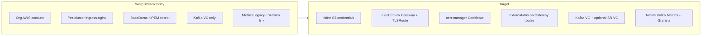
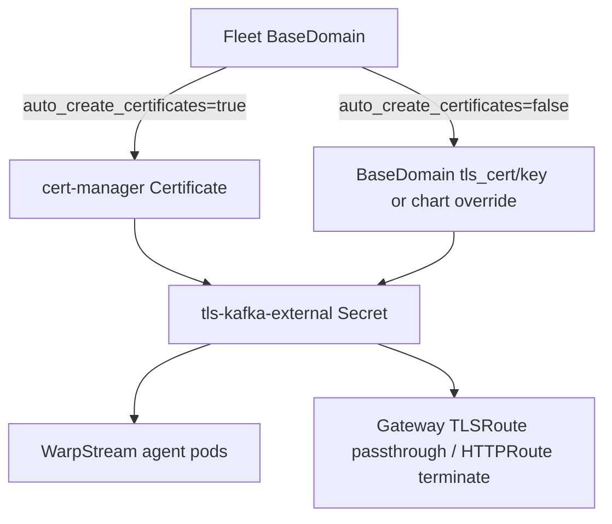

# WarpStream First-Class Kafka Provider Parity

## Current state vs target



| Area | Today | Target (match CFK/Strimzi) |
|------|-------|----------------------------|
| External routing | Per-cluster `ingress-nginx` + `Ingress` | Fleet Envoy + `Gateway` / `TLSRoute` |
| TLS | Manual PEM from BaseDomain in workflow (workflow-only) | **Dual mode:** BYO PEM *or* cert-manager auto-TLS (fleet `BaseDomain.auto_create_certificates`) |
| DNS | Ingress annotations only; manual Route53 on delete | external-dns on TLSRoute; `warpstream_cleanup_dns_hostnames()` on delete |
| Storage creds | Org `aws_account` → bootstrap provider | Inline `s3_access_key` / `s3_secret_access_key` in advanced config |
| Agent version | User field `"latest"` | Pinned in chart subchart + Package preload (not in advanced config) |
| Schema Registry | None | Optional `schema_registry_enabled` → SR virtual cluster + SR agents + HTTP endpoint |
| Workflows | CREATE / DELETE only | CREATE / UPDATE / UPDATE_VERSION / DELETE |
| Metrics | Legacy UI; Grafana panels often empty | Native top-25 panels + audited Grafana dashboard |
| Alerts | None | `alerts` + `alert_rules` charts + `apply_kafka_alert_rules_after_workload` |

**Assumption:** No existing WarpStream clusters — remove `aws_account` migration paths, delete-recreate VC idempotency hacks, and ingress-nginx code without feature flags.

---

## TLS: bring-your-own certificates + auto-generated certificates (dual mode)

WarpStream must support **both** TLS paths, using the same fleet-level switch as CFK/Strimzi — not a separate WarpStream advanced-config toggle.

### Control plane

| Source | Field | Effect |
|--------|-------|--------|
| Fleet `BaseDomain` | `auto_create_certificates` | `true` → cert-manager ACME path; `false` → BYO PEM path |
| Fleet `BaseDomain` | `tls_cert` / `tls_key` | BYO PEM when auto-create is off (wildcard or SAN covering broker hostnames) |
| Fleet `BaseDomain` | `dns_provider_config` | Required for auto-create (Route53, Cloudflare, etc.; same `AUTO_CERT_DNS_PROVIDERS` as Strimzi) |
| Per-cluster override | `chart_config.main.values.certs.kafka` | Operator PEM override via Helm values editor (same escape hatch as CFK/Strimzi) |

**Not in WarpStream advanced config:** no cluster-level cert upload fields in the create form (parity with CFK/Strimzi — certs come from fleet domain or chart overrides).

### Mode A — Auto-generated certificates (cert-manager)

Mirror Strimzi [`external-certificate.yaml`](charts/fleet-manager-strimzi/templates/external-certificate.yaml):

1. Backend enrichment calls `_populate_cert_manager_auto_tls()` when `fd.auto_create_certificates` is true ([`kafka_workload_charts.py`](fleet-manager-backend/core/services/kafka_workload_charts.py) ~L406–449).
2. Helm renders `Certificate` `external-kafka-cert` → Secret `tls-kafka-external` (PKCS#8 private key).
3. WarpStream agent pods mount TLS from `tls-kafka-external` (or chart copies into `warpstream-tls` — single canonical secret name in templates).
4. Orchestrator adds `build_external_kafka_cert_status_wait()` to `status_waits` before marking cluster Healthy.
5. Gateway TLSRoute uses **TLS passthrough** to agents; cert on agent pods is what clients validate.
6. **Schema Registry HTTPRoute** (when enabled): Gateway **terminates** TLS using the same `tls-kafka-external` Secret (mirror Strimzi `schema-registry-httproute.yaml` HTTPS listener pattern).

Validation (fail fast at compute-components):
- If external listener enabled and `auto_create_certificates=true` but DNS provider unsupported → raise like Strimzi.
- If external listener enabled and BYO mode but PEM missing → raise with actionable message (same as Strimzi ~L1202–1211).

### Mode B — Bring your own certificates (manual PEM)

Mirror Strimzi [`kafka-cert-secret.yaml`](charts/fleet-manager-strimzi/templates/kafka-cert-secret.yaml):

1. When `auto_create_certificates=false`, backend injects `certs.kafka.cert` / `certs.kafka.key` from fleet `BaseDomain.tls_cert` / `tls_key` (unless already set in chart values).
2. Helm renders static `Secret` `tls-kafka-external` from PEM values; **does not** render `Certificate` CR.
3. Orchestrator **does not** fetch PEM in workflow (`get_base_domain` tls injection in current `warpstream.py` ~L377–385 must be **removed** — certs resolved only via compute-components, same as Strimzi).
4. `_validate_chart_tls_material()` runs on injected PEM before chart install.

### Kafka brokers vs Schema Registry

| Component | TLS mode | Notes |
|-----------|----------|-------|
| Kafka agents (bootstrap) | Passthrough via TLSRoute | Cert on pod (`WARPSTREAM_TLS_*` env → mounted Secret) |
| Schema Registry agents | HTTPRoute with terminate or passthrough per WarpStream SR docs | Separate hostname `{ns}-schema-registry.{domain}`; may need **second** `Certificate` or shared wildcard `*.domain` |

When SR enabled with auto-TLS, add `schema-registry-external-certificate.yaml` if SR hostname is not covered by the Kafka wildcard cert.

### Files touched for dual TLS

| Layer | Files |
|-------|-------|
| Helm | `charts/fleet-manager-warpstream/templates/external-certificate.yaml`, `kafka-cert-secret.yaml`, `_helpers.tpl` (`certManagerAcmeEnabled`), agent volume mounts → `tls-kafka-external` |
| Backend | `kafka_workload_charts.py` warpstream branch: `_populate_cert_manager_auto_tls`, PEM backfill, `_validate_chart_tls_material`, external-listener PEM guard |
| Orchestrator | `workflows/warpstream.py`: remove workflow PEM fetch; conditional `build_external_kafka_cert_status_wait()` |
| Tests | `test_kafka_workload_charts_service.py` — warpstream auto-TLS + BYO PEM cases; orchestrator tests for cert wait presence/absence |



---

## Phase 1 — Advanced configuration & types

### Replace AWS account with inline credentials

Update Pydantic models (keep backend + orchestrator copies in sync):

- [`fleet-manager-backend/fm_types/warpstream.py`](fleet-manager-backend/fm_types/warpstream.py)
- [`fleet-manager-orchestrator/shared/fm_types/warpstream.py`](fleet-manager-orchestrator/shared/fm_types/warpstream.py)

**Remove fields:**
- `aws_account` / legacy `aws` alias
- `version` (agent version)

**Add / change fields:**

| Field | Type | Notes |
|-------|------|-------|
| `s3_access_key` | str | Required; UI password widget |
| `s3_secret_access_key` | str | Required; UI password widget |
| `s3_bucket_name` | str | Globally unique; existing validation pattern |
| `s3_region` | str | AWS region for bucket URL (can default to `warpstream_region` if same) |
| `storage_create_bucket` | bool, default `true` | Auto-create when missing (user chose this) |
| `schema_registry_enabled` | bool, default `false` | Optional SR |
| `cluster_access` | enum | Wire to `gatewayApi` / external listener (Internal / External / Internal & External) |
| `number_of_zones` | 1 or 2 | Wire to pod topology / spread constraints |

**Keep:** `warpstream_api_key`, `warpstream_region`, `cluster_tier`, `private_access`, `alert_channels`, `chart_config`.

**`chart_config` keys:** `main`, `alerts` (drop `ingress_nginx`).

### Backend workload plugin

[`fleet-manager-backend/fleet_workload/warpstream.py`](fleet-manager-backend/fleet_workload/warpstream.py)

- Rewrite `get_advanced_configs()` JSON schema: remove `aws`, `version`; add credential fields + SR checkbox.
- Update `validate_advanced_configs()`:
  - Pre-flight S3 bucket accessibility using **inline credentials** (adapt [`BaseWorkloadProvider._validate_tiered_storage_bucket_availability`](fleet-manager-backend/fleet_workload/base.py) pattern or new helper with inline boto3 session).
  - Respect `storage_create_bucket=false` → bucket must exist and be accessible.
- Update metadata `components` to include optional Schema Registry.
- Update `size_kafka_workload()`: set `replicas` / `node_count` from `kafka_units` (not hardcoded 3).
- Remove `tiered_storage_providers` dependency from `WorkloadContext` for WarpStream selection schema.

### Schema registry

[`fleet-manager-backend/core/schemas/kafka_advanced_config_schema.py`](fleet-manager-backend/core/schemas/kafka_advanced_config_schema.py) — no structural change if model-driven; ensure registry includes updated `WarpstreamAdvancedConfig`.

### Command dispatch

[`fleet-manager-backend/core/command_dispatch.py`](fleet-manager-backend/core/command_dispatch.py)

```python
class WarpstreamWorkloadInput(BaseModel):
    action: str  # CREATE | UPDATE | UPDATE_VERSION | DELETE
    component_key: Optional[str] = None  # main | alerts | alert_rules
```

### Tests

- [`fleet-manager-backend/tests/fleet_workload/test_warpstream.py`](fleet-manager-backend/tests/fleet_workload/test_warpstream.py)
- [`fleet-manager-backend/fm_types/tests/test_warpstream.py`](fleet-manager-backend/fm_types/tests/test_warpstream.py)
- [`fleet-manager-backend/core/tests/schemas/test_kafka_advanced_config_schema.py`](fleet-manager-backend/core/tests/schemas/test_kafka_advanced_config_schema.py)

---

## Phase 2 — Version pins & preload (agent not in advanced config)

### Pin warpstream-agent subchart

Current: [`charts/fleet-manager-warpstream/Chart.lock`](charts/fleet-manager-warpstream/Chart.lock) → `warpstream-agent` **0.14.12**.

**Target:** bump to latest validated **1.0.x** line (GitHub releases show **1.0.80** as of research). Validate SR + Gateway compatibility in dev before locking.

Files:
- [`charts/fleet-manager-warpstream/Chart.yaml`](charts/fleet-manager-warpstream/Chart.yaml) — bump chart `version` (e.g. `0.3.0`) and dependency `version: 1.0.80`
- Run `helm dependency update` → refresh `Chart.lock`
- [`fleet-manager-backend/preload/package_rules.yaml`](fleet-manager-backend/preload/package_rules.yaml) — bump `Fleet Manager Warpstream` `default_version` (align with published OCI chart, currently `1.1.14` → new semver after publish)
- [`fleet-manager-backend/preload/registry_images.yaml`](fleet-manager-backend/preload/registry_images.yaml) — add `warpstream-agent` image entry for private-registry mirroring (mirror CFK pattern)

### Agent image tag via preload, not UI

- Set default agent image/tag in Package `default_values` for `fleet-manager-warpstream` (seeded via package import), **not** in advanced config.
- [`fleet-manager-backend/core/services/kafka_workload_charts.py`](fleet-manager-backend/core/services/kafka_workload_charts.py) — ensure `resolve_kafka_workload_charts` does not expose agent version as user-configurable field; only `chart_config.main` overrides for operators.

### Remove ingress-nginx package coupling

- [`fleet-manager-backend/preload/package_rules.yaml`](fleet-manager-backend/preload/package_rules.yaml) — update Ingress NGINX rule comment (no longer WarpStream-specific once Gateway path ships).

---

## Phase 3 — Helm chart: Gateway API, cert-manager, SR, metrics

Directory: [`charts/fleet-manager-warpstream/`](charts/fleet-manager-warpstream/)

### Delete / retire

- [`templates/kafka-ingress.yaml`](charts/fleet-manager-warpstream/templates/kafka-ingress.yaml) — remove (no legacy path)
- Per-cluster ingress class wiring in values

### Add (mirror Strimzi patterns)

Reference templates from [`charts/fleet-manager-strimzi/templates/`](charts/fleet-manager-strimzi/templates/):

| New template | Purpose |
|--------------|---------|
| `gateway-class.yaml` | Per-cluster `GatewayClass` → Envoy |
| `gateway.yaml` | TLS passthrough listener for Kafka brokers |
| `kafka-tls-routes.yaml` | Per-broker `TLSRoute` with `external-dns.alpha.kubernetes.io/hostname` |
| `external-certificate.yaml` | cert-manager `Certificate` → `tls-kafka-external` Secret (Mode A — auto-generated) |
| `kafka-cert-secret.yaml` | Static PEM Secret when `certs.kafka.cert/key` set and ACME off (Mode B — BYO) |
| `_helpers.tpl` | `certManagerAcmeEnabled` helper (mutually exclusive with manual PEM secret) |
| `schema-registry-agents.yaml` | Conditional second `warpstream-agent` release values (SR mode env) |
| `schema-registry-httproute.yaml` | HTTP(S) route for SR REST (`{ns}-schema-registry.{domain}`) |
| `schema-registry-external-certificate.yaml` | Optional separate cert for SR hostname |
| `_helpers.tpl` | `validateGatewayApi`, hostname helpers |

### values.yaml additions

```yaml
gatewayApi:
  createGateway: true
  createGatewayClass: true
  name: ""          # set by compute-components: {kafka_id}-gw
  className: ""     # {kafka_id}-envoy
  service:
    annotations: {} # private LB / cloud-specific from fleet
  allowedRoutes: { namespaces: { from: All } }

certManager:
  clusterIssuerName: ""  # injected by backend enrichment

schemaRegistry:
  enabled: false
  replicas: 1
  # SR virtual cluster ID + agent key injected by workflow (not user-facing)

certManager:
  namespace: cert-manager
  clusterIssuerName: ""   # injected when auto_create_certificates
  acmeEmail: ""           # injected when auto_create_certificates

certs:
  kafka: { cert: "", key: "" }  # BYO PEM; populated from BaseDomain or chart override

s3:
  access_key: ""
  secret_access_key: ""
```

### SR agent environment (per WarpStream BYOC SR docs)

When `schemaRegistry.enabled`:
- Create VC with `virtual_cluster_type: "byoc_schema_registry"`
- Deploy SR agents with env such as `WARPSTREAM_SCHEMA_REGISTRY_TLS_ENABLED`, basic auth flags as needed
- Optionally set `WARPSTREAM_SCHEMA_VALIDATION_VIRTUAL_CLUSTER_ID` on **Kafka** agents when SR enabled
- Expose endpoint `https://{namespace}-schema-registry.{domain}` (port per WarpStream SR default, typically 9094)

### ServiceMonitor

- [`values.yaml`](charts/fleet-manager-warpstream/values.yaml) — ensure `serviceMonitor` labels match Prometheus scrape config used by fleet (`release: prometheus` etc., mirror Strimzi chart)
- Add SR agent ServiceMonitor when SR enabled

### Helm tests

- [`charts/fleet-manager-warpstream/tests/`](charts/fleet-manager-warpstream/tests/) — add tests for Gateway, TLSRoute, Certificate (auto), kafka-cert-secret (BYO), mutual exclusivity, SR conditional templates; update/remove ingress tests

### New alerts chart (recommended)

Create [`charts/fleet-manager-warpstream-alerts/`](charts/fleet-manager-warpstream-alerts/) modeled on [`charts/fleet-manager-strimzi-alerts/`](charts/fleet-manager-strimzi-alerts/) with WarpStream-specific AlertmanagerConfig webhook URL enrichment (backend already supports this pattern for `alerts` chart_key).

---

## Phase 4 — Backend chart resolution & enrichment

Primary file: [`fleet-manager-backend/core/services/kafka_workload_charts.py`](fleet-manager-backend/core/services/kafka_workload_charts.py)

### `KAFKA_WORKLOAD_CHARTS["warpstream"]` catalog

```python
"warpstream": {
    "main": { ... fleet-manager-warpstream ... },
    "alerts": { ... fleet-manager-warpstream-alerts ... },
    "alert_rules": { ... fleet-manager-prometheus-rules ... },
    "dashboard_kafka": { ... },
    # REMOVE ingress_nginx
}
```

### Extend `_enrich_merged_values_from_kafka()` for `warpstream`

Currently early-returns at `if workload_type not in ("strimzi", "cfk")`. Add full `warpstream` branch for `main` and `alerts`:

- Domain from fleet `BaseDomain`
- **TLS dual mode** (full Strimzi parity):
  - `auto_create_certificates=true` → `_populate_cert_manager_auto_tls()`; do not inject PEM
  - `auto_create_certificates=false` → inject `certs.kafka.cert/key` from `BaseDomain` unless chart override present; validate PEM structure
  - External listener guard: fail if neither ACME config nor PEM available
- `gatewayApi` name/className, LB annotations via `_load_balancer_annotations(kafka)`
- `kongGatewayApi.sharedGatewayNamespace`
- `schemaRegistry.enabled` from advanced config
- `warpstream.replicas` from `kafka_units` / sizing
- `warpstream.config.bucketURL` from `s3://{bucket}?region={region}`
- S3 secret values redacted in API responses (follow [`test_compute_components_redaction.py`](fleet-manager-backend/core/tests/views/test_compute_components_redaction.py) pattern)
- `cluster_access` → enable/disable external listener + TLSRoutes
- `number_of_zones` → topology spread / affinity presets
- Alert webhook URL for `alerts` chart_key (copy Strimzi block)

### Extend `resolve_kafka_workload_charts()` gateway block

Add `warpstream` to the block at ~L2060 that sets `gatewayApi.skipCrds`, per-cluster gateway name, and validates `_gateway_api_crds_installed()`.

### Dashboard toggle

At ~L1068, change:

```python
if workload_type in ("cfk", "strimzi", "warpstream"):
    toggles["envoy_gateway"] = True
```

### S3 bucket pre-flight

New helper `_validate_warpstream_s3_bucket()` using inline credentials + `storage_create_bucket` (user choice: auto-create when missing).

### Tests

- [`fleet-manager-backend/core/tests/services/test_kafka_workload_charts_service.py`](fleet-manager-backend/core/tests/services/test_kafka_workload_charts_service.py) — warpstream gateway enrichment, **auto-TLS vs BYO PEM branches**, SR, redaction
- [`fleet-manager-backend/core/tests/test_kafka_workload_charts.py`](fleet-manager-backend/core/tests/test_kafka_workload_charts.py)

---

## Phase 5 — Orchestrator workflow rewrite

Primary file: [`fleet-manager-orchestrator/workflows/warpstream.py`](fleet-manager-orchestrator/workflows/warpstream.py)

Refactor CREATE to follow [`fleet-manager-orchestrator/workflows/strimzi.py`](fleet-manager-orchestrator/workflows/strimzi.py) structure.

### Imports & helpers

From [`fleet-manager-orchestrator/shared/fm_types/kafka_workload.py`](fleet-manager-orchestrator/shared/fm_types/kafka_workload.py):

- `gateway_api_values`, `envoy_gateway_load_balancer`, `gateway_api_preflight_resources`, `build_external_kafka_cert_status_wait`, `gateway_route_hostname`, `gateway_kafka_public_port`

Add new helper: `warpstream_cleanup_dns_hostnames()` (mirror `strimzi_cleanup_dns_hostnames`) in `kafka_workload.py`.

### CREATE flow (ordered)

1. Status → `Provisioning`; fleet placement / tenancy checks (existing)
2. Read `WarpstreamAdvancedConfig` — **inline S3 credentials** (no `get_bootstrap_provider` for AWS account)
3. S3 bucket: call `AwsProvider.aws_create_object_storage_bucket` with inline keys + `storage_create_bucket`; persist bucket metadata on `kafka.metadata` (new key e.g. `object_storage_provisioning`)
4. **Kafka virtual cluster** API (`byoc`) — improve idempotency: reuse existing VC by name if present (no delete-recreate)
5. If `schema_registry_enabled`: **SR virtual cluster** API (`byoc_schema_registry`) + SR agent key
6. `get_kafka_compute_components` — backend resolves chart versions/values (no workflow-built nginx values)
7. Build `charts[]`: `main`, `alerts`, `dashboard_kafka`, optionally `alert_rules`
8. `gateway_api_preflight_resources` → `DiscoveryProbeWorkflow`
9. `DeployWarpstreamWorkloadInput` with:
   - `loadbalancer_services`: `kong-gateway-proxy` + `envoy_gateway_load_balancer(...)` (remove nginx controller)
   - `status_waits`: `build_external_kafka_cert_status_wait()` **only when** `BaseDomain.auto_create_certificates` is true (skip for BYO PEM path)
   - **Remove** workflow `get_base_domain` PEM injection (~L377–385) — TLS resolved entirely via compute-components
10. Post-deploy: build `resources.endpoints`:
    - `bootstrap_server_{i}` via `gateway_route_hostname` + Envoy LB IP
    - `schema_registry` endpoint when enabled
    - `shared_services` Kong hostname
    - `console_url` for WarpStream console
11. `apply_kafka_alert_rules_after_workload()` from [`alert_rules_lifecycle.py`](fleet-manager-orchestrator/workflows/alert_rules_lifecycle.py)
12. Status → `Healthy`

### UPDATE / UPDATE_VERSION

Mirror Strimzi ~L1156–1295:

- `component_key` support (`main`, `alerts`, `alert_rules`)
- Call `UpdateWarpstreamWorkloadWorkflow` (already in Go: [`streamtime-agent/internal/workflows/warpstream.go`](streamtime-agent/internal/workflows/warpstream.go))
- Status `Upgrading` with restore on failure

### DELETE flow

1. `gateway_api_cleanup_components` + `warpstream_cleanup_dns_hostnames` → `Route53Activities.delete_dns_record` (replace hardcoded loop ~L1032)
2. Teardown charts: `alert_rules` → `alerts` → `dashboard_kafka` → `main` (no nginx)
3. Delete SR virtual cluster if provisioned
4. Delete Kafka virtual cluster
5. Delete S3 bucket when `storage_create_bucket` was true
6. Node pool cleanup (existing)

### Virtual cluster activities

Extend activities in same file:

- `warpstream_create_virtual_cluster` — accept `virtual_cluster_type` (`byoc` | `byoc_schema_registry`)
- `warpstream_delete_virtual_cluster` — delete by stored ID
- Store IDs: `kafka.cluster_id` (Kafka VC), `kafka.metadata["schema_registry_cluster_id"]` (SR VC)

### Bug fix

Line ~659: `components` → `resolved_components` for `dashboard_kafka` install.

### Command dispatch wiring

[`fleet-manager-backend/core/command_dispatch.py`](fleet-manager-backend/core/command_dispatch.py) — UPDATE actions.

### Tests

- [`fleet-manager-orchestrator/tests/test_warpstream_workload_run.py`](fleet-manager-orchestrator/tests/test_warpstream_workload_run.py) — rewrite for Gateway, SR, UPDATE, inline creds
- New: `test_warpstream_gateway_integration.py` (mirror [`test_envoy_gateway_integration.py`](fleet-manager-orchestrator/tests/test_envoy_gateway_integration.py))
- [`fleet-manager-orchestrator/tests/test_workload_update_outputs.py`](fleet-manager-orchestrator/tests/test_workload_update_outputs.py)

### Go agent

[`streamtime-agent/internal/workflows/warpstream.go`](streamtime-agent/internal/workflows/warpstream.go) — verify `StatusWaits` handling for cert-manager Certificate readiness (may already support generic CR waits; add if missing).

---

## Phase 6 — Metrics (native UI + Grafana)

### Native top-25 Kafka Metrics UI

**Backend** — new catalog module or section:

- Add [`fleet-manager-backend/core/services/kafka_metrics_catalog_warpstream.py`](fleet-manager-backend/core/services/kafka_metrics_catalog_warpstream.py) (~25 panels using `warpstream_agent_*`, `warpstream_consumer_group_*`, `warpstream_blob_store_*` metrics scoped by `namespace="{ns}"`)
- Update `SUPPORTED_WORKLOADS` in [`kafka_metrics_catalog.py`](fleet-manager-backend/core/services/kafka_metrics_catalog.py) → include `warpstream`
- [`kafka_metrics.py`](fleet-manager-backend/core/services/kafka_metrics.py) — select catalog by `kafka.workload`
- Panel groups: availability (agents up), traffic (produce/fetch throughput), saturation (lag), resources (CPU/mem), replication (N/A or agent jobs)

**Frontend**

- [`fleet-manager-frontend/src/features/metrics/kafkaMetricsUtils.js`](fleet-manager-frontend/src/features/metrics/kafkaMetricsUtils.js) — add `warpstream` to `SUPPORTED_KAFKA_METRICS_WORKLOADS`
- [`MonitoringLayout.test.js`](fleet-manager-frontend/src/layout/__tests__/MonitoringLayout.test.js) — add warpstream → `kafka-metrics` test
- [`KafkaMetrics.test.js`](fleet-manager-frontend/src/features/metrics/__tests__/KafkaMetrics.test.js) — warpstream payload fixture

### Grafana dashboard audit

File: [`charts/fleet-manager-dashboard-kafka/dashboards/warpstream/warpstream-grafana-dashboard.json`](charts/fleet-manager-dashboard-kafka/dashboards/warpstream/warpstream-grafana-dashboard.json)

Tasks:
- Align all PromQL expressions with metrics exported by **warpstream-agent 1.0.x** (metric renames since 0.14.x)
- Fix template variables (`$namespace` must match Kafka cluster identifier / release namespace)
- Remove panels referencing deprecated metrics; add replacements from upstream WarpStream dashboard (gnetId 21070 baseline)
- Sync duplicate: [`fleet-manager-orchestrator/dashboards/warpstream-grafana-dashboard.json`](fleet-manager-orchestrator/dashboards/warpstream-grafana-dashboard.json)
- Validate every panel returns data in dev (acceptance: no empty panels at steady state with load generator)

### ServiceMonitor alignment

Ensure chart ServiceMonitor `namespaceSelector` / `matchLabels` match Prometheus `ServiceMonitor` selector installed at fleet bootstrap.

---

## Phase 7 — Alerting

- Create WarpStream alert rule templates in [`fleet-manager-backend/core/services/alert_rule_catalog.py`](fleet-manager-backend/core/services/alert_rule_catalog.py) (today returns empty for warpstream per tests)
- Seed rules: agent down, high consumer lag, blob store errors, elevated request latency
- Wire `ensure_kafka_alert_rules` backend activity for workload `warpstream`
- Install `alert_rules` chart on CREATE; upgrade on UPDATE_VERSION

---

## Phase 8 — Frontend & operator UX

| File | Change |
|------|--------|
| [`fleet-manager-frontend/src/components/BootstrapConfig/KafkaChartVersionsEditor.js`](fleet-manager-frontend/src/components/BootstrapConfig/KafkaChartVersionsEditor.js) | warpstream: `main`, `alerts`, `dashboard_kafka`; remove `ingress_nginx` |
| [`fleet-manager-frontend/src/features/agent-tasks/utils/valuesConfigurability.js`](fleet-manager-frontend/src/features/agent-tasks/utils/valuesConfigurability.js) | Update warpstream component keys |
| [`fleet-manager-frontend/src/features/clusters/KafkaClusterDetail.js`](fleet-manager-frontend/src/features/clusters/KafkaClusterDetail.js) | Show `schema_registry` endpoint type; sample curl for SR |
| Cluster create flow | Auto from backend schema (no hardcoded warpstream fields) |

**UI terminology:** use "Object storage credentials", "Schema Registry", not internal field slugs.

---

## Phase 9 — Integration, smoke, MCP/CLI

- [`integration-tests/test_smoke_suite.py`](integration-tests/test_smoke_suite.py) — fix warpstream `advanced_config` fixture (inline creds, no `aws_account`)
- [`fleet-manager-backend/test_smoke_suite.py`](fleet-manager-backend/test_smoke_suite.py) — same
- [`fleet-manager-mcp/server.py`](fleet-manager-mcp/server.py) — document warpstream SR endpoint in cluster read tools if applicable
- [`streamtime-cli/`](streamtime-cli/) — update kafka create examples if present

---

## Phase 10 — Billing & sizing (parity extras)

- [`fleet-manager-orchestrator/workflows/warpstream.py`](fleet-manager-orchestrator/workflows/warpstream.py) `get_billing_usage_query` — implement Storage/Ingress/Egress PromQL using `warpstream_*` metrics (today empty strings)
- `warpstream_replica_count = max(3, kafka_units)` in workflow + chart values (replace hardcoded `3`)

---

## Feature parity items not in your prompt (included in this plan)

| Item | Rationale |
|------|-----------|
| **UPDATE / UPDATE_VERSION** | Required for first-class provider; Go workflow exists but Python never dispatches |
| **Alert rules + alerts chart** | CFK/Strimzi install these; WarpStream has empty catalog |
| **Native Kafka Metrics UI** | You confirmed both Grafana + in-app |
| **`kafka_units` → agent replicas** | Today hardcoded to 3 |
| **`cluster_access` / `number_of_zones` wiring** | Fields exist in schema but orchestrator ignores them |
| **`alert_channels` wiring** | Present in schema; needs alerts chart enrichment |
| **Fix `dashboard_kafka` install bug** | `components` undefined variable |
| **Virtual cluster reuse** | Safer idempotency than delete-recreate |
| **Credential redaction** in compute-components API | Security parity with other secrets |
| **registry_images.yaml** | Air-gapped fleet image mirroring |

### Explicitly out of scope (unless you want them added)

- **Kafka Connect** on WarpStream (connectors plan is Strimzi-only)
- **OAuth / SASL credential CRUD** (WarpStream uses console/API keys; different from CFK MDS)
- **Tiered storage hot/cold model** (WarpStream is object-native; not applicable)
- **Cluster Link** (CFK-only replication product)

---

## Suggested implementation order

1. Types + advanced config + tests (Phase 1)
2. Helm chart Gateway/cert-manager/SR skeleton (Phase 3)
3. Backend chart enrichment (Phase 4)
4. Orchestrator CREATE rewrite (Phase 5)
5. UPDATE + DELETE + SR (Phase 5 continued)
6. Metrics native + Grafana (Phase 6)
7. Alerting (Phase 7)
8. Frontend + integration (Phases 8–9)
9. Version bump + preload publish (Phase 2 — validate agent 1.0.80 last)

---

## Acceptance criteria

- [ ] WarpStream cluster provisions with Envoy TLSRoutes and external-dns hostnames resolving
- [ ] **Auto-TLS path:** fleet `auto_create_certificates=true` → cert-manager issues certs, workflow waits for Certificate Ready, agents mount `tls-kafka-external`
- [ ] **BYO cert path:** fleet `auto_create_certificates=false` + BaseDomain PEM → static Secret rendered, no Certificate CR, no cert wait, cluster reaches Healthy
- [ ] BYO PEM override via `chart_config.main.values.certs.kafka` works without BaseDomain PEM
- [ ] External listener enabled with neither valid ACME config nor PEM fails at compute-components with clear error
- [ ] Advanced config accepts inline S3 credentials; auto-creates bucket when missing
- [ ] Agent version not in advanced config; pinned in preload/chart
- [ ] Optional Schema Registry: SR VC + agents + REST endpoint in cluster resources
- [ ] Monitoring tab shows native Kafka Metrics (25 panels with data)
- [ ] Grafana WarpStream dashboard: all panels show metrics under load
- [ ] UPDATE upgrades `main` / `alerts` / `alert_rules` components
- [ ] DELETE cleans Gateway routes, DNS, VCs (Kafka + SR), S3 bucket, charts
- [ ] No `ingress-nginx` per-cluster release for new WarpStream clusters
