# Confluent Platform on BYOVM

Streamtime deploys Confluent Platform to a [BYOVM fleet]({{ site.baseurl }}/bootstrapping-fleet/byovm.html) with `cp-ansible`. The topology selected when the fleet was created controls which components are installed and where they run.


> **NOTE:** Confluent Platform (VM) can be deployed only to a BYOVM fleet. The cluster uses Dedicated tenancy, so the wizard does not ask for tenancy mode or Kafka Units.

## Before you begin

Make sure that:

- The BYOVM fleet is **Healthy**.
- The fleet has a configured base domain.
- All VM addresses and SSH credentials are still valid.
- Your Confluent Platform license is available if you are not using a trial.
- You know whether clients should use SCRAM-SHA-512 (recommended and selected by default) or PLAIN authentication over TLS.

## Create the cluster

1. Open **Kafka Clusters** and click **Create Kafka Cluster**.
2. Select **Confluent Platform (VM)**. Streamtime automatically selects **BYOVM** as the provider.

   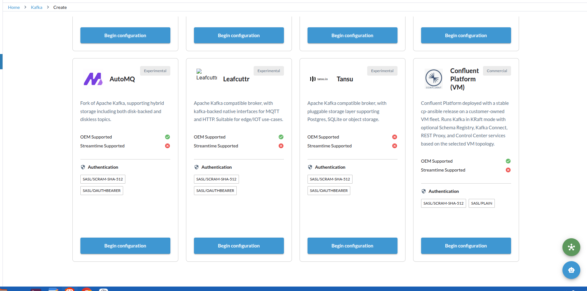

3. In **Basic Configuration**:
   - Enter a unique cluster identifier.
   - Choose the retention mode and, for finite retention, the retention period.

   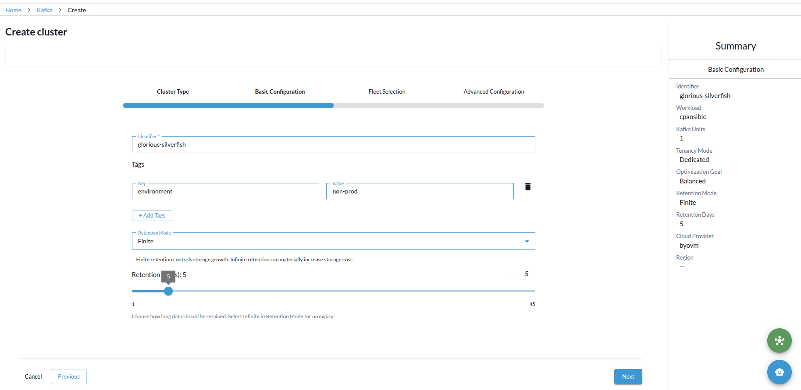

4. In **Fleet Selection**, select a healthy BYOVM fleet.
5. In **Advanced Configuration**:
   - Select a stable Confluent Platform package version.
   - Choose `scram` or `plain` for the SASL protocol.
   - Enter the Confluent Platform license, or leave it blank for a trial.
   - Optionally add custom broker and controller properties.
6. Review the configuration and click **Deploy**.

Streamtime provisions persistent TLS and access material, installs the components assigned by the fleet topology, and reconciles the cluster. A healthy cluster remains on its detail page instead of reopening the setup wizard, even if an older reconciliation marker is present.

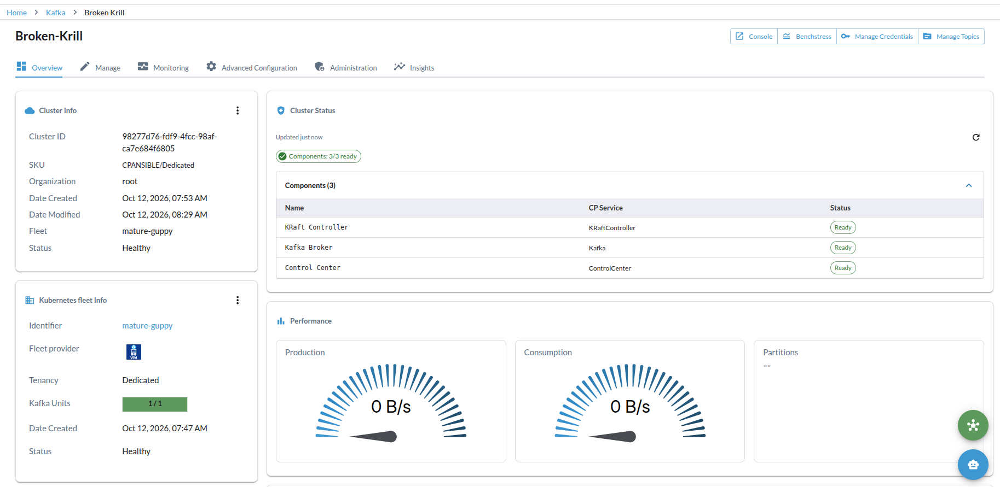

## Production-minimum topology

For a **Production / Minimum** fleet, Streamtime deploys:

- Three dedicated Kafka brokers
- Three dedicated KRaft controllers
- One Control Center Next Gen instance
- One shared-services VM for ingress, metrics, dashboards, logs, and alerting

This topology requires eight VMs. Development topologies do not deploy Control Center. The production full topology also deploys Control Center and adds highly available Kafka Connect, Schema Registry, REST Proxy, and split shared services.

## Configure DNS

After deployment, open the cluster's **Endpoints** page. For every displayed endpoint, create a DNS record that points the displayed DNS name to its **DNS record** value. Kafka clients must be able to resolve the bootstrap name and each advertised broker name; resolving only the bootstrap name is not sufficient.

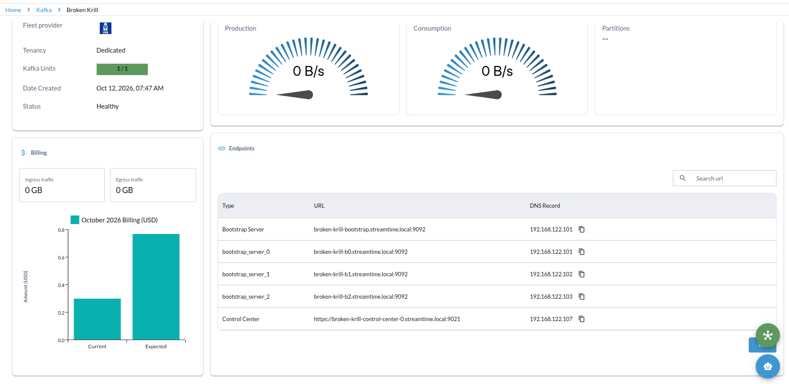

The endpoint list can include Kafka bootstrap and broker endpoints, Schema Registry, Kafka Connect, REST Proxy, and Control Center according to the fleet topology.

## Connect a Kafka client

1. Open the cluster's **Endpoints** page.
2. Click **Test Kafka Connection**.
3. Copy the `client.properties` content into a local file with that name.
4. Copy the `ca-certificate.pem` content into a file next to `client.properties`.
5. Restrict both files to the users or services that need cluster access.
6. Run one of the displayed Kafka CLI commands, for example:

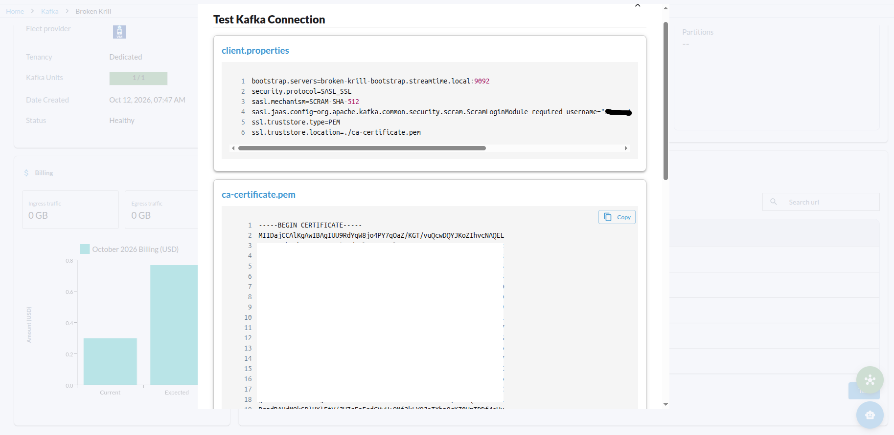

The same dialog provides the Control Center credentials when the selected topology includes Control Center. It also provides ready-to-copy commands for common Kafka operations, including listing topics, creating a topic, and producing messages.

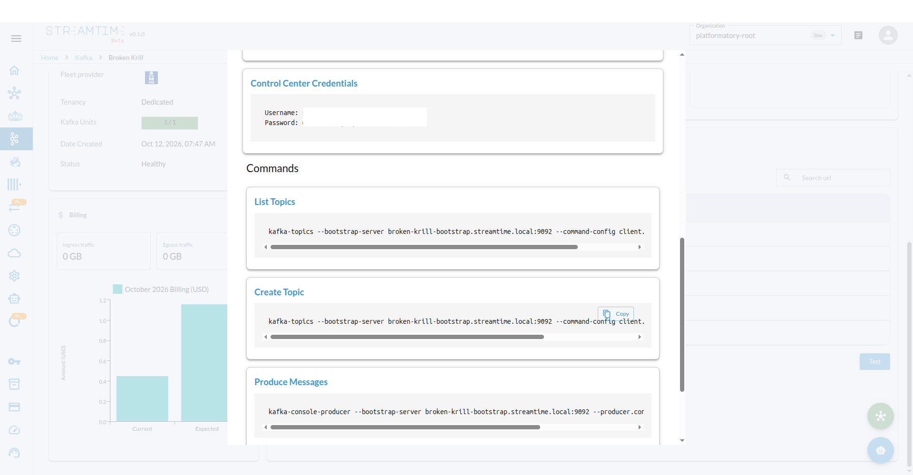

```bash
kafka-topics \
  --bootstrap-server <cluster>-bootstrap.<base-domain>:9092 \
  --command-config client.properties \
  --list
```

The generated client configuration includes the cluster's bootstrap address, SASL mechanism, persistent username and password, and the relative CA path. Credentials remain stable across normal reconciliations.


> **WARNING:** `client.properties` contains a usable password, and the CA file is part of the connection bundle. Store them in your secret manager, do not commit them to source control, and rotate access according to your organization's policy.

If the dialog reports that the connection configuration is unavailable, reconcile the cluster and try again. Streamtime backfills the persistent access credential for existing BYOVM clusters during reconciliation.

## Open Control Center

Production topologies expose a **Control Center** endpoint on the **Endpoints** page. Open the HTTPS URL and use the **Control Center Credentials** shown in **Test Kafka Connection**. The Control Center username and password are shown only for a topology that includes Control Center.

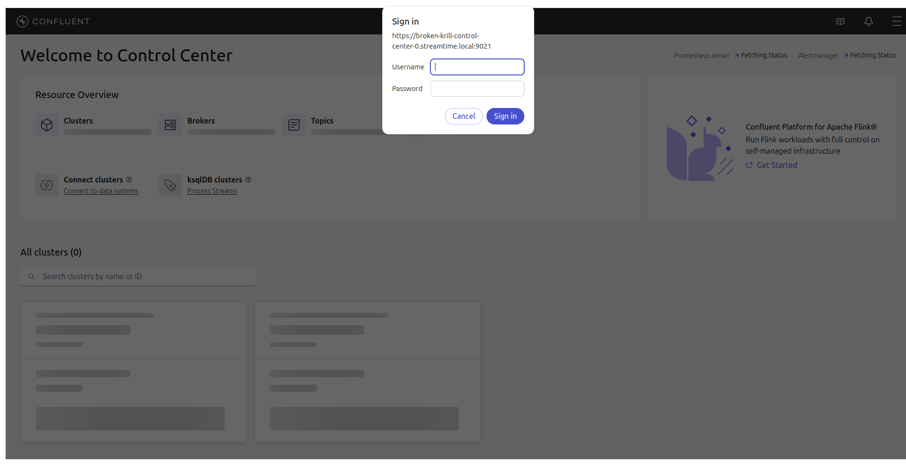

After signing in, use the cluster overview to verify broker, topic, partition, and replication health.

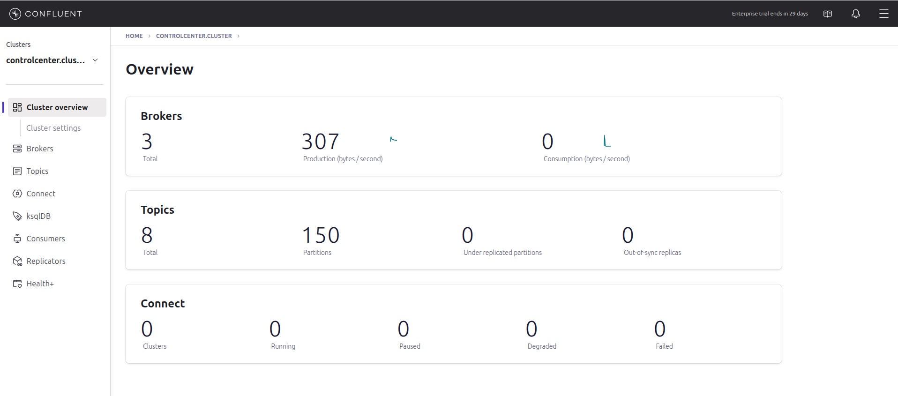


> **WARNING:** Control Center credentials grant access to the cluster UI. Handle them as secrets and do not share screenshots that expose the password.

## Monitor the cluster

Open the cluster and select **Monitoring**. For Confluent Platform (VM), click **Open Dashboards** to open the Grafana endpoint published by the BYOVM fleet. The cluster status view also reports the health of topology components such as brokers, controllers, Schema Registry, Kafka Connect, REST Proxy, and Control Center when present.

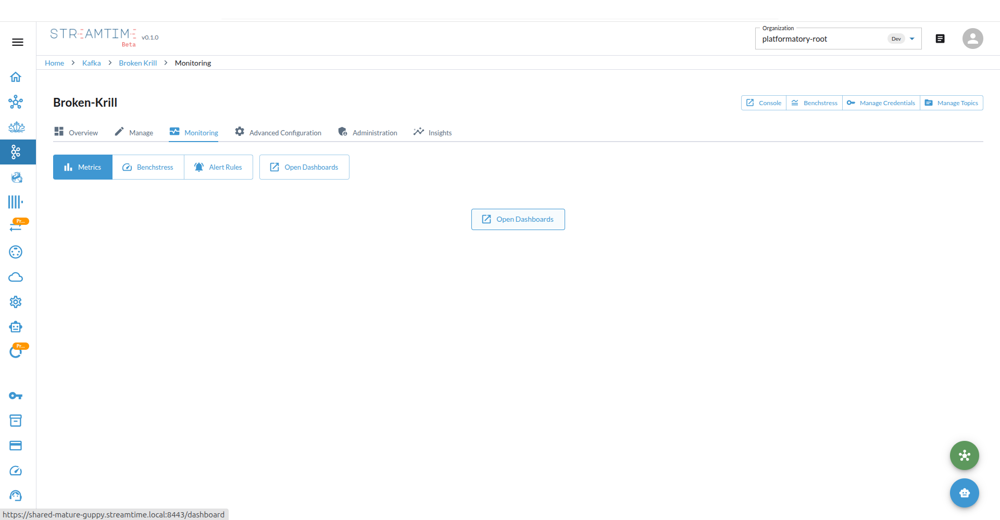

Grafana organizes the supplied dashboards by fleet and component. Select the dashboard that matches the service or host you want to investigate.

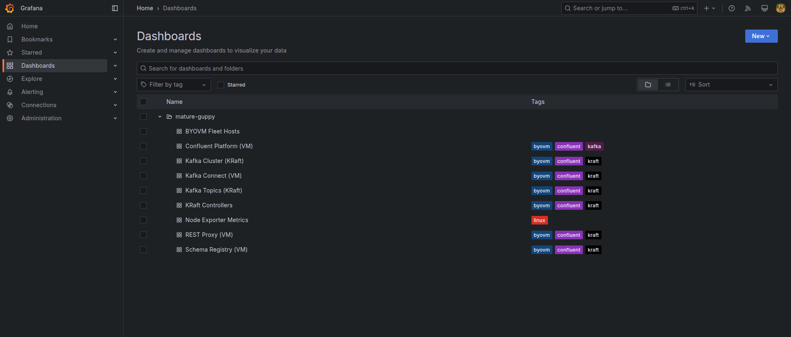

## Upgrade and redeploy Confluent Platform

Streamtime upgrades Confluent Platform in place on the existing BYOVM hosts. Before starting, confirm that the cluster and fleet are **Healthy**, every VM is reachable over SSH, and you have completed your organization's backup and maintenance-window procedures.

1. Open the Kafka cluster and select **Manage**.
2. On the **confluent-platform** component, open the actions menu and select **Upgrade version**.

   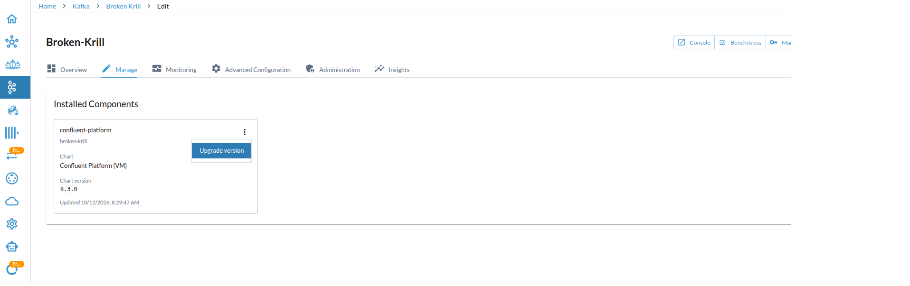

3. Select a target Confluent Platform version. The target must be a newer stable `cp-ansible` release; Streamtime rejects the installed version, older versions, and releases it cannot validate.
4. Start the upgrade and monitor the workflow status. Do not start another lifecycle operation while the upgrade is running.
5. When the workflow completes, confirm that its result reports `status: healthy`, `action: UPDATE`, and the expected source version, target version, and completed upgrade path. Click **Return To Components**, then verify the cluster status and component health.

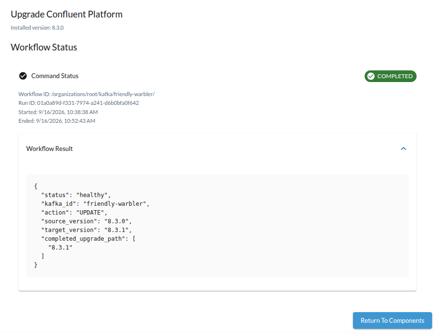

The upgrade workflow uses `cp-ansible` to converge the selected version across the existing hosts. It applies the package and service changes, reapplies Streamtime's VM-specific configuration, refreshes monitoring targets, and verifies the published DNS records. The fleet topology, host assignments, TLS material, Kafka client credentials, and Control Center credentials remain in place.

> **NOTE:** Confluent Platform (VM) does not provide the **Restart deployments** action used by Helm-based Kafka workloads. For BYOVM, an upgrade is the supported in-place redeployment path; it does not create replacement VMs or a new fleet.

### Retry a failed upgrade

The deployment steps are convergent, so a retry continues from the package and service state already present on each VM. If an upgrade ends in **Error**:

1. Review the workflow error and correct the underlying problem. Check SSH and `sudo` access, package-repository connectivity, available disk space, inter-host connectivity, and DNS.
2. Return to **Manage**, open **Upgrade version**, and select the same intended target version.
3. Start the upgrade again and wait for the workflow to return the cluster to **Healthy**.

You normally do not need to recreate the Kafka cluster or its BYOVM fleet to retry a failed upgrade.

## API: retrieve connection configuration

Users with permission to read secrets can retrieve the same connection bundle through the API:

```bash
curl \
  -H "Authorization: Bearer <api-token>" \
  "https://<streamtime-api-endpoint>/organizations/<org-id>/kafka/<cluster-id>/connection-configuration/"
```

The response contains `client_properties`, `ca_certificate`, and `ca_filename`. Production topologies that include Control Center also return `control_center_username` and `control_center_password`.
